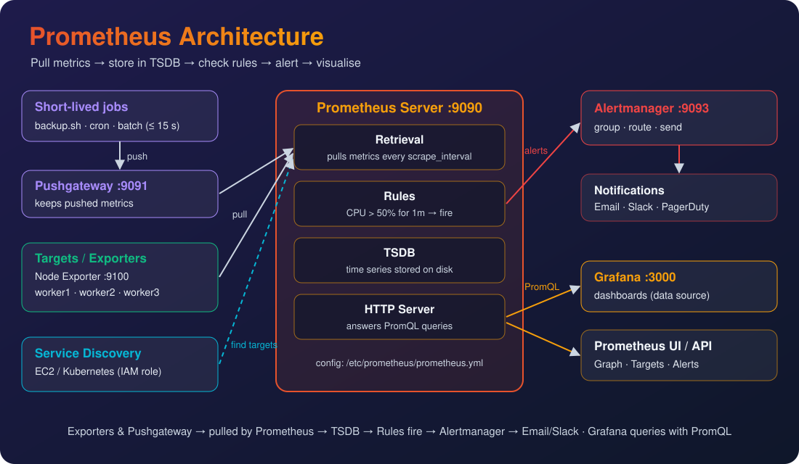

# Day 12 — Pushgateway, Grafana RBAC, Loki, Custom Dashboards

[← Day 11](../day-11-service-discovery/README.md) · [All notes](../README.md)

- **Pushgateway:** captures metrics of **short-living** scripts / jobs / pods (≤ 15 s) — they **push**, Prometheus **pulls** (port 9091).
- **Grafana RBAC:** control **what each user can do** in Grafana (users, teams, folder permissions).
- **Loki:** collects **logs** from every server (via **Promtail**) and shows them in Grafana (port 3100).
- **Custom dashboards:** build our own Grafana panels for **all** machines (CPU, memory, disk).

## Prometheus Architecture



| Part                  | Job                                                        |
| --------------------- | ---------------------------------------------------------- |
| **Exporters**         | Expose metrics on each server (Node Exporter :9100)        |
| **Pushgateway**       | Holds metrics **pushed** by short-lived jobs (:9091)       |
| **Service discovery** | Finds targets automatically (EC2 / Kubernetes)             |
| **Retrieval**         | Prometheus **pulls** metrics from all targets              |
| **TSDB**              | Stores the metrics on disk (time series)                   |
| **Rules**             | Check conditions → fire alerts                             |
| **Alertmanager**      | Sends alerts → Email / Slack / PagerDuty (:9093)           |
| **Grafana / UI**      | Query with **PromQL** → dashboards (:3000 / :9090)         |

## What is Pushgateway?

**Pushgateway** = captures the metrics of **short-living objects** (scripts, cron jobs, pods that
run only a few seconds). That is its **only purpose**.

**The problem:** Prometheus **pulls** metrics every **15 s** (our `scrape_interval`). If a script or
pod runs for **15 s or less**, it finishes **before** Prometheus comes → **metrics are lost**.

**The fix:** the short job **pushes** its metrics to Pushgateway before it exits. Pushgateway
**keeps** them, and Prometheus pulls them from there.

```
Without Pushgateway:
  0s  backup.sh starts ──── 10s ends ✗          15s Prometheus scrapes → nothing there

With Pushgateway:
  0s  backup.sh starts ──── 10s ends ──push──► Pushgateway :9091 (keeps it)
                                                     ▲
                                        15s Prometheus pulls ✓
```

| Field          | Value                                                          |
| -------------- | -------------------------------------------------------------- |
| **Purpose**    | Capture metrics of **short-living** scripts / jobs / pods      |
| **Install**    | With **Docker** (`prom/pushgateway`)                           |
| **Port**       | **9091** → open it in the **Prometheus server's** SG           |
| **Model**      | Job **pushes** → Pushgateway keeps → Prometheus **pulls**       |
| **Not for**    | Servers / apps that run all the time (use exporters)           |

> Prometheus's built-in default is **1 min**; we set **15 s** in `prometheus.yml`. Either way, a
> job shorter than the interval can be missed.

## What is Loki?

**Loki** = collects the **logs** from each server and stores them in one place.

**Why?** When users use the application, the server writes **logs** (requests, errors). We need
those logs from **every** server — Loki collects them, so we don't SSH into each VM to read files.

**Promtail** = the **agent** installed on **all VMs**. It reads the logs and **gives them to Loki**.

```
VM-1 logs ─► Promtail ─┐
VM-2 logs ─► Promtail ─┼─push─► Loki :3100 (stores logs) ◄─query─ Grafana :3000
VM-3 logs ─► Promtail ─┘                                        (logs + metrics, visually)
```

| Component    | Job                                               | Where             |
| ------------ | ------------------------------------------------- | ----------------- |
| **Promtail** | Agent — collects logs, sends to Loki              | **Every VM**      |
| **Loki**     | Stores the logs Promtail sends                    | My lab: worker (Amazon VM) |
| **Grafana**  | Shows logs **and** metrics visually in one place  | Monitoring server |

| Tool         | Stores      | Agent on servers | Query language |
| ------------ | ----------- | ---------------- | -------------- |
| Prometheus   | **Metrics** | Node Exporter    | PromQL         |
| Loki         | **Logs**    | Promtail         | LogQL          |

> **Order matters:** install **Loki first** — Promtail needs a Loki address to send logs to.

## Lab — Pushgateway

### Step 1 — Install Pushgateway (Docker)

On the **monitoring server**, as root:

```bash
apt update
apt install docker.io -y
docker run -d -p 9091:9091 prom/pushgateway # -d = background, -p = host:container port
docker ps -a                                # STATUS must be "Up"
```

Open port **9091** (Custom TCP, My IP) in the **Prometheus server's SG** (`monitoring-sg`) →
`http://<monitoring-public-ip>:9091` → Pushgateway UI.

### Step 2 — Configure Prometheus to Scrape Pushgateway

```bash
vim /etc/prometheus/prometheus.yml
```

Add this job under `scrape_configs:` (keep the `ec2-discovery` job):

```yaml
scrape_configs:
  - job_name: "pushgateway"
    honor_labels: true # keep the job label the pushed metrics came with
    static_configs:
      - targets: ["localhost:9091"] # Pushgateway on this same server
```

```bash
systemctl restart prometheus
```

**Check:** `:9090` → **Status → Targets** → `pushgateway` = **UP**.

### Step 3 — Create the Backup Script (this is the core)

We **intentionally** make a script that runs only **10 s** (less than the 15 s scrape) and pushes
its metric before it exits.

```bash
vim /tmp/backup.sh
```

```bash
#!/bin/bash

START=$(date +%s)

# simulate backup (10 sec)
sleep 10

END=$(date +%s)
DURATION=$((END - START))

echo "backup_duration_seconds $DURATION" | \
curl --data-binary @- http://localhost:9091/metrics/job/backup_job
```

| Line                                      | What it does                                     |
| ----------------------------------------- | ------------------------------------------------ |
| `date +%s`                                | Current time in seconds                          |
| `sleep 10`                                | "Backup" lives **10 s** → shorter than the scrape |
| `DURATION=$((END - START))`               | How long it ran → **10**                         |
| `curl --data-binary @- …/job/backup_job`  | **Push** the metric to Pushgateway               |

### Step 4 — Make It Executable and Run

```bash
chmod +x /tmp/backup.sh
sh /tmp/backup.sh
```

**Check:**

```bash
curl -s localhost:9091/metrics | grep backup
```

```
backup_duration_seconds{instance="",job="backup_job"} 10
```

| Where                                 | You see                                   |
| ------------------------------------- | ----------------------------------------- |
| Browser `http://<monitoring-public-ip>:9091` | Pushgateway UI → group `job="backup_job"` |
| Prometheus `:9090` → Graph            | Query `backup_duration_seconds` → **10**  |

> The script is **already finished**, but Prometheus still has its metric — Pushgateway kept it.

## Lab — Grafana RBAC (Role-Based Access Control)

**RBAC** = control the **permissions** of a user — who can **see**, **edit** or **manage** what.

| Role       | Can do                                 |
| ---------- | -------------------------------------- |
| **Viewer** | Only **see** dashboards (default)      |
| **Editor** | See + **edit / create** dashboards     |
| **Admin**  | Everything — users, data sources, settings |

### Steps

| #   | Do                    | Where in Grafana                                         |
| --- | --------------------- | -------------------------------------------------------- |
| 1   | Create users          | **Shield symbol** (Server admin) → **Users** → **New user** |
| 2   | Create a team         | **Settings** (gear) → **Teams** → **New team** → add users |
| 3   | Give the team access  | **Dashboards** → folder → **Permissions** → **Add a permission** → Team → View / Edit / Admin |

```
Users ──► Team (e.g. dev-team) ──► Folder permission (View) ──► team sees only that folder's dashboards
```

> Give permissions to **teams**, not single users — one change applies to everyone in the team.

## Lab — Loki + Promtail

In this lab **Loki and Promtail both run on the worker (Amazon VM)** — that's where the app logs are.
Grafana (on the monitoring server) reads the logs from Loki.

```
Worker (Amazon VM)                                        Monitoring server
┌──────────────────────────────────────────────┐          ┌────────────────┐
│ nginx → /var/log/nginx/access.log (app logs) │          │                │
│        │                                     │          │                │
│     Promtail ──push──► Loki :3100 ◄──────────┼─ query ──│ Grafana :3000  │
└──────────────────────────────────────────────┘          └────────────────┘
```

Commands from the **official Loki docs** ([Install Loki with Docker](https://grafana.com/docs/loki/v3.4.x/setup/install/docker/)).

### Step 1 — Install Docker (worker)

```bash
ssh -i <key.pem> ubuntu@<worker-public-ip>
sudo su -
apt update
apt install docker.io -y
```

### Step 2 — Download the Loki + Promtail Config Files

```bash
mkdir loki
cd loki
wget https://raw.githubusercontent.com/grafana/loki/v3.5.7/cmd/loki/loki-local-config.yaml -O loki-config.yaml
wget https://raw.githubusercontent.com/grafana/loki/v3.5.7/clients/cmd/promtail/promtail-docker-config.yaml -O promtail-config.yaml
```

### Step 3 — Add Our App Logs Path to the Promtail Config

The default config only reads `/var/log/*log` (system logs). Our **app logs** are in
`/var/log/nginx/access.log` → add them with the label **`job: applogs`**.

```bash
vim promtail-config.yaml
```

```yaml
server:
  http_listen_port: 9080
  grpc_listen_port: 0

positions:
  filename: /tmp/positions.yaml # remembers how far it read each file

clients:
  - url: http://loki:3100/loki/api/v1/push # where Loki is (container name "loki")

scrape_configs:
- job_name: system
  static_configs:
  - targets:
      - localhost
    labels:
      job: varlogs
      __path__: /var/log/*log # system logs (default)

- job_name: applogs # ← added
  static_configs:
  - targets:
      - localhost
    labels:
      job: applogs # label to search in Grafana
      __path__: /var/log/nginx/access.log # our app (Amazon page) logs
```

| Field       | Meaning                                         |
| ----------- | ----------------------------------------------- |
| `clients`   | **Where to send** the logs → Loki               |
| `job`       | **Label** → we pick it in Grafana to find logs  |
| `__path__`  | **Which log file** to read                      |

### Step 4 — Run Loki and Promtail

```bash
docker run --name loki -d -v $(pwd):/mnt/config -p 3100:3100 grafana/loki:3.5.7 -config.file=/mnt/config/loki-config.yaml
docker run --name promtail -d -v $(pwd):/mnt/config -v /var/log:/var/log --link loki grafana/promtail:3.5.7 -config.file=/mnt/config/promtail-config.yaml
docker ps   # loki + promtail → both "Up"
```

| Part                       | Meaning                                                   |
| -------------------------- | --------------------------------------------------------- |
| `-v $(pwd):/mnt/config`    | Give the config files in this folder to the container     |
| `-p 3100:3100`             | Loki listens on **3100**                                  |
| `-v /var/log:/var/log`     | Promtail can read the server's log files                  |
| `--link loki`              | Promtail reaches Loki by the name `loki`                  |

> Changed `promtail-config.yaml` after starting? → `docker restart promtail`.

**Check** (wait **~15 s** — Loki needs time to start):

```bash
curl -s localhost:3100/ready   # ready
```

### Step 5 — Open Port 3100

Worker SG → **Edit inbound rules → Add rule**:

| Type       | Port | Source                                  | Why                       |
| ---------- | ---- | --------------------------------------- | ------------------------- |
| Custom TCP | 3100 | Monitoring server's public IP /32 (lab) | Grafana reads logs from Loki |

### Step 6 — Add Loki as a Data Source in Grafana

**Connections → Data sources → Add data source → Loki**

- **URL:** `http://<worker-public-ip>:3100`
- **Save & test** → "Data source connected"

> **Lab:** the public IP **changes** every stop/start → update the URL in the Loki data source
> (and the SG source) each time.
> **Real time:** we use an **Elastic IP** — it never changes, so no need to update.

### Step 7 — See the Logs

1. Open `http://<worker-public-ip>` a few times → creates new lines in `access.log`.
2. Grafana → **Explore** (compass icon) → data source **Loki**.
3. **Label filters:** select **`job`** → **`applogs`** → **Run query** → the app logs show.

| Query                        | Shows                                 |
| ---------------------------- | ------------------------------------- |
| `{job="applogs"}`            | App (nginx access) logs               |
| `{job="varlogs"}`            | System logs                           |
| `{job="applogs"} \|= "404"`  | Only app log lines containing **404** |

> To keep it on a dashboard: **Dashboards → New → Add visualization → Loki** → `{job="applogs"}` →
> visualization **Logs** → Save.

### Step 8 — Live Logs

Explore → Loki → `{job="applogs"}` → click **Live** (top right) → new log lines appear **as users
open the app**.

**One app log line** (`/var/log/nginx/access.log`):

```
2.82.252.24 - - [11/Oct/2026:10:15:02 +0000] "GET / HTTP/1.1" 403 153 "-" "Mozilla/5.0 ..."
│                │                             │              │
user's IP        time                          request        status code
```

| Status  | Meaning                                       |
| ------- | --------------------------------------------- |
| **200** | OK — user got the page                        |
| **403** | **Forbidden** — user was **blocked**          |
| **404** | **Not Found** — page / app not available      |
| **5xx** | Server error — app is broken                  |

### Step 9 — Find Errors: 404 and 403

In Explore → **Label filters:** `job = applogs` → **+ Operations → Line contains** → type the code → **Run query**.

| Want to see                         | Line contains | LogQL                          |
| ----------------------------------- | ------------- | ------------------------------ |
| Who got **404** (page not available) | `404`        | `{job="applogs"} \|= " 404 "`  |
| Who got **403** (blocked)            | `403`        | `{job="applogs"} \|= " 403 "`  |

> Put **spaces** around the code (`" 403 "`) so it matches the **status**, not a number inside a URL
> or byte size.

**Test 404:** open `http://<worker-public-ip>/abc` (a page that doesn't exist) → run the 404 query.

### Step 10 — Block Everyone on Purpose (403 Test)

**1. Add `deny all;`** inside the `http { … }` block:

```bash
vim /etc/nginx/nginx.conf
```

```nginx
http {
    deny all; # ← add: block every user (temporary, for the test)
    ...
}
```

**2. Check and restart:**

```bash
nginx -t                  # syntax is ok
systemctl restart nginx
```

**3. Open the app** `http://<worker-public-ip>` → **403 Forbidden** → the app is blocked for everyone.

**4. Grafana → run** `{job="applogs"} |= " 403 "` → you see every user who got blocked.

**5. Undo** → remove `deny all;` → `nginx -t` → `systemctl restart nginx` → app works again (200).

```
deny all ──► every request gets 403 ──► access.log ──► Promtail ──► Loki ──► Grafana shows who was blocked
```

### Step 11 — Who Was Affected? How Many?

**Which IPs got blocked** (and how many times each):

```
sum by (ip) (count_over_time({job="applogs"} |= " 403 " | pattern "<ip> <_>" [1h]))
```

**How many different users** were affected:

```
count(sum by (ip) (count_over_time({job="applogs"} |= " 403 " | pattern "<ip> <_>" [1h])))
```

**Error % of all requests** (last 5 min):

```
sum(count_over_time({job="applogs"} |= " 403 " [5m])) / sum(count_over_time({job="applogs"}[5m])) * 100
```

| Part                     | Meaning                                               |
| ------------------------ | ----------------------------------------------------- |
| `\|= " 403 "`            | Keep only blocked requests                            |
| `pattern "<ip> <_>"`     | Take the **first word** of the line = user's **IP**   |
| `count_over_time([1h])`  | Count log lines in the last 1 hour                    |
| `sum by (ip)`            | One row **per IP** → who + how many times             |
| `count(...)`             | Number of rows = **how many users** affected          |

> Use **Table** view in Explore to read IP → count clearly.

### Step 12 — Download Logs and Upload to S3

Keep a copy of the logs (e.g. for an incident report) outside the server.

1. Explore → Loki → `{job="applogs"}` → **Run query**.
2. **Inspect → Data → Download logs** (or **Download** on the logs panel) → `.txt` / `.json`.
3. Upload to S3 → **S3 console → bucket → Upload**, or with the AWS CLI:

```bash
aws s3 cp applogs.txt s3://<my-bucket>/loki-logs/
```

> In real time Loki itself can store its logs **in S3** (cheap, long-term) instead of local disk.

## SLA — Why These Errors Matter

**SLA (Service Level Agreement)** = a promise of how much time the app is **available**.
**99.9%** → the app must work for **almost everyone, almost all the time**.

| SLA        | Allowed downtime / month | / year     |
| ---------- | ------------------------ | ---------- |
| 99%        | ~7.2 hours               | ~3.65 days |
| **99.9%**  | **~43 minutes**          | ~8.8 hours |
| 99.99%     | ~4.3 minutes             | ~53 minutes |

**How Loki helps:** 403 / 404 / 5xx logs show **when** the app was unavailable, **how many users**
were affected and **who** (their IPs) — so we fix it fast and protect the SLA.

## Custom Grafana Dashboards

Imported dashboards (like 1860) show **one** server. A **custom** dashboard shows **what we want**,
for **all** machines at once.

### Steps

1. **Dashboards → New → New Dashboard → Add visualization** → data source **Prometheus**.
2. **Metric:** pick a metric (e.g. `node_memory_MemAvailable_bytes`).
3. **Label filters:** `job` = **`ec2-discovery`** → every discovered machine shows (one line each).
4. **Run queries** → the graph appears.
5. **Panel options** (right side) → title, colours, unit, thresholds (below).
6. **Apply** → add more panels → **Save dashboard** (give it a name).
7. ⭐ **Star** it → it shows on the **Home** dashboard.

### Queries for All Machines

| Panel      | Query (Code mode)                                                                                     | Unit             |
| ---------- | ----------------------------------------------------------------------------------------------------- | ---------------- |
| **CPU %**  | `100 - (avg by (instance) (rate(node_cpu_seconds_total{job="ec2-discovery", mode="idle"}[1m])) * 100)` | Percent (0-100)  |
| **Memory %** | `100 * (1 - node_memory_MemAvailable_bytes{job="ec2-discovery"} / node_memory_MemTotal_bytes{job="ec2-discovery"})` | Percent (0-100) |
| **Disk %** | `100 * (1 - node_filesystem_avail_bytes{job="ec2-discovery", mountpoint="/"} / node_filesystem_size_bytes{job="ec2-discovery", mountpoint="/"})` | Percent (0-100) |
| **Up / Down** | `up{job="ec2-discovery"}`                                                                          | 1 = up, 0 = down |

> `{job="ec2-discovery"}` = the **label filter** → all machines found by EC2 service discovery.

### Make It Look Good (Panel Options)

| Option                         | What to set                                       |
| ------------------------------ | ------------------------------------------------- |
| **Visualization**              | Time series (graph) · Gauge · Stat · Table         |
| **Title**                      | e.g. "CPU % — all servers"                        |
| **Standard options → Unit**    | **Percent (0-100)**                               |
| **Standard options → Min/Max** | 0 / 100                                           |
| **Thresholds**                 | Green (base) → **Orange 70** → **Red 90**          |
| **Color scheme**               | "From thresholds" → the colour changes with the value |
| **Legend → Values**            | Last, Max                                         |

```
Custom dashboard "My Servers"
├── CPU %      (all machines, red > 90)
├── Memory %   (all machines)
├── Disk %     (all machines)
└── Up / Down  (Stat: 1 = green, 0 = red)
```

## Promtail on Kubernetes — DaemonSet

**DaemonSet** = a Kubernetes object that runs **one copy of a pod on every node**. New node joins
→ a Promtail pod is created there **automatically**.

```
Kubernetes cluster
├── node-1 ── promtail pod ─┐
├── node-2 ── promtail pod ─┼──► Loki
└── node-3 ── promtail pod ─┘     (DaemonSet: 1 pod per node, automatic)
```

| Where          | How Promtail gets on every server            |
| -------------- | -------------------------------------------- |
| EC2 VMs (lab)  | Install on each VM (Steps 1–4) or **user data** |
| Kubernetes     | **DaemonSet** — e.g. `helm install promtail grafana/promtail` |

> DaemonSet only exists in **Kubernetes** — on plain EC2 VMs there is no DaemonSet.
> Note: Grafana now recommends **Grafana Alloy** as the newer agent; Promtail still works for labs.

## Interview One-Liner

> Pushgateway captures metrics of short-living jobs — a 10 s backup script **pushes** its metric to
> port 9091 before it exits, and Prometheus pulls it from there later.

> Grafana RBAC controls user permissions — I create users, group them into teams, and give teams
> View / Edit / Admin on folders.

> With Loki I find who was affected by an outage — filter app logs for `403` / `404`, pull the
> client IP with `pattern`, and count unique IPs — to measure impact against a 99.9% SLA.

> Loki collects logs from every server: Promtail (an agent on each VM, a DaemonSet in Kubernetes)
> pushes logs to Loki on port 3100, and Grafana shows logs next to Prometheus metrics.
