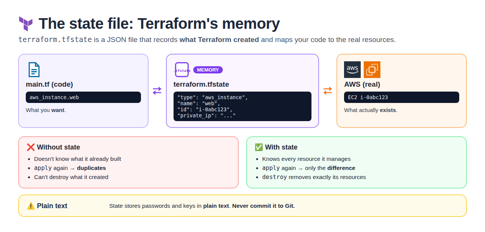
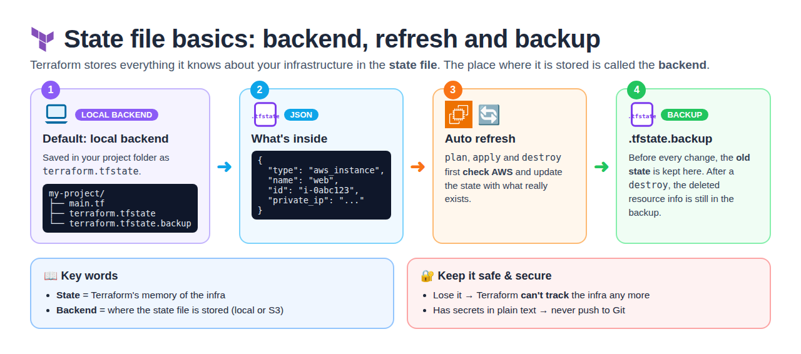
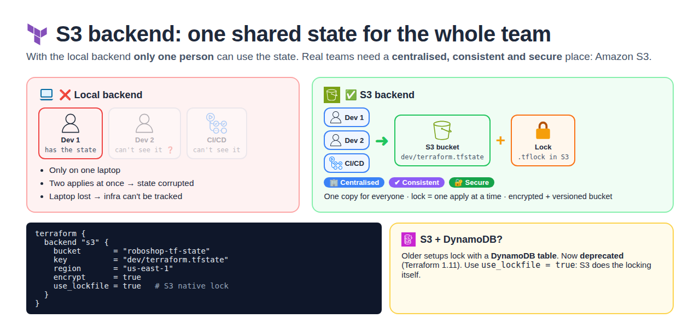
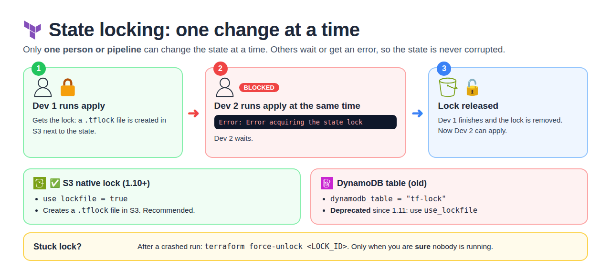
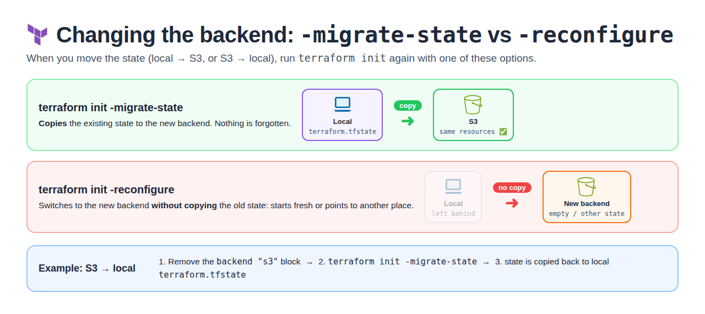
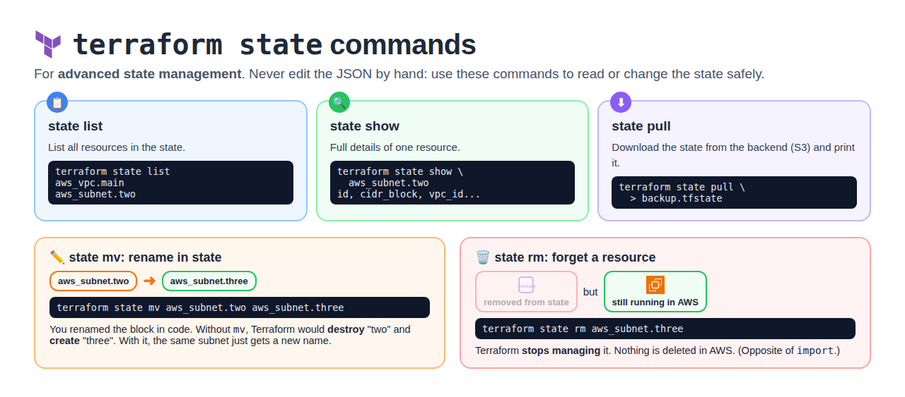

# Day 14 — Terraform State File & State Management

[← All notes](../README.md)

## Table of Contents

1. [Quick Definitions](#quick-definitions)
2. [What is the State File?](#what-is-the-state-file)
3. [Backend, Refresh & Backup](#backend-refresh--backup)
4. [Local State (default)](#local-state-default)
5. [Remote State (S3 Backend)](#remote-state-s3-backend)
6. [State Locking](#state-locking)
7. [Migrating State (init options)](#migrating-state-init-options)
8. [State Commands](#state-commands)
9. [Interview One-Liners](#interview-one-liners)

## Quick Definitions

**State file** (`terraform.tfstate`) = Terraform's **memory**: a JSON file that records what Terraform created.
- Maps code to real resources, so Terraform knows what to create, change or destroy.
- Stores secrets in plain text → **never commit to Git**.

**Backend** = **where the state file is stored**. Default = **local** backend (project folder); team = **S3** backend.

**Refresh** = `plan`, `apply` and `destroy` first **check the real infra** and update the state automatically.

**Local state** = the **default** — the state file is stored on your machine.
- `terraform.tfstate` = current, `terraform.tfstate.backup` = previous version.
- **Problem:** can't share, no locking, lost if the laptop is lost.

**Remote state (S3 backend)** = keep the state file in a **shared S3 bucket**.
- **Use when:** working in a team or running Terraform from CI/CD.

**State locking** = only **one person / pipeline can change the state at a time**.
- S3 native lock `use_lockfile = true` (new, recommended) or DynamoDB table (old, **deprecated**).

**-migrate-state vs -reconfigure** = `terraform init` options when changing the backend.
- **-migrate-state** → copies existing state to the new backend.
- **-reconfigure** → switches backend **without** copying old state.

**terraform state list** = lists **all resources** in the state.
**terraform state show** = shows **full details** of one resource (ID, IP, tags).
**terraform state mv** = **renames** a resource in the state (after renaming the block in code) → no destroy/recreate.
**terraform state rm** = **removes** a resource from the state → Terraform forgets it, but it **still exists in AWS**.
**terraform state pull** = **downloads** the state from the backend (S3) and prints it.

## What is the State File?



**State file** (`terraform.tfstate`) = Terraform's **memory**. A JSON file that records **what
Terraform created** and maps your code to the real resources in the cloud.

```
main.tf (code)  ◄──►  terraform.tfstate (memory)  ◄──►  AWS (real resources)
aws_instance.web       id = i-0abc123, ip = ...           EC2 i-0abc123
```

**Why it's needed**

| Without state                                 | With state                              |
| --------------------------------------------- | --------------------------------------- |
| Terraform doesn't know what it already built  | Knows every resource it manages         |
| `apply` again → creates duplicates            | `apply` again → only changes the difference |
| Can't destroy what it created                 | `destroy` removes exactly its resources |

⚠️ State stores values in **plain text** (passwords, keys) → **never commit it to Git**.

## Backend, Refresh & Backup



| Term                       | Meaning                                                                 |
| -------------------------- | ----------------------------------------------------------------------- |
| **Backend**                | **Where** the state file is stored. Default = **local** (project folder) |
| **Format**                 | **JSON**                                                                |
| **Refresh**                | `plan`, `apply`, `destroy` first check AWS and update the state automatically |
| `terraform.tfstate.backup` | The **old** state, saved before every change. After a `destroy`, the deleted resource's info is still here |

⚠️ Keep the state **safe & secure**: if it's lost, Terraform **can't track** the infra any more.

## Local State (default)

By default Terraform stores state **on your machine**, in the project folder.

| File                        | What it is                               |
| --------------------------- | ---------------------------------------- |
| `terraform.tfstate`         | Current state                            |
| `terraform.tfstate.backup`  | **Previous** state (automatic backup before each change) |

**Problems with local state in a team**

| Problem             | Why                                                       |
| ------------------- | --------------------------------------------------------- |
| No sharing          | Only on one laptop — teammates can't see it               |
| No locking          | Two people run `apply` at once → state gets corrupted     |
| Easy to lose        | Laptop lost / folder deleted → Terraform forgets everything |
| Secrets on laptop   | Plain-text values sitting locally                         |

## Remote State (S3 Backend)



**Why:** with the local backend **only one person** can use the state. Real teams need a
**centralised, consistent and secure** place for it → **Amazon S3**.

| Need            | How S3 backend gives it                         |
| --------------- | ----------------------------------------------- |
| **Centralised** | One copy for the whole team + CI/CD             |
| **Consistent**  | Lock → only one apply at a time                 |
| **Secure**      | `encrypt = true`, bucket versioning, IAM access |

> Older setups used **S3 + DynamoDB** for locking. DynamoDB locking is now **deprecated** →
> use `use_lockfile = true`.

**Remote backend** = keep the state file in a **shared, central place** like an **S3 bucket**.

```hcl
terraform {
  backend "s3" {
    bucket       = "roboshop-tf-state"
    key          = "dev/terraform.tfstate"
    region       = "us-east-1"
    encrypt      = true
    use_lockfile = true     # S3 native locking
  }
}
```

```
Dev 1 ─┐
Dev 2 ─┼──►  S3 bucket (terraform.tfstate)  +  lock
CI/CD ─┘
```

✅ Shared by the team · ✅ Encrypted · ✅ Versioning on bucket = old versions to roll back

## State Locking



**Locking** = only **one person / pipeline** can change the state at a time. Others wait or get an
error → no corruption.

| Locking method                       | How                                        |
| ------------------------------------ | ------------------------------------------ |
| **S3 native lock** (Terraform 1.10+) | `use_lockfile = true` → creates a `.tflock` file in S3 |
| **DynamoDB table** (old way — **deprecated**) | `dynamodb_table = "tf-lock"` → lock row in DynamoDB. Deprecated since Terraform 1.11; use `use_lockfile` instead |

```
Dev 1: terraform apply  ──► gets lock  ──► changes ──► releases lock
Dev 2: terraform apply  ──► "Error acquiring the state lock" ──► waits
```

If a lock gets stuck (crashed run): `terraform force-unlock <LOCK_ID>` — only when sure no one is
running.

## Migrating State (init options)



When you change the backend (local → S3 or S3 → local), run `terraform init` again.

| Command                          | What it does                                               |
| -------------------------------- | ---------------------------------------------------------- |
| `terraform init -migrate-state`  | **Copies** the existing state to the new backend           |
| `terraform init -reconfigure`    | Uses the new backend **without copying** old state (starts fresh / points to a new place) |

**Example: S3 → local**
1. Remove the `backend "s3"` block from the code
2. Run `terraform init -migrate-state` → state is copied back to local `terraform.tfstate`
3. Use `-reconfigure` when you just want to switch backends and **don't** need the old state copied

## State Commands



`terraform state` = commands for **advanced state management**. Never edit the JSON by hand: use
these instead.

| Command                                              | What it does                                              |
| ---------------------------------------------------- | --------------------------------------------------------- |
| `terraform state list`                               | Lists **all resources** in the state                      |
| `terraform state show aws_subnet.two`                | Shows **full details** of one resource                    |
| `terraform state mv aws_subnet.two aws_subnet.three` | **Renames** it in the state (after renaming the block in code) |
| `terraform state rm aws_subnet.three`                | **Removes** it from the state; resource **stays in AWS**  |
| `terraform state pull`                               | **Downloads** the state from the backend and prints it    |

| Situation                                     | Without the command                    | With it                          |
| --------------------------------------------- | -------------------------------------- | -------------------------------- |
| Renamed `aws_subnet.two` → `three` in code    | Destroys "two", creates "three"        | `state mv` → same subnet, new name |
| Want Terraform to stop managing a resource    | `destroy` would delete it              | `state rm` → kept in AWS, forgotten |
| Need a copy of the remote state               | Download from S3 manually              | `state pull > backup.tfstate`    |

```bash
$ terraform state list
aws_instance.app["frontend"]
aws_instance.app["user"]
aws_security_group.allow_all

$ terraform state show 'aws_instance.app["user"]'
# id, ami, instance_type, private_ip, tags ...
```

## Interview One-Liners

- **State file** = Terraform's memory; maps code to real resources so it knows what to create, change or destroy.
- **Default** = local `terraform.tfstate` + `terraform.tfstate.backup` (previous version).
- **Why remote state?** Team sharing, locking, encryption, no single laptop holding it.
- **Locking** = only one apply at a time; S3 native `use_lockfile` (new) — DynamoDB locking is **deprecated**.
- **-migrate-state** copies state to the new backend; **-reconfigure** switches backend without copying.
- **Backend** = where the state is stored; `plan` / `apply` / `destroy` refresh the state automatically.
- **state mv** = rename in state (no recreate); **state rm** = forget a resource (stays in AWS); **state pull** = download remote state.
- **Never** commit state to Git — it holds secrets in plain text.
