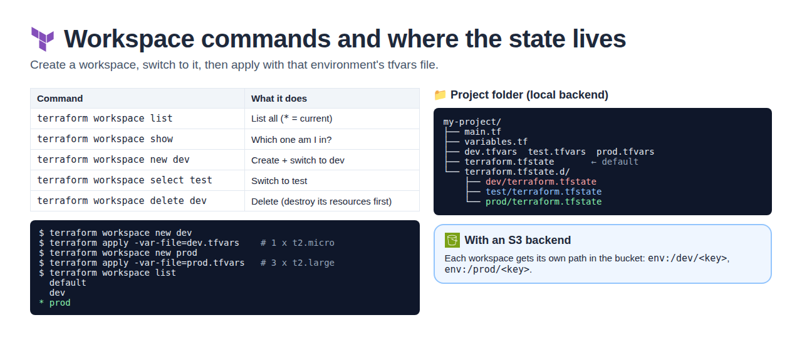
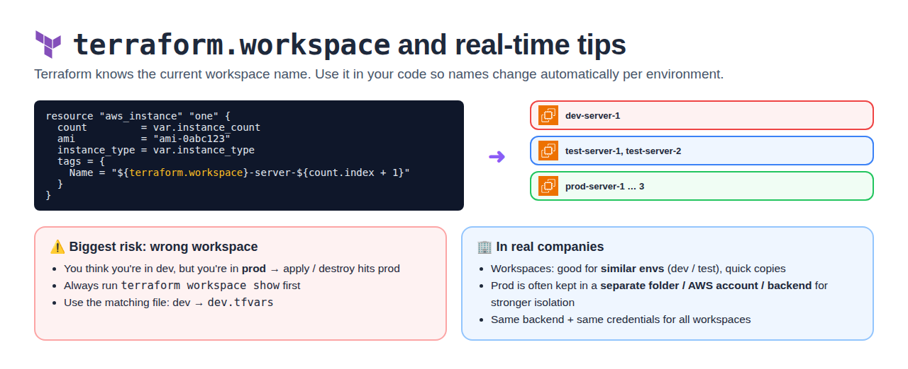
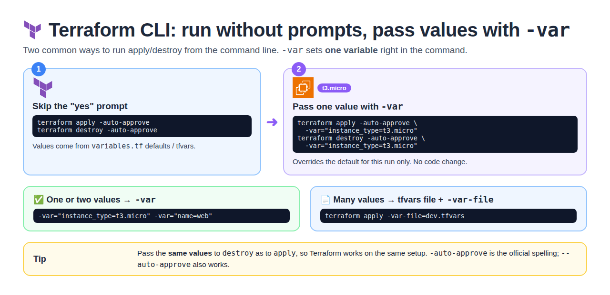
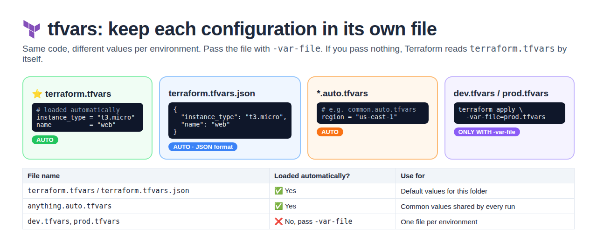
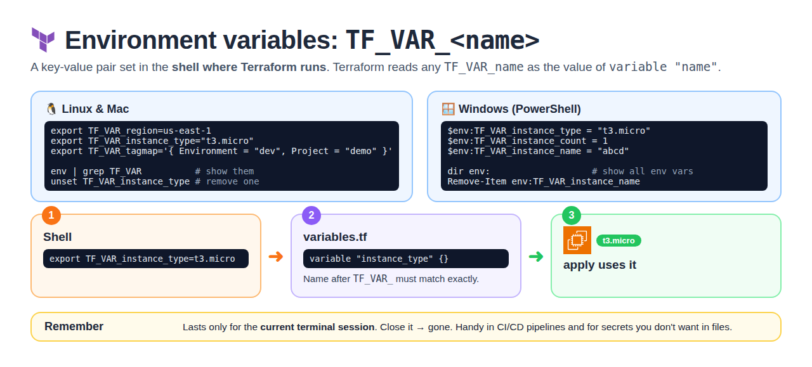
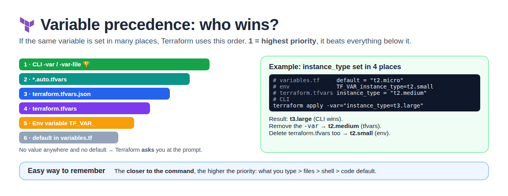

# Day 17 — Terraform Workspaces & Passing Variables

[← All notes](../README.md)

## Table of Contents

1. [Quick Definitions](#quick-definitions)
2. [What are Workspaces?](#what-are-workspaces)
3. [Example: dev, test, prod](#example-dev-test-prod)
4. [Workspace Commands](#workspace-commands)
5. [Where the State Lives](#where-the-state-lives)
6. [terraform.workspace](#terraformworkspace)
7. [Real-Time Tips](#real-time-tips)
8. [Terraform CLI: -auto-approve and -var](#terraform-cli--auto-approve-and--var)
9. [tfvars Files](#tfvars-files)
10. [Environment Variables (TF_VAR_)](#environment-variables-tf_var_)
11. [Variable Precedence](#variable-precedence)
12. [Interview One-Liners](#interview-one-liners)

## Quick Definitions

**Workspace** = a separate **state file** for the **same Terraform code**.
- One code → many environments (dev, test, prod), each with its own state.
- **Use when:** you need similar copies of the same infra for different environments.

**default workspace** = the workspace every project starts in, called `default`.

**Isolated** = resources in one workspace **don't affect** other workspaces (separate state).

**terraform.tfstate.d/** = folder where each workspace's state is kept (local backend).

**terraform.workspace** = built-in value with the **current workspace name** (`dev`, `prod`).

**-var** = pass **one** variable value from the command line.

**tfvars file** = a file that holds **many** variable values (one file per environment).

**TF_VAR_name** = environment variable that sets `variable "name"`.

**Variable precedence** = the priority order Terraform uses when the same variable is set in many places.

## What are Workspaces?


**Workspaces** = maintain **multiple environments** (development, testing, production) using the
**same Terraform configuration** but with **different state files**.

```
                 same code (main.tf)
          ┌──────────────┼──────────────┐
     dev workspace   test workspace   prod workspace
     dev state       test state       prod state
     DEV INFRA       TEST INFRA       PROD INFRA
```

| Point                     | Meaning                                                    |
| ------------------------- | ---------------------------------------------------------- |
| Same code                 | No copy-paste of `.tf` files per environment               |
| Own state file            | Each workspace has its own state (`terraform.tfstate.d/`)  |
| Isolated                  | Destroy dev → test and prod are **not affected**           |
| Default                   | Every project starts in the `default` workspace            |

## Example: dev, test, prod

Same code; only the **values** change per environment, through a tfvars file.

| Workspace | tfvars file   | count | type        | name         | State folder                  |
| --------- | ------------- | ----- | ----------- | ------------ | ----------------------------- |
| **dev**   | `dev.tfvars`  | 1     | `t2.micro`  | dev-server   | `terraform.tfstate.d/dev/`    |
| **test**  | `test.tfvars` | 2     | `t2.medium` | test-server  | `terraform.tfstate.d/test/`   |
| **prod**  | `prod.tfvars` | 3     | `t2.large`  | prod-server  | `terraform.tfstate.d/prod/`   |

**variables.tf**
```hcl
variable "instance_count" {}
variable "instance_type"  {}
variable "name"           {}
```

**main.tf**
```hcl
resource "aws_instance" "one" {
  count         = var.instance_count
  ami           = "ami-0abc123"
  instance_type = var.instance_type
  tags = {
    Name = "${var.name}-${count.index + 1}"     # dev-server-1, prod-server-3 ...
  }
}
```

**dev.tfvars**
```hcl
instance_count = 1
instance_type  = "t2.micro"
name           = "dev-server"
```

**test.tfvars**
```hcl
instance_count = 2
instance_type  = "t2.medium"
name           = "test-server"
```

**prod.tfvars**
```hcl
instance_count = 3
instance_type  = "t2.large"
name           = "prod-server"
```

## Workspace Commands



| Command                            | What it does                               |
| ---------------------------------- | ------------------------------------------ |
| `terraform workspace list`         | Lists all workspaces (`*` = current)       |
| `terraform workspace show`         | Shows the **current** workspace            |
| `terraform workspace new dev`      | **Creates** dev and switches to it         |
| `terraform workspace select test`  | **Switches** to test                       |
| `terraform workspace delete dev`   | **Deletes** dev (destroy its resources first) |

**Full flow**
```bash
terraform init

terraform workspace new dev
terraform apply -var-file=dev.tfvars      # 1 x t2.micro

terraform workspace new test
terraform apply -var-file=test.tfvars     # 2 x t2.medium

terraform workspace new prod
terraform apply -var-file=prod.tfvars     # 3 x t2.large

terraform workspace list
#   default
#   dev
#   test
# * prod
```

**Clean up** (one workspace at a time):
```bash
terraform workspace select dev
terraform destroy -var-file=dev.tfvars
terraform workspace select default        # can't delete the workspace you're in
terraform workspace delete dev
```

| Rule                                         | Why                                         |
| -------------------------------------------- | ------------------------------------------- |
| **Empty** the workspace first (`destroy`)    | Otherwise its resources keep running, untracked |
| Can't delete the **current** workspace       | Switch to another one, then delete          |
| Can't delete the `default` workspace         | It always exists                            |

## Where the State Lives

| Backend   | default workspace         | Other workspaces                                |
| --------- | ------------------------- | ----------------------------------------------- |
| **Local** | `terraform.tfstate`       | `terraform.tfstate.d/<name>/terraform.tfstate`  |
| **S3**    | `<key>`                   | `env:/<name>/<key>` in the same bucket          |

```
my-project/
├── main.tf
├── variables.tf
├── dev.tfvars  test.tfvars  prod.tfvars
├── terraform.tfstate          ← default
└── terraform.tfstate.d/
    ├── dev/terraform.tfstate
    ├── test/terraform.tfstate
    └── prod/terraform.tfstate
```

## terraform.workspace



**terraform.workspace** = the **current workspace name**. Use it in code so names change
automatically.

```hcl
resource "aws_instance" "one" {
  count         = var.instance_count
  ami           = "ami-0abc123"
  instance_type = var.instance_type
  tags = {
    Name = "${terraform.workspace}-server-${count.index + 1}"
  }
}
```

| Current workspace | Servers created                              |
| ----------------- | -------------------------------------------- |
| dev               | dev-server-1                                 |
| test              | test-server-1, test-server-2                 |
| prod              | prod-server-1, prod-server-2, prod-server-3  |

## Real-Time Tips

| Tip                                            | Why                                                   |
| ---------------------------------------------- | ----------------------------------------------------- |
| Run `terraform workspace show` before apply    | Wrong workspace = changes hit the **wrong environment** |
| Match the tfvars file to the workspace         | dev workspace + `prod.tfvars` = prod-sized servers in dev |
| Workspaces fit **similar** envs (dev / test)   | Quick copies of the same infra                        |
| Prod often in a **separate folder / account / backend** | All workspaces share one backend and the same credentials → weaker isolation |

## Terraform CLI: -auto-approve and -var



| Method | Command | Meaning |
| ------ | ------- | ------- |
| **1. Skip the prompt** | `terraform apply -auto-approve`<br>`terraform destroy -auto-approve` | No "yes" question. Values come from defaults / tfvars |
| **2. Pass a value** | `terraform apply -auto-approve -var="instance_type=t3.micro"`<br>`terraform destroy -auto-approve -var="instance_type=t3.micro"` | Overrides the value for **this run only**. No code change |

```bash
# more than one -var is allowed
terraform apply -var="instance_type=t3.micro" -var="name=web"
```

| You need to pass | Use |
| ---------------- | --- |
| **One** (or two) values | `-var="key=value"` |
| **Many** values | a tfvars file + `-var-file=dev.tfvars` |

> Pass the **same values to destroy** as you used for apply. `-auto-approve` is the official spelling; `--auto-approve` also works.

## tfvars Files



**tfvars** = a file that stores variable **values**. When you have **different configurations** (dev, test, prod), keep each in its own tfvars file and pass it with the apply command.

```hcl
# variables.tf  → declares the variables (no values needed)
variable "instance_type" {}
variable "name" {}

# terraform.tfvars  → the values
instance_type = "t3.micro"
name          = "web"
```

| File name | Loaded automatically? | Use for |
| --------- | --------------------- | ------- |
| `terraform.tfvars` | ✅ Yes, **by default** | Default values for this folder |
| `terraform.tfvars.json` | ✅ Yes | Same thing, written in **JSON** format |
| `anything.auto.tfvars` | ✅ Yes | Common values shared by every run |
| `dev.tfvars`, `prod.tfvars` | ❌ No → `-var-file=dev.tfvars` | One file per environment |

```bash
terraform apply                          # reads terraform.tfvars by itself
terraform apply -var-file=prod.tfvars    # reads prod.tfvars (plus the auto-loaded files)
```

**terraform.tfvars.json** example:
```json
{
  "instance_type": "t3.micro",
  "name": "web"
}
```

## Environment Variables (TF_VAR_)



**Environment variable** = a key-value pair set in the **shell where Terraform runs**. Terraform reads `TF_VAR_<name>` as the value of `variable "<name>"`.

| OS | Set | Show | Remove |
| -- | --- | ---- | ------ |
| **Linux / Mac** | `export TF_VAR_instance_type="t3.micro"` | `env \| grep TF_VAR` | `unset TF_VAR_instance_type` |
| **Windows (PowerShell)** | `$env:TF_VAR_instance_type = "t3.micro"` | `dir env:` | `Remove-Item env:TF_VAR_instance_type` |

**Linux / Mac**
```bash
export TF_VAR_region=us-east-1
export TF_VAR_instance_type="t3.micro"
export TF_VAR_tagmap='{ Environment = "dev", Project = "demo" }'   # a map
```

**Windows (PowerShell)**
```powershell
$env:TF_VAR_instance_type = "t3.micro"
$env:TF_VAR_instance_count = 1
$env:TF_VAR_instance_name = "abcd"
dir env:          # show all env vars
```

| Point | Meaning |
| ----- | ------- |
| Name must match | `TF_VAR_instance_type` → `variable "instance_type"` (case-sensitive) |
| Lasts for the session | Close the terminal → gone |
| Real-time use | CI/CD pipelines and secrets you don't want written in files |

## Variable Precedence



**Variable precedence** = the priority order Terraform follows when the same variable is set in many places. **1 = highest**, it wins over everything below.

| Priority | Source | Example |
| -------- | ------ | ------- |
| **1** 🏆 | **CLI** `-var` / `-var-file` | `-var="instance_type=t3.large"` |
| **2** | `*.auto.tfvars` | `common.auto.tfvars` |
| **3** | `terraform.tfvars.json` | `{ "instance_type": "t2.medium" }` |
| **4** | `terraform.tfvars` | `instance_type = "t2.medium"` |
| **5** | **Env variable** | `export TF_VAR_instance_type=t2.small` |
| **6** | **Default** in `variables.tf` | `default = "t2.micro"` |

**Example:** `instance_type` is set in 4 places.
```bash
# variables.tf       default = "t2.micro"
# env                export TF_VAR_instance_type=t2.small
# terraform.tfvars   instance_type = "t2.medium"
terraform apply -var="instance_type=t3.large"
```

| What you remove | Value used |
| --------------- | ---------- |
| Nothing | **t3.large** (CLI wins) |
| The `-var` | **t2.medium** (terraform.tfvars) |
| `-var` + terraform.tfvars | **t2.small** (env variable) |
| All of the above | **t2.micro** (default) |
| No value anywhere and no default | Terraform **asks** you at the prompt |

> **Easy way to remember:** the closer to the command, the higher the priority → what you type > files > shell > code default.

## Interview One-Liners

- **Workspace** = same Terraform code, separate state file per environment (dev, test, prod).
- **Default workspace** = `default`; its state is `terraform.tfstate`. Others live in `terraform.tfstate.d/<name>/`.
- **Isolation** = changes or destroy in one workspace don't affect the others.
- **Commands** = `workspace new / select / list / show / delete`.
- **terraform.workspace** = current workspace name, used in resource names and tags.
- **Risk** = applying in the wrong workspace; always check `terraform workspace show`. Many teams keep prod in a separate backend or account.
- **-var** = pass one value from the CLI; for many values use a tfvars file with `-var-file`.
- **terraform.tfvars** = loaded automatically (also `terraform.tfvars.json` and `*.auto.tfvars`); other tfvars files need `-var-file`.
- **TF_VAR_name** = environment variable that sets `variable "name"`; lasts only for the shell session.
- **Precedence** (high → low) = CLI `-var`/`-var-file` → `*.auto.tfvars` → `terraform.tfvars.json` → `terraform.tfvars` → `TF_VAR_` → default.
