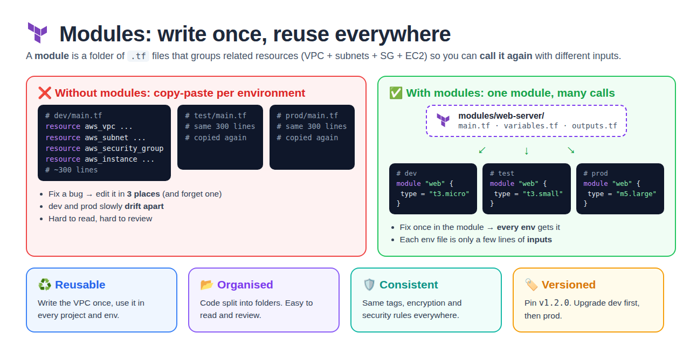
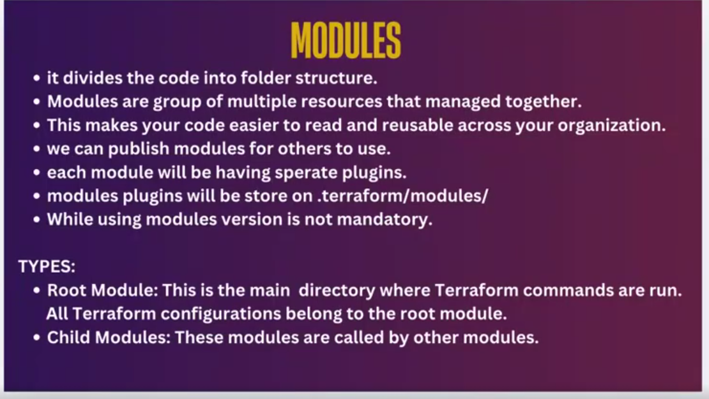
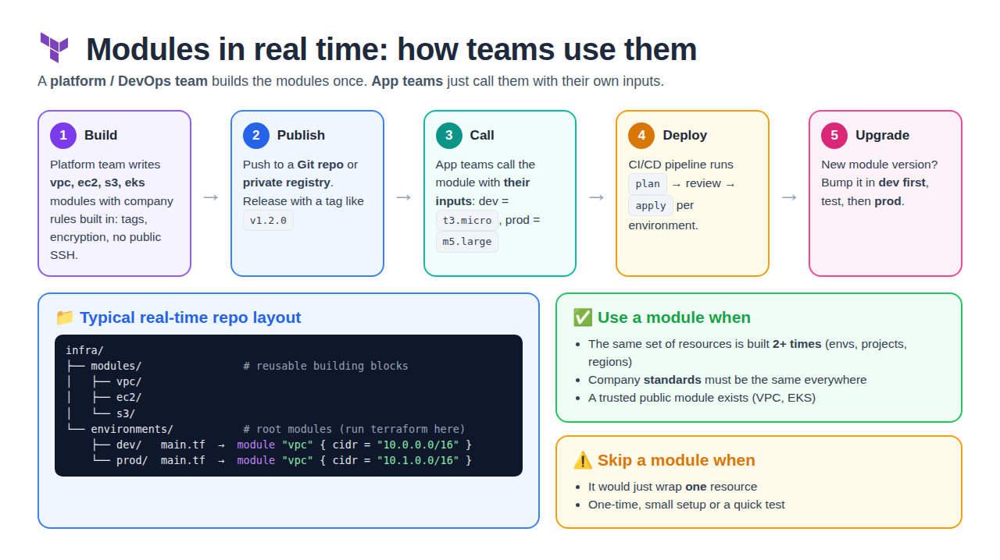
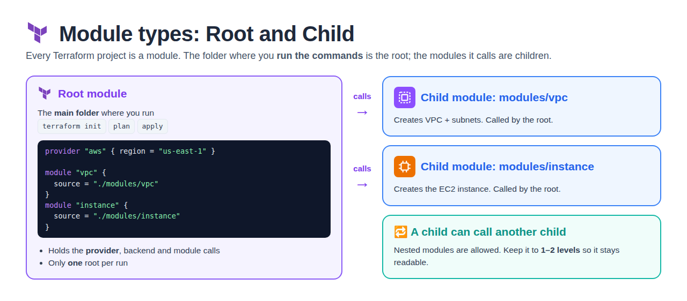
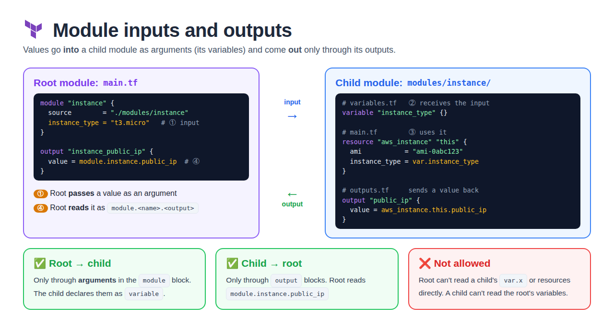
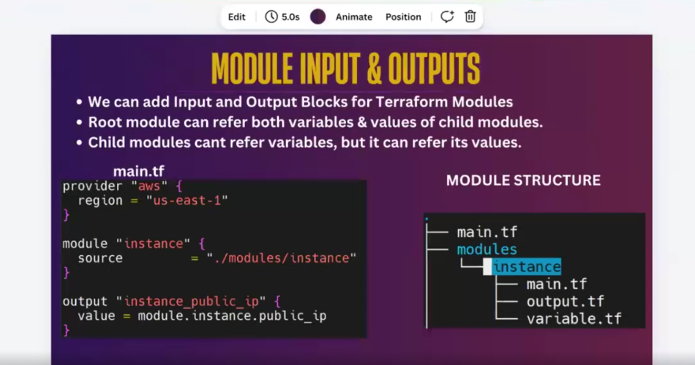
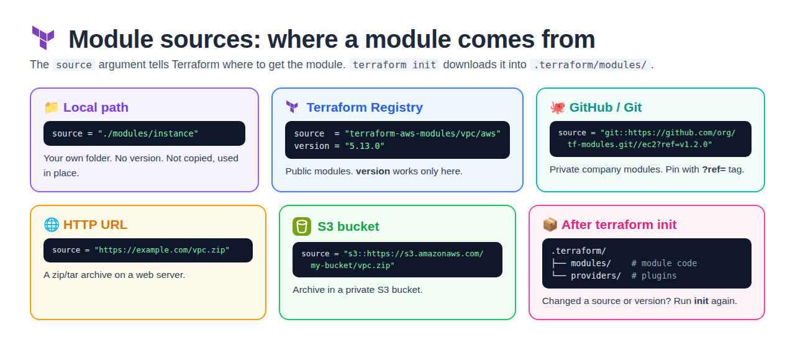
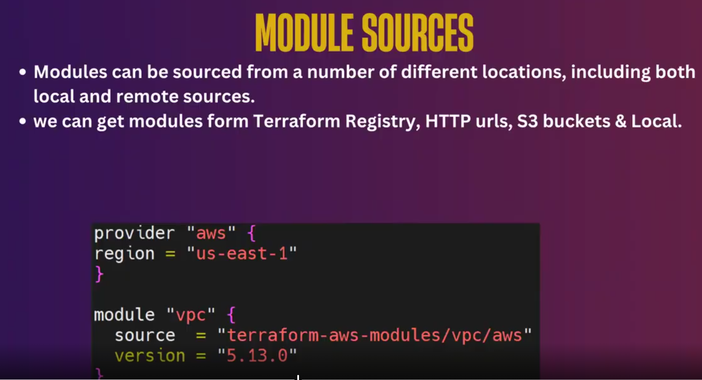
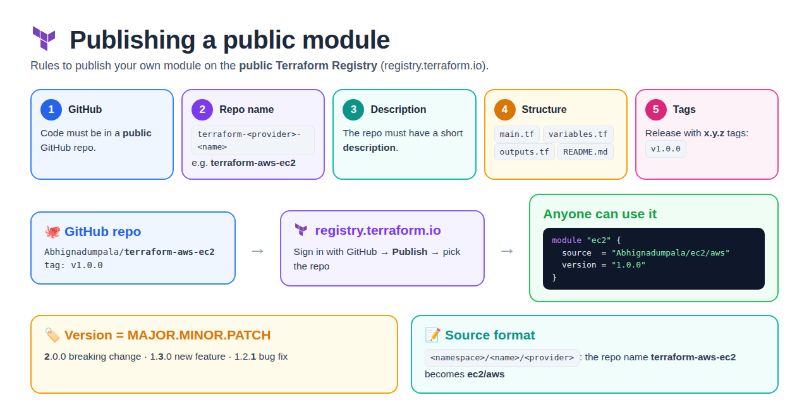
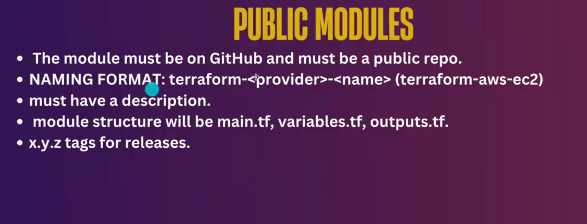

# Day 18 — Terraform Modules

[← All notes](../README.md)

## Table of Contents

1. [Quick Definitions](#quick-definitions)
2. [What are Modules?](#what-are-modules)
3. [Why Use Modules?](#why-use-modules)
4. [When to Use Modules in Real Time](#when-to-use-modules-in-real-time)
5. [Module Types: Root and Child](#module-types-root-and-child)
6. [Module Structure](#module-structure)
7. [Module Inputs and Outputs](#module-inputs-and-outputs)
8. [Module Sources](#module-sources)
9. [Public Modules](#public-modules)
10. [Module Commands](#module-commands)
11. [Real-Time Tips](#real-time-tips)
12. [Interview Questions](#interview-questions)
13. [Interview One-Liners](#interview-one-liners)

## Quick Definitions

**Module** = a **folder of `.tf` files** that groups related resources so they are managed together and can be **reused**.

**Root module** = the main folder where you run `terraform init / plan / apply`.

**Child module** = a module that is **called** by another module (by the root module, or by another child module).

**module block** = how you call a module: `module "name" { source = "..." }`.

**source** = **where** the module code comes from (local folder, Registry, GitHub, HTTP, S3).

**version** = which release of a **Registry** module to use (e.g. `"5.13.0"`).

**Input** = a value passed **into** a module (the module declares it as a `variable`).

**Output** = a value the module sends **back** (read as `module.<name>.<output>`).

## What are Modules?



A **module** is a container for **multiple resources that are used together**. Instead of one big `main.tf`,
you split the code into **folders**. Each folder does **one job** (VPC, EC2, S3…).

- It divides the code into a **folder structure**.
- Modules are a **group of multiple resources** that are **managed together** (e.g. VPC + subnets + route tables).
- This makes your code **easier to read** and **reusable** across your organisation.
- We can **publish** modules for others to use.
- Each module is **downloaded separately** by `terraform init`.
- Downloaded modules are stored in **`.terraform/modules/`** (provider plugins go to `.terraform/providers/`).
- While using modules, **version is not mandatory** (but always pin it in real time).

**Types**
- **Root module:** the main directory where Terraform commands are run. All Terraform configuration in it belongs to the root module.
- **Child modules:** modules that are **called by other modules**.

<details>
<summary>📸 Class slide: Modules</summary>



</details>

> **Analogy:** a module is like a **function** in programming. Write it once, call it many times with different inputs, and get outputs back.

| Programming | Terraform module |
| ----------- | ---------------- |
| Function    | Module folder |
| Calling the function | `module "web" { source = "./modules/web" }` |
| Parameters  | Input variables (`variable`) |
| Return value | Outputs (`output`) |

```
Without modules                     With modules
dev/main.tf   300 lines             modules/web-server/  (written once)
test/main.tf  300 lines (copy)        ├── dev   → module "web" { type = "t3.micro" }
prod/main.tf  300 lines (copy)        ├── test  → module "web" { type = "t3.small" }
                                      └── prod  → module "web" { type = "m5.large" }
```

## Why Use Modules?

| Reason | Meaning |
| ------ | ------- |
| **Reusability** | Write the VPC code once, use it in every project and environment |
| **No copy-paste** | Fix a bug in the module once → every env that uses it gets the fix |
| **Organised code** | Small folders with one job each; easier to read and review |
| **Consistency** | Same tags, encryption and security rules everywhere |
| **Versioning** | Pin a module version (`v1.2.0`); upgrade dev first, then prod |
| **Teamwork** | Platform team owns the modules; app teams only pass inputs |
| **Faster delivery** | New environment = a few lines of inputs, not hundreds of lines of code |

## When to Use Modules in Real Time



**Real-time flow in a company**

| Step | Who | What happens |
| ---- | --- | ------------ |
| **1. Build** | Platform / DevOps team | Writes `vpc`, `ec2`, `s3`, `eks` modules with company rules built in (tags, encryption, no public SSH) |
| **2. Publish** | Platform team | Pushes to a Git repo or private registry, releases a tag like `v1.2.0` |
| **3. Call** | App teams | Call the module with their own inputs (dev = `t3.micro`, prod = `m5.large`) |
| **4. Deploy** | CI/CD pipeline | `terraform plan` → review → `terraform apply` for each environment |
| **5. Upgrade** | Everyone | New module version → bump it in dev first, then test, then prod |

**Typical real-time repo layout**
```
infra/
├── modules/                  # reusable building blocks (child modules)
│   ├── vpc/
│   ├── ec2/
│   └── s3/
└── environments/             # root modules (run terraform here)
    ├── dev/main.tf           # module "vpc" { cidr = "10.0.0.0/16" }
    └── prod/main.tf          # module "vpc" { cidr = "10.1.0.0/16" }
```

| ✅ Use a module when | ⚠️ Skip a module when |
| -------------------- | --------------------- |
| The same resources are built **2+ times** (envs, projects, regions) | It would only wrap **one** resource |
| Company **standards** must be the same everywhere | One-time, small setup or a quick test |
| A trusted public module already exists (VPC, EKS) | It only adds extra layers and makes code harder to follow |

**Real-time examples**
- **VPC module** → every project gets the same VPC layout (public + private subnets, NAT, tags).
- **EC2 module** → every server gets the same SG rules, IAM role, monitoring and tags.
- **S3 module** → every bucket is created with encryption, versioning and public access blocked.
- **EKS module** → one tested way to create Kubernetes clusters for all teams.

## Module Types: Root and Child



| Type | Meaning | Example |
| ---- | ------- | ------- |
| **Root module** | The main folder where Terraform commands are run. All config in this folder belongs to the root module | `my-project/` with `main.tf` |
| **Child module** | A module **called by** another module | `./modules/instance`, `terraform-aws-modules/vpc/aws` |

- Every Terraform project **is** a module (at least the root module).
- The **provider** and **backend** are set in the **root** module.
- A child module can call another child module (nested). Keep it to **1–2 levels**.

## Module Structure

```
.
├── main.tf                  # root module: provider + module calls
└── modules/
    └── instance/            # child module
        ├── main.tf          # resources
        ├── variables.tf     # inputs
        └── outputs.tf       # outputs
```

| File | Holds |
| ---- | ----- |
| `main.tf` | The resources (`aws_instance`, `aws_vpc`…) |
| `variables.tf` | Input variables the module accepts |
| `outputs.tf` | Values the module sends back |
| `README.md` | How to use the module (needed for public modules) |

> File names are a **convention**. Terraform reads every `.tf` file in the folder, so `output.tf` / `variable.tf` also work. `variables.tf` / `outputs.tf` is the standard.

## Module Inputs and Outputs



**Root module: main.tf**
```hcl
provider "aws" {
  region = "us-east-1"
}

module "instance" {
  source        = "./modules/instance"
  instance_type = "t3.micro"          # input → goes to var.instance_type
  name          = "dev-server"
}

output "instance_public_ip" {
  value = module.instance.public_ip   # read the child's output
}
```

**Child module: modules/instance/variables.tf**
```hcl
variable "instance_type" {
  default = "t2.micro"
}

variable "name" {}
```

**Child module: modules/instance/main.tf**
```hcl
resource "aws_instance" "this" {
  ami           = "ami-0abc123"
  instance_type = var.instance_type
  tags = {
    Name = var.name
  }
}
```

**Child module: modules/instance/outputs.tf**
```hcl
output "public_ip" {
  value = aws_instance.this.public_ip
}
```

**How the values flow**
```
root main.tf                      child module (modules/instance)
module "instance" {
  instance_type = "t3.micro"  ─①─▶ variables.tf   variable "instance_type"
}                                      │
                                  ②    ▼
                                  main.tf        instance_type = var.instance_type
                                       │
                                  ③    ▼
module.instance.public_ip   ◀─④── outputs.tf     output "public_ip"
```

| Direction | How | Example |
| --------- | --- | ------- |
| **Root → child** | Arguments in the `module` block; child declares them as `variable` | `instance_type = "t3.micro"` |
| **Child → root** | `output` blocks in the child; root reads `module.<name>.<output>` | `module.instance.public_ip` |
| ❌ Root reads child's `var.x` or resources directly | Not allowed | Use an output instead |
| ❌ Child reads root's variables | Not allowed | Pass it as an argument |

> **Rule:** a module is a closed box. The only doors are **variables (in)** and **outputs (out)**.
> A variable with **no default** is **required**. If the root doesn't pass it, `plan` fails.

<details>
<summary>📸 Class slide: Module Input & Outputs</summary>



</details>

## Module Sources



Modules can come from **local** and **remote** locations: Terraform Registry, GitHub/Git, HTTP URLs, S3 buckets and local folders.

| Source | Example `source =` | Version |
| ------ | ------------------ | ------- |
| **Local path** | `"./modules/instance"` | No version (uses the folder as it is) |
| **Terraform Registry** | `"terraform-aws-modules/vpc/aws"` | `version = "5.13.0"` |
| **GitHub / Git** | `"git::https://github.com/org/tf-modules.git//ec2?ref=v1.2.0"` | `?ref=` tag or branch |
| **HTTP URL** | `"https://example.com/vpc.zip"` | — |
| **S3 bucket** | `"s3::https://s3.amazonaws.com/my-bucket/vpc.zip"` | — |

**Registry example (public VPC module)**
```hcl
provider "aws" {
  region = "us-east-1"
}

module "vpc" {
  source  = "terraform-aws-modules/vpc/aws"
  version = "5.13.0"

  name            = "my-vpc"
  cidr            = "10.0.0.0/16"
  azs             = ["us-east-1a", "us-east-1b"]
  public_subnets  = ["10.0.1.0/24", "10.0.2.0/24"]
  private_subnets = ["10.0.11.0/24", "10.0.12.0/24"]
}
```

**Where modules are stored after `terraform init`**
```
.terraform/
├── modules/      # downloaded module code (+ modules.json)
└── providers/    # provider plugins (aws, azurerm…)
```

| Point | Meaning |
| ----- | ------- |
| `terraform init` | Downloads remote modules into `.terraform/modules/` |
| Changed `source` or `version`? | Run `terraform init` again |
| `version` mandatory? | **No**, but without it you get the **latest** → may break later. Always pin in real time |
| `version` works for | **Registry** modules only. Git uses `?ref=`, local paths have no version |

<details>
<summary>📸 Class slide: Module Sources</summary>



</details>

## Public Modules



Rules to publish your own module on the **public Terraform Registry** (registry.terraform.io):

| # | Rule | Example |
| - | ---- | ------- |
| 1 | Module must be on **GitHub** in a **public** repo | `github.com/Abhignadumpala/terraform-aws-ec2` |
| 2 | **Naming format** `terraform-<provider>-<name>` | `terraform-aws-ec2` |
| 3 | Repo must have a **description** | "EC2 instance module with tags and SG" |
| 4 | **Standard structure** | `main.tf`, `variables.tf`, `outputs.tf`, `README.md` |
| 5 | **x.y.z tags** for releases | `v1.0.0`, `v1.1.0` |

**Publish flow:** GitHub repo → sign in to registry.terraform.io with GitHub → **Publish** → pick the repo.

**Others then use it like this:**
```hcl
module "ec2" {
  source  = "Abhignadumpala/ec2/aws"     # <namespace>/<name>/<provider>
  version = "1.0.0"
}
```

| Version part | Change it when | Example |
| ------------ | -------------- | ------- |
| **MAJOR** | Breaking change (inputs renamed/removed) | `1.4.0` → `2.0.0` |
| **MINOR** | New feature, still compatible | `1.2.0` → `1.3.0` |
| **PATCH** | Bug fix | `1.2.0` → `1.2.1` |

<details>
<summary>📸 Class slide: Public Modules</summary>



</details>

## Module Commands

| Command | What it does |
| ------- | ------------ |
| `terraform init` | Downloads modules + providers |
| `terraform get` | Downloads/updates **only modules** |
| `terraform init -upgrade` | Gets the newest allowed module and provider versions |
| `terraform state list` | Module resources show as `module.instance.aws_instance.this` |
| `terraform plan -target=module.vpc` | Plan only one module |
| `terraform output` | Shows root outputs (e.g. `instance_public_ip`) |

```bash
terraform init
terraform plan
terraform apply -auto-approve
terraform output instance_public_ip
terraform state list
# module.instance.aws_instance.this
```

## Real-Time Tips

| Tip | Why |
| --- | --- |
| **Pin** the module version (`version` / `?ref=v1.2.0`) | Unpinned modules can change and break `apply` |
| Upgrade **dev first**, then prod | Catch breaking changes before production |
| Keep the **provider** in the root module | Child modules inherit it; one place to set region |
| Give every input a `description` and `type` | The module is self-documenting |
| Output only what callers **need** (IDs, IPs) | Keeps the module's interface small and clear |
| Check a public module before using it | Look at downloads, last update, open issues and the code |
| Don't over-nest modules | Hard to debug when there are 4–5 levels |

## Interview Questions

**1. What are the different types of modules? Difference between a local module and a remote module?**

Modules are of two types by where they come from: **local** and **remote**.

- **Local module** = a module **we write ourselves**, kept in our own project folder.
- **Remote module** = a module **already developed by someone else** (HashiCorp, the community, or another team), downloaded from the Terraform Registry, GitHub, HTTP or S3.

| | Local module | Remote module |
| - | ------------ | ------------- |
| Who writes it | **We write it ourselves** | **Already developed by someone else** |
| Where it lives | Our project folder | Terraform Registry, GitHub/Git, HTTP URL, S3 |
| `source` example | `"./modules/instance"` | `"terraform-aws-modules/vpc/aws"` |
| `version` | Not used | `version = "5.13.0"` (Registry) or `?ref=v1.2.0` (Git) |
| `terraform init` | Not downloaded; used from the folder | Downloaded into `.terraform/modules/` |
| Control | Full control; we change the code | We use it as it is; changes come with new versions |
| Use when | Company-specific setup | Common infra (VPC, EKS) that is already built and tested |

```hcl
# Local module: written by us
module "instance" {
  source = "./modules/instance"
}

# Remote module: already developed by someone else
module "vpc" {
  source  = "terraform-aws-modules/vpc/aws"
  version = "5.13.0"
}
```

> **One-liner:** a local module is written by us in our own folder; a remote module is already developed by someone else and downloaded by `terraform init`.

More practice questions → [interview-questions/](interview-questions/README.md)

## Interview One-Liners

- **Module** = a folder of `.tf` files grouping related resources; reusable like a function.
- **Why** = reuse, no copy-paste, consistency, versioning, cleaner code.
- **When** = the same infra is needed 2+ times (dev/test/prod, many projects) or company standards must be enforced.
- **Root module** = folder where you run Terraform; **child module** = module called by another module.
- **Inputs** = `variable` blocks in the child, passed as arguments in the `module` block.
- **Outputs** = `output` blocks in the child, read in the root as `module.<name>.<output>`.
- **Root can't** read a child's variables directly, and **a child can't** read the root's variables; values cross only through inputs and outputs.
- **Sources** = local path, Terraform Registry, GitHub/Git, HTTP URL, S3 bucket.
- **version** = optional, works for Registry modules only; Git uses `?ref=`. Always pin in real time.
- **terraform init** = downloads modules into `.terraform/modules/` (providers go to `.terraform/providers/`).
- **Public module rules** = public GitHub repo, name `terraform-<provider>-<name>`, description, standard structure, `x.y.z` tags.
