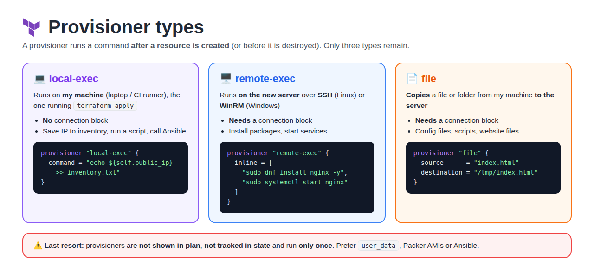
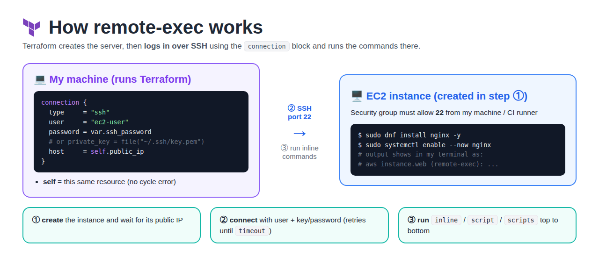
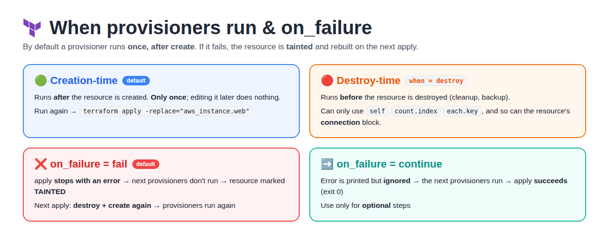

# Day 19 — Terraform Provisioners

[← All notes](../README.md)

## Table of Contents

1. [Quick Definitions](#quick-definitions)
2. [What are Provisioners?](#what-are-provisioners)
3. [Provisioner Types](#provisioner-types)
4. [local-exec](#local-exec)
5. [remote-exec and the connection Block](#remote-exec-and-the-connection-block)
6. [file Provisioner](#file-provisioner)
7. [When Provisioners Run: Creation vs Destroy](#when-provisioners-run-creation-vs-destroy)
8. [Failure Behaviour: on_failure](#failure-behaviour-on_failure)
9. [Running Provisioners Without a Resource: terraform_data / null_resource](#running-provisioners-without-a-resource-terraform_data--null_resource)
10. [Provisioners vs user_data vs Ansible](#provisioners-vs-user_data-vs-ansible)
11. [Hands-On Lab: Problems I Hit and Fixes](#hands-on-lab-problems-i-hit-and-fixes)
12. [Real-Time Tips](#real-time-tips)
13. [Interview Questions](#interview-questions)
14. [Interview One-Liners](#interview-one-liners)

## Quick Definitions

**Provisioner** = a block **inside a resource** that runs a **command or script** after the resource is created (or before it is destroyed).

**local-exec** = runs a command on the **machine where you run Terraform** (your laptop / CI runner).

**remote-exec** = runs commands **on the new server** over **SSH** (Linux) or **WinRM** (Windows).

**file** = **copies** a file or folder from your machine **to the new server**.

**connection block** = tells remote-exec / file **how to log in** to the server (type, user, key/password, host).

**self** = inside a provisioner or connection, refers to the **parent resource** (`self.public_ip`).

**when = destroy** = makes a provisioner run **before the resource is destroyed** instead of after it is created.

**on_failure** = what to do if the provisioner fails: `fail` (default, stop + taint) or `continue`.

**terraform_data** = built-in resource (Terraform 1.4+) that holds provisioners **without creating any real infra**. Replaces `null_resource`.

## What are Provisioners?



Terraform **creates** infrastructure (EC2, VPC, S3). Provisioners let you **do something extra** once it exists:
install a package, copy a config file, run a script, or save the IP to a file.

- Written **inside** a `resource` block.
- Run **only once**, when the resource is **created** (by default). Not on every `apply`.
- **Not shown in `plan`** and **not tracked in state**. Terraform can't know what the script changed.
- HashiCorp says: provisioners are a **last resort**. Prefer `user_data`, cloud-init, Packer images or Ansible.

> **Analogy:** Terraform builds the **house**. A provisioner is the **one-time job** you do on moving day (hang the curtains).
> If you repaint later, Terraform doesn't know about it.

```
terraform apply
   │
   ├─ 1. create aws_instance.web          (Terraform tracks this in state)
   │
   └─ 2. run provisioners in order        (NOT tracked in state)
          ├─ file        → copy index.html to the server
          ├─ remote-exec → install + start nginx on the server
          └─ local-exec  → write the IP to inventory.txt on my laptop
```

## Provisioner Types

| Type | Runs where | Needs `connection`? | Typical use |
| ---- | ---------- | ------------------- | ----------- |
| **local-exec** | **Your machine** (laptop / CI runner) | ❌ No | Save IP to a file, call a script, run `ansible-playbook` |
| **remote-exec** | **The new server** (SSH / WinRM) | ✅ Yes | Install packages, start services |
| **file** | Copies **local → server** | ✅ Yes | Copy a config file, script or website folder |

> Old vendor provisioners (`chef`, `puppet`, `salt-masterless`, `habitat`) were **removed in Terraform 0.15**. Only these three remain.

## local-exec

Runs on the machine **running `terraform apply`**, not on the server. No SSH needed.

```hcl
resource "aws_instance" "web" {
  ami           = "ami-0220d79f3f480ecf5"
  instance_type = "t3.micro"

  provisioner "local-exec" {
    command = "echo ${self.private_ip} >> inventory.txt"
  }
}
```

| Argument | Meaning | Example |
| -------- | ------- | ------- |
| `command` | Command to run (**required**) | `"echo ${self.public_ip} > ip.txt"` |
| `working_dir` | Folder to run it in | `"scripts/"` |
| `interpreter` | Program that runs the command | `["/bin/bash", "-c"]`, `["python3", "-c"]` |
| `environment` | Env variables for the command | `{ ENV = "dev" }` |

**Real-time uses**
- Write server IPs to an **Ansible inventory**, then run `ansible-playbook` (Terraform creates, Ansible configures).
- Send a **Slack/HTTP** notification after a server is created.
- Run an **AWS CLI** command Terraform has no resource for.

## remote-exec and the connection Block



Runs **on the new server**. Terraform logs in over **SSH** using the `connection` block.

```hcl
resource "aws_instance" "web" {
  ami                    = "ami-0220d79f3f480ecf5"
  instance_type          = "t3.micro"
  vpc_security_group_ids = [aws_security_group.web.id]   # must allow port 22 from Terraform's machine

  connection {
    type     = "ssh"
    user     = "ec2-user"
    password = var.ssh_password          # or: private_key = file("~/.ssh/my-key.pem")
    host     = self.public_ip
  }

  provisioner "remote-exec" {
    inline = [
      "sudo dnf install nginx -y",
      "sudo systemctl enable --now nginx",
    ]
  }
}
```

| remote-exec argument | Meaning |
| -------------------- | ------- |
| `inline` | **List** of commands, run one by one |
| `script` | **One** local script; Terraform copies it to the server and runs it |
| `scripts` | **List** of local scripts, run in order |

> Use only **one** of `inline`, `script` or `scripts` per provisioner.

| connection argument | Meaning | Example |
| ------------------- | ------- | ------- |
| `type` | `ssh` (default) or `winrm` | `"ssh"` |
| `host` | Server to log in to (**required**) | `self.public_ip` |
| `user` | Login user | `"ec2-user"`, `"ubuntu"` |
| `private_key` | Key **contents** (use `file()`) | `file("~/.ssh/key.pem")` |
| `password` | Password login (if the AMI allows it) | `var.ssh_password` |
| `port` | SSH port | `22` |
| `timeout` | How long to keep trying | `"5m"` |

> **Use `self`, not `aws_instance.web`**, inside the resource's own provisioner/connection.
> Referring to the resource by name inside itself creates a **cycle error**.

**Where to put `connection`**
- **Resource level** → shared by every provisioner in that resource (most common).
- **Inside one provisioner** → only that provisioner uses it.

## file Provisioner

**Copies** files from your machine to the server. Needs a `connection` block (same as remote-exec).

```hcl
  provisioner "file" {
    source      = "index.html"               # local file
    destination = "/tmp/index.html"          # path on the server
  }

  provisioner "file" {
    content     = "env=${var.env}"           # or write text directly
    destination = "/tmp/app.conf"
  }
```

| Argument | Meaning |
| -------- | ------- |
| `source` | Local file or folder to copy |
| `content` | Text to write (instead of `source`) |
| `destination` | Path on the server (**required**) |

| Folder copy | Result |
| ----------- | ------ |
| `source = "site"` → `destination = "/tmp"` | `/tmp/site/...` (folder itself is copied) |
| `source = "site/"` → `destination = "/tmp"` | `/tmp/...` (only the folder's **contents**) |

> The SSH user must be able to **write** to `destination`. Copy to `/tmp` first, then `sudo mv` with remote-exec.

**Common pattern: file + remote-exec together**
```hcl
  provisioner "file" {
    source      = "index.html"
    destination = "/tmp/index.html"
  }

  provisioner "remote-exec" {
    inline = [
      "sudo dnf install nginx -y",
      "sudo mv /tmp/index.html /usr/share/nginx/html/index.html",
      "sudo systemctl enable --now nginx",
    ]
  }
```

Provisioners run **top to bottom** in the order they are written.

## When Provisioners Run: Creation vs Destroy



| Type | How | Runs | Example |
| ---- | --- | ---- | ------- |
| **Creation-time** | Default (no `when`) | **After** the resource is created. **Only once** | Install nginx |
| **Destroy-time** | `when = destroy` | **Before** the resource is destroyed | Remove the server from inventory, take a backup |

```hcl
  provisioner "local-exec" {
    when    = destroy
    command = "echo 'destroying ${self.id}' >> destroy.log"
  }
```

| Point | Meaning |
| ----- | ------- |
| Runs only on **create** | Editing the provisioner later does **nothing** to an existing server |
| To run it again | `terraform apply -replace="aws_instance.web"` (recreates the server) |
| Destroy-time can only use | `self`, `count.index`, `each.key` (no other resources or variables) |
| Same rule for `connection` | If a resource has a destroy-time provisioner, its **shared `connection` block** is also limited to `self` (see [lab](#hands-on-lab-problems-i-hit-and-fixes)) |
| `self.public_ip` at destroy | Still works: Terraform reads it from **state** |
| Delete the whole resource block | Its destroy-time provisioner is deleted too → it **won't run**. Run `destroy` first |

## Failure Behaviour: on_failure

```hcl
  provisioner "remote-exec" {
    on_failure = continue          # default is fail
    inline     = ["sudo dnf install nginx -y"]
  }
```

| `on_failure` | What happens |
| ------------ | ------------ |
| **`fail`** (default) | `apply` **stops with an error**. A failed creation-time provisioner marks the resource **tainted** → next `apply` **destroys and recreates** it |
| **`continue`** | Ignore the error and carry on with the apply |

```
remote-exec fails  (on_failure = fail)
   │
   ▼
apply errors ──► resource marked TAINTED in state
   │
   ▼
next terraform apply ──► destroy + create again ──► provisioners run again
```

> **Why taint?** Terraform can't tell how far the script got. A half-configured server is not trusted, so it is rebuilt.

## Running Provisioners Without a Resource: terraform_data / null_resource

Sometimes you want to run a script that **isn't tied to creating one server**, or **re-run** it when something changes.

```hcl
resource "terraform_data" "deploy_app" {
  triggers_replace = [aws_instance.web.id, var.app_version]   # change → re-run

  connection {
    type     = "ssh"
    user     = "ec2-user"
    password = var.ssh_password
    host     = aws_instance.web.public_ip      # other resource → use its name, not self
  }

  provisioner "remote-exec" {
    inline = ["echo deploying version ${var.app_version}"]
  }
}
```

| | `terraform_data` | `null_resource` |
| - | ---------------- | --------------- |
| Comes from | **Built in** (Terraform 1.4+) | `hashicorp/null` provider (extra download) |
| Re-run when values change | `triggers_replace` | `triggers` (map of strings) |
| Use today? | ✅ Yes | Old code only; migrate to `terraform_data` |

**Real-time uses**
- Run a script **after several resources** are ready (DB + app server).
- **Re-deploy** when `app_version` changes, without rebuilding the EC2 instance.

## Provisioners vs user_data vs Ansible

| | Provisioner (remote-exec) | `user_data` | Ansible / config management | Packer (baked AMI) |
| - | ------------------------- | ----------- | --------------------------- | ------------------ |
| Runs from | Terraform, over SSH | The server itself at **first boot** | Ansible control node | Image build time |
| Needs SSH / port 22 open to Terraform | ✅ Yes | ❌ No | ✅ Yes | Only during build |
| Tracked in state / plan | ❌ No | ✅ `user_data` is an argument | Separate tool | AMI ID in state |
| Re-runnable | ❌ Only by replacing | ❌ First boot only | ✅ Any time, idempotent | New image |
| Best for | Small one-time step, last resort | Simple bootstrap (install nginx) | Real config on many servers | Fast, identical servers (ASG) |

```hcl
# Same nginx install with user_data: no SSH, no connection block
resource "aws_instance" "web" {
  ami           = "ami-0220d79f3f480ecf5"
  instance_type = "t3.micro"
  user_data     = file("install-nginx.sh")
}
```

**The ladder: each step needs less at launch time**
```
remote-exec        → runs after launch, needs SSH + key + port 22 open   (last resort)
   ▼
user_data          → runs at first boot, no SSH needed                    (good)
   ▼
custom AMI         → nginx already installed, nothing runs at launch      (best for scale)
(Packer / EC2 Image Builder)
```

| Image tool | Use when |
| ---------- | -------- |
| **EC2 Image Builder** | AWS only; managed by AWS, nothing extra to run |
| **Packer** (HashiCorp) | Same image for **many clouds** (AWS, Azure, GCP) from one file |

> **Rule of thumb:** Terraform **creates** infra → `user_data` / Packer / Ansible **configure** it. Use a provisioner only when nothing else fits.

### Small setup vs large configuration: which tool?

**Last resort** = the **last option**, used only when nothing better works. HashiCorp's own docs call provisioners a last resort.

**Common mistake:** "small setup → provisioners, large setup → Ansible". ❌
**Correct:** small setup → **user_data**, large setup → **Ansible**. Provisioners → only as a **bridge** or when nothing else fits. ✅

| Job | First choice | Why |
|-----|--------------|-----|
| **Small** setup at boot (install an agent, set the hostname, install nginx) | **user_data** | Runs inside the server at first boot, no SSH, works with Auto Scaling |
| **Large** setup on many long-running servers, updated later (e.g. RoboShop on 10 EC2s) | **Ansible** | Idempotent, re-runnable, one command updates all servers |
| Auto Scaling servers that must start fast | **Pre-baked AMI** (Packer, often with Ansible inside) | Software already in the image, so boot is quick |
| App runs in containers | **Docker image + Kubernetes/Helm** | No server setup at all |
| Create an AWS thing (DNS record, bucket) | **A Terraform resource** | Don't use `local-exec` + AWS CLI when a resource exists |
| Start Ansible right after `terraform apply` | **`local-exec` provisioner** | The one common real use: a bridge between the two tools |

```
Terraform (creates EC2, SG, DNS)
   → local-exec: ansible-playbook -i <new IP>, app.yml     (bridge)
   → Ansible installs + configures the app                 (re-run any time to update)
```

**Why not provisioners for a small setup?** They run **only once** at creation (editing them later does nothing to existing servers), **aren't in state** (Terraform doesn't know what they installed), **aren't idempotent** (commands run blindly, with no "already installed? skip"), and `remote-exec` needs SSH, a key and port 22 open. user_data does the same small job without any of that.

## Hands-On Lab: Problems I Hit and Fixes

Full lab with code and output: [KodeKloud Module 8.4 hands-on lab](https://github.com/Abhignadumpala/terraform-notes-kodekloud/tree/main/module-08-terraform-provisioners/module-08.4-terraform-provisioners/hands-on-lab)

**What I built:** EC2 (Ubuntu, t3.micro) with nginx installed by `remote-exec` over SSH, `local-exec` on **create** and **destroy** writing to `instance_state.txt`, and a separate `null_resource` to test `on_failure`.

| What I checked | Result |
| -------------- | ------ |
| `remote-exec` really worked | Fresh SSH session: `systemctl is-active nginx` → `active`, `is-enabled` → `enabled` |
| Create-time `local-exec` | `instance_state.txt` → `Instance 13.219.207.120 Created!` (EC2 created in 51 s) |
| Destroy-time `local-exec` | File changed to `... Destroyed!`; ran **before** the instance was removed |
| `on_failure = fail` (default) | Apply failed (exit status 2), 2nd provisioner **never ran**, `terraform show` → `(tainted)` |
| `on_failure = continue` | Same error printed, but apply **exit 0** and the 2nd provisioner ran |
| Taint → recreate | Next apply showed `-/+ ... is tainted, so must be replaced` |

| # | Problem | Why | Fix |
| - | ------- | --- | --- |
| 1 | `tls_private_key` for the SSH key → `Destroy-time provisioners and their connection configurations may only reference attributes of the related resource, via 'self'...` | The resource had a destroy-time provisioner, so its **shared `connection` block** can only use `self`. `tls_private_key.web...` is another resource | Generate the key **outside** Terraform: `ssh-keygen -t rsa -b 4096 -f ./web -N ""`, then `private_key = file("${path.module}/web")` |
| 2 | `file("./web.pem")` → `no file exists at "./web.pem"` | `file()` reads the disk at **plan** time, before the apply creates the file | Same fix: the key must exist **before** `terraform apply` |
| 3 | `local-exec` writing to `/no/such/directory/...` failed | Path doesn't exist → command exit status 2 → apply fails + resource tainted | Fix the path, or `on_failure = continue` if the step is optional |

> **Lesson:** a destroy-time provisioner restricts the **whole** `connection` block to `self`, even when the destroy step doesn't use SSH.

## Real-Time Tips

| Tip | Why |
| --- | --- |
| Prefer **`user_data`** / Packer / Ansible | Provisioners aren't in plan or state, and can't be re-run cleanly |
| Use **`self`** inside the resource | Naming the resource itself causes a cycle error |
| Open **port 22** in the SG from the Terraform machine (or CI runner) | Otherwise remote-exec waits and **times out** |
| Never hard-code **passwords / keys** | Use `var` with `sensitive = true`, or `file()` on a key path |
| Copy files to **`/tmp`**, then `sudo mv` | The SSH user may not have write access to system folders |
| Make scripts **safe to re-run** (`-y`, `enable --now`, `mkdir -p`) | Tainted resources run the provisioner again |
| Use **`terraform_data`**, not `null_resource` | Built in, no extra provider |
| In CI, `remote-exec` needs network access from the **runner** | GitHub-hosted runners can't reach private-IP servers |

## Interview Questions

**1. What are provisioners and when would you use them?**

Provisioners run a command or script after a resource is created (or before it's destroyed): **local-exec** on the Terraform machine, **remote-exec** on the server over SSH, and **file** to copy files.
I use them only as a **last resort**, e.g. a local-exec that writes server IPs to an Ansible inventory. To set up servers I prefer `user_data`, Packer or Ansible, because provisioners aren't shown in `plan`, aren't tracked in state, and only run once.

**2. local-exec vs remote-exec?**

| | local-exec | remote-exec |
| - | ---------- | ----------- |
| Runs on | Machine running Terraform | The created server |
| Needs `connection` | No | Yes (SSH / WinRM) |
| Example | `echo ${self.public_ip} >> inventory` | `sudo dnf install nginx -y` |

**3. A remote-exec provisioner failed during apply. What happens?**

By default (`on_failure = fail`) apply stops and the resource is marked **tainted**. On the next `apply` Terraform **destroys and recreates** it, and the provisioners run again.
With `on_failure = continue` the error is ignored.

More practice questions → [interview-questions/](interview-questions/README.md)

## Interview One-Liners

- **Provisioner** = runs a command/script after a resource is created (or before destroy); a **last resort**.
- **Three types** = `local-exec` (my machine), `remote-exec` (server via SSH/WinRM), `file` (copy to server).
- **connection** = how remote-exec / file log in: `type`, `user`, `private_key`/`password`, `host = self.public_ip`.
- **self** = the parent resource inside its own provisioner; avoids a cycle error.
- **Runs once** = only at creation; changing it later does nothing → use `-replace` to run it again.
- **when = destroy** = runs **before** destroy; can only use `self`, `count.index`, `each.key`.
- **on_failure** = `fail` (default → resource **tainted** → recreated next apply) or `continue`.
- **Not in plan or state** = Terraform can't see what a provisioner changed.
- **terraform_data** = built-in resource for provisioners with `triggers_replace`; replaces `null_resource`.
- **Better options** = `user_data` / cloud-init, Packer AMIs, Ansible.
- **Terraform vs Ansible** = Terraform **builds** the servers (provisioning); Ansible **sets up the app inside** them (configuration).
- **Small setup → user_data, large setup → Ansible**; provisioners only as a bridge (`local-exec` → `ansible-playbook` after apply).
