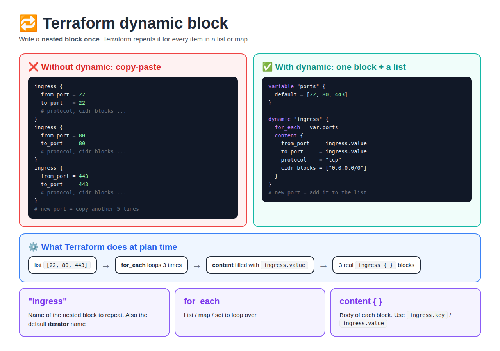
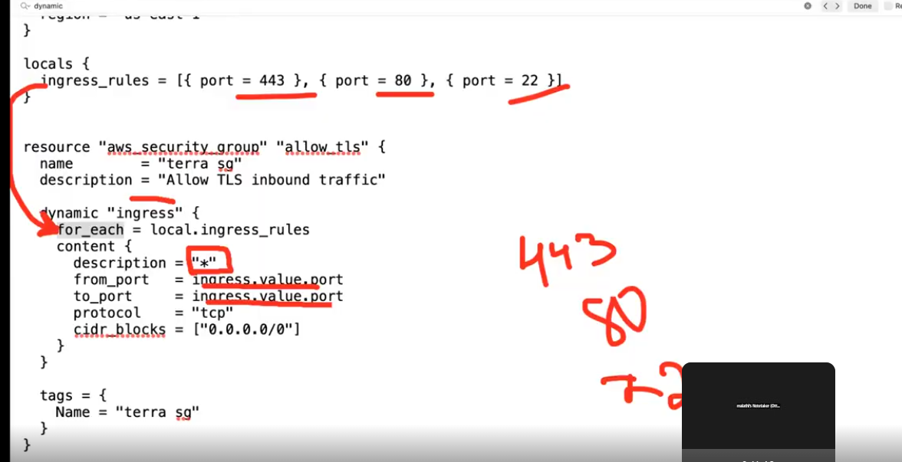

# Day 22 — Terraform Dynamic Blocks

[← All notes](../README.md)

> **In short:** some resources contain **repeated nested blocks** (like many `ingress` rules in a security group). A **dynamic block** lets you write that nested block **once** and loop over a list or map, so Terraform generates the copies for you. **Main purpose: reduce the length of the code.** Adding a rule means adding one item to a list.

## Table of Contents

1. [Quick Definitions](#1-quick-definitions)
2. [The Problem: Repeated Nested Blocks](#2-the-problem-repeated-nested-blocks)
3. [Syntax](#3-syntax)
4. [Example 1: Security Group Ports (list)](#4-example-1-security-group-ports-list)
5. [Example 2: Rules with Details (list of objects)](#5-example-2-rules-with-details-list-of-objects)
6. [Example 3: Map + Custom iterator](#6-example-3-map--custom-iterator)
7. [Example 4: Optional Block (on/off)](#7-example-4-optional-block-onoff)
8. [Nested Dynamic Blocks](#8-nested-dynamic-blocks)
9. [Dynamic Block vs count / for_each on a Resource](#9-dynamic-block-vs-count--for_each-on-a-resource)
10. [Where It's Used in Real Projects](#10-where-its-used-in-real-projects)
11. [Rules and Limits](#11-rules-and-limits)
12. [Interview Questions](#12-interview-questions)
13. [Interview One-Liners](#13-interview-one-liners)

---

## 1. Quick Definitions

**Nested block** = a block **inside** a resource, like `ingress { }` inside `aws_security_group` or `ebs_block_device { }` inside `aws_instance`. Not a separate resource.

**Dynamic block** = a special block that **generates** nested blocks by looping over a collection.

**for_each (inside dynamic)** = the **list, set or map** to loop over. One nested block is created per item.

**content { }** = the **body** of each generated block (what goes inside every copy).

**Iterator** = the temporary variable for the current item. By default its name is the **block's name** (e.g. `ingress`), and it has:
- `ingress.key` → the index (list) or key (map)
- `ingress.value` → the item itself

**Main purpose** = **reduce the length of the code**. Instead of writing the same nested block again and again, write it **once** and loop. This is the **DRY** idea (Don't Repeat Yourself).

| | Without dynamic | With dynamic |
|--|-----------------|--------------|
| 3 ports | 3 blocks, ~18 lines | 1 block + a list, ~10 lines |
| 10 ports | 10 blocks, ~60 lines | **Still** 1 block, just a longer list |
| Add a port | Copy-paste 6 more lines | Add **one item** to the list |

Bonus benefits: fewer copy-paste mistakes, and the rules can come from **variables** (different per environment).

## 2. The Problem: Repeated Nested Blocks



A security group allowing ports 22, 80 and 443 needs **three** `ingress` blocks:

```hcl
resource "aws_security_group" "web" {
  name = "web-sg"

  ingress {
    from_port   = 22
    to_port     = 22
    protocol    = "tcp"
    cidr_blocks = ["0.0.0.0/0"]
  }
  ingress {
    from_port   = 80
    to_port     = 80
    protocol    = "tcp"
    cidr_blocks = ["0.0.0.0/0"]
  }
  ingress {
    from_port   = 443
    to_port     = 443
    protocol    = "tcp"
    cidr_blocks = ["0.0.0.0/0"]
  }
}
```

| Problem | Why it hurts |
|---------|--------------|
| Copy-paste | 10 ports = 60 lines of almost the same code |
| Easy mistakes | Change `from_port` but forget `to_port` |
| Hard to reuse | Can't pass a different port list per environment (dev / prod) |

**Note:** `count` and `for_each` on a **resource** create many **resources**. They can't repeat a **nested block inside one** resource. That's what `dynamic` is for.

## 3. Syntax

```hcl
dynamic "<BLOCK_NAME>" {          # name of the nested block to generate (e.g. "ingress")
  for_each = <LIST_OR_MAP>        # what to loop over
  iterator = <NAME>               # optional: rename the loop variable (default = BLOCK_NAME)

  content {                       # body of each generated block
    argument = <BLOCK_NAME>.value # current item
  }
}
```

| Part | Required? | Meaning |
|------|-----------|---------|
| `"ingress"` (label) | ✅ | Which nested block to repeat. Must be a block the resource supports |
| `for_each` | ✅ | List, set or map. One block per item. Empty → **no blocks** |
| `content { }` | ✅ | What each block contains |
| `iterator` | ❌ | Custom name for the loop variable (e.g. `rule`) |
| `<name>.key` | — | List: index `0, 1, 2…` · Map: the key |
| `<name>.value` | — | The item (a number, string or object) |

## 4. Example 1: Security Group Ports (list)

```hcl
variable "ingress_ports" {
  type    = list(number)
  default = [22, 80, 443]
}

resource "aws_security_group" "web" {
  name = "web-sg"

  dynamic "ingress" {
    for_each = var.ingress_ports
    content {
      from_port   = ingress.value
      to_port     = ingress.value
      protocol    = "tcp"
      cidr_blocks = ["0.0.0.0/0"]
    }
  }

  egress {
    from_port   = 0
    to_port     = 0
    protocol    = "-1"
    cidr_blocks = ["0.0.0.0/0"]
  }
}
```

| Loop | `ingress.key` | `ingress.value` | Generated block |
|------|---------------|-----------------|-----------------|
| 1 | 0 | 22 | ingress 22 |
| 2 | 1 | 80 | ingress 80 |
| 3 | 2 | 443 | ingress 443 |

**Add port 8080?** Just change the list: `[22, 80, 443, 8080]`. `terraform plan` shows **one new rule**.

## 5. Example 2: Rules with Details (list of objects)

When each rule has a different port, CIDR and description, loop over **objects**:

```hcl
variable "ingress_rules" {
  type = list(object({
    port        = number
    cidr_blocks = list(string)
    description = string
  }))
  default = [
    { port = 22,   cidr_blocks = ["203.0.113.10/32"], description = "SSH from my IP" },
    { port = 80,   cidr_blocks = ["0.0.0.0/0"],       description = "HTTP" },
    { port = 8080, cidr_blocks = ["172.31.0.0/16"],   description = "App port from VPC" },
  ]
}

resource "aws_security_group" "app" {
  name = "app-sg"

  dynamic "ingress" {
    for_each = var.ingress_rules
    content {
      from_port   = ingress.value.port
      to_port     = ingress.value.port
      protocol    = "tcp"
      cidr_blocks = ingress.value.cidr_blocks
      description = ingress.value.description
    }
  }
}
```

`ingress.value` is now an **object**, so you read its fields: `ingress.value.port`, `ingress.value.cidr_blocks`.

**RoboShop link:** each app server's SG (8080 from the frontend, 27017 for MongoDB, 3306 for MySQL) can come from one `ingress_rules` variable per server instead of hand-written blocks.

### Class example: `locals` + list of objects



```hcl
locals {
  ingress_rules = [{ port = 443 }, { port = 80 }, { port = 22 }]
}

resource "aws_security_group" "allow_tls" {
  name        = "terra sg"
  description = "Allow TLS inbound traffic"

  dynamic "ingress" {
    for_each = local.ingress_rules
    content {
      description = "*"
      from_port   = ingress.value.port
      to_port     = ingress.value.port
      protocol    = "tcp"
      cidr_blocks = ["0.0.0.0/0"]
    }
  }

  tags = {
    Name = "terra sg"
  }
}
```

**How to read it:**

| Part | Meaning |
|------|---------|
| `locals { ingress_rules = [...] }` | **Local value** = a fixed value defined inside the code (not passed in like a variable). Here: a **list of 3 objects**, each with one field `port` |
| `dynamic "ingress"` | Repeat the `ingress { }` block |
| `for_each = local.ingress_rules` | Loop over the 3 objects → **3 ingress rules** |
| `ingress.value` | The current object, e.g. `{ port = 443 }` |
| `ingress.value.port` | The `port` field of that object → `443`, then `80`, then `22` |
| `description = "*"` | The same text for every rule (it doesn't change per loop) |

**What Terraform builds:**

| Loop | `ingress.value` | `from_port` / `to_port` | Rule |
|------|-----------------|-------------------------|------|
| 1 | `{ port = 443 }` | 443 | HTTPS from anywhere |
| 2 | `{ port = 80 }` | 80 | HTTP from anywhere |
| 3 | `{ port = 22 }` | 22 | SSH from anywhere |

**Why objects `{ port = 443 }` instead of a plain list `[443, 80, 22]`?** With objects you can add more fields later without changing the loop structure, e.g. `{ port = 22, cidr = "203.0.113.10/32" }` → `cidr_blocks = [ingress.value.cidr]`. With a plain list you'd use `ingress.value` directly (Example 1).

**Lab note:** port 22 open to `0.0.0.0/0` is fine for practice, but in real projects restrict SSH to your IP.

## 6. Example 3: Map + Custom iterator

**`iterator`** gives the loop variable a clearer name. Useful with maps, or when dynamic blocks are nested.

```hcl
variable "ports" {
  type = map(number)
  default = {
    ssh   = 22
    http  = 80
    https = 443
  }
}

resource "aws_security_group" "web" {
  name = "web-sg"

  dynamic "ingress" {
    for_each = var.ports
    iterator = rule                  # use "rule" instead of "ingress"
    content {
      description = rule.key         # "ssh", "http", "https"
      from_port   = rule.value       # 22, 80, 443
      to_port     = rule.value
      protocol    = "tcp"
      cidr_blocks = ["0.0.0.0/0"]
    }
  }
}
```

| Collection | `.key` | `.value` |
|------------|--------|----------|
| List `[22, 80]` | `0, 1` (index) | `22, 80` |
| Map `{ ssh = 22 }` | `"ssh"` | `22` |

## 7. Example 4: Optional Block (on/off)

**Purpose:** add a nested block **only if** a condition is true. Loop over a list with **one item** (on) or **zero items** (off).

```hcl
variable "allow_ssh" {
  type    = bool
  default = false               # true in dev, false in prod
}

resource "aws_security_group" "web" {
  name = "web-sg"

  dynamic "ingress" {
    for_each = var.allow_ssh ? [1] : []      # [1] = create once, [] = create none
    content {
      from_port   = 22
      to_port     = 22
      protocol    = "tcp"
      cidr_blocks = ["203.0.113.10/32"]
    }
  }
}
```

| `allow_ssh` | `for_each` | Result |
|-------------|------------|--------|
| `true` | `[1]` | 1 SSH rule |
| `false` | `[]` | No SSH rule |

Same trick for optional blocks like an extra `ebs_block_device` on an EC2 instance only in prod.

## 8. Nested Dynamic Blocks

A dynamic block can sit **inside another** dynamic block's `content`. Use `iterator` names so it's clear which loop is which.

```hcl
# Example shape: each "setting" group has several "option" blocks
dynamic "setting" {
  for_each = var.settings
  iterator = s
  content {
    name = s.value.name

    dynamic "option" {
      for_each = s.value.options
      iterator = o
      content {
        key   = o.key
        value = o.value
      }
    }
  }
}
```

**Keep it rare:** two levels is already hard to read. If you need more, rethink the design.

## 9. Dynamic Block vs count / for_each on a Resource

| | `count` / `for_each` on a **resource** | `dynamic` block |
|--|---------------------------------------|-----------------|
| Repeats | **Whole resources** | **Nested blocks inside one resource** |
| Example | 5 EC2 instances | 5 ingress rules in 1 security group |
| Written where | Top of the `resource` block | Inside the `resource` block |
| Result in state | 5 separate resources (`aws_instance.web[0..4]`) | 1 resource with 5 blocks |

```
for_each on resource:  aws_instance.web["frontend"], aws_instance.web["cart"] ...  (many resources)
dynamic block:         aws_security_group.web { ingress, ingress, ingress }        (one resource)
```

## 10. Where It's Used in Real Projects

| Resource | Nested block repeated | Why dynamic |
|----------|----------------------|-------------|
| `aws_security_group` | `ingress` / `egress` | Port lists differ per app or environment |
| `data "aws_iam_policy_document"` | `statement` | Build IAM policy statements from a variable |
| `aws_autoscaling_group` | `tag` | Add many tags (`propagate_at_launch`) from a map |
| `aws_instance` / launch template | `ebs_block_device`, `block_device_mappings` | Variable number of extra disks |
| `aws_route_table` | `route` | Routes from a list |
| Reusable **modules** | Any nested block | Module users pass a list instead of editing module code |

**Modern note:** the AWS provider now recommends **separate rule resources** (`aws_vpc_security_group_ingress_rule` with `for_each`) instead of inline `ingress` blocks for new code. Inline `ingress` + `dynamic` is still very common in existing projects and interviews.

## 11. Rules and Limits

| Rule | Meaning |
|------|---------|
| Only for **nested blocks** | Can't make plain arguments (`instance_type = ...`) dynamic. Use variables/expressions for those |
| ❌ Not for meta-argument blocks | `lifecycle`, `provisioner`, `connection` **can't** be dynamic |
| Must be a block the resource supports | `dynamic "ingress"` works on `aws_security_group`, `dynamic "foo"` doesn't |
| `for_each` value must be known at plan time | Values from resources not yet created can cause "value depends on resource attributes that cannot be determined" errors |
| Empty collection = no blocks | `for_each = []` generates nothing (used for on/off) |
| Don't overuse | HashiCorp: use dynamic blocks **only when needed**, mainly in reusable modules. Too many make code hard to read. A few fixed blocks are clearer written normally |

**When to use:**
- ✅ The number of blocks **changes** (per environment, per app, from a variable).
- ✅ Inside a **reusable module** whose users pass their own list.
- ❌ 2–3 blocks that never change → just write them normally.

## 12. Interview Questions

### ⭐ Very Important (asked in class)

**1. How do you reduce the length of Terraform code?**

Dynamic blocks are **one** answer. A strong answer lists the main ways, each for a different kind of repetition:

| Repetition | Tool | Example |
|------------|------|---------|
| Same **nested block** many times | **Dynamic block** | 10 `ingress` rules → 1 `dynamic "ingress"` |
| Same **resource** many times | **`count` / `for_each`** | 10 EC2 servers → 1 `aws_instance` with `for_each` |
| Same **group of resources** in many places / environments | **Modules** | One `vpc` module used for dev, qa, prod |
| Same **value / expression** repeated | **`locals`** | `local.common_tags`, `local.name_prefix` |
| Hard-coded values per environment | **Variables + `.tfvars`** | `dev.tfvars`, `prod.tfvars` with the same code |
| Same tags on every resource | **`default_tags`** in the provider block | Tags written once, applied to all AWS resources |
| Building lists / maps by hand | **`for` expressions** | `[for s in var.servers : "${s}.example.com"]` |
| Hard-coded IDs (AMI, VPC) | **Data sources** | `data "aws_ami"` instead of pasting AMI IDs |

**Model answer:**
> "I use `count` or `for_each` to create many similar resources from one block, and dynamic blocks for repeated nested blocks like security group rules. Common values go in `locals`, environment differences go in variables and `.tfvars` files, and tags go in the provider's `default_tags`. For larger setups I package resources into reusable modules, so each environment is just a few lines calling the module."

### Other Questions

**1. What is a dynamic block in Terraform?**
A block that **generates repeated nested blocks** inside a resource by looping over a list or map with `for_each`. The body comes from `content { }`.

**2. Why use it?**
To avoid **copy-pasting** nested blocks (like many `ingress` rules). The data comes from variables, so adding a rule means adding a list item, and modules become reusable.

**3. Difference between `for_each` on a resource and a dynamic block?**
`for_each` on a resource creates **many resources**. A dynamic block creates **many nested blocks inside one resource**.

**4. What are `.key` and `.value`?**
The iterator's fields. For a list: index and item. For a map: key and value. The iterator name defaults to the block name, or whatever `iterator =` sets.

**5. How do you add a nested block only sometimes?**
`for_each = var.enabled ? [1] : []`, which creates one block or none.

**6. Can you make `lifecycle` dynamic?**
No. Meta-argument blocks (`lifecycle`, `provisioner`, `connection`) can't be generated dynamically.

**7. Any downside?**
Readability. Too many or deeply nested dynamic blocks make code hard to follow. Use them when the number of blocks really varies.

## 13. Interview One-Liners

- "A dynamic block generates repeated **nested blocks** from a list or map. Main purpose: **shorter code**, no copy-paste."
- "`for_each` on a resource repeats **resources**; `dynamic` repeats **blocks inside a resource**."
- "Inside `content`, use `<name>.key` and `<name>.value`; `iterator` renames the loop variable."
- "`for_each = cond ? [1] : []` makes a nested block optional."
- "Meta-argument blocks like `lifecycle` and `provisioner` can't be dynamic."
- "Use dynamic blocks when the count varies or in reusable modules; otherwise write blocks normally."
- "To reduce Terraform code: `for_each`/`count` for resources, dynamic blocks for nested blocks, modules for groups, `locals` and variables for values."
