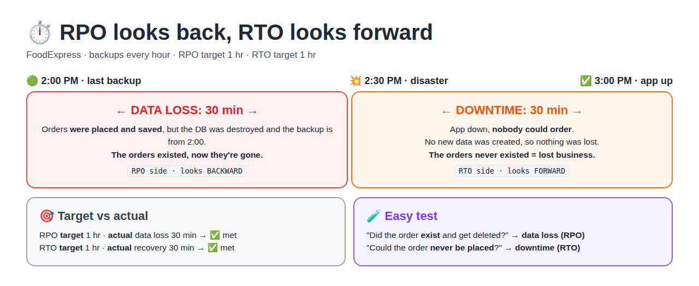
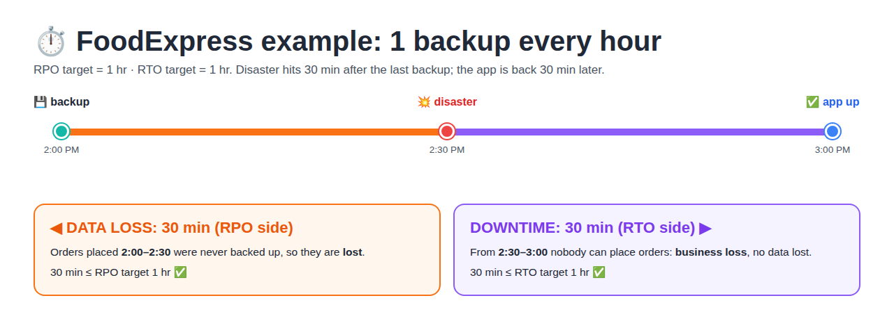
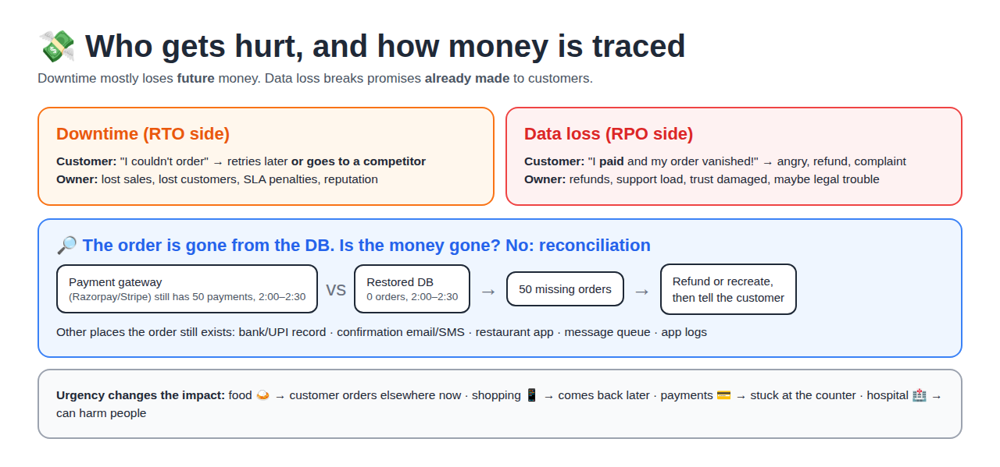
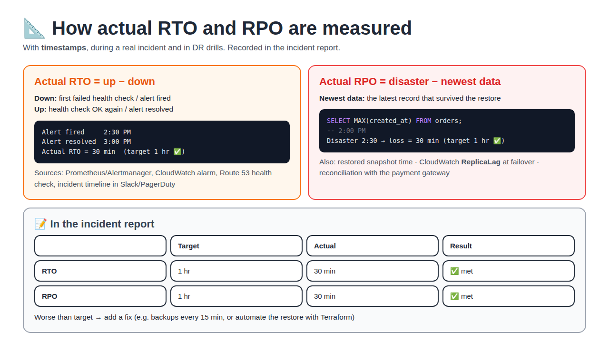
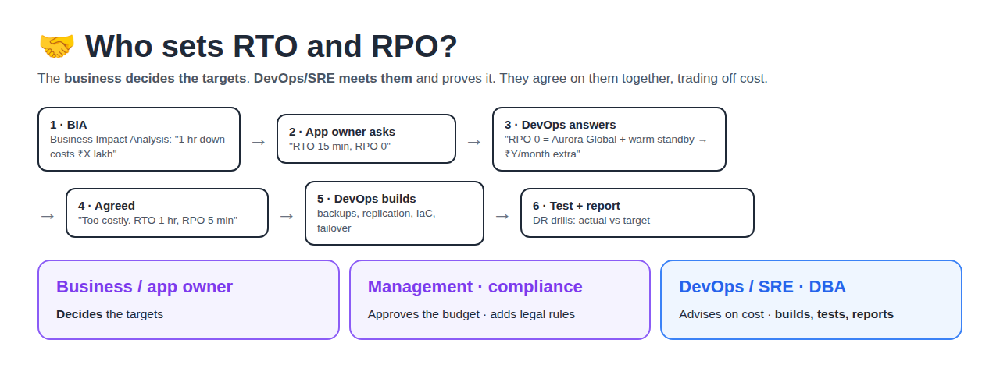

# RTO and RPO Explained (Deep Dive)

[← Disaster Recovery notes](../README.md)

> **In short:** **RPO** = how much **data** you might lose (looks **backward** from the disaster). **RTO** = how long the app stays **down** (looks **forward** from the disaster). Data loss hurts customers who already paid. Downtime loses future business. The **business sets** the targets, and **DevOps meets** them and proves it.

## Table of Contents

1. [Definitions](#1-definitions)
2. [The Timeline: Data Loss vs Downtime](#2-the-timeline-data-loss-vs-downtime)
3. [Target vs Actual: Examples](#3-target-vs-actual-examples)
4. [Who Gets Hurt?](#4-who-gets-hurt)
5. ["I Paid in the Lost 30 Minutes. Do I Get My Food?"](#5-i-paid-in-the-lost-30-minutes-do-i-get-my-food)
6. [Real-World RPO Values](#6-real-world-rpo-values)
7. [How Actual RTO and RPO Are Measured](#7-how-actual-rto-and-rpo-are-measured)
8. [Who Sets RTO and RPO?](#8-who-sets-rto-and-rpo)
9. [Common Confusions](#9-common-confusions)
10. [Interview Answers and One-Liners](#10-interview-answers-and-one-liners)

---

## 1. Definitions

**RPO (Recovery Point Objective)** = the **maximum data loss** the business accepts, measured in time. "We can lose at most 1 hour of data."

**RTO (Recovery Time Objective)** = the **maximum downtime** the business accepts. "The app must be back within 1 hour."

**Data loss** = data that **existed** (was saved) but is **gone** after recovery, because it was never backed up or replicated.

**Downtime** = the time the app is **down**. Users can't do anything, so **no new data is created**, and that time causes **business loss**, not data loss.

**Target vs actual:** RPO and RTO are **limits agreed before** a disaster. After a disaster you **measure the actual** data loss and recovery time and check that they're within the limits.

| | Question | You lose | Direction |
|--|----------|----------|-----------|
| **RPO** | How much **data** might I lose? | Data (existed, now gone) | **Backward**: disaster → last good copy |
| **RTO** | How long until the app is **back**? | Business (sales that never happened) | **Forward**: disaster → app up |

## 2. The Timeline: Data Loss vs Downtime



**Example:** FoodExpress takes a backup **every hour**. RPO target = 1 hr, RTO target = 1 hr.



| Period | What happened | Type |
|--------|---------------|------|
| **2:00 → 2:30** | Customers placed orders and the app **saved** them. Then the DB was destroyed, and the backup is from 2:00. Those orders **existed and are gone**. | **Data loss** (RPO) |
| **2:30 → 3:00** | App down, **nobody could order**. Those orders **never existed**. | **Business loss** (RTO) |

**Key point:** data loss happens **only between the last good copy and the disaster**. After the disaster nothing is written, so that period is downtime.

**Easy test:**
- "Did the order **exist** and get deleted?" → **data loss (RPO)**
- "Could the order **never be placed**?" → **downtime (RTO)**

## 3. Target vs Actual: Examples

Same setup: hourly backups, **RPO target = 1 hr**.

| Last good backup | Disaster | Actual data lost | RPO 1 hr? |
|------------------|----------|------------------|-----------|
| 2:00 PM | 2:30 PM | 30 min | ✅ Met |
| 2:00 PM | 2:59 PM | 59 min (worst case) | ✅ Met, just barely |
| 3:00 PM backup **failed** → last good one is 2:00 PM | 3:30 PM | 1 hr 30 min | ❌ Missed |

**Lessons:**
- **The gap between copies = the most data you can lose.** With hourly backups you can't promise a 5-minute RPO.
- **Monitor backup success.** One failed backup and the RPO is broken.

**RPO decides how often you copy data:**

| RPO target | What you need |
|------------|---------------|
| 24 hr | Daily backup |
| 1 hr | Hourly backup |
| 5 min | Backups every 5 min, or continuous replication |
| ~0 | Live replication (e.g. Aurora Global, about 1 s lag) |

## 4. Who Gets Hurt?



**Downtime (RTO side):**
- **Business owner:** lost sales, customers who go to a competitor and don't come back, SLA penalties, reputation.
- **Customer:** can't use the service **when they need it**. Some retry later, many don't.

**How much it hurts depends on how urgent the app is:**

| App | During downtime the customer... | Impact |
|-----|--------------------------------|--------|
| Food delivery 🍛 | orders from Swiggy or Zomato instead | Order lost forever |
| Shopping 📱 | comes back later | Mostly a delay |
| Payments / banking 💳 | is stuck at the shop counter | Directly hurt |
| Hospital / emergency 🏥 | can't get help | Can harm people |

The more urgent the app, the **shorter the RTO** it needs.

**Data loss (RPO side):**
- **Customer:** "I **paid** and my order vanished!" → angry, asks for a refund, complains.
- **Owner:** refunds, support load, lost trust, maybe legal trouble.

**That's why data loss is often treated as worse than downtime.** Downtime loses **future** money. Data loss breaks promises **already made** to customers.

## 5. "I Paid in the Lost 30 Minutes. Do I Get My Food?"

**In a simple app with one database:** your order record is gone. **But your payment isn't untraceable**, because it is recorded in other places too:

| Place | What it still has |
|-------|-------------------|
| **Payment gateway** (Razorpay, Stripe, PayPal) | Payment ID, amount, time, your email/phone. It's a separate company, untouched by the disaster |
| Bank / UPI app | The debit record |
| Confirmation email / SMS | Order ID |
| Restaurant app | The order may already have been sent there |
| Message queue | e.g. RoboShop payment → RabbitMQ → dispatch |
| App logs | "order 1234 created by user X" |

**Reconciliation** = comparing two sets of records to find what's missing.

```
Payment gateway:  50 payments, 2:00–2:30
Restored DB:       0 orders,   2:00–2:30
→ 50 missing orders → refund or recreate each one → tell the customer
```

**As a customer:** money debited, then no food, or a cancellation followed by a refund. Annoying, but **your money isn't lost**.

**Real design:** companies give **different data different RPOs**:

| Data | RPO | How |
|------|-----|-----|
| Orders, payments | **Near zero** | Live replication (Multi-AZ, Aurora Global) |
| Product catalogue | Hours | Daily backup (products can be re-added) |
| Logs, analytics | 1 day | Daily backup |

So "hourly backups only" is fine **for learning**, but too risky for real order data.

## 6. Real-World RPO Values

**There's no single RPO.** The business sets it **for each app**, based on how bad losing that data would be.

| Tier | Example apps | Typical RPO | How |
|------|-------------|-------------|-----|
| **Tier 0**: mission critical | Payments, banking, orders, trading | **~0 to seconds** | Synchronous / near-real-time replication |
| **Tier 1**: business critical | E-commerce, accounts, bookings | **≤ 5–15 min** | Async replication, point-in-time recovery |
| **Tier 2**: important | Internal apps, CRM, HR | **1–4 hr** | Frequent snapshots |
| **Tier 3**: non-critical | Reports, analytics, dev/test, logs | **24 hr** | Daily backup |

**What AWS services give you:**

| Service | RPO |
|---------|-----|
| RDS Multi-AZ | ~0 for an **AZ** failure (synchronous copy) |
| RDS automated backups (point-in-time restore) | About **5 min** (transaction logs uploaded every 5 min) |
| Aurora Global Database | Usually **< 1 s** to another region |
| DynamoDB Global Tables | About a second or less |
| S3 Cross-Region Replication | Seconds to minutes. With Replication Time Control, 99.99% within **15 min** |
| EBS / RDS snapshots | = snapshot frequency (hourly → up to 1 hr) |
| AWS Backup daily plan | Up to 24 hr |

**Lower RPO = more cost.** Near-zero RPO needs replication running 24/7, so pay for it only where losing data really hurts.

## 7. How Actual RTO and RPO Are Measured



**Definition:** they're measured with **timestamps**, both in real incidents and in **DR drills** (practice failovers).

### Actual RTO

```
Actual RTO = time the app was back up − time it went down
```

| Timestamp | Comes from |
|-----------|-----------|
| Went down | First failed health check / alert fired (Prometheus, Alertmanager, CloudWatch alarm, Route 53 health check) |
| Back up | Health check passing again / alert resolved |

```
Alert fired     2:30 PM
Alert resolved  3:00 PM
Actual RTO = 30 min   (target 1 hr ✅)
```

The **incident timeline** (in Slack or PagerDuty) records each step's time, e.g. "2:35 restore started" and "2:52 DB restored". It shows which step was slow.

### Actual RPO (data loss)

```
Actual data loss = disaster time − time of the newest record in the restored DB
```

```sql
SELECT MAX(created_at) FROM orders;   -- 2:00 PM
-- Disaster 2:30 → 30 min lost (target 1 hr ✅)
```

| Setup | How to find the loss |
|-------|---------------------|
| Backups / snapshots | Time of the snapshot you restored (shown in AWS Backup / RDS) |
| Replication | **Replica lag** at failover (CloudWatch `ReplicaLag`, e.g. 3 s → about 3 s lost) |
| Business check | **Reconciliation**: payments with no matching order |

### Recorded in the incident report

| | Target | Actual | Result |
|--|--------|--------|--------|
| RTO | 1 hr | 30 min | ✅ |
| RPO | 1 hr | 30 min | ✅ |

**Worse than target?** The report includes a fix, e.g. "backups every 15 min instead of hourly" or "automate the restore with Terraform to save 20 minutes". (See sections 11 and 12 of the [SRE incident report](../../day-21-sre/day-21-sre-incidents/README.md#10-incident-report).)

**Practice idea (RoboShop):** take a MySQL dump → insert rows → "destroy" the DB → restore → measure both numbers with `date` and `SELECT MAX(...)`.

## 8. Who Sets RTO and RPO?



**The business decides the targets. DevOps/SRE meets them and proves it.** They agree on them together, trading cost against risk.

| Role | Responsibility |
|------|----------------|
| **Business / app owner** | **Decides** RTO and RPO: "how much downtime and data loss can we afford?" |
| **Management / finance** | Approves the **budget** (lower RTO/RPO = more cost) |
| **Compliance / risk team** | Adds legal or regulatory limits (e.g. banking) |
| **DevOps / SRE / cloud engineer** | Explains what's **possible and what it costs**, **designs and builds** it, **tests** it in drills, **reports** actual vs target |
| **DBA / app team** | DB backups and replication, app restart steps |

**BIA (Business Impact Analysis)** = a study of **how much each app's downtime and data loss would cost**. The targets are set from it.

```
BIA: "1 hr down costs ₹X lakh"
  → App owner: "RTO 15 min, RPO 0"
  → DevOps: "RPO 0 = Aurora Global + warm standby → ₹Y/month extra"
  → Business: "Too costly. RTO 1 hr, RPO 5 min" → agreed
  → DevOps builds it → tests it in DR drills → reports actual vs target
```

**In short:** the owner decides **what** the targets are, and the DevOps engineer is responsible for **meeting** them.

## 9. Common Confusions

| Wrong idea | Correct |
|------------|---------|
| "RPO = the time from disaster until recovery" | No, that's **RTO**. RPO is from the **last good copy back to the disaster** |
| "Data is lost while the app is down" | No, nothing is written while it's down. That's **business loss** |
| "RPO 1 hr means we always lose 1 hr" | No, it's the **maximum**. Actual loss can be 0–59 min |
| "RPO = what we already lost" | RPO is the **allowed limit** (set before). What you lost = **actual data loss** (measured after) |
| "Lost order = lost money forever" | The **payment gateway** still has it → reconciliation → refund |
| "Multi-AZ gives region-level RPO 0" | Multi-AZ covers an **AZ** failure. A region needs cross-region replication |
| "DevOps decides RTO/RPO" | **Business** decides, DevOps advises, builds and proves it |
| "MTTR = RTO" | MTTR = what **actually** happened (average). RTO = what's **required** |

## 10. Interview Answers and One-Liners

**Q: Explain RPO and RTO with an example.**
> "Backups run hourly. The last one was at 2:00 PM, the disaster hit at 2:30, and the app was back at 3:00. Orders from 2:00 to 2:30 are lost: that's data loss, measured against the RPO. From 2:30 to 3:00 the app was down: that's downtime, measured against the RTO. With a 1-hour target for both, we met both."

**Q: What is a typical RPO?**
> "There's no fixed number. The business sets it per application. Payments and orders need near-zero, using replication like RDS Multi-AZ or Aurora Global Database. Reporting can accept 24 hours with daily backups. Lower RPO costs more, so we tier the apps."

**Q: How do you know you met them?**
> "With timestamps. Actual RTO is from the first failed health check to the alert resolving. Actual data loss is from the disaster time back to the newest record in the restored database, or the replica lag at failover. We record both in the incident report and test them in DR drills."

**Q: Who decides RTO and RPO?**
> "The business, based on a business impact analysis and budget. As a DevOps engineer, I advise on what's possible and what it costs, then build the backups, replication and failover to meet the targets and prove it with DR drills."

**One-liners:**
- "RPO looks back to the last good copy; RTO looks forward to recovery."
- "RPO is data loss; RTO is business loss."
- "The gap between copies is the most data you can lose."
- "A failed backup silently breaks your RPO, so monitor backups."
- "Downtime loses future money; data loss breaks promises already made."
- "The business sets the targets; DevOps meets them and proves it."
