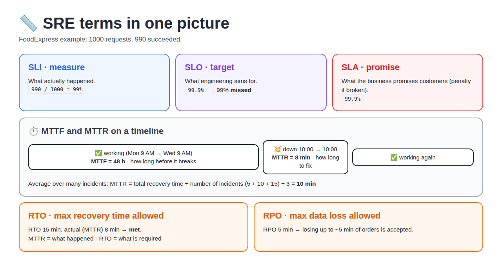
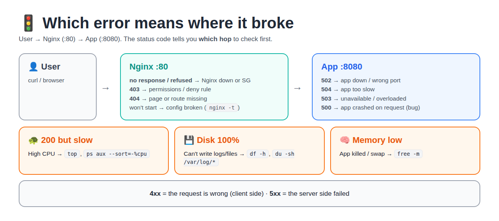
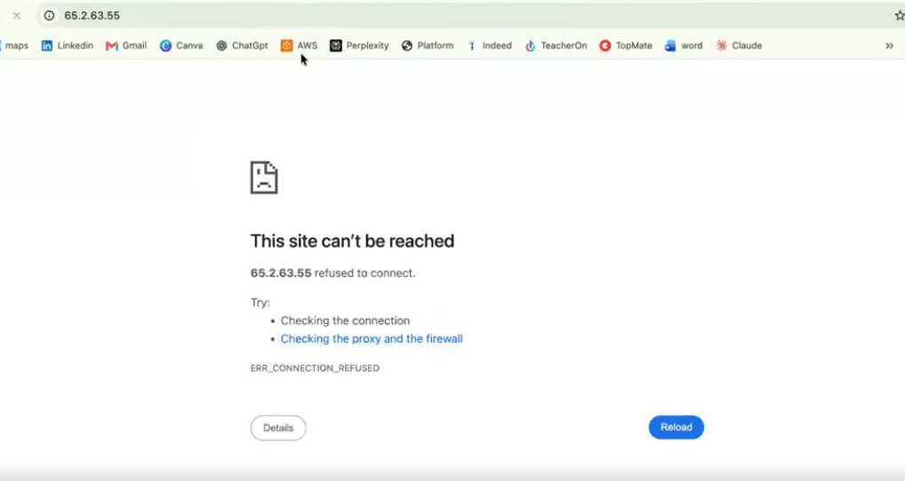
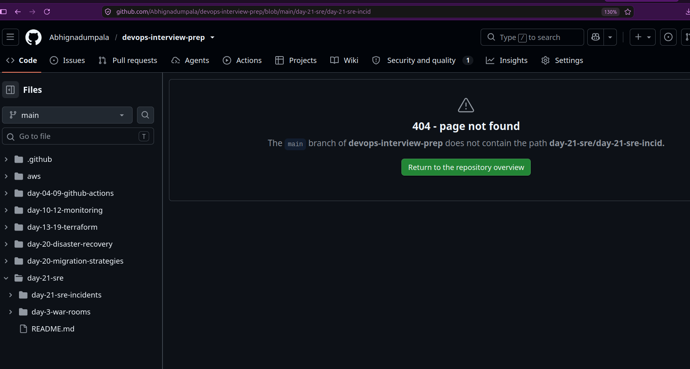
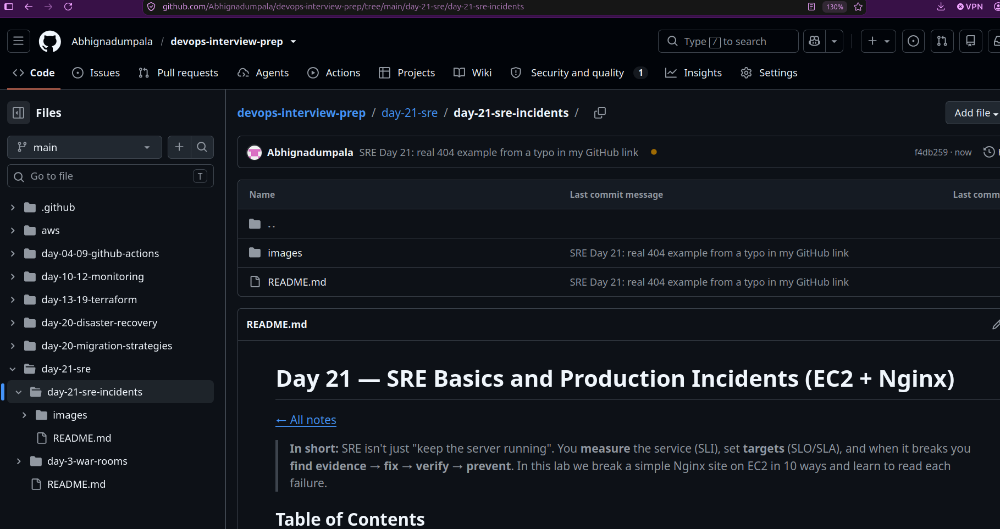
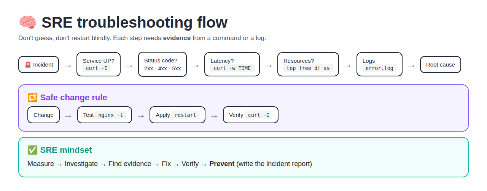

# Day 21 — SRE Basics and Production Incidents (EC2 + Nginx)

[← All notes](../README.md)

> **In short:** SRE isn't just "keep the server running". You **measure** the service (SLI), set **targets** (SLO/SLA), and when it breaks you **find evidence → fix → verify → prevent**. In this lab we break a simple Nginx site on EC2 in 10 ways and learn to read each failure.

## Table of Contents

1. [What is SRE?](#1-what-is-sre)
2. [Lab Setup](#2-lab-setup)
3. [SLI, SLO, SLA](#3-sli-slo-sla)
4. [MTTF and MTTR](#4-mttf-and-mttr)
5. [RTO and RPO](#5-rto-and-rpo)
6. [HTTP Status Codes](#6-http-status-codes)
7. [The 10 Incidents](#7-the-10-incidents)
8. [Measuring Availability and Latency](#8-measuring-availability-and-latency)
9. [SRE Troubleshooting Flow](#9-sre-troubleshooting-flow)
10. [Incident Report (Postmortem)](#10-incident-report-postmortem)
11. [Commands Cheat Sheet](#11-commands-cheat-sheet)
12. [Final Challenge: "Sometimes Working, Sometimes Failing"](#12-final-challenge-sometimes-working-sometimes-failing)
13. [Interview Questions and One-Liners](#13-interview-questions-and-one-liners)
14. [Next Level](#14-next-level)

---

## 1. What is SRE?

**Definition:** **SRE (Site Reliability Engineering)** = using engineering (measuring, automation, root-cause fixing) to keep a service **reliable**.

An SRE must be able to answer these questions:

| Question | Measured by |
|----------|-------------|
| Is the app available? | Availability SLI |
| Is it fast? | Latency SLI |
| Is it working correctly? | Error rate, status codes |
| How quickly do we recover? | MTTR, RTO |
| How much data can we lose? | RPO |
| How do we stop it happening again? | Incident report, prevention |

## 2. Lab Setup

**Definition:** a **production-like service** = a real server, a web server and an app, with logs. Small, but it fails the same way real systems do.

```
USER ──HTTP :80──► EC2 [ NGINX ──► APP ] ──► LOGS (/var/log/nginx/)
```

| Item | Value |
|------|-------|
| EC2 | Ubuntu, t2.micro / t3.micro, 8 GB+ disk |
| Security Group | 22 from **my IP** only, 80 from `0.0.0.0/0`. No other ports |

```bash
ssh -i devops.pem ubuntu@<EC2-PUBLIC-IP>
sudo apt update && sudo apt install nginx -y
sudo systemctl enable --now nginx
sudo systemctl status nginx          # Active: active (running)
curl http://localhost                # HTML page
```

**App page:** remove the default page, then create `/var/www/html/index.html`:

```bash
sudo rm -f /var/www/html/index.nginx-debian.html
sudo vi /var/www/html/index.html
```

```html
<html><head><title>FoodExpress</title></head>
<body>
  <h1>🍛 Welcome to FoodExpress</h1>
  <h2>Application Status: ONLINE</h2>
  <p>Welcome to our food ordering application.</p>
</body></html>
```

```bash
curl -i http://localhost             # HTTP/1.1 200 OK
```

Also open `http://<EC2-PUBLIC-IP>` from the laptop browser.

## 3. SLI, SLO, SLA



**SLI (Service Level Indicator)** = **what we measure**. A real number. Examples: availability, latency, error rate, request count.

```
Availability SLI = successful requests / total requests × 100
                 = 990 / 1000 × 100 = 99%
```

**SLO (Service Level Objective)** = **what we aim for**, an internal engineering target. Example: availability SLO = 99.9%. SLI 99% < SLO 99.9% → **SLO missed**.

**SLA (Service Level Agreement)** = **what the business promises the customer**, usually with a penalty (refund or credits) if broken. The SLA is set looser than the SLO, so the team gets warned before the promise is broken.

| Term | Means | Who cares | Example |
|------|-------|-----------|---------|
| SLI | Measurement | Engineers | 99% |
| SLO | Engineering target | Engineering team | 99.9% |
| SLA | Business commitment | Customers, legal | 99.5% promised |

**Remember:** SLI = what happened · SLO = what we wanted · SLA = what we promised.

### Should SLI equal SLO?

**No.** The SLI does not have to equal the SLO. It must **meet or beat** it.

- **SLI** = the **actual** result we measured
- **SLO** = the **target** (the pass mark)
- **SLA** = the **promise** to the customer (looser than the SLO, with a penalty if broken)

**Analogy:** an exam. The pass mark is 35 (SLO), you scored 80 (SLI). You don't need exactly 35, just **at least 35**. The SLA is like the college rule "below 30 = fail the year": stricter consequences, lower bar.

**For availability, the SLI should be ≥ the SLO ≥ the SLA:**

| SLI (measured) | SLO (target) | SLA (promise) | Result |
|---|---|---|---|
| 99.95% | 99.9% | 99.5% | ✅ SLO met (better than target), SLA safe |
| 99.9% | 99.9% | 99.5% | ✅ SLO just met (on the edge), SLA safe |
| 99.7% | 99.9% | 99.5% | ⚠️ SLO missed, SLA still safe → team is warned, fix now |
| 99% | 99.9% | 99.5% | ❌ SLO missed **and SLA broken** → customer gets refund/credits |

**For "bad" metrics the direction flips. The SLI should be ≤ the SLO ≤ the SLA:**

| Metric | SLO (target) | SLA (promise) | Good SLI |
|---|---|---|---|
| Latency | p95 < 300 ms | p95 < 500 ms | 250 ms ✅ (lower is better) |
| Error rate | < 0.1% | < 0.5% | 0.05% ✅ |

**Why the SLA is looser than the SLO:** the gap between them is a **safety buffer**. When the SLO is missed, the team gets warned and fixes the problem **before** the SLA (and the penalty) is broken.

**Error budget:** an SLO of 99.9% allows 0.1% failures. That 0.1% is the **error budget**.
- Budget left → safe to ship new features
- Budget almost used → slow down releases, fix reliability first

> **One line:** SLI is reality, SLO is the goal, SLA is the promise. Keep **SLI ≥ SLO ≥ SLA** (for availability).

## 4. MTTF and MTTR

**MTTF (Mean Time To Failure)** = the average time the system **works before it breaks**.

👉 **In simple words:** how long the **application keeps running fine** before it fails. Higher = better (it fails less often).

**Not just the first time:** MTTF is the **average of every working period**: from "app up" to "app fails", counted again after every fix and restart. Repair time is **not** counted (that goes into MTTR).

```
Start ✅ ── 30 h ── 💥 fix ✅ ── 50 h ── 💥 fix ✅ ── 40 h ── 💥
MTTF = (30 + 50 + 40) ÷ 3 = 40 h      (only the first 30 h = "time to first failure")
```

> **Note:** for systems that get repaired and restarted (like apps), the exact term is **MTBF** (Mean Time Between Failures). In classes and interviews MTTF is often used for the same idea.

```
Started Mon 9 AM → failed Wed 9 AM  → MTTF = 48 h
Failures after 20 h, 30 h, 40 h     → MTTF = 90 / 3 = 30 h
```

**MTTR (Mean Time To Recovery)** = the average time **to fix** it after it breaks.

👉 **In simple words:** how long it takes us, on average, to **recover the application** and bring it back to normal after a failure.

```
Down 10:00 → back 10:08             → MTTR = 8 min
Incidents 5 + 10 + 15 min           → MTTR = 30 / 3 = 10 min
MTTR = total recovery time / number of incidents
```

| | Question | Better when |
|--|----------|-------------|
| MTTF | How long before it **breaks**? | **Higher** |
| MTTR | How long to **fix** it? | **Lower** |

## 5. RTO and RPO

**RTO (Recovery Time Objective)** = the **maximum time** the business allows to restore the service. Example: RTO 15 min, actual recovery 8 min → **met**.

**RPO (Recovery Point Objective)** = the **maximum data loss** the business accepts. Example: RPO 5 min → losing about the last 5 minutes of data is acceptable.

| Pair | Difference |
|------|------------|
| MTTR vs RTO | MTTR = what **actually** happened · RTO = what is **required** |
| RTO vs RPO | RTO = how **fast** we recover · RPO = how much **data** we lose |

### Is MTTR / MTTF the same as RTO / RPO?

**No.** RTO/RPO are **targets** set **before** a disaster. MTTR/MTTF are **averages measured** after many failures.

| Term | Full form | Type | Question it answers |
|---|---|---|---|
| **RTO** | Recovery Time Objective | 🎯 Target | **Max time** we can be down? |
| **RPO** | Recovery Point Objective | 🎯 Target | **Max data** we can lose? |
| **MTTR** | Mean Time To Recover / Repair | 📏 Measured average | How long do we **usually** take to fix? |
| **MTTF** | Mean Time To Failure | 📏 Measured average | How long does it **usually** run before breaking? |

**How they connect:**
- **MTTR vs RTO:** both are about **downtime**. RTO = the limit, MTTR = your real average → **MTTR should be below RTO**. Example: RTO 1 hr, MTTR 27 min ✅. MTTR 2 hrs → you usually miss the RTO ❌.
- **RPO** is about **data loss**; no MT-something matches it.
- **MTTF** is about **how often** things break (higher is better); RTO/RPO don't measure this.

**Example:** a server failed 3 times this month; fixes took 20, 30 and 40 min, and it ran about 10 days between failures.
- MTTR = (20 + 30 + 40) ÷ 3 = **30 min** → compare with RTO 1 hr ✅
- MTTF ≈ **10 days**

> **One line:** RTO/RPO = the **rule** for one disaster (how long down, how much data lost). MTTR/MTTF = the **report card** over many failures (how fast we fix, how often it breaks). Goal: **MTTR < RTO**, MTTF as high as possible.

Deeper DR notes: [Disaster Recovery](../../day-20-disaster-recovery/README.md).

### 📌 Quick SRE Cheat Sheet

| Term | Simple meaning |
|---|---|
| **SLI** | What we measure |
| **SLO** | What we target |
| **SLA** | What we promise |
| **MTTR** | How quickly we recover |
| **MTTF** | How long before failure |
| **RTO** | Maximum recovery time |
| **RPO** | Maximum acceptable data loss |

## 6. HTTP Status Codes

**Definition:** a **status code** = a 3-digit number in every HTTP response that says what happened. The **first digit** tells you the type.

| Range | Meaning | Whose problem |
|-------|---------|---------------|
| 2xx | Success | — |
| 3xx | Redirect / cache | — |
| 4xx | Bad request | Client side (wrong URL, no permission) |
| 5xx | Server failed | Server side (Nginx or the app) |

| Code | Name | Think about |
|------|------|-------------|
| 200 | OK | Success (but check latency!) |
| 201 | Created | A resource was created |
| 301 / 302 | Moved / Found | Permanent / temporary redirect |
| 304 | Not Modified | Served from cache |
| 400 | Bad Request | Invalid request |
| 401 | Unauthorized | Not logged in (authentication) |
| 403 | Forbidden | Logged in or not, **access denied** (permission) |
| 404 | Not Found | Page or route missing |
| 408 | Request Timeout | Client was too slow to send |
| 429 | Too Many Requests | Rate limiting |
| 500 | Internal Server Error | App crashed while processing |
| 502 | Bad Gateway | Proxy OK, **upstream app down / wrong port** |
| 503 | Service Unavailable | Overloaded / maintenance / no backend |
| 504 | Gateway Timeout | Upstream app **too slow** |



**Upstream** = the server Nginx forwards the request to (the app on :8080). **Gateway / reverse proxy** = Nginx itself.

### WAF, Rate Limiting and Geo-Blocking (where 403 / 429 come from)

**WAF (Web Application Firewall):** a firewall for web traffic. It sits **in front of the app**, checks every HTTP request, and **blocks bad ones before they reach the servers**.

```
User → WAF (checks each request) → ALB / CloudFront / API Gateway → App
          ❌ bad / too many / blocked country → 403 (never reaches the app)
```

| | Security Group | WAF |
|---|---|---|
| Looks at | IP + port (network level) | The **HTTP request**: URL, headers, body, rate, country |
| Example rule | "Allow 443 from anywhere" | "Block SQL injection", "block an IP sending too many requests", "block UK" |

**What a WAF blocks:** too many requests (bots, brute-force, small DDoS) · SQL injection (`' OR 1=1 --`) and XSS (`<script>`) · bad IPs, countries, bots · known attacks via AWS **managed rules**.

#### Rate limiting (rate-based rule)

**Definition:** automatically block a user (IP) who sends **more requests than allowed** in a time window.

```
Rule: same IP > 10 requests in 1 minute → BLOCK
request 1–10 → ✅ allowed
request 11+  → ❌ blocked (403 in AWS WAF)
rate drops   → ✅ allowed again automatically
```

- **Automatic:** no one blocks by hand; WAF counts requests per IP, blocks while over the limit, unblocks when the rate drops.
- **AWS WAF:** limit can be as low as **10**, window **1, 2, 5 or 10 min**; count per IP or per header (e.g. API key). Attaches to CloudFront, ALB, API Gateway.
- **Tip:** start in **Count** mode (log only), check who would be blocked, then switch to **Block**.
- **Same idea in Nginx:**

```nginx
limit_req_zone $binary_remote_addr zone=perip:10m rate=10r/m;   # 10 requests/min per IP
location / { limit_req zone=perip; limit_req_status 429; }      # Nginx default is 503 (see Incident 5)
```

- **Real uses:** login page (stop password guessing), OTP/SMS API (stop spam costing money), public API (fair use).

#### Geo-blocking (region-level block)

**Definition:** block (or allow) users by **country**, found from their **IP address**.

```
User in UK 🇬🇧    → WAF: country = GB → ❌ 403 Forbidden
User in India 🇮🇳 → WAF: country = IN → ✅ allowed → App
```

- **AWS WAF:** **geo match rule** (country = GB, action = Block). **CloudFront** also has built-in **geo restriction** (allow list / block list).
- **Why 403:** the server understood the request but **refuses** it: the user is not allowed to access the app from that location.
- **Know:** a VPN can bypass it (UK user with an Indian IP gets in); you can return a custom page ("Not available in your region") instead of a plain 403.
- **Real reasons:** licence or law allows the service only in some countries (OTT, banking), compliance, blocking attack traffic.

| Code | Meaning | Example |
|---|---|---|
| **401** | "Who are you?" Not logged in | Wrong password, no token |
| **403** | "Not allowed" | Geo-blocked, IP blocked by WAF, no permission |
| **429** | "Slow down" | Rate limit hit (Nginx / API) |

> **One line:** "WAF is a Layer-7 firewall that inspects HTTP requests. A rate-based rule auto-blocks an IP over the limit (like 10 requests/min), and a geo match rule blocks whole countries; blocked users get 403 before reaching the app."

## 7. The 10 Incidents

**Definition:** an **incident** = any unplanned event that hurts the service for users (down, errors, slow).

Every incident is written as **Problem → Root Cause → Issue → Fix**:

| Word | Meaning |
|------|---------|
| **Problem** | What the customer sees |
| **Root cause** | The real reason (not the symptom) |
| **Issue** | Which component is affected, and the impact |
| **Fix** | What restored the service, and how it was verified |

### Summary table

| # | Incident | Root cause | First checks | Fix |
|---|----------|-----------|--------------|-----|
| 1 | Site won't open | Nginx stopped | `systemctl status nginx` | `systemctl start nginx` |
| 2 | 404 on `/menu` | Page/route doesn't exist | `ls -la /var/www/html` | Add the file / fix the route |
| 3 | 403 Forbidden | Permissions or deny rule | `ls -ld /var/www/html`, `nginx -t`, error.log | Fix permissions / config |
| 4 | 502 Bad Gateway | App down / wrong port | `ss -lntp`, error.log, `systemctl status <app>` | Start/fix the app |
| 5 | 503 Unavailable | Overload, app down, maintenance, resources | `top`, `free -m`, `df -h`, `ss -lntp`, logs | Fix the cause, don't blindly restart |
| 6 | 504 Timeout | App or its DB too slow | `top`, `free -m`, error.log | Fix the slow part |
| 7 | 500 Error | Bug / exception / bad config in the app | **App logs first**, then error.log | Fix the app / roll back the deploy |
| 8 | 200 but slow | A process hogging CPU | `top`, `ps aux --sort=-%cpu \| head` | Fix/stop that process |
| 9 | Disk 100% | Big logs, temp files, old artifacts | `df -h`, `du -sh /var/log/*` | Clean up + log rotation + alerts |
| 10 | Nginx won't start | Broken config | `nginx -t` | Fix config → test → restart |

### How every incident below is written

| Part | Meaning |
|---|---|
| 🎬 **Scenario** | The real-life situation: what the customer / alert says |
| 🔍 **How I debug** | Commands in order, what I see, what it tells me |
| 🎯 **Root cause** | The real reason (not the symptom) |
| 🔧 **Fix** | What restores the service |
| ✅ **Verify** | Proof that it's fixed |
| 🛡️ **Prevent** | So it doesn't happen again |
| 🧪 **Practice** | How to break it on purpose in the lab |

**Debug order for every web incident:** client (`curl`) → web server (Nginx status, logs) → app → resources (CPU, RAM, disk) → config.

---

### Incident 1 — Nginx is down

🎬 **Scenario:** 9:05 AM, the support team says *"Customers can't open the website at all."* An uptime alert also fired.

**Real example from my lab:** opening the EC2 public IP in the browser showed **"This site can't be reached, refused to connect, ERR_CONNECTION_REFUSED"**. I checked `systemctl status nginx` → **inactive**. I started Nginx again → the site loaded.



**Reading the browser error:**

| Browser shows | Meaning | Look at |
|---|---|---|
| `ERR_CONNECTION_REFUSED` (fast) | Reached the server, but **nothing is listening** on port 80 | Nginx stopped / wrong port → `systemctl status nginx` |
| `ERR_CONNECTION_TIMED_OUT` (slow) | Packets never got an answer | **Security Group / firewall** blocking port 80, or server off |
| Page loads with `502` / `504` | Nginx is up, app behind it has a problem | App / upstream (incidents 4 and 6) |

🔍 **How I debug:**

| Step | Command | What I see | What it tells me |
|---|---|---|---|
| 1 | `curl -I http://localhost` | `Failed to connect ... Connection refused` | Nothing is answering on port 80 |
| 2 | `sudo systemctl status nginx` | `Active: inactive (dead)` | Nginx is not running |
| 3 | `sudo ss -lntp \| grep :80` | (empty) | Confirms nobody listens on 80 |
| 4 | `sudo journalctl -u nginx --since "1 hour ago"` | `Stopped A high performance web server` | It was stopped (not crashed by a config error) |

🎯 **Root cause:** Nginx service is stopped.
🔧 **Fix:** `sudo systemctl start nginx` (and `sudo systemctl enable nginx` so it starts after a reboot).
✅ **Verify:** `systemctl status nginx` → `active (running)`; `curl -I http://localhost` → `HTTP/1.1 200 OK`.
🛡️ **Prevent:** `enable` the service, uptime monitoring + alert on "Nginx down".
🧪 **Practice:** `sudo systemctl stop nginx`

> **Interview line:** "Site fully down → I curl it, check `systemctl status nginx`, see it's inactive, check journalctl for why, start + enable it, and verify with curl."

**How to explain it (incident update / interview story):**

> "Our website became unreachable: users got **ERR_CONNECTION_REFUSED** and the uptime alert fired. I confirmed with `curl -I http://localhost` (connection refused, so nothing was listening on port 80). `systemctl status nginx` showed **inactive (dead)**. To find **why**, I checked the system logs (`journalctl -u nginx`, `dmesg`) and found **[the reason, e.g. the OOM killer stopped Nginx because another process used all the memory]**. To restore service quickly I started Nginx, enabled it on boot, and verified with `systemctl status` (active) and `curl -I` (200 OK), back in about 5 minutes. Then I **[fixed the memory-hungry process / added alerts / enabled auto-restart]** and wrote the incident report."

**Why did Nginx stop? (fill the "x y z" with evidence, never guess):**

| Possible reason | Command to prove it | What you'd see |
|---|---|---|
| Server rebooted, Nginx not enabled | `last reboot`, `systemctl is-enabled nginx` | Recent reboot; `disabled` |
| OOM killer (another process ate all RAM) | `dmesg -T \| grep -i oom`, `free -m` | `Out of memory: Killed process ... (nginx)` |
| Someone stopped it by hand | `journalctl -u nginx`, `last`, `sudo grep nginx /var/log/secure` | `Stopped nginx` + who ran `sudo systemctl stop` |
| Crashed after a bad config change | `journalctl -u nginx`, `nginx -t` | `test failed` → see Incident 10 |
| Disk full | `df -h` | `100%` → see Incident 9 |

**Two layers of fix:** ① **restore** the service in minutes (`systemctl start nginx`) → ② **remove the root cause** afterwards (fix what stopped it, `enable`, `Restart=always` in the systemd unit, alert).

> **One line:** "Restarting brings the service back, but finding **why** it stopped is what prevents the next outage."

---

### Incident 2 — 404 Not Found

🎬 **Scenario (real, from my own repo):** I opened my notes link but typed the folder name wrong: `.../day-21-sre/day-21-sre-incid` instead of `.../day-21-sre/day-21-sre-incidents`. GitHub showed **404 - page not found**.



🔍 **How I debug:**

| Step | What I check | What I see | What it tells me |
|---|---|---|---|
| 1 | Is the site itself up? | GitHub loads, my repo and file tree load | **Server is fine**, not an outage |
| 2 | Read the error | *"main branch does not contain the path day-21-sre/day-21-sre-incid"* | The **path** I asked for doesn't exist |
| 3 | Compare the URL with the real folder list | Real folder = `day-21-sre-incidents`, URL = `day-21-sre-incid` | **Typo** in the URL |
| 4 | Fix the URL | `.../day-21-sre/day-21-sre-incidents` | Page opens ✅ |

🎯 **Root cause:** the requested path doesn't exist (typo in the link).
🔧 **Fix:** correct the link.
✅ **Verify:** with the correct link `.../day-21-sre/day-21-sre-incidents`, the page loads (HTTP 200): folder, files and the Day 21 notes are shown.



| | URL path | Result |
|---|---|---|
| ❌ Before | `day-21-sre/day-21-sre-incid` | 404 - page not found |
| ✅ After | `day-21-sre/day-21-sre-incidents` | 200 - page loaded |

**Same thing on an Nginx server:**

| Step | Command | What I see |
|---|---|---|
| 1 | `curl -I http://localhost/` | `200 OK` → server up |
| 2 | `curl -I http://localhost/menuu` | `404 Not Found` → only this path fails |
| 3 | `ls -la /var/www/html` | real file is `menu`, not `menuu` |
| 4 | `sudo tail /var/log/nginx/error.log` | `open() "/var/www/html/menuu" failed (2: No such file or directory)` |

**Common 404 causes:** typo in the URL or link, page not deployed, file renamed/moved (old links break: this happened when I renamed my folders), wrong `location` / `root` in the Nginx config.
🛡️ **Prevent:** check links after renaming files, redirects for moved pages, link checks / smoke tests in CI.

> **Lesson:** 404 ≠ server down. The server is fine; the **path** is wrong or missing.

---

### Incident 3 — 403 Forbidden

🎬 **Scenario:** After a teammate "cleaned up permissions" on the server, users see *"403 Forbidden"* on the home page.

🔍 **How I debug:**

| Step | Command | What I see | What it tells me |
|---|---|---|---|
| 1 | `curl -I http://localhost` | `403 Forbidden` | Server is up but refuses |
| 2 | `sudo tail -20 /var/log/nginx/error.log` | `open() "/var/www/html/index.html" failed (13: Permission denied)` | Nginx can't read the file |
| 3 | `ls -l /var/www/html/index.html` | `---------- root root` | File permissions are `000` |
| 4 | `sudo nginx -T \| grep -n deny` | (nothing) | No `deny` rule, so it's permissions |

🎯 **Root cause:** wrong file permissions (the Nginx user can't read `index.html`).
🔧 **Fix:** `sudo chmod 644 /var/www/html/index.html` (folders need `755`).
✅ **Verify:** `curl -I http://localhost` → `200 OK`.
🛡️ **Prevent:** manage permissions with Ansible / config management, not by hand; review changes.
🧪 **Practice:** `sudo chmod 000 /var/www/html/index.html` (undo with `chmod 644`).

> **Other 403 causes:** a `deny all;` rule in the config, or no `index.html` while directory listing is off.

---

### Incident 4 — 502 Bad Gateway (most important)

```
User → Nginx ✅ → App :8080 ❌
```

🎬 **Scenario:** Right after a deployment, users see *"502 Bad Gateway"* on every page that needs the backend.

🔍 **How I debug:**

| Step | Command | What I see | What it tells me |
|---|---|---|---|
| 1 | `curl -I http://localhost` | `502 Bad Gateway` | Nginx is up; the problem is behind it |
| 2 | `sudo tail -20 /var/log/nginx/error.log` | `connect() failed (111: Connection refused) while connecting to upstream ... 127.0.0.1:8080` | Nginx can't reach the app on 8080 |
| 3 | `sudo ss -lntp \| grep 8080` | (empty) | App is not listening on 8080 |
| 4 | `sudo systemctl status backend` | `failed` / `inactive` | App service is down |
| 5 | `sudo journalctl -u backend -n 50` | e.g. `Error: listen EADDRINUSE` / missing env var / crash | Why the app died |
| 6 | `grep proxy_pass /etc/nginx/conf.d/*.conf` | `proxy_pass http://127.0.0.1:8080;` | Check the port matches the app's real port |

🎯 **Root cause:** the upstream app is **down, crashed, or on a different port** than Nginx expects.
🔧 **Fix:** fix the app error and start it (`sudo systemctl restart backend`), or correct the port in `proxy_pass` → `nginx -t` → reload.
✅ **Verify:** `ss -lntp` shows 8080; `curl -I http://localhost` → `200 OK`.
🛡️ **Prevent:** health checks, deploy with smoke tests, auto-restart (`Restart=always` in the systemd unit).
🧪 **Practice:** `sudo systemctl stop backend`.

> **Remember:** **502 = the gateway is alive, the upstream has a problem.** Full RoboShop version: [devops-notes debugging guide](https://github.com/Abhignadumpala/devops-notes/blob/main/roboshop-debugging-guide/README.md).

---

### Incident 5 — 503 Service Unavailable

🎬 **Scenario:** A big sale starts at 12:00. At 12:02, users get *"503 Service Unavailable"* on and off.

🔍 **How I debug:**

| Step | Command | What I see | What it tells me |
|---|---|---|---|
| 1 | `curl -I http://localhost` (a few times) | Sometimes `200`, sometimes `503` | Overloaded, not fully down |
| 2 | `top` | CPU 100%, load very high | Server is overloaded |
| 3 | `free -m` | Almost no free memory | Memory pressure too |
| 4 | `df -h` | Disk OK | Not a disk issue |
| 5 | `sudo tail /var/log/nginx/error.log` | `limiting requests` / `no live upstreams` | Rate limit hit or all upstreams busy/down |
| 6 | Check for maintenance mode | e.g. a `maintenance.html` rule active | Rule out planned maintenance |

🎯 **Root cause:** too much traffic for the current capacity (or app in maintenance / resources exhausted).
🔧 **Fix:** scale out (more instances / pods), raise limits carefully, turn off maintenance mode if left on by mistake.
✅ **Verify:** repeated `curl` → always `200`; CPU back to normal.
🛡️ **Prevent:** auto-scaling, load testing before sales, capacity planning, alerts on CPU / saturation.

> **Don't blindly restart everything:** a restart under heavy load often makes it worse. Find the cause first.

---

### Incident 6 — 504 Gateway Timeout

🎬 **Scenario:** The "Order history" page spins for about 60 seconds, then shows *"504 Gateway Timeout"*. Other pages are fine.

🔍 **How I debug:**

| Step | Command | What I see | What it tells me |
|---|---|---|---|
| 1 | `curl -s -o /dev/null -w "HTTP=%{http_code} TIME=%{time_total}\n" http://localhost/orders` | `HTTP=504 TIME=60.0` | Nginx waited the full 60 s |
| 2 | `sudo tail /var/log/nginx/error.log` | `upstream timed out (110: Connection timed out) while reading response header` | App answered too slowly |
| 3 | `top`, `free -m` on the app server | Normal | App server itself is fine |
| 4 | App logs / DB slow query log | A query taking 70 s | The **database** is the slow part |

🎯 **Root cause:** the app (or its DB / external API) takes longer than Nginx's `proxy_read_timeout` (60 s default).
🔧 **Fix:** fix the slow part (add a DB index, fix the query, fix the slow API). Raising the timeout only hides it.
✅ **Verify:** `TIME` drops to under a second, `HTTP=200`.
🛡️ **Prevent:** latency alerts (p95/p99), slow-query monitoring, tracing.

> **Remember:** **502 = upstream broken · 504 = upstream too slow.**

---

### Incident 7 — 500 Internal Server Error

🎬 **Scenario:** 15 minutes after a new release, the checkout page shows *"500 Internal Server Error"*.

🔍 **How I debug:**

| Step | Command | What I see | What it tells me |
|---|---|---|---|
| 1 | `curl -I http://localhost/checkout` | `500 Internal Server Error` | App received it but crashed while processing |
| 2 | **What changed?** CI/CD history | New release 15 min ago | #1 suspect |
| 3 | `sudo journalctl -u backend -n 100` (app logs first) | `TypeError: cannot read property 'price' of undefined` / `DB_PASSWORD not set` | A bug or missing config in the new version |
| 4 | `sudo tail /var/log/nginx/error.log` | Little or nothing | Confirms it's the app, not Nginx |

🎯 **Root cause:** a bug, exception or bad config in the application (often from the latest deploy).
🔧 **Fix:** **roll back** to the last good version first (fastest), then fix the bug and redeploy.
✅ **Verify:** `curl -I /checkout` → `200 OK`; error rate back to normal.
🛡️ **Prevent:** tests in CI, canary / blue-green deploys, error-rate alerts.

> **Tip:** for 500, read the **app logs first**, not the Nginx logs.

---

### Incident 8 — High CPU (200 OK but slow)

🎬 **Scenario:** Users say *"The site works, but it's very slow."* The uptime check is green (200 OK).

🔍 **How I debug:**

| Step | Command | What I see | What it tells me |
|---|---|---|---|
| 1 | `curl -s -o /dev/null -w "HTTP=%{http_code} TIME=%{time_total}\n" http://localhost` | `HTTP=200 TIME=4.8` | Available but slow (normal is about 0.05 s) |
| 2 | `top` | CPU 100%, one process on top | Something is hogging the CPU |
| 3 | `ps aux --sort=-%cpu \| head` | e.g. `yes`, a runaway script or a backup job | The guilty process |
| 4 | Ask: who started it and why? | A cron job / stuck script | The reason |

🎯 **Root cause:** one process is using all the CPU, so Nginx/app requests wait.
🔧 **Fix:** stop or fix that process (`kill <PID>`), move heavy jobs to off-peak hours or another server.
✅ **Verify:** `TIME` back to normal; `top` shows normal CPU.
🛡️ **Prevent:** CPU and latency alerts, not just "is it up".
🧪 **Practice:** `yes > /dev/null &` (stop with `kill %1`).

> **Lesson:** **200 OK doesn't mean healthy.** Measure latency too.

---

### Incident 9 — Disk full

🎬 **Scenario:** At night, the app starts throwing errors, and new logs stop appearing. An alert says *"Disk usage 100%"*.

🔍 **How I debug:**

| Step | Command | What I see | What it tells me |
|---|---|---|---|
| 1 | `df -h` | `/dev/root  100%` | Disk is full |
| 2 | `sudo du -sh /var/* 2>/dev/null \| sort -h \| tail` | `/var/log` is huge | Logs are the problem |
| 3 | `sudo du -sh /var/log/* \| sort -h \| tail` | `access.log` = 15 GB | One log file grew without limit |
| 4 | `ls /etc/logrotate.d/` | No rule for this log | Log rotation was never set up |

🎯 **Root cause:** a log file grew forever because there was no log rotation.
🔧 **Fix:** free space **safely**: `sudo truncate -s 0 /var/log/nginx/access.log` (not `rm`: a deleted file still holds its space while Nginx has it open). Remove old archives / temp files.
✅ **Verify:** `df -h` shows free space; app errors stop; new log lines appear.
🛡️ **Prevent:** `logrotate`, retention policies, disk alert at **> 80%**, capacity planning.

---

### Incident 10 — Nginx config broken

🎬 **Scenario:** A teammate edits the Nginx config to add a new site and restarts it. Now the whole website is down.

🔍 **How I debug:**

| Step | Command | What I see | What it tells me |
|---|---|---|---|
| 1 | `curl -I http://localhost` | `Connection refused` | Nginx isn't running |
| 2 | `sudo systemctl status nginx` | `failed` | It tried to start and failed |
| 3 | `sudo nginx -t` | `unexpected "}" in /etc/nginx/conf.d/site.conf:14` / `test failed` | Exact file and line of the error |
| 4 | `git diff` / backup of the config | A missing `;` on line 13 | The bad change |

🎯 **Root cause:** a syntax error in the Nginx config (missing `;`, wrong directive or bracket).
🔧 **Fix:** fix the line → `sudo nginx -t` (must say `test is successful`) → `sudo systemctl restart nginx`.
✅ **Verify:** `systemctl status nginx` → running; `curl -I` → `200 OK`.
🛡️ **Prevent:** **always run `nginx -t` before restart/reload**, keep configs in Git, prefer `reload` (keeps the old config if the new one is bad).

> **Golden rule:** **Change → Test → Apply → Verify.**


## 8. Measuring Availability and Latency

**Availability** = % of requests that succeeded. **Latency** = how long one request takes.

```bash
# generate 100 requests
for i in {1..100}; do curl -s http://localhost > /dev/null; done

# count by status code (column 9 of access.log = status)
sudo awk '$9 == 200 {c++} END {print c}' /var/log/nginx/access.log
sudo awk '$9 == 404 {c++} END {print c}' /var/log/nginx/access.log

# latency of one request
curl -s -o /dev/null -w "HTTP=%{http_code} TIME=%{time_total}\n" http://localhost
# HTTP=200 TIME=0.004   → 4 ms
```

**Why `$9`?** An access.log line looks like `IP - - [date] "GET / HTTP/1.1" 200 615 ...`. Split by spaces, the **9th field is the status code**.

Availability = count of 200s ÷ total lines × 100. These two give you **two SLIs: availability and latency**.

## 9. SRE Troubleshooting Flow

**Definition:** a **fixed order of checks** so you don't run random commands during an incident.



```
INCIDENT → Is the service UP?
              ├─ NO  → check Nginx → check logs → root cause
              └─ YES → check latency → check status codes (2xx / 4xx / 5xx)
```

**The 10 questions to ask:**

1. What happened?
2. **What changed?** (deploy, config, traffic)
3. What is the customer impact?
4. Which component failed?
5. What do the logs say?
6. Can I reproduce it?
7. What is the root cause?
8. What is the **safest** fix?
9. Did the fix actually work? (verify)
10. How do we prevent it next time?

## 10. Incident Report (Postmortem)

**Definition:** an **incident report**, also called a **postmortem**, is a written record of **what broke, why, how it was fixed and how we stop it happening again**.

Whenever something goes wrong, don't just say *"Nginx was down."* Write an incident report.

**Why write it:**
- **Learn:** find the real root cause, not just the symptom
- **Prevent:** every report ends with action items so it doesn't repeat
- **Share:** other teams learn from it; new joiners read old reports
- **Measure:** records MTTR, SLI/SLO/SLA impact for the business

**When:** after every **SEV-1 / SEV-2** incident (see [War Rooms: severity](../day-3-war-rooms/README.md#3-incident-severity)), usually within 1–5 days, while memory is fresh.

**Blameless:** the report blames the **system/process, not the person**. Write *"the config was deployed without `nginx -t`"*, not *"Ravi broke Nginx"*. People then report problems honestly instead of hiding them.

### The 13 parts

| # | Section | Question it answers |
|---|---------|--------|
| 1 | **Problem** | What did the customer experience? |
| 2 | **Root cause** | What actually caused the problem? |
| 3 | **Issue** | Which component was affected? |
| 4 | **Fix** | What did we do to restore the service? |
| 5 | **Impact** | How many users / requests were affected? |
| 6 | **SLI** | What did we measure? (e.g. 92% success) |
| 7 | **SLO** | Was our target met? |
| 8 | **SLA** | Was the customer commitment at risk? |
| 9 | **MTTR** | How long did recovery take? |
| 10 | **MTTF** | How long had the system been working before the failure? |
| 11 | **RTO** | Did we recover within the required time? |
| 12 | **RPO** | Was any data lost? |
| 13 | **Prevention** | What will we change so this doesn't happen again? |

> Real postmortems also add a **Timeline** (what happened at each minute; the Scribe writes it in the war room) and **Action items** with an **owner and due date**, so prevention actually gets done.

### Copy-paste template

```markdown
# Incident Report: <short title>
Date: <YYYY-MM-DD>   Severity: SEV-<1-4>   Author: <name>   Status: Resolved

## 1. Problem
What did the customer experience?

## 2. Root Cause
What actually caused the problem? (ask "why?" until you reach the real cause)

## 3. Issue
Which component was affected?

## 4. Fix
What did you do to restore the service? How did you verify it?

## 5. Impact
How many users/requests were affected? For how long?

## 6. SLI
What did we measure?

## 7. SLO
Was our target met?

## 8. SLA
Was the customer commitment at risk?

## 9. MTTR
How long did recovery take?

## 10. MTTF
How long had the system been working before the failure?

## 11. RTO
Did we recover within the required time?

## 12. RPO
Was any data lost?

## 13. Prevention
What will we change so this doesn't happen again?

## Timeline
| Time | Event |
|------|-------|

## Action Items
| Action | Owner | Due |
|--------|-------|-----|
```

### Finding the root cause: "5 Whys"

**Definition:** keep asking **"why?"** (about 5 times) until you reach the cause you can fix for good.

```
Site down            → why? Nginx was inactive
Nginx inactive       → why? OOM killer stopped it
OOM killer           → why? a backup script used all the RAM
Script used all RAM  → why? it loads the whole DB dump into memory
Runs at peak time    → why? cron was never reviewed
Root cause: heavy backup job at peak hours with no memory limit
```

Restarting Nginx fixes the **symptom**; fixing the backup job fixes the **root cause**.

### Filled example (Incident 1: Nginx down)

```
Incident Report: Website down, Nginx stopped
Date: 2026-10-23   Severity: SEV-1   Status: Resolved

1. Problem:     Customers got ERR_CONNECTION_REFUSED; curl → connection refused
2. Root cause:  Nginx stopped (systemctl status → inactive); it was not enabled, so it stayed down after a reboot
3. Issue:       Nginx on EC2, nothing listening on port 80
4. Fix:         systemctl start nginx → status active → curl -I → 200 OK
5. Impact:      All users, 10:00–10:06 (6 min)
6. SLI:         Availability for the day 99.58% (6 min of 1440 down)
7. SLO:         99.9% → missed
8. SLA:         99.5% → still met, but very close (at risk)
9. MTTR:        6 min
10. MTTF:       48 h since the last failure
11. RTO:        15 min → met
12. RPO:        Static site, no data lost
13. Prevention: systemctl enable nginx, Restart=always, uptime alert on port 80

Timeline:
10:00  Uptime alert fired
10:01  curl → connection refused
10:02  systemctl status nginx → inactive
10:03  journalctl → stopped after reboot, service disabled
10:05  systemctl start + enable nginx
10:06  curl -I → 200 OK, alert resolved

Action items:
Enable nginx on all web servers      | Ops team | 2026-10-25
Add Restart=always to nginx unit     | Ops team | 2026-10-25
Port-80 uptime alert for every site  | SRE team | 2026-10-30
```

> **One line:** "A postmortem is a blameless report of problem, root cause, fix, impact (SLI/SLO/SLA, MTTR, RTO/RPO) and prevention, with owners and dates so it doesn't happen again."

## 11. Commands Cheat Sheet

| Area | Commands |
|------|----------|
| Nginx | `systemctl status/start/stop/restart nginx`, `nginx -t` |
| HTTP | `curl -I` (headers), `curl -v` (full conversation), `curl -w "%{http_code} %{time_total}"` |
| Ports | `ss -lntp` (what is listening, and which process) |
| Processes | `ps aux`, `ps aux --sort=-%cpu \| head` |
| CPU | `top`, `uptime` (load average) |
| Memory | `free -m` |
| Disk | `df -h` (per filesystem), `du -sh /var/log/*` (per folder) |
| Logs | `tail -f /var/log/nginx/access.log`, `tail -f /var/log/nginx/error.log` |

**access.log** = every request (who, what, status, size). **error.log** = why something failed (refused, timeout, permission).

## 12. Final Challenge: "Sometimes Working, Sometimes Failing"

**Definition:** an **intermittent failure** = it fails only some of the time, so a single `curl` may look fine.

**Investigate first, don't restart:**

```bash
curl -I http://localhost ; curl -v http://localhost
sudo systemctl status nginx ; sudo nginx -t
sudo ss -lntp ; top ; free -m ; df -h
sudo tail -50 /var/log/nginx/access.log
sudo tail -50 /var/log/nginx/error.log
```

**Tips for intermittent issues:**
- Run curl in a loop and **count codes**: `for i in {1..50}; do curl -s -o /dev/null -w "%{http_code}\n" http://localhost; done | sort | uniq -c`.
- Look for a **pattern**: certain times, certain URLs, under load.
- Common causes: one bad backend among several, CPU/memory spikes, the app restarting (crash loop), the disk filling up, rate limiting (429).

**Assignment:** submit a report with all 13 sections plus the HTTP status code, **based on command output and logs, not guesses**.

## 13. Interview Questions and One-Liners

| Q | Short answer |
|---|--------------|
| SLI vs SLO vs SLA? | Measurement vs engineering target vs customer promise |
| Why is the SLO stricter than the SLA? | So we're alerted and fix things before the customer promise breaks |
| MTTR vs MTTF? | Time to fix (lower is better) vs time until it breaks (higher is better) |
| MTTR vs RTO? | What actually happened vs what the business requires |
| 502 vs 504? | 502 = upstream down/refused · 504 = upstream too slow |
| 401 vs 403? | 401 = not authenticated · 403 = authenticated or not, access denied |
| Is a 404 an outage? | No, the server is up; one resource is missing |
| Site returns 200, is it healthy? | Not necessarily: check latency and error rate too |
| Nginx won't start after a change? | `nginx -t` first, fix, then restart and verify |
| Disk is 100%, what now? | `df -h` → `du -sh` → clean safely → logrotate + alerts |
| First question in any incident? | "What changed?" |
| What is a WAF? | A Layer-7 firewall in front of the app that inspects HTTP requests and blocks bad ones (SQLi, XSS, bots) |
| WAF vs Security Group? | SG = IP + port · WAF = the HTTP request itself (URL, headers, rate, country) |
| User sends > 10 requests/min? | WAF rate-based rule blocks that IP automatically (403), unblocks when the rate drops |
| Block users from the UK? | WAF geo match rule / CloudFront geo restriction → they get 403 Forbidden |

**One-liners:**
- "SLI is what we measure, SLO is what we target, SLA is what we promise."
- "502 means the gateway is alive but the upstream isn't."
- "200 OK doesn't always mean healthy: measure latency."
- "Change, test, apply, verify. Never restart blindly."
- "An incident isn't closed until there's a prevention step."
- "Don't guess. Measure, investigate, find evidence, fix, verify, prevent."

## 14. Next Level

Next, add observability so incidents are **alerted** instead of reported by customers:

```
EC2 → Nginx → App → Prometheus → Grafana → Alertmanager → Alert → Troubleshoot → Root cause → Postmortem
```

See my [monitoring notes](../../day-10-12-monitoring/) (Prometheus, Grafana, Alertmanager).
