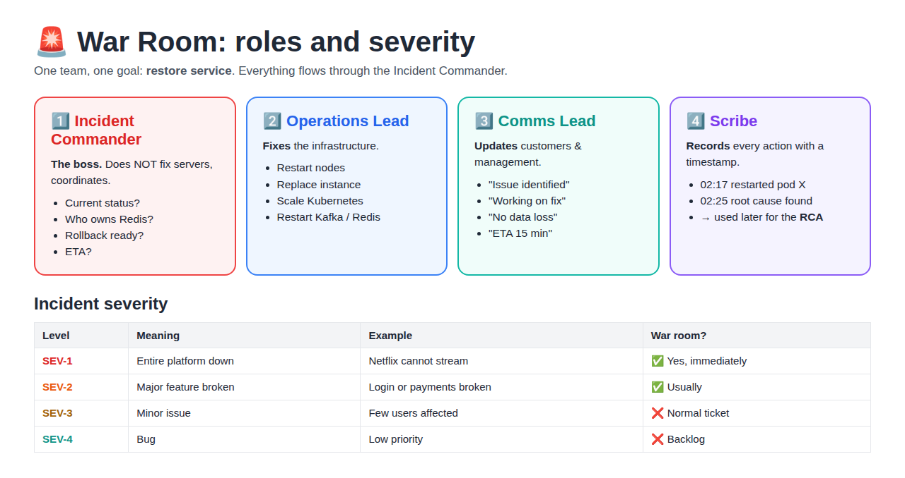
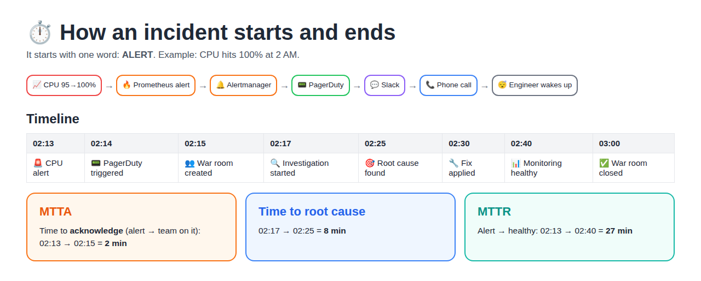
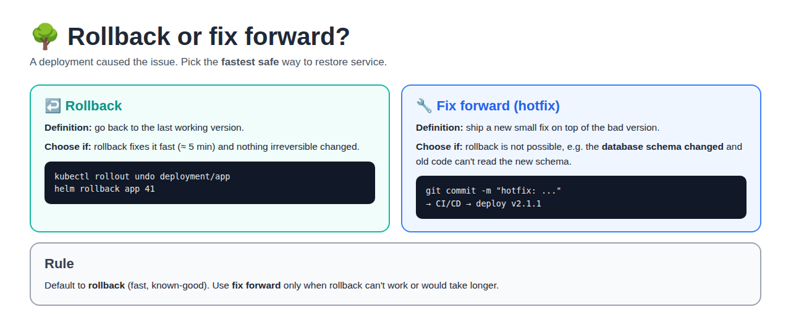

# Day 23 — War Rooms and Incident Management (SRE class 3)

[← SRE notes](../README.md) · [Day 21 — SRE Incidents](../day-21-sre-incidents/README.md)

> **In short:** When production breaks badly, the right people join a **war room**, each with a clear **role**. They follow the **alert → investigate → decide → fix → verify** flow using **data**, not guesses, and close it with an **RCA**.

## Table of Contents

1. [What is a War Room?](#1-what-is-a-war-room)
2. [War Room Roles](#2-war-room-roles)
3. [Incident Severity](#3-incident-severity)
4. [How an Incident Starts (and ends)](#4-how-an-incident-starts-and-ends)
5. [Real Investigation](#5-real-investigation)
6. [Rollback or Fix Forward?](#6-rollback-or-fix-forward)
7. [Golden Signals](#7-golden-signals)
8. [War Room Tools](#8-war-room-tools)
9. [Interview Questions](#9-interview-questions)

---

## 1. What is a War Room?

**Definition:** A war room is a **temporary command centre** (a Slack channel, Zoom/Teams call or real room) where the right people come together to **solve a critical issue and restore normal service**.

**When is a war room created?**

| Trigger | Meaning |
|---|---|
| **Major outage** | Service down or badly slow |
| **Customer impact** | Many users affected |
| **Revenue at risk** | Business is losing money every minute |
| **Escalation** | Alerts fire, or the CEO / Twitter is asking |

**Key principles:**

| Principle | Meaning |
|---|---|
| **Focus** | One goal only: restore service (deep fix later) |
| **Right people** | Engineers, SREs, Ops, product managers who own the broken parts |
| **Clear communication** | Live updates and decisions in one place |
| **Action oriented** | Identify → fix → validate → monitor |
| **Stay until resolved** | No one leaves until the service is stable |

> **One line:** A war room is not about working more, it's about **working together** to get back to normal.

---

## 2. War Room Roles

**Definition:** Each person in the war room has **one clear job**, so nobody does the same work twice and nothing is missed.



| Role | Job | Example |
|---|---|---|
| **Incident Commander (IC)** | The boss. **Does NOT fix servers**, coordinates everyone and makes decisions | "Current status? Who owns Redis? Rollback ready? ETA?" |
| **Operations Lead** | Actually **fixes** the infrastructure | Restart nodes, replace instance, scale Kubernetes, restart Kafka, repair Redis |
| **Communications Lead** | **Updates** customers and management | "Issue identified · Working on fix · No data loss · ETA 15 min" |
| **Scribe** | **Records** every action with a timestamp | Notes are used later for the **RCA** |

- **Everything flows through the IC.** Teams report to the IC; the IC decides.
- **Why the IC doesn't fix things:** if the leader is busy typing commands, nobody is watching the whole picture.

---

## 3. Incident Severity

**Definition:** Severity (SEV) = **how bad** an incident is. It decides how fast and how many people respond. Most companies use 4 levels.

| Level | Meaning | Example | Response |
|---|---|---|---|
| **SEV-1** | Entire platform down | Netflix cannot stream | War room now, all hands, every minute counts |
| **SEV-2** | Major feature broken | Login or payments broken | War room, on-call team + owners |
| **SEV-3** | Minor issue | Few users affected | Normal ticket, fix in working hours |
| **SEV-4** | Bug | Low priority | Backlog |

> **Goal:** detect fast · communicate clearly · resolve faster.

---

## 4. How an Incident Starts (and ends)

**Definition:** An incident starts with one word: **ALERT**. Monitoring sees a problem and wakes up the on-call engineer.



**Alert chain:**

```
CPU 95% → 100%  →  Prometheus alert  →  Alertmanager  →  PagerDuty  →  Slack  →  Phone call  →  Engineer wakes up
```

**Example timeline:**

| Time | Step |
|---|---|
| 02:13 | CPU alert fires |
| 02:14 | PagerDuty triggered (on-call paged) |
| 02:15 | War room created |
| 02:17 | Investigation started |
| 02:25 | Root cause found |
| 02:30 | Fix applied |
| 02:40 | Monitoring healthy |
| 03:00 | War room closed (watched 20 min to be sure) |

**From this timeline:**
- **MTTA** (Mean Time To Acknowledge) = alert → team working on it = **2 min**
- **MTTR** (Mean Time To Recover) = alert → healthy = **27 min** (see [MTTR in Day 21](../day-21-sre-incidents/README.md#4-mttf-and-mttr))
- The **Scribe** writes this timeline; it goes into the **RCA**.

---

## 5. Real Investigation

**Definition:** Investigation = finding the **root cause** using **data** (metrics, logs, traces), not guesses.

| # | Where to look | Tools | What to check |
|---|---|---|---|
| 1 | **Dashboards** (metrics) | Grafana | CPU, memory, disk, latency, errors, requests |
| 2 | **Logs** | Loki, ELK, Splunk | Search `ERROR`, `500`, `timeout`, `connection refused` |
| 3 | **Tracing** | Jaeger, Tempo, Zipkin | Which service in the chain is **slow** |
| 4 | **Kubernetes** | kubectl | `kubectl get pods` · `describe pod` · `logs` · `top pod` |
| 5 | **AWS** | Console / CloudWatch | EC2, RDS, ALB, NLB, EKS, CloudWatch, IAM, VPC |

```
Dashboards (what is wrong?) → Logs (why?) → Traces (where?) → Fix → Verify on dashboards
```

> **One line:** Investigate with data, find the root cause, fix it permanently.

---

## 6. Rollback or Fix Forward?

**Definition:** When a **deployment** caused the issue, there are 2 ways out:
- **Rollback** = go back to the last working version.
- **Fix forward (hotfix)** = ship a new small fix on top of the bad version.



| | Rollback | Fix forward |
|---|---|---|
| **Choose when** | Rollback restores service fast (≈ 5 min) | Rollback is **not possible**, e.g. **DB schema changed** and old code can't use the new schema |
| **Speed** | Fast, known-good version | Slower: write fix → CI/CD → deploy |
| **Risk** | Low | Higher (new untested code under pressure) |
| **Example** | `kubectl rollout undo deployment/app` · `helm rollback app 41` | Commit hotfix → pipeline → deploy v2.1.1 |

```
Deployment caused issue
      │
      ├── Can rollback fix it in ~5 min? ── YES → ROLLBACK ✅
      │
      └── DB schema changed / rollback impossible? ── YES → FIX FORWARD (hotfix) 🔧
```

> **Rule:** default to **rollback**; use fix forward only when rollback can't work.

---

## 7. Golden Signals

**Definition:** The **4 golden signals** are the 4 key metrics to watch for any service (from the Google SRE book; Netflix watches them closely too). If all 4 look fine, the service is usually healthy.

| Signal | Meaning | Example metric |
|---|---|---|
| **Latency** | How long a request takes | p95 response time = 250 ms |
| **Traffic** | How much demand the system handles | 5,000 requests/sec |
| **Errors** | Rate of requests that fail | 0.5% of requests return 5xx |
| **Saturation** | How **full** the resources are | CPU 90%, disk 95%, DB connections 98/100 |

**Use P95 / P99 / P999 latency, not averages:**

| Term | Meaning |
|---|---|
| **p95 = 300 ms** | 95% of requests are faster than 300 ms; the slowest 5% are slower |
| **p99** | Slowest 1%, the users having the worst time |
| **p999** | Slowest 0.1% |

**Why not the average?** 99 requests at 100 ms + 1 request at 10 s → average ≈ 200 ms (looks fine), but that one user waited 10 seconds. Percentiles show the slow users the average hides.

> Golden signals are the usual **SLIs** (see [SLI/SLO/SLA in Day 21](../day-21-sre-incidents/README.md#3-sli-slo-sla)).

---

## 8. War Room Tools

| Category | Tools | Used for |
|---|---|---|
| **Alerts / paging** | PagerDuty, Opsgenie | Wake up the on-call engineer |
| **Chat** | Slack, Microsoft Teams | The war room channel itself |
| **Monitoring** | Prometheus, Grafana | Metrics and dashboards |
| **Logs** | Loki, ELK, Splunk | Search error messages |
| **Tracing** | Jaeger, Tempo | Find the slow service |
| **Incident management** | Jira, ServiceNow | Track the incident ticket and RCA |
| **Cloud** | AWS CloudWatch | AWS metrics, logs and alarms |

---

## 9. Interview Questions

### Other Questions

**Q1. What is a war room?**
A temporary command centre where the right people come together to restore service during a major incident.

**Q2. What are the war room roles?**
Incident Commander (coordinates, doesn't fix), Operations Lead (fixes), Communications Lead (updates customers), Scribe (records the timeline for the RCA).

**Q3. Why doesn't the Incident Commander fix servers?**
So someone always sees the full picture, tracks every team and makes decisions.

**Q4. SEV-1 vs SEV-2?**
SEV-1 = whole platform down (Netflix can't stream). SEV-2 = a major feature broken (login or payments).

**Q5. Rollback or fix forward?**
Rollback if it restores service quickly. Fix forward only when rollback is impossible, e.g. a DB schema change.

**Q6. What are the 4 golden signals?**
Latency, traffic, errors, saturation.

**Q7. Why p99 latency instead of the average?**
The average hides slow requests; p99 shows what the slowest 1% of users experience.

**Q8. How do you investigate a production issue?**
Dashboards → logs → traces → Kubernetes / AWS checks. Use data, find the root cause, fix, then verify on the dashboards.
