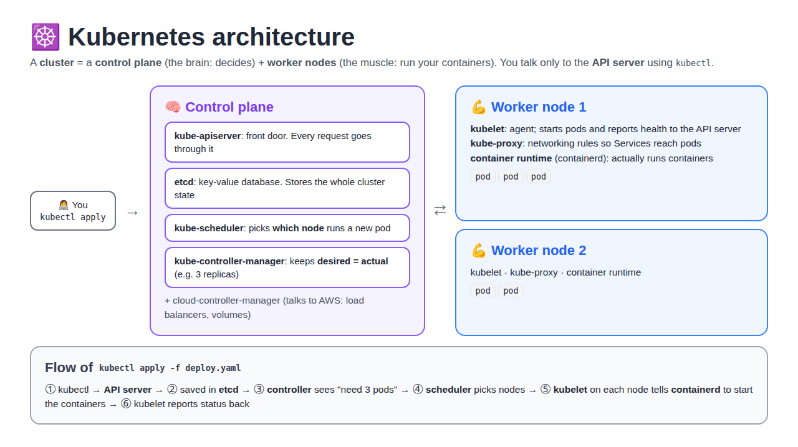
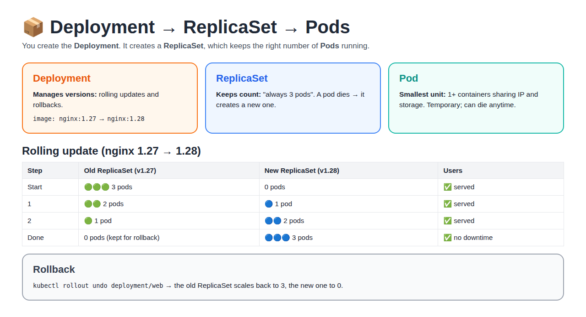
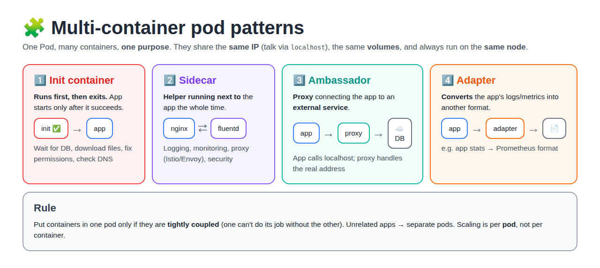
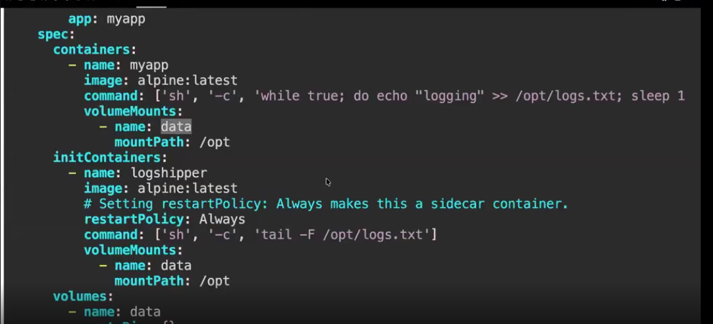

# Day 22 — Kubernetes: Architecture, Pods, ReplicaSet, Deployment, Multi-Container Pods, Jobs

[← Kubernetes notes](../README.md)

> **In short:** Docker runs containers on **one** machine. **Kubernetes** runs and manages containers across **many** machines: it restarts them when they crash, scales them, spreads them across servers, and updates them with zero downtime. You tell it **what you want** (YAML) and it keeps it that way.

## Table of Contents

1. [What is Kubernetes?](#1-what-is-kubernetes)
2. [Why Kubernetes? (problems with only Docker)](#2-why-kubernetes-problems-with-only-docker)
3. [Kubernetes in Real Time](#3-kubernetes-in-real-time)
4. [Kubernetes Architecture](#4-kubernetes-architecture)
5. [Pod](#5-pod)
6. [ReplicaSet](#6-replicaset)
7. [Deployment](#7-deployment)
8. [Pod vs ReplicaSet vs Deployment](#8-pod-vs-replicaset-vs-deployment)
9. [Multi-Container Pod](#9-multi-container-pod)
10. [Init Container](#10-init-container)
11. [Sidecar Container](#11-sidecar-container)
12. [Job](#12-job)
13. [CronJob](#13-cronjob)
14. [Commands Cheat Sheet](#14-commands-cheat-sheet)
15. [Interview Questions](#15-interview-questions)

---

## 1. What is Kubernetes?

**Definition:** Kubernetes (**K8s**) is an open-source **container orchestration** platform. It automatically **deploys, scales, heals and manages** containers across a group of servers (a **cluster**).

- **K8s** = K + 8 letters + s
- Built by **Google** (from its internal system Borg), now run by the **CNCF**
- **Orchestration** = managing many containers together, like a conductor managing an orchestra

| Word | Simple meaning |
|---|---|
| **Container** | App + everything it needs, packed together (Docker image running) |
| **Cluster** | A group of machines Kubernetes manages as one |
| **Node** | One machine (EC2 / VM) in the cluster |
| **Pod** | The smallest unit in K8s: wraps 1+ containers |
| **Desired state** | What you ask for in YAML, e.g. "3 copies of nginx" |
| **Actual state** | What is really running right now |

**Key idea: desired state.** You write *"I want 3 nginx pods"*. Kubernetes checks all the time: if only 2 run, it starts 1 more. You say **what**, K8s handles **how**.

---

## 2. Why Kubernetes? (problems with only Docker)

**Docker alone** is great on one server. In production with many containers and servers, these problems appear:

| Problem with only Docker | What Kubernetes does |
|---|---|
| Container crashes at 2 AM → stays down until someone restarts it | **Self-healing:** restarts / replaces it automatically |
| Traffic spikes (sale day) → you add containers by hand | **Auto-scaling:** adds pods when CPU is high (HPA) |
| Server dies → all its containers die | **Reschedules** the pods on healthy nodes |
| Which server has free CPU/RAM? You decide by hand | **Scheduler** places pods on the best node |
| New version → stop old, start new → **downtime** | **Rolling update:** replaces pods one by one, no downtime |
| Bad release → manual fix | **Rollback** with one command |
| Containers' IPs keep changing → how to find them? | **Service** gives a fixed name/IP + load balancing |
| Passwords in the image / env files | **Secrets & ConfigMaps** |

> **One line:** Docker **builds and runs** containers; Kubernetes **manages** them at scale (heal, scale, update, network).

---

## 3. Kubernetes in Real Time

**Where it's used:** almost every company running microservices: Netflix, Spotify, Swiggy, Zomato, banks, SaaS products.

**Real example: food delivery app (like our RoboShop)**

```
Frontend · Catalogue · Cart · User · Payment · Shipping   → each is a Deployment
MongoDB · Redis · MySQL · RabbitMQ                         → databases / queues
```

| Real situation | Kubernetes feature |
|---|---|
| Lunch time traffic 10x | HPA scales `cart` from 3 → 15 pods, back to 3 after |
| `payment` pod crashes | ReplicaSet creates a new pod in seconds |
| Release v2 of `catalogue` at 3 PM | Deployment rolling update, users don't notice |
| v2 has a bug | `kubectl rollout undo` → back to v1 in a minute |
| One EC2 node dies | Pods moved to other nodes automatically |

**Managed Kubernetes (used in real jobs):** you don't build the control plane yourself.

| Cloud | Service |
|---|---|
| AWS | **EKS** (Elastic Kubernetes Service) |
| Azure | AKS |
| Google Cloud | GKE |

Local practice: **minikube**, **kind**, **k3s**.

---

## 4. Kubernetes Architecture

**Definition:** a cluster has 2 parts: the **control plane** (the brain that **decides**) and **worker nodes** (the muscle that **runs** your pods).



### Control plane (master) components

| Component | Simple job | Analogy |
|---|---|---|
| **kube-apiserver** | Front door. Every request (kubectl, nodes, controllers) goes through it | Reception desk |
| **etcd** | Key-value database storing the **whole cluster state** | The company register |
| **kube-scheduler** | Decides **which node** a new pod runs on (free CPU/RAM, rules) | HR assigning desks |
| **kube-controller-manager** | Runs controllers that keep **desired = actual** (ReplicaSet, Node, Deployment controllers) | Manager checking "do we have 3 people on shift?" |
| **cloud-controller-manager** | Talks to the cloud (AWS load balancers, volumes, nodes) | Contact with the landlord |

### Worker node components

| Component | Simple job |
|---|---|
| **kubelet** | Agent on every node. Gets pod specs from the API server, starts them, reports health |
| **kube-proxy** | Network rules on each node so **Services** can reach the right pods |
| **Container runtime** | Actually runs containers: **containerd** (or CRI-O). Docker images still work |

### What happens on `kubectl apply -f deploy.yaml`

```
1. kubectl          → sends YAML to the API server
2. API server       → validates it, saves it in etcd
3. Controller       → sees "Deployment wants 3 pods, 0 exist" → creates 3 pod objects
4. Scheduler        → picks a node for each pod
5. kubelet (node)   → tells containerd to pull the image and start the containers
6. kubelet          → reports "Running" back to the API server
```

> **Remember:** only the **API server** talks to **etcd**. Everything else talks to the API server.

> **On EKS:** AWS runs and manages the whole control plane for you; you manage only the worker nodes (or use Fargate).

---

## 5. Pod

**Definition:** a **Pod** is the **smallest deployable unit** in Kubernetes. It wraps **one or more containers** that share the same **IP address, network and storage**.

- Pods are **ephemeral** (short-living objects).
- Usually **1 container per pod**, but you can run **multiple containers** in the same pod if needed (see [Multi-Container Pod](#9-multi-container-pod)).
- Containers in a pod share the **same network namespace** (same IP, talk on `localhost`) and can share the **same storage volumes**.
- When creating a pod, you specify the **image** along with **configuration** and **resource limits** (CPU / memory).
- Pods are **temporary**: if a pod dies, it is **not** brought back by itself. A new pod (new name, new IP) must replace it → that's why we use ReplicaSet / Deployment.

```yaml
apiVersion: v1
kind: Pod
metadata:
  name: nginx-pod
  labels:
    app: nginx
spec:
  containers:
    - name: nginx
      image: nginx:1.27
      ports:
        - containerPort: 80
```

```bash
kubectl apply -f pod.yaml
kubectl get pods
kubectl delete pod nginx-pod     # it is gone for good, nobody recreates it
```

---

## 6. ReplicaSet

**Definition:** a **ReplicaSet** makes sure a **fixed number of identical pods** (replicas) is **always running**. A pod dies → it creates a new one. Too many → it deletes extras.

- It finds "its" pods using **labels** (`selector.matchLabels` must match the pod template labels).
- Creates **multiple replicas of the same pod**; all pods have the **same config** (from the `template`).
- Pod deleted → **automatically creates a new pod**.
- Scaling: change `replicas` (manually or with **HPA** for auto scaling). Traffic is spread across the replicas by a **Service** (load balancing).
- In the background, a **controller** (the ReplicaSet controller in kube-controller-manager) keeps creating replicas.

| | ReplicationController (RC) | ReplicaSet (RS) |
|---|---|---|
| Age | **Older** version | **Newer** version (use this) |
| Selector | Only equality (`app = nginx`) | Also set-based (`app in (nginx, web)`) |
| Used today? | Legacy | ✅ (created by Deployments) |

```yaml
apiVersion: apps/v1
kind: ReplicaSet
metadata:
  name: nginx-rs
spec:
  replicas: 3                  # desired count
  selector:
    matchLabels:
      app: nginx               # "my pods are the ones with app=nginx"
  template:                    # how to create a pod
    metadata:
      labels:
        app: nginx
    spec:
      containers:
        - name: nginx
          image: nginx:1.27
```

**Self-healing test:**

```bash
kubectl apply -f rs.yaml
kubectl get pods                         # 3 pods
kubectl delete pod <one-pod-name>
kubectl get pods                         # still 3: a new pod was created
kubectl scale rs nginx-rs --replicas=5   # now 5
```

**Limitation:** if you change the image in a ReplicaSet, **existing pods are not updated**. No rolling update, no rollback. → Use a **Deployment**.

---

## 7. Deployment

**Definition:** a **Deployment** manages **ReplicaSets** for you and adds **rolling updates** and **rollbacks**. It's what we use in real projects for stateless apps.

```
Deployment  →  ReplicaSet  →  Pods
(versions)     (count)        (containers)
```



```yaml
apiVersion: apps/v1
kind: Deployment
metadata:
  name: web
spec:
  replicas: 3
  selector:
    matchLabels:
      app: web
  strategy:
    type: RollingUpdate
    rollingUpdate:
      maxUnavailable: 1        # at most 1 pod down during the update
      maxSurge: 1              # at most 1 extra pod during the update
  template:
    metadata:
      labels:
        app: web
    spec:
      containers:
        - name: web
          image: nginx:1.27
          ports:
            - containerPort: 80
```

**What is a Deployment (class points):** one word: **automate**.
- It has all features of a **ReplicaSet** plus **updating** and **rolling back** to a particular version.
- The best part: we can do it **without downtime**.
- **Deployment creates ReplicaSet, ReplicaSet creates Pods.**
- **Deployment = zero-downtime updates + rollbacks + self-healing.**

**Class example (movies app):**

```yaml
apiVersion: apps/v1
kind: Deployment
metadata:
  name: movies
  labels:
    app: paytm
spec:
  replicas: 3
  selector:
    matchLabels:
      app: paytm
  template:
    metadata:
      labels:
        app: paytm
    spec:
      containers:
        - name: cont1
          image: rahamshaik/mynetflix:1.0
```

**Rolling update and rollback:**

```bash
kubectl apply -f deploy.yaml
kubectl get deploy,rs,pods                           # 1 Deployment, 1 ReplicaSet, 3 pods

kubectl set image deployment/web web=nginx:1.28      # update the version
kubectl rollout status deployment/web                # watch pods replaced one by one
kubectl get rs                                       # 2 ReplicaSets: old (0 pods), new (3 pods)

kubectl rollout history deployment/web               # list revisions
kubectl rollout undo deployment/web                  # back to the previous version
```

**Deployment strategies:**

| Strategy | How | Downtime |
|---|---|---|
| **RollingUpdate** (default) | Replace pods a few at a time | No |
| **Recreate** | Kill all old pods, then start new ones | Yes (short) |

> Links to SRE: rollback is the first choice when a deploy breaks prod. See [War Rooms: rollback or fix forward](../../day-3-war-rooms/README.md#6-rollback-or-fix-forward).

---

## 8. Pod vs ReplicaSet vs Deployment

| | Pod | ReplicaSet | Deployment |
|---|---|---|---|
| **What** | 1+ containers | Keeps N pods running | Manages ReplicaSets + versions |
| **Self-healing** | ❌ | ✅ | ✅ |
| **Scaling** | ❌ | ✅ | ✅ |
| **Rolling update** | ❌ | ❌ | ✅ |
| **Rollback** | ❌ | ❌ | ✅ |
| **Use in real projects?** | Rarely directly | Rarely directly (Deployment creates it) | ✅ **Yes, always** |

> **One line:** Pod runs the container, ReplicaSet keeps the count, Deployment manages versions. In practice you create **Deployments**.

---

## 9. Multi-Container Pod

**Definition:** a **multi-container pod** = **more than one container in a single pod**, working together for **one application**. One word: **teamwork**.



**Key points:**

| Point | Meaning |
|---|---|
| Same **network IP and ports** | Containers talk to each other on **`localhost`** |
| Same **storage volumes** | They can share files (e.g. log files) |
| **Same node**, always | Scheduled together |
| **Start and stop together** | If the pod dies, all its containers die |
| Scaling is per **pod** | You can't scale one container alone |
| YAML | Multiple entries under `spec.containers` |

**Why used:** the **main purpose is to support the main application container** with helper work: logging, monitoring, syncing files, proxy, security, setup.

**When to use / avoid:**
- ✅ **Tightly coupled** containers (helper can't live without the app)
- ❌ **Unrelated apps** (e.g. frontend + database) → separate pods, so each scales on its own

### The 4 patterns

| Pattern | What it does | Example |
|---|---|---|
| **Init container** | Runs **first** and exits before the app starts | Wait for DB, download config |
| **Sidecar** | Helper running **alongside** the app the whole time | Nginx + **Fluentd** log shipper |
| **Ambassador** | **Proxy** connecting the app to an **external service** | App calls `localhost:6379`, proxy forwards to the real Redis cluster |
| **Adapter** | **Converts** logs/data into another format | App's custom metrics → Prometheus format |

---

## 10. Init Container

**Definition:** an **init container** runs **before** the app containers, does setup work, and **exits**. The main containers start **only after it completes successfully**. It **prepares the environment** so the app starts in the right conditions.

```
Init container (runs first) ──✅ success──▶ Main containers start ──▶ Pod Running
        │
        └── ❌ fails → pod restarts it until it succeeds (app never starts)
```

| Point | Meaning |
|---|---|
| Runs **before** app containers | Order is guaranteed |
| Runs **one time** at pod startup | Then it exits (status Completed) |
| **Fails → retried** until success | App containers wait |
| Several init containers | Run **one after another**, in order |
| YAML | Under **`spec.initContainers`** |

### Why do we use an init container?

Because **some apps crash or misbehave if something isn't ready when they start**. The init container does that "get ready" work **first**, so the app starts only when everything it needs is in place.

**Example: backend app that needs MySQL**

```
WITHOUT init:  pod starts → app starts → MySQL not up yet → "Connection refused" → crash
               → restart → crash again → CrashLoopBackOff 🔁

WITH init:     pod starts → init: "MySQL up? no… wait… YES ✅" → exits
               → app starts → MySQL ready → works first time ✅
```

**Why not put the setup inside the app itself?**

| Reason | Meaning |
|---|---|
| **Order is guaranteed** | Kubernetes **promises** the app won't start until init succeeds, so no race conditions |
| **Keeps the app image clean** | Setup tools (`curl`, `git`, `nslookup`, DB clients) live in the init image (busybox), not the app image → smaller, safer image |
| **Separate jobs** | Developers write the app; DevOps writes the setup step. No app code change just to "wait for DB" |
| **Runs once, then gone** | Uses no CPU/RAM after it finishes (unlike a sidecar) |
| **Safer permissions** | Init can run with extra rights (e.g. root to `chown` a folder) so the app can run as a normal user |

**Common real uses:**

| Problem the app would have | What the init container does first |
|---|---|
| App crashes because the DB isn't ready | **Waits** until MySQL / Redis answers |
| App needs a config file or ML model at startup | **Downloads** it into a shared volume |
| App can't write to its data folder | **Fixes permissions** (`chown`) on the volume |
| New version needs new DB tables | **Runs the DB migration** before the app starts |
| App needs another service | **Checks DNS / Service** exists (`nslookup cart`) |

> **Analogy:** a cook (app) can't start until the kitchen helper (init container) washes the vegetables and lights the stove. The helper preps, leaves, and the cook starts with everything ready.

> **One line:** "We use an init container to make sure everything the app depends on (DB, files, permissions, migrations) is ready **before** the app starts, so it doesn't crash on startup, and to keep setup logic out of the app image."

### How it works, step by step (simple)

**Both containers live inside the SAME pod.** The pod is created first. Inside it, the containers take turns:

```
Pod created
 ├─ 1️⃣ Init container runs first
 │     "Is the DB up? Are the files ready?"
 │     ✅ Yes → its work is done → it stops (exits)
 │
 └─ 2️⃣ App container starts now
       (DB and files are already ready, so the app works)

→ Pod status: Running
```

- ❗ It's the **app container** that waits, not the pod. The pod already exists.
- The init container can **check** things (is the DB up?) and also **do** things (download files, fix permissions, run a DB migration).
- If the check **fails**, the init container **tries again and again**. The app container **keeps waiting** and never starts until everything is ready.

**What you see in `kubectl get pods` while this happens:**

| STATUS | What it means in simple words |
|---|---|
| `Init:0/1` | The init container is still working or waiting (e.g. the DB is not up yet) |
| `PodInitializing` | The init container finished; the app container is starting |
| `Running` | The app container is up ✅ |
| `Init:CrashLoopBackOff` | The init container keeps failing, so the app never starts → check `kubectl logs <pod> -c <init-name>` |

> **In one line:** "The init container goes first inside the pod, makes sure everything the app needs is ready, and then stops. Only after that does the app container start."

**Class example:**

```yaml
apiVersion: v1
kind: Pod
metadata:
  name: init-demo
spec:
  initContainers:
    - name: init-container
      image: busybox
      command: ['sh', '-c', 'echo Preparing App']
  containers:
    - name: main-container
      image: nginx
```

**Real example: wait for MySQL before starting the app:**

```yaml
  initContainers:
    - name: wait-for-db
      image: busybox
      command: ['sh', '-c', 'until nslookup mysql; do echo waiting for db; sleep 2; done']
```

```bash
kubectl get pod init-demo          # STATUS: Init:0/1 → PodInitializing → Running
kubectl logs init-demo -c init-container    # "Preparing App"
```

> If the pod is stuck in **`Init:0/1`** or **`Init:CrashLoopBackOff`**, the init container is failing: check `kubectl logs <pod> -c <init-name>`.

---

## 11. Sidecar Container

**Definition:** a **sidecar** is a helper container that runs **together with the main container in the same pod**, the whole time, to **support** it. One word: **assistant**.

| Point | Meaning |
|---|---|
| Same pod, runs **simultaneously** | Not before (that's init); **alongside** |
| Shares **network, IP and volumes** | Talks over `localhost`, reads shared files |
| **Starts and stops with the pod** | Same lifecycle |
| **Separates helper logic** from app code | App team doesn't write logging/proxy code |
| Commonly for | **Logging, monitoring, proxy, security** |

**Common real example: Nginx app + Fluentd sidecar.** Nginx writes logs to a shared volume; Fluentd reads them and ships them to Elasticsearch / Loki.

```yaml
apiVersion: v1
kind: Pod
metadata:
  name: web-with-logger
spec:
  volumes:
    - name: logs
      emptyDir: {}               # shared folder, lives as long as the pod
  containers:
    - name: nginx                # main app
      image: nginx
      volumeMounts:
        - name: logs
          mountPath: /var/log/nginx
    - name: fluentd              # sidecar
      image: fluent/fluentd
      volumeMounts:
        - name: logs
          mountPath: /var/log/nginx
```

```bash
kubectl get pod web-with-logger    # READY 2/2 = both containers running
kubectl logs web-with-logger -c fluentd
```

### How does the sidecar get the app's logs? (⭐ interview question)

**Containers in the same pod do NOT share files automatically.**

| What | Shared automatically? |
|---|---|
| **Network** (IP, ports) | ✅ Yes → talk on `localhost` |
| **Files / folders** | ❌ No → each container has its **own filesystem** from its own image |

So Nginx's logs in container 1 are **invisible** to Fluentd in container 2, unless we add a **shared volume**:

```
┌──────────────────── Pod ────────────────────┐
│  nginx (container 1)      fluentd (container 2)
│  writes → /var/log/nginx   reads ← /var/log/nginx
│             └───────┬──────────────┘
│              📁 volume "logs" (emptyDir)
│              same folder mounted in both
└──────────────────────────────────────────────┘
          fluentd ships logs → Elasticsearch / Loki
```

1. **`emptyDir`** = an empty folder created when the pod starts (on the node's disk).
2. Both containers **mount the same volume** (in the YAML above: `volumes` + `volumeMounts` in both).
3. Nginx writes a log line → Fluentd sees it at once (same folder).
4. Pod deleted → **emptyDir deleted too** (temporary), so the sidecar must ship logs out.

### Class example: native sidecar + emptyDir (explained simply)



```yaml
spec:
  containers:
    - name: myapp                       # 1️⃣ the main app
      image: alpine:latest
      command: ['sh', '-c', 'while true; do echo "logging" >> /opt/logs.txt; sleep 1; done']
      volumeMounts:
        - name: data                    # uses the shared folder "data"
          mountPath: /opt               # ...seen inside myapp as /opt
  initContainers:
    - name: logshipper                  # 2️⃣ the sidecar
      image: alpine:latest
      restartPolicy: Always             # ⭐ makes this init container a SIDECAR
      command: ['sh', '-c', 'tail -F /opt/logs.txt']
      volumeMounts:
        - name: data                    # SAME shared folder
          mountPath: /opt
  volumes:
    - name: data                        # 3️⃣ the shared folder itself
      emptyDir: {}
```

**What each part does, in simple words:**

| Part | Simple meaning |
|---|---|
| `volumes: - name: data, emptyDir: {}` | Create **one empty shared folder** called `data` when the pod starts |
| **myapp** + `mountPath: /opt` | The app sees that folder as **`/opt`**. Every 1 second it writes the word **"logging"** into `/opt/logs.txt` |
| **logshipper** + `mountPath: /opt` | The sidecar sees the **same folder** as `/opt`, so it sees the **same `logs.txt`** |
| `tail -F /opt/logs.txt` | Keep reading the file and print every new line as it is added (`-F` keeps following even if the file is recreated) |
| `restartPolicy: Always` inside `initContainers` | Normally an init container runs once and exits. With `Always` it becomes a **native sidecar**: it **starts before the app** and **keeps running** next to it |

**The flow:**

```
Pod starts
 → emptyDir "data" created (empty folder)
 → logshipper (sidecar) starts first and waits on /opt/logs.txt
 → myapp starts, writes "logging" to /opt/logs.txt every second
 → logshipper sees each new line instantly (same folder) and prints it
```

**Try it:**

```bash
kubectl apply -f sidecar.yaml
kubectl get pod                          # READY 2/2
kubectl logs <pod> -c logshipper -f      # "logging" every second, read by the sidecar
kubectl exec <pod> -c myapp -- cat /opt/logs.txt
```

> **Key point:** the volume name (`data`) must be the **same** in both `volumeMounts`. That's what connects the two containers to one folder. Remove the volume and logshipper would never see the app's file.

> In real life, `logshipper` would be **Fluentd / Fluent Bit** sending the lines to Elasticsearch or Loki instead of just printing them.

> **Bonus:** in many real clusters apps log to **stdout**; Kubernetes stores it on the node in `/var/log/containers/`, and **one Fluent Bit/Fluentd per node (DaemonSet)** collects all pods' logs. Sidecars are used when an app can only write to files or needs special log handling.

**Other famous sidecars:** **Envoy** proxy in Istio service mesh, Vault agent (injects secrets), Prometheus exporters.

> **Newer Kubernetes (1.29+):** a "native sidecar" is written as an init container with `restartPolicy: Always`: it starts before the app and keeps running. Good to know for interviews.

### Init vs Sidecar

| | Init container | Sidecar |
|---|---|---|
| When it runs | **Before** the app | **Alongside** the app |
| How long | Runs once, then **exits** | Runs the **whole pod life** |
| YAML | `spec.initContainers` | `spec.containers` (extra entry) |
| Example | Wait for DB | Ship logs with Fluentd |

---

## 12. Job

**Definition:** a **Job** runs a pod for a **one-time or batch task** and makes sure it **runs until it completes successfully**, then **stops**. One word: **task**.

```
Job → Pod running (task in progress) → Pod Completed ✅ → Job finished (stops)
```

| Point | Meaning |
|---|---|
| For **one-time / batch** work | Not for long-running apps (that's a Deployment) |
| Pod fails → Job creates a **new pod** | Retries automatically |
| **`backoffLimit`** | How many retries before the Job is marked **Failed** (default 6) |
| **`completions`** | How many successful runs are needed |
| **`parallelism`** | How many pods run at the same time |
| Pod status after success | **Completed** |

**Used for:** backups, **DB migration**, batch processing, data import/export, running a script.

```yaml
apiVersion: batch/v1
kind: Job
metadata:
  name: db-migration
spec:
  completions: 1
  backoffLimit: 3
  template:
    spec:
      restartPolicy: Never       # Jobs need Never or OnFailure
      containers:
        - name: migrate
          image: busybox
          command: ['sh', '-c', 'echo running migration; sleep 5; echo done']
```

```bash
kubectl apply -f job.yaml
kubectl get jobs                 # COMPLETIONS 1/1
kubectl get pods                 # STATUS Completed
kubectl logs job/db-migration
```

---

## 13. CronJob

**Definition:** a **CronJob** creates **Jobs automatically on a schedule**, using **Linux cron syntax**. Schedule → automate → repeat.

```
CronJob (schedule) → creates a Job → Job creates a Pod → task Completed
```

**Cron format:** 5 fields

```
┌ minute (0-59)
│ ┌ hour (0-23)
│ │ ┌ day of month (1-31)
│ │ │ ┌ month (1-12)
│ │ │ │ ┌ day of week (0-6, Sun=0)
* * * * *        → every minute
0 2 * * *        → daily at 2 AM
*/15 * * * *     → every 15 minutes
0 9 * * 1        → every Monday 9 AM
```

**Used for:** daily backups, log cleanup, monitoring scripts, scheduled reports.

```yaml
apiVersion: batch/v1
kind: CronJob
metadata:
  name: daily-backup
spec:
  schedule: "0 2 * * *"              # daily at 2 AM
  concurrencyPolicy: Forbid          # skip if the last one is still running
  successfulJobsHistoryLimit: 3      # keep last 3 successful Jobs
  failedJobsHistoryLimit: 1          # keep last 1 failed Job
  jobTemplate:
    spec:
      template:
        spec:
          restartPolicy: OnFailure
          containers:
            - name: backup
              image: busybox
              command: ['sh', '-c', 'echo backup done']
```

**Concurrency policy** (what if the previous run is still running?):

| Policy | Meaning |
|---|---|
| **Allow** (default) | Run jobs at the same time |
| **Forbid** | Skip the new run if one is still running |
| **Replace** | Stop the running job and start the new one |

**History limits:** `successfulJobsHistoryLimit` (default 3) and `failedJobsHistoryLimit` (default 1) decide how many old Jobs are kept for checking logs.

```bash
kubectl get cronjobs
kubectl get jobs --watch                          # a new Job appears on schedule
kubectl create job test-run --from=cronjob/daily-backup   # run it now to test
```

### Deployment vs Job vs CronJob

| | Deployment | Job | CronJob |
|---|---|---|---|
| Runs | **Forever** (web apps, APIs) | **Once**, until success | **On a schedule** |
| Ends? | No | Yes (Completed) | Each run ends; schedule repeats |
| Example | Nginx, cart service | DB migration | Daily 2 AM backup |

---

## 14. Commands Cheat Sheet

| Command | What it does |
|---|---|
| `kubectl get nodes` | List cluster nodes |
| `kubectl get pods -o wide` | Pods + which node + IP |
| `kubectl apply -f file.yaml` | Create / update from YAML |
| `kubectl describe pod <name>` | Details + **Events** (why it's failing) |
| `kubectl logs <pod>` | Container logs |
| `kubectl exec -it <pod> -- sh` | Shell inside the container |
| `kubectl get deploy,rs,pods` | See all three levels |
| `kubectl scale deploy web --replicas=5` | Scale |
| `kubectl set image deploy/web web=nginx:1.28` | Update image |
| `kubectl rollout status / history / undo deploy/web` | Watch / list / roll back |
| `kubectl delete -f file.yaml` | Delete what the file created |
| `kubectl logs <pod> -c <container>` | Logs of one container in a multi-container pod |
| `kubectl exec -it <pod> -c <container> -- sh` | Shell into one container of the pod |
| `kubectl get jobs` / `kubectl get cronjobs` | List Jobs / CronJobs |
| `kubectl create job now --from=cronjob/<name>` | Run a CronJob immediately |

---

## 15. Interview Questions

### ⭐ Very Important (asked in class)

**Q1. In a sidecar, the app writes logs in container 1. How does container 2 get them? Do 2 containers in the same pod share data automatically?**
No. Containers in a pod share the **network** automatically (localhost) but **not files**. To share logs, define an **`emptyDir` volume** in the pod and **mount it in both containers**: the app writes logs there and the sidecar (Fluentd) reads the same folder and ships them to Elasticsearch / Loki.

### Other Questions

**Q1. What is Kubernetes?**
An open-source container orchestration platform that deploys, scales, heals and manages containers across a cluster.

**Q2. Why Kubernetes if we have Docker?**
Docker runs containers on one machine. Kubernetes manages them across many machines: self-healing, auto-scaling, rolling updates, rollback, service discovery.

**Q3. Explain Kubernetes architecture.**
Control plane: API server (front door), etcd (state database), scheduler (picks a node), controller manager (keeps desired = actual). Worker nodes: kubelet (runs pods), kube-proxy (networking), container runtime (containerd).

**Q4. What is etcd?**
A key-value database that stores the entire cluster state. Only the API server talks to it. Back it up.

**Q5. What does the scheduler do?**
Chooses which node a new pod runs on, based on free resources and rules.

**Q6. What is a Pod?**
The smallest deployable unit: one or more containers sharing IP and storage. Temporary.

**Q7. ReplicaSet vs Deployment?**
ReplicaSet keeps N pods running. Deployment manages ReplicaSets and adds rolling updates and rollbacks. Use Deployments.

**Q8. What happens when you delete a pod managed by a Deployment?**
The ReplicaSet notices the count dropped and creates a new pod.

**Q9. How do you roll back a bad release?**
`kubectl rollout undo deployment/<name>`: the old ReplicaSet scales back up.

**Q10. What is EKS?**
AWS-managed Kubernetes: AWS runs the control plane, you run (or let Fargate run) the worker nodes.

**Q11. What is a multi-container pod and why use it?**
Several tightly coupled containers in one pod sharing IP (localhost) and volumes, to support the main app (logging, proxy, setup).

**Q12. Init container vs sidecar?**
Init runs before the app and exits; sidecar runs alongside the app for the whole pod life.

**Q13. What happens if an init container fails?**
The pod restarts it until it succeeds; the main containers never start until then.

**Q14. Name the multi-container patterns.**
Init, sidecar, ambassador (proxy to external service), adapter (converts output format).

**Q15. ReplicationController vs ReplicaSet?**
RC is the older version; ReplicaSet is newer and supports set-based selectors. Deployments create ReplicaSets.

**Q16. Job vs CronJob vs Deployment?**
Job = run once until success; CronJob = create Jobs on a schedule; Deployment = keep a long-running app up.

**Q17. What are backoffLimit and completions?**
backoffLimit = retries before the Job fails; completions = successful runs needed.

**Q18. CronJob concurrencyPolicy options?**
Allow (run together), Forbid (skip if still running), Replace (stop old, start new).

---

**Source:** [Kubernetes docs: components](https://kubernetes.io/docs/concepts/overview/components/) · [Deployments](https://kubernetes.io/docs/concepts/workloads/controllers/deployment/) · [ReplicaSet](https://kubernetes.io/docs/concepts/workloads/controllers/replicaset/) · [Init containers](https://kubernetes.io/docs/concepts/workloads/pods/init-containers/) · [Sidecar containers](https://kubernetes.io/docs/concepts/workloads/pods/sidecar-containers/) · [Jobs](https://kubernetes.io/docs/concepts/workloads/controllers/job/) · [CronJob](https://kubernetes.io/docs/concepts/workloads/controllers/cron-jobs/)
