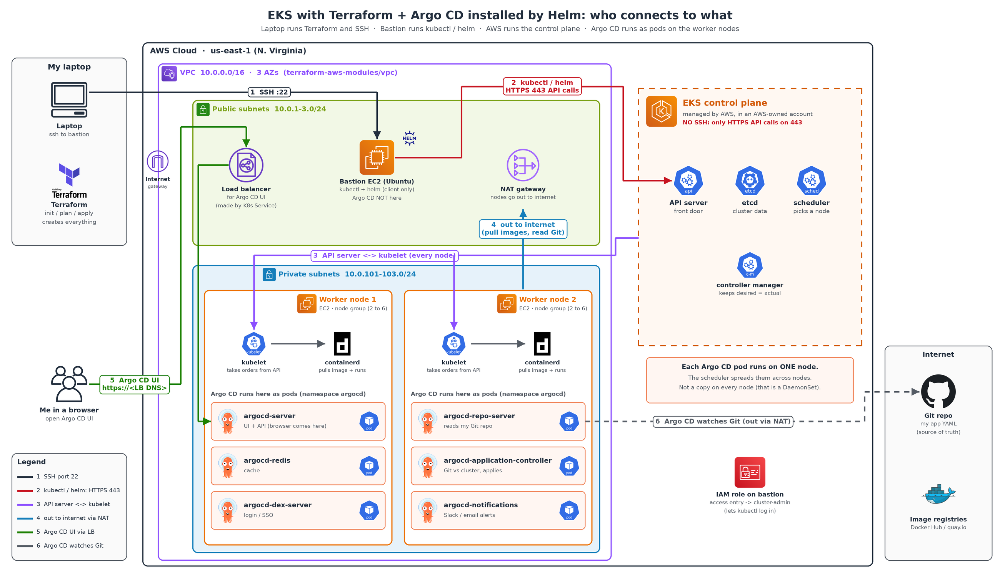

# Day 23 — EKS with Terraform Modules, Helm Intro, Argo CD with Helm

[← Kubernetes notes](../README.md)

> **In short:** [Day 22](../day-22-k8s-intro/README.md#4-eks-cluster-creation-manual-console) we clicked through the AWS console to make an EKS cluster. In real jobs we build it with **Terraform modules**: one `terraform apply` creates the VPC, the EKS cluster, worker nodes and a bastion server. Then we use **Helm** (the package manager for Kubernetes) to install **Argo CD** into the cluster.

## Table of Contents

1. [Console vs Terraform](#1-console-vs-terraform)
2. [What we build (architecture)](#2-what-we-build-architecture)
3. [Beginner Guide: Who Creates What, Who You Talk To](#3-beginner-guide-who-creates-what-who-you-talk-to)
4. [Terraform module](#4-terraform-module)
5. [Project files](#5-project-files)
6. [The code](#6-the-code)
7. [Steps: create the cluster](#7-steps-create-the-cluster)
8. [Introduction to Helm](#8-introduction-to-helm)
   - [Helm vs Ansible: which one in real projects?](#helm-vs-ansible-which-one-in-real-projects)
9. [Install Argo CD with Helm](#9-install-argo-cd-with-helm)
10. [Destroy everything](#10-destroy-everything)
11. [Common problems](#11-common-problems)
12. [Commands Cheat Sheet](#12-commands-cheat-sheet)
13. [Interview Questions](#13-interview-questions)

---

## 1. Console vs Terraform

**Definition:** **Infrastructure as Code (IaC)** means writing your servers, networks and clusters as code files, then letting a tool (Terraform) create them.

| | AWS console (GUI) | Terraform |
|---|---|---|
| How | Click, click, click | Write `.tf` files, run `terraform apply` |
| Repeat in dev / test / prod | Click again, may differ | Same code → same cluster every time |
| Review | No record | Code is in Git, reviewed in a PR |
| Delete | Delete each thing by hand, in order | `terraform destroy` removes all in the right order |
| Real time | Learning only | ✅ **What companies use** |

---

## 2. What we build (architecture)



```
                         Internet
                            │
┌──────────────── VPC 10.0.0.0/16 (3 AZs) ────────────────┐
│                                                         │
│  Public subnets  10.0.1-3.0/24                          │
│   ┌──────────────┐     ┌─────────────┐                  │
│   │ Bastion EC2  │     │ NAT gateway │  (+ load balancers)
│   │ kubectl/helm │     └──────┬──────┘                  │
│   └──────┬───────┘            │ outbound internet       │
│          │ port 443           │                         │
│  Private subnets 10.0.101-103.0/24                      │
│   ┌──────▼─────────────────────▼──────┐                 │
│   │ EKS worker nodes (node group 2–6) │ ← pods run here │
│   └──────────────────┬────────────────┘                 │
└──────────────────────┼──────────────────────────────────┘
                       │
        EKS control plane (AWS manages: API server, etcd)
```

| Resource | What it is | Why |
|---|---|---|
| **VPC** + 3 public + 3 private subnets | Our own private network across 3 AZs | High availability |
| **NAT gateway** (one) | Lets private nodes reach the internet (pull images) | One shared NAT = cheaper |
| **Bastion EC2** (Ubuntu) | Admin server we SSH into to run `kubectl` / `helm` | Nodes stay private; only bastion is public |
| **EKS cluster** | Managed control plane | AWS runs API server + etcd |
| **Managed node group** | Worker nodes in **private** subnets, 2 to 6 | Pods run here, auto-scaling |
| **IAM OIDC provider** | Lets pods use IAM roles (IRSA) | Needed later for add-ons like ALB controller |

---

## 3. Beginner Guide: Who Creates What, Who You Talk To

### A Kubernetes cluster has 2 parts

| Part | Also called | Job | Example |
|---|---|---|---|
| **Control plane** | Master node | The **brain**: decides where pods run, stores cluster state | API server, etcd, scheduler, controller manager |
| **Worker nodes** | Nodes | The **hands**: actually run your pods (containers) | EC2 machines with kubelet, kube-proxy, containerd |

### Do I create the control plane or only worker nodes?

**In EKS, you ask for both in the code, but AWS builds and runs the control plane for you.**

| | Control plane (master) | Worker nodes |
|---|---|---|
| Asked for in my code? | ✅ Yes: `module "eks"` → `cluster_name`, `cluster_version` | ✅ Yes: `eks_managed_node_groups` → instance type, 2–6 nodes |
| Who builds it? | **AWS** | **AWS** launches the EC2s from my settings |
| Where does it live? | In an **AWS-owned account**, not in my VPC | In **my VPC**, private subnets |
| Can I see the machines in EC2 console? | ❌ No, hidden | ✅ Yes, 2 EC2 instances |
| Can I SSH into it? | ❌ Never | ✅ Possible (from bastion), but rarely needed |
| Who patches / backs up / keeps it running? | **AWS** (3 copies across AZs) | Me (updates via node group) |
| How do I talk to it? | Through its **API endpoint** (an HTTPS URL) using `kubectl` | I don't; the control plane tells them what to run |

> **Simple:** I write *"I want a cluster named `abhigna-cluster` with 2 worker nodes"*. AWS creates the brain (control plane) in its own account and the hands (worker nodes) in my VPC.

### What is the bastion, and who do I connect to?

**Bastion host** = a small Ubuntu EC2 with a public IP, created by my code (`bastion.tf`). It is **not** part of the cluster. It is my **admin desk**: `kubectl` and `helm` are installed on it, and from there I send commands to the cluster.

**Why do I need it?**

- The **control plane is managed by AWS**, so I **cannot SSH into it**. The only way to talk to it is through its **API server**, using **HTTPS API calls on port 443**.
- `kubectl` is the tool that makes those API calls. I run `kubectl` **on the bastion**.
- The **worker nodes** are in private subnets with no public IP. I don't log in to them; the control plane manages them for me.

| Question | Answer |
|---|---|
| Who creates the bastion? | My code (`bastion.tf`); the bootstrap script installs all tools |
| Where do I **SSH**? | **Bastion only** (port 22) |
| Can I SSH into the control plane? | ❌ No, AWS manages it |
| Do I SSH into worker nodes? | ❌ No, not needed |
| How do I talk to the control plane? | `kubectl` on the bastion → **HTTPS API calls, port 443** → API server |
| Who talks to the worker nodes? | The **API server** ↔ **kubelet** on each worker node |
| Who actually runs the containers? | **Container runtime** (containerd) on the worker node |

### Step by step: what happens when I run `kubectl apply`

Example: I want 2 nginx pods (`kubectl apply -f deploy.yaml`).

| Step | Where | What happens |
|---|---|---|
| 1 | 💻 Laptop | I **SSH** into the bastion (port 22) |
| 2 | 🖥️ Bastion | I run `kubectl apply -f deploy.yaml` |
| 3 | Bastion → Control plane | `kubectl` reads `~/.kube/config`, logs in with the bastion's IAM role, and sends an **HTTPS API call (443)** to the **API server** |
| 4 | Control plane | **API server** checks I'm allowed, then saves *"2 nginx pods wanted"* in **etcd** |
| 5 | Control plane | **Scheduler** picks which **worker node** each pod should run on |
| 6 | Control plane → Worker node | **API server** gives the pod to the **kubelet** on that node (kubelet keeps watching the API server for new work) |
| 7 | Worker node | **kubelet** tells the **container runtime** (containerd): *"run nginx"* |
| 8 | Worker node | **Container runtime pulls the image** (from Docker Hub / ECR, through the NAT gateway) and **starts the container** |
| 9 | Worker node → Control plane | **kubelet** reports back to the API server: *"pod is Running"* |
| 10 | 🖥️ Bastion | `kubectl get pods` → I see 2 pods **Running** |

```
 ① SSH (22)        ② kubectl: HTTPS API call (443)     ③ API server ↔ kubelet       ④ pull + run
┌────────┐       ┌─────────────┐       ┌──────────────────────────┐       ┌───────────────────────────────┐
│ Laptop │ ────► │ Bastion EC2 │ ────► │ Control plane (AWS)      │ ────► │ Worker node (my VPC)          │
│  (me)  │       │ kubectl     │       │ API server · etcd ·      │       │ kubelet → containerd          │
│        │       │ helm        │       │ scheduler                │       │        → pulls image → pod ✅  │
└────────┘       └─────────────┘       └──────────────────────────┘       └───────────────────────────────┘
 my home          public subnet          AWS-owned account                  private subnet
```

> **Note:** `kubectl` manages what runs **on** the worker nodes (pods, deployments, services). The worker **nodes themselves** (the EC2 machines) are created by Terraform's **node group**, not by `kubectl`.

> **In one line:** I SSH into the bastion → `kubectl` makes HTTPS API calls (443) to the API server in the AWS-managed control plane → the API server talks to the kubelet on a worker node → kubelet tells the container runtime to pull the image and run the container.

### How do worker nodes join the control plane? (kubeadm vs EKS)

A worker node is just a normal machine until it **joins** the cluster. Joining means: the node finds the control plane, proves who it is, and registers itself.

#### A) Normal self-managed cluster (kubeadm): I do it by hand

**Step 1: create the control plane** (on the control-plane machine)

```bash
kubeadm init
```

At the end it prints a **join command**. Copy it.

**Step 2: run the join command** (on each worker machine)

```bash
kubeadm join 10.0.0.10:6443 --token abc123.xyz \
  --discovery-token-ca-cert-hash sha256:1a2b3c...
```

| Part | Simple meaning |
|---|---|
| `10.0.0.10:6443` | **Address** of the API server (where to go) |
| `--token abc123.xyz` | **Temporary password**: "let me in" |
| `--discovery-token-ca-cert-hash` | **Proof the control plane is real**, not a fake one |

**Step 3: kubelet registers the node**

The worker's **kubelet** gets its own certificate and tells the API server: *"I'm node01, I'm ready."*

**Step 4: check** (on the control plane)

```bash
kubectl get nodes        # node01   Ready
```

#### B) EKS (my lab): no join command, it's automatic

**Step 1: Terraform creates the node group**

`terraform apply` → the EKS module creates a **managed node group** → AWS launches 2 EC2 instances from the **EKS-optimized AMI** (Amazon Linux 2023). This AMI already has **kubelet** and **containerd** installed.

**Step 2: each EC2 boots with user data**

AWS gives every new node a small config (user data) that already contains:

- the **cluster name**
- the **API endpoint** (replaces the `10.0.0.10:6443` address)
- the **CA certificate** (replaces `--discovery-token-ca-cert-hash`)

**Step 3: kubelet starts**

A bootstrap tool on the node (`nodeadm`) reads that config, writes the kubelet settings and **starts kubelet**.

**Step 4: kubelet logs in with the node's IAM role**

No token. kubelet proves who it is using the **IAM role attached to the EC2** (replaces `--token`). An **EKS access entry** (created by the module) says: *"this IAM role is allowed in as a node."*

**Step 5: the node registers**

kubelet tells the API server *"I'm ready"*. Check from the bastion:

```bash
kubectl get nodes        # 2 nodes   Ready
```

#### Side by side

| What the node needs | kubeadm (by hand) | EKS (automatic) |
|---|---|---|
| Who starts the join | Me: `kubeadm join` | Node group + user data |
| Where is the API server? | Address in the join command | **API endpoint** in user data |
| How do I prove who I am? | **Token** | **IAM role** of the EC2 |
| Is the control plane real? | CA **hash** in the join command | **CA certificate** in user data |
| kubelet + containerd installed by | Me | Already in the **EKS AMI** |

### How does the AWS control plane talk to my worker nodes?

The control plane lives in an **AWS-owned VPC**. My worker nodes live in **my VPC**. They still talk to each other, in **2 directions**.

**Direction 1: kubelet → API server** (most of the traffic)

1. kubelet connects to the API server endpoint on **HTTPS 443**.
2. It **registers** the node and sends **status** (Ready, CPU, memory).
3. It keeps **watching** the API server: *"any new pod for me?"*
4. When the scheduler gives it a pod, kubelet tells **containerd** to pull the image and run it.

> kubelet **pulls** its work. The API server doesn't push orders to it.

**Direction 2: API server → kubelet** (only for some commands)

1. I run `kubectl logs`, `kubectl exec` or `kubectl port-forward` on the bastion.
2. The API server must reach the kubelet **directly**, on port **10250**.
3. EKS places its own **network interfaces (ENIs)** inside **my subnets**. The API server uses them to reach my nodes.

```
 AWS-owned VPC                                     My VPC (private subnets)
┌───────────────────────┐                         ┌───────────────────────────┐
│ EKS control plane     │ ◄── 1. HTTPS 443 ────── │ kubelet (worker node)     │
│ API server            │   register, watch pods, │                           │
│                       │   report status         │                           │
│                       │ ── 2. port 10250 ─────► │ kubelet                   │
│                       │   via EKS ENIs in my    │ (logs, exec,              │
│                       │   subnets               │  port-forward)            │
└───────────────────────┘                         └───────────────────────────┘
        The security groups created by the EKS module allow both directions
```

> **In short:** kubeadm → I run `kubeadm join` with a token. EKS → the node group launches nodes that already know the API endpoint and CA cert; kubelet logs in with the EC2's IAM role and registers itself. After that, kubelet talks to the API server on **443**, and the API server reaches kubelet on **10250** through EKS ENIs in my subnets.

### Where each command runs

| Command | Run on | Talks to |
|---|---|---|
| `terraform init / plan / apply / destroy` | **Laptop** | AWS APIs (creates VPC, EKS, nodes, bastion) |
| `ssh -i ... ubuntu@<bastion-ip>` | **Laptop** | Bastion |
| `kubectl get nodes`, `kubectl apply ...` | **Bastion** | Control plane (API server) |
| `helm install argocd ...` | **Bastion** | Control plane (API server) |

> **Interview one-liner:** In EKS, AWS creates and manages the control plane in its own account; I only define the worker nodes (node group) that run in my VPC. I SSH into a **bastion host**, and from there `kubectl` talks to the control plane's API server over HTTPS. I never SSH into the control plane.

---

## 4. Terraform module

**Definition:** A **module** is a ready-made, reusable package of Terraform code. You give it inputs; it creates many resources for you.

| Without module | With module |
|---|---|
| Write every subnet, route table, IAM role, security group yourself (hundreds of lines) | Call `terraform-aws-modules/eks/aws` with ~20 inputs |

We use two public modules from the Terraform Registry:

| Module | Creates |
|---|---|
| `terraform-aws-modules/vpc/aws` | VPC, subnets, route tables, internet gateway, NAT gateway |
| `terraform-aws-modules/eks/aws` | EKS cluster, node group, IAM roles, security groups, OIDC |

```hcl
module "vpc" {
  source  = "terraform-aws-modules/vpc/aws"   # where the module comes from
  version = "~> 5.8"                          # pin the version
  cidr    = var.vpc_cidr                      # your inputs
}
```

> **One line:** a module is like a function: inputs go in, resources come out.

---

## 5. Project files

```
eks-terraform/
├── providers.tf               # Terraform + AWS + Kubernetes providers
├── variables.tf               # All inputs with default values
├── terraform.tfvars           # MY values (name, region, sizes) ← edit this
├── vpc.tf                     # VPC module
├── eks.tf                     # EKS module + node group
├── bastion.tf                 # Bastion EC2 + security group + IAM role
├── outputs.tf                 # Prints cluster name, endpoint, kubectl command
└── bastion_bootstrap.sh.tpl   # user_data: installs AWS CLI, kubectl, eksctl, helm on first boot
```

| File | Simple meaning |
|---|---|
| `variables.tf` | **What** inputs exist (and defaults) |
| `terraform.tfvars` | **Your** actual values for those inputs |
| `outputs.tf` | What Terraform prints after `apply` |
| `*.tpl` | Template file; Terraform fills in `${aws_region}` and `${cluster_name}` |

---

## 6. The code

Class code: [devopsbyraham/eks-code](https://github.com/devopsbyraham/eks-code). Names changed to mine in `terraform.tfvars`.

> **My runnable code:** [k8s-eks-projects / 01-eks-terraform](https://github.com/Abhignadumpala/k8s-eks-projects/tree/main/01-eks-terraform)

### terraform.tfvars (my values)

```hcl
aws_region   = "us-east-1"
project_name = "abhigna"

# Bastion / admin host
bastion_ami_id           = "ami-033ea4ff4a9c726dc" # Ubuntu 22.04, us-east-1 only
bastion_instance_type    = "m7i-flex.large"
bastion_root_volume_size = 30
key_pair_name            = "abhigna-eks-key"       # create this key pair first in the same region
ssh_allowed_cidr         = "0.0.0.0/0"             # real time: your IP only, e.g. "1.2.3.4/32"

# Networking
vpc_cidr             = "10.0.0.0/16"
azs                  = ["us-east-1a", "us-east-1b", "us-east-1c"]
public_subnet_cidrs  = ["10.0.1.0/24", "10.0.2.0/24", "10.0.3.0/24"]
private_subnet_cidrs = ["10.0.101.0/24", "10.0.102.0/24", "10.0.103.0/24"]

# EKS cluster
cluster_name    = "abhigna-cluster"
cluster_version = "1.33"

# Managed node group
nodegroup_name      = "abhigna-cluster-ng-1"
node_instance_types = ["m7i-flex.large"]
node_volume_size    = 20
node_desired_size   = 2
node_min_size       = 2
node_max_size       = 6
```

> **Changing region?** Change `aws_region`, `azs`, `bastion_ami_id` (AMI IDs are different in every region) and create the key pair in that region.

### providers.tf

```hcl
terraform {
  required_version = ">= 1.5.0"
  required_providers {
    aws        = { source = "hashicorp/aws",        version = "~> 5.0" }
    kubernetes = { source = "hashicorp/kubernetes", version = "~> 2.27" }
    tls        = { source = "hashicorp/tls",        version = "~> 4.0" }
    cloudinit  = { source = "hashicorp/cloudinit",  version = "~> 2.3" }
  }
}

provider "aws" {
  region = var.aws_region
  default_tags {
    tags = { Project = var.project_name, ManagedBy = "terraform" }   # tag on every resource
  }
}

# Kubernetes provider logs in to the new cluster (used for the RBAC binding in eks.tf)
data "aws_eks_cluster_auth" "this" {
  name = module.eks.cluster_name
}

provider "kubernetes" {
  host                   = module.eks.cluster_endpoint
  cluster_ca_certificate = base64decode(module.eks.cluster_certificate_authority_data)
  token                  = data.aws_eks_cluster_auth.this.token
}
```

### variables.tf

Each input is declared like this (with a description, type and default):

```hcl
variable "cluster_name" {
  description = "Name of the EKS cluster"
  type        = string
  default     = "abhigna-cluster"
}
```

All inputs in the file:

| Variable | Type | Default |
|---|---|---|
| `aws_region` | string | `us-east-1` |
| `project_name` | string | `abhigna` |
| `bastion_ami_id` | string | Ubuntu 22.04 AMI (region-specific) |
| `bastion_instance_type` | string | `m7i-flex.large` |
| `bastion_root_volume_size` | number | `30` |
| `key_pair_name` | string | `abhigna-eks-key` |
| `ssh_allowed_cidr` | string | `0.0.0.0/0` |
| `vpc_cidr` | string | `10.0.0.0/16` |
| `azs` | list(string) | `us-east-1a`, `1b`, `1c` |
| `public_subnet_cidrs` | list(string) | `10.0.1.0/24`, `10.0.2.0/24`, `10.0.3.0/24` |
| `private_subnet_cidrs` | list(string) | `10.0.101.0/24`, `10.0.102.0/24`, `10.0.103.0/24` |
| `cluster_name` | string | `abhigna-cluster` |
| `cluster_version` | string | `1.33` |
| `nodegroup_name` | string | `abhigna-cluster-ng-1` |
| `node_instance_types` | list(string) | `["m7i-flex.large"]` |
| `node_volume_size` | number | `20` |
| `node_desired_size` | number | `2` |
| `node_min_size` | number | `2` |
| `node_max_size` | number | `6` |

> `terraform.tfvars` values override these defaults.

### vpc.tf

```hcl
module "vpc" {
  source  = "terraform-aws-modules/vpc/aws"
  version = "~> 5.8"

  name = "${var.project_name}-vpc"
  cidr = var.vpc_cidr

  azs             = var.azs
  public_subnets  = var.public_subnet_cidrs    # bastion, NAT, load balancers
  private_subnets = var.private_subnet_cidrs   # worker nodes

  enable_nat_gateway   = true
  single_nat_gateway   = true    # one NAT for all AZs = cheaper
  enable_dns_hostnames = true
  enable_dns_support   = true

  # Tags so EKS knows which subnets to use for load balancers
  public_subnet_tags = {
    "kubernetes.io/role/elb"                    = "1"   # internet-facing LB
    "kubernetes.io/cluster/${var.cluster_name}" = "shared"
  }
  private_subnet_tags = {
    "kubernetes.io/role/internal-elb"           = "1"   # internal LB
    "kubernetes.io/cluster/${var.cluster_name}" = "shared"
  }

  tags = { Name = "${var.project_name}-vpc" }
}
```

### eks.tf

```hcl
module "eks" {
  source  = "terraform-aws-modules/eks/aws"
  version = "~> 20.31"

  cluster_name    = var.cluster_name
  cluster_version = var.cluster_version

  cluster_endpoint_public_access           = true   # API reachable from outside
  enable_cluster_creator_admin_permissions = true   # whoever runs terraform = cluster admin

  # Give the bastion's IAM role access to the cluster
  access_entries = {
    bastion-admin = {
      principal_arn     = aws_iam_role.bastion.arn
      type              = "STANDARD"
      kubernetes_groups = ["bastion-admin"]
    }
  }

  vpc_id     = module.vpc.vpc_id
  subnet_ids = module.vpc.private_subnets   # nodes in private subnets

  enable_irsa = true   # IAM OIDC provider → pods can use IAM roles

  eks_managed_node_group_defaults = {
    ami_type = "AL2023_x86_64_STANDARD"     # Amazon Linux 2023
  }

  eks_managed_node_groups = {
    (var.nodegroup_name) = {
      instance_types = var.node_instance_types
      capacity_type  = "ON_DEMAND"

      min_size     = var.node_min_size
      max_size     = var.node_max_size
      desired_size = var.node_desired_size
      disk_size    = var.node_volume_size

      create_launch_template     = false
      use_custom_launch_template = false

      # SSH into nodes only from the bastion
      remote_access = {
        ec2_ssh_key               = var.key_pair_name
        source_security_group_ids = [aws_security_group.bastion_sg.id]
      }

      iam_role_additional_policies = {
        AmazonEKSWorkerNodePolicy            = "arn:aws:iam::aws:policy/AmazonEKSWorkerNodePolicy"
        AmazonEKS_CNI_Policy                 = "arn:aws:iam::aws:policy/AmazonEKS_CNI_Policy"
        AmazonEC2ContainerRegistryFullAccess = "arn:aws:iam::aws:policy/AmazonEC2ContainerRegistryFullAccess"
        AmazonEC2ContainerRegistryReadOnly   = "arn:aws:iam::aws:policy/AmazonEC2ContainerRegistryReadOnly"
        ElasticLoadBalancingFullAccess       = "arn:aws:iam::aws:policy/ElasticLoadBalancingFullAccess"
        AutoScalingFullAccess                = "arn:aws:iam::aws:policy/AutoScalingFullAccess"
      }

      labels = { role = "worker" }
      tags   = { Name = "${var.project_name}-eks-node" }
    }
  }

  # Bastion can talk to the EKS API on 443
  cluster_security_group_additional_rules = {
    ingress_from_bastion = {
      description              = "Allow bastion host to access EKS API"
      protocol                 = "tcp"
      from_port                = 443
      to_port                  = 443
      type                     = "ingress"
      source_security_group_id = aws_security_group.bastion_sg.id
    }
  }

  tags = { Name = var.cluster_name }
}

# Make the "bastion-admin" group a full cluster admin
resource "kubernetes_cluster_role_binding" "bastion_admin" {
  metadata { name = "${var.cluster_name}-bastion-admin" }

  role_ref {
    api_group = "rbac.authorization.k8s.io"
    kind      = "ClusterRole"
    name      = "cluster-admin"
  }

  subject {
    kind      = "Group"
    name      = "bastion-admin"
    api_group = "rbac.authorization.k8s.io"
  }
}
```

**How the bastion gets cluster access (3 links):**

```
Bastion EC2 → IAM role (instance profile)
           → EKS access entry  (IAM role → K8s group "bastion-admin")
           → ClusterRoleBinding ("bastion-admin" → cluster-admin)
```

### bastion.tf

```hcl
resource "aws_security_group" "bastion_sg" {
  name   = "${var.cluster_name}-bastion-sg"
  vpc_id = module.vpc.vpc_id

  ingress {                       # SSH in
    from_port   = 22
    to_port     = 22
    protocol    = "tcp"
    cidr_blocks = [var.ssh_allowed_cidr]
  }
  egress {                        # all out
    from_port   = 0
    to_port     = 0
    protocol    = "-1"
    cidr_blocks = ["0.0.0.0/0"]
  }
}

# IAM role the bastion EC2 uses
resource "aws_iam_role" "bastion" {
  name = "${var.cluster_name}-bastion-server-role-eks"
  assume_role_policy = jsonencode({
    Version = "2012-10-17"
    Statement = [{
      Effect    = "Allow"
      Principal = { Service = "ec2.amazonaws.com" }
      Action    = "sts:AssumeRole"
    }]
  })
}

# Needed for: aws eks update-kubeconfig
resource "aws_iam_role_policy" "bastion_eks_read" {
  name = "${var.cluster_name}-bastion-server-eks-read"
  role = aws_iam_role.bastion.id
  policy = jsonencode({
    Version = "2012-10-17"
    Statement = [{
      Effect   = "Allow"
      Action   = ["eks:DescribeCluster", "eks:ListClusters", "eks:DescribeNodegroup", "eks:ListNodegroups"]
      Resource = "*"
    }]
  })
}

resource "aws_iam_role_policy_attachment" "bastion_ecr_readonly" {
  role       = aws_iam_role.bastion.name
  policy_arn = "arn:aws:iam::aws:policy/AmazonEC2ContainerRegistryReadOnly"
}

resource "aws_iam_instance_profile" "bastion" {
  name = "${var.cluster_name}-bastion-profile-eks"
  role = aws_iam_role.bastion.name
}

resource "aws_instance" "bastion" {
  ami                         = var.bastion_ami_id
  instance_type               = var.bastion_instance_type
  key_name                    = var.key_pair_name
  subnet_id                   = module.vpc.public_subnets[0]
  vpc_security_group_ids      = [aws_security_group.bastion_sg.id]
  iam_instance_profile        = aws_iam_instance_profile.bastion.name
  associate_public_ip_address = true

  root_block_device {
    volume_size           = var.bastion_root_volume_size
    volume_type           = "gp3"
    delete_on_termination = true
    encrypted             = true
  }

  depends_on = [module.eks]   # create the bastion only after the cluster exists

  user_data = templatefile("${path.module}/bastion_bootstrap.sh.tpl", {
    aws_region   = var.aws_region
    cluster_name = var.cluster_name
  })

  tags = { Name = "${var.cluster_name}-bastion" }
}

output "bastion_public_ip" {
  value = aws_instance.bastion.public_ip
}

output "bastion_ssh_command" {
  value = "ssh -i ${var.key_pair_name}.pem ubuntu@${aws_instance.bastion.public_ip}"
}
```

### outputs.tf

```hcl
output "cluster_name"              { value = module.eks.cluster_name }
output "cluster_endpoint"          { value = module.eks.cluster_endpoint }
output "cluster_version"           { value = module.eks.cluster_version }
output "cluster_security_group_id" { value = module.eks.cluster_security_group_id }
output "vpc_id"                    { value = module.vpc.vpc_id }
output "oidc_provider_arn"         { value = module.eks.oidc_provider_arn }
output "nodegroup_name"            { value = var.nodegroup_name }

output "configure_kubectl" {
  value = "aws eks update-kubeconfig --region ${var.aws_region} --name ${module.eks.cluster_name}"
}
```

### bastion_bootstrap.sh.tpl (runs on first boot)

| Step | What it does |
|---|---|
| 1 | `apt-get update`, install `unzip curl wget tar git jq` |
| 2 | Install **AWS CLI v2** |
| 3 | Install **kubectl** |
| 4 | Install **eksctl** |
| 5 | Install **helm** |
| 6 | Wait until the cluster status is `ACTIVE` (checks every 15s, up to 10 min) |
| 7 | Run `aws eks update-kubeconfig` for `ubuntu` and copy to `root` |
| 8 | Set `AWS_REGION`, `KUBECONFIG` and alias `k=kubectl` in `.profile` |

```bash
#!/bin/bash
set -euo pipefail
exec > >(tee -a /var/log/bastion-bootstrap.log) 2>&1   # log everything

apt-get update -y
apt-get install -y unzip curl wget tar git jq

# AWS CLI v2
cd /tmp
curl "https://awscli.amazonaws.com/awscli-exe-linux-x86_64.zip" -o awscliv2.zip
unzip -o awscliv2.zip && ./aws/install

# kubectl
curl -LO "https://dl.k8s.io/release/v1.35.0/bin/linux/amd64/kubectl"
chmod +x kubectl && mv kubectl /usr/local/bin/kubectl

# eksctl
curl -L "https://github.com/weaveworks/eksctl/releases/latest/download/eksctl_Linux_amd64.tar.gz" -o eksctl.tar.gz
tar -xzf eksctl.tar.gz -C /tmp && mv /tmp/eksctl /usr/local/bin/eksctl

# helm
curl https://raw.githubusercontent.com/helm/helm/main/scripts/get-helm-3 | bash

# Wait for the cluster, then write kubeconfig
mkdir -p /home/ubuntu/.kube /root/.kube
chown -R ubuntu:ubuntu /home/ubuntu/.kube
export HOME=/home/ubuntu
export AWS_DEFAULT_REGION="${aws_region}"

retry_count=0
until aws eks describe-cluster --region "${aws_region}" --name "${cluster_name}" \
      --query "cluster.status" --output text | grep -q "ACTIVE"; do
  retry_count=$((retry_count + 1))
  [ "$retry_count" -ge 40 ] && { echo "Cluster not ACTIVE"; exit 1; }
  sleep 15
done

sudo -u ubuntu bash -lc "HOME=/home/ubuntu AWS_DEFAULT_REGION=${aws_region} aws eks update-kubeconfig --region ${aws_region} --name ${cluster_name}"
cp /home/ubuntu/.kube/config /root/.kube/config
chown ubuntu:ubuntu /home/ubuntu/.kube/config
chmod 600 /home/ubuntu/.kube/config /root/.kube/config

cat > /home/ubuntu/.profile <<EOF
export AWS_REGION=${aws_region}
export KUBECONFIG=/home/ubuntu/.kube/config
alias k='kubectl'
EOF

cat > /root/.profile <<EOF
export AWS_REGION=${aws_region}
export KUBECONFIG=/root/.kube/config
alias k='kubectl'
EOF
chown ubuntu:ubuntu /home/ubuntu/.profile
```

> `${aws_region}` and `${cluster_name}` are filled in by Terraform's `templatefile()` before the script reaches the EC2.

---

## 7. Steps: create the cluster

**Before you start**

| Need | Check |
|---|---|
| Terraform ≥ 1.5 | `terraform version` |
| AWS credentials (admin-level for VPC, EC2, EKS, IAM) | `aws sts get-caller-identity` |
| Key pair `abhigna-eks-key` in `us-east-1` | EC2 → Key pairs → Create → download `.pem` |

**Step 0 — 💻 run on LAPTOP: create the key pair (once, by hand)**

The only thing the code does **not** create. Terraform uses it to let me SSH into the bastion.

```bash
# 💻 LAPTOP
aws ec2 create-key-pair --region us-east-1 --key-name abhigna-eks-key \
  --query KeyMaterial --output text > ~/.ssh/abhigna-eks-key.pem
chmod 400 ~/.ssh/abhigna-eks-key.pem      # SSH refuses keys others can read
```

Or console: EC2 → region **N. Virginia** → Key pairs → Create → name `abhigna-eks-key`, RSA, `.pem`.

**Step 1 — 💻 run on LAPTOP: get the code**

```bash
# 💻 LAPTOP
git clone git@github.com:Abhignadumpala/k8s-eks-projects.git
cd k8s-eks-projects/01-eks-terraform
cat terraform.tfvars        # my values already set: abhigna-cluster, abhigna-eks-key, us-east-1
```

**Step 2 — 💻 run on LAPTOP: create everything with Terraform**

```bash
# 💻 LAPTOP (inside 01-eks-terraform)
terraform init              # downloads AWS provider + VPC and EKS modules (~1 min)
terraform validate          # syntax check
terraform plan              # preview only: lists what will be created, creates nothing
terraform apply -auto-approve   # really creates it (~15–20 min)
```

| `terraform` command | What it means |
|---|---|
| `init` | Get ready: download plugins and modules into `.terraform/` |
| `plan` | Dry run: "this is what I would create" |
| `apply` | Do it: create resources in AWS |
| `-auto-approve` | Don't ask "yes?" before applying |

What `apply` creates, in order:

| # | Created | Who runs it after |
|---|---|---|
| 1 | VPC, subnets, NAT gateway | AWS (network) |
| 2 | EKS **control plane** (~10–12 min, slowest) | **AWS manages** |
| 3 | IAM OIDC provider + **node group** (2 worker EC2s) | AWS launches, I own |
| 4 | **Bastion** EC2 → installs AWS CLI, kubectl, eksctl, helm + sets kubeconfig | Me |

**Step 3 — 💻 run on LAPTOP: SSH into the bastion**

```bash
# 💻 LAPTOP
terraform output            # prints bastion IP, cluster name, kubectl command
ssh -i ~/.ssh/abhigna-eks-key.pem ubuntu@$(terraform output -raw bastion_public_ip)
```

`$(terraform output -raw bastion_public_ip)` = put the bastion's IP here automatically.

**Step 4 — 🖥️ run on BASTION: talk to the cluster**

```bash
# 🖥️ BASTION (prompt changes to ubuntu@ip-10-0-1-x)
kubectl get nodes           # 2 worker nodes, STATUS Ready
kubectl get pods -A         # system pods: coredns, aws-node (VPC CNI), kube-proxy
kubectl cluster-info        # shows the control plane (API server) URL

# Only if kubectl says "no configuration" (bootstrap not finished / failed):
aws eks update-kubeconfig --region us-east-1 --name abhigna-cluster
```

> Bootstrap takes a few minutes after the bastion starts. If `kubectl` is not found yet, check `sudo tail -f /var/log/bastion-bootstrap.log`.

> Bastion user is **ubuntu** (Ubuntu AMI), not `ec2-user`.

---

## 8. Introduction to Helm

**Definition:** **Helm** is the **package manager for Kubernetes**. Like `apt` / `yum` installs software on Linux, `helm install` installs a full app (all its YAML files) into a cluster with one command.

**Why Helm?** An app like Argo CD needs many YAML files: Deployments, Services, ConfigMaps, Secrets, RBAC, CRDs. Writing and applying them by hand is slow and easy to get wrong.

| Without Helm | With Helm |
|---|---|
| `kubectl apply` 20+ YAML files one by one | `helm install argocd argo/argo-cd` |
| Copy YAML for dev, test, prod, change values by hand | Same chart, different `values.yaml` |
| Upgrade = edit many files | `helm upgrade` |
| Rollback = remember old YAML | `helm rollback <release> <revision>` |
| Delete = find every object | `helm uninstall` |

### Helm words

| Word | Simple meaning | Linux example |
|---|---|---|
| **Chart** | A package: a folder of K8s YAML templates | `.rpm` / `.deb` package |
| **Repository** | A place that stores charts | yum / apt repo |
| **Release** | One installed copy of a chart in the cluster | Installed software |
| **values.yaml** | Settings you can change (replicas, image, service type) | Config file |
| **Template** | YAML with placeholders, filled from values | |
| **Revision** | Version number of a release; goes up on every upgrade | |

### Chart structure

```
mychart/
├── Chart.yaml        # name, version, description
├── values.yaml       # default settings
└── templates/        # K8s YAML with placeholders
    ├── deployment.yaml
    └── service.yaml
```

```yaml
# templates/deployment.yaml (part)
spec:
  replicas: {{ .Values.replicaCount }}
  containers:
    - image: "{{ .Values.image.repository }}:{{ .Values.image.tag }}"
```

```yaml
# values.yaml
replicaCount: 2
image:
  repository: nginx
  tag: "1.27"
```

```
values.yaml ──┐
              ├──► helm ──► final K8s YAML ──► cluster (release)
templates/ ───┘
```

> **Interview one-liner:** Helm is the package manager for Kubernetes. A **chart** is a package of templated YAML, **values.yaml** holds the settings, and a **release** is one installed copy. It gives one-command install, upgrade and rollback.

### Helm use cases (2 main ones)

| Use case | What | Example |
|---|---|---|
| **1. Manage releases** | Install, check, upgrade and roll back an app with one command | `helm list`, `helm upgrade`, `helm rollback argocd 1` (see [section 9](#check-a-release-and-roll-back-helm-list-kubectl-get-pods-helm-rollback)) |
| **2. Install ready-made tools** | Every popular tool already has a chart. Find it on **Artifact Hub**, copy the commands, install | Argo CD, Jenkins, Prometheus, Grafana, ingress-nginx |

### Use case 2: Artifact Hub (the "app store" for Helm charts)

**Definition:** **Artifact Hub** ([artifacthub.io](https://artifacthub.io)) is a public website where tool publishers list their Helm charts. Whatever tool you want **inside the K8s cluster**, search it there and you get the ready-made install commands.

> Artifact Hub is the **catalog** (search page). The chart itself is stored in the **publisher's repo**. `helm repo add` points Helm to that repo, and `helm install` downloads the chart from it and installs it.

**Steps:**

| Step | Where | What to do |
|---|---|---|
| 1 | 💻 Laptop browser | Open [artifacthub.io](https://artifacthub.io), search the tool (e.g. `argo-cd`) |
| 2 | 💻 Laptop browser | Pick the chart from the **official / Verified Publisher** (see below) |
| 3 | 💻 Laptop browser | Click **INSTALL** → it shows the `helm repo add` + `helm install` commands. Copy them |
| 4 | 🖥️ Bastion | Paste and run: add repo → update → install |
| 5 | 🖥️ Bastion | Check: `helm list -n <ns>` and `kubectl get pods -n <ns>` |

**How to pick the right chart (many people publish charts with the same name):**

| Badge / check | Meaning |
|---|---|
| ✅ **Verified Publisher** | Artifact Hub confirmed the publisher really owns that repo |
| 🏅 **Official** | Published by the tool's own team (e.g. Argo project for Argo CD) |
| ⭐ Stars + recent updates | Popular and maintained |

> Always use the **official / Verified Publisher** chart. A random chart could be old, broken or unsafe.

**Official charts for common tools:**

| Tool | Repo add (name + URL) | Install chart |
|---|---|---|
| Argo CD | `argo https://argoproj.github.io/argo-helm` | `argo/argo-cd` |
| Jenkins | `jenkins https://charts.jenkins.io` | `jenkins/jenkins` |
| Prometheus + Grafana | `prometheus-community https://prometheus-community.github.io/helm-charts` | `prometheus-community/kube-prometheus-stack` |
| Grafana only | `grafana https://grafana.github.io/helm-charts` | `grafana/grafana` |

**Example: install Jenkins the same way as Argo CD**

```bash
# 🖥️ BASTION (commands copied from Artifact Hub → INSTALL)
helm repo add jenkins https://charts.jenkins.io   # 1. tell Helm where the chart lives
helm repo update                                  # 2. get the latest chart list
helm install jenkins jenkins/jenkins -n jenkins --create-namespace   # 3. install
helm list -n jenkins                              # 4. check the release
kubectl get pods -n jenkins                       # 5. check the pods
```

**Useful extra commands:**

```bash
# 🖥️ BASTION
helm search repo jenkins                          # find charts in repos you added
helm show values jenkins/jenkins > values.yaml    # see all settings you can change
helm pull jenkins/jenkins --untar                 # download the chart folder to look inside
```

> **Interview one-liner:** Helm has two main uses: managing releases (install, upgrade, rollback) and installing ready-made tools. Every popular tool (Argo CD, Jenkins, Prometheus) publishes an official chart on Artifact Hub; I pick the Verified Publisher chart, copy the `helm repo add` and `helm install` commands and run them on the bastion.

### Helm vs Ansible: which one in real projects?

**Definition:** **Ansible** is a **configuration management** tool: it logs in to **servers** (VMs, EC2) over SSH and sets them up by installing packages, creating users, copying files and starting services. **Helm** is the **package manager for Kubernetes**: it turns chart templates into Kubernetes YAML and **installs, upgrades and rolls back apps inside a cluster** through the Kubernetes API. They solve **different problems**, so they don't replace each other.

| | **Ansible** | **Helm** |
|---|---|---|
| Manages | **Servers** (VMs, EC2, on-prem, network devices) | **Apps on Kubernetes** |
| Talks to | The server's OS, over **SSH** | The **Kubernetes API** |
| Files | Playbooks, roles, inventory | Charts: `Chart.yaml`, `values.yaml`, `templates/` |
| Example | Install nginx and Java on 50 EC2 servers | Install Prometheus, or upgrade my app v1.2 → v1.3, on EKS |

**Why Kubernetes companies use Ansible less:** on a VM, the server lives for months and we keep **changing** it with Ansible. With containers we **don't log in and change** anything: the software is **baked into the Docker image**, and a new version means a **new image**, deployed with Helm.

**When every app is built by CI/CD, containerised and deployed to Kubernetes, Ansible has little or no part in deploying apps.** This is normal for cloud-native teams.

| Job | Old way (VMs) | Kubernetes company |
|---|---|---|
| Install software for the app (Java, Node, nginx) | Ansible on each server | **Dockerfile** (baked into the image) |
| Build and ship the app | Ansible copies files to servers | **CI/CD** builds the image and pushes it to ECR |
| Deploy / upgrade | Ansible playbook | **Helm** chart (often through **Argo CD**) |
| App config | Ansible templates | **ConfigMaps / Secrets** (values in Helm) |
| Create servers / infra | Manual or Ansible | **Terraform** (EKS, VPC, RDS) |
| Patch and update nodes | Ansible | **EKS managed node groups** (AWS updates the node images) |

So in a Kubernetes company the main daily tools are **Docker, CI/CD, Kubernetes, Helm, Argo CD and Terraform**.

**Where Ansible still appears, even in a Kubernetes company:**

- Servers **outside** Kubernetes: Jenkins and its agents, bastion hosts, VPN, monitoring VMs
- Databases running on **EC2** instead of RDS
- **Self-managed** Kubernetes nodes (kubeadm), unlike EKS
- Building **golden AMIs** (Packer + Ansible)
- On-prem servers or network devices

**A typical modern stack:**

```
 Terraform  → builds the infra (VPC, EKS, RDS)
 Ansible    → configures servers / VMs / AMIs (outside Kubernetes)
 Helm       → packages the apps for Kubernetes
 Argo CD    → keeps the cluster in sync with Git (deploys the Helm charts)
```

> **Interview one-liner:** Ansible is configuration management for servers: it connects over SSH and installs and configures software on VMs. Helm is a package manager for Kubernetes: it templates and versions Kubernetes manifests and installs, upgrades and rolls back apps in a cluster. In a company where every app is containerised and deployed to EKS through CI/CD, Helm and Argo CD do the deployment, and Ansible is used only for servers outside Kubernetes.

---

## 9. Install Argo CD with Helm

**Definition:** **Argo CD** is a **GitOps** tool for Kubernetes. It watches a Git repo and keeps the cluster the same as what is in Git.

**GitOps** = Git is the single source of truth. You change YAML in Git → Argo CD sees it → applies it to the cluster.

```
Developer ──push YAML──► Git repo ◄──watches── Argo CD (in cluster) ──applies──► Pods
```

### Helm vs Argo CD: what is installed where?

> **Helm is on the bastion. Argo CD is inside the cluster.** We do **not** install Argo CD on the bastion.

| Tool | Installed where | Who installs it |
|---|---|---|
| **Helm** | 🖥️ **Bastion** | Already installed by the bootstrap script when the bastion starts. Nothing to do |
| **kubectl** | 🖥️ **Bastion** | Same, already installed |
| **Argo CD** | ☸️ **Inside the EKS cluster**, as pods on the **worker nodes** | Me, by running `helm install` **from** the bastion |

**Think of it like an app store:**

1. **Helm** = the app store program. It sits on the **bastion**.
2. I type `helm install argocd ...` on the **bastion**.
3. Helm sends the Argo CD YAML files to the cluster's **API server** (HTTPS 443).
4. Argo CD gets **installed in the cluster** and **runs on the worker nodes as pods**, **not on the bastion**.

```
🖥️ Bastion                         ☸️ EKS cluster
┌──────────────┐   helm install   ┌───────────────────────────────┐
│ helm     ✅   │ ───────────────► │ Worker nodes                  │
│ kubectl  ✅   │   (HTTPS 443)    │   argocd-server pod       ✅   │
│ argocd   ❌   │                  │   argocd-repo-server pod  ✅   │
└──────────────┘                  │   argocd-controller pod   ✅   │
                                  └───────────────────────────────┘
```

**Proof (run on 🖥️ bastion):**

```bash
kubectl get pods -n argocd -o wide   # NODE column = worker node names, not the bastion
```

### Is Argo CD installed on every worker node?


**No.** Argo CD is a group of **pods** (Deployments + one StatefulSet), usually **1 copy of each** by default. The **scheduler** places each pod on **one** worker node that has free CPU/RAM. So the pods are **spread across** the nodes, not copied to every node.

| Argo CD pod | Job | Copies (default) |
|---|---|---|
| `argocd-server` | UI + API (what I open in the browser) | 1 |
| `argocd-repo-server` | Reads my Git repo, builds the YAML | 1 |
| `argocd-application-controller` | Compares Git vs cluster, applies changes (StatefulSet) | 1 |
| `argocd-applicationset-controller` | Creates many Argo CD apps from one template | 1 |
| `argocd-redis` | Cache | 1 |
| `argocd-dex-server` | Login with GitHub / SSO | 1 |
| `argocd-notifications-controller` | Sends Slack / email alerts | 1 |

Example with my 2 worker nodes:

```
Worker node 1                        Worker node 2
┌───────────────────────────┐       ┌───────────────────────────┐
│ argocd-server             │       │ argocd-repo-server        │
│ argocd-redis              │       │ argocd-application-ctrl   │
│ argocd-dex-server         │       │ argocd-applicationset-ctrl│
│                           │       │ argocd-notifications-ctrl │
└───────────────────────────┘       └───────────────────────────┘
        (scheduler decides; your layout may be different)
```

| Question | Answer |
|---|---|
| Who decides which node? | The **scheduler** in the control plane |
| What if a node dies? | Its Argo CD pods are **recreated on the other node** |
| Something that runs on **every** node? | That's a **DaemonSet** (e.g. `kube-proxy`, `aws-node`). Argo CD is **not** a DaemonSet |
| Production (high availability)? | Run **2+ copies** of each pod (Helm values, e.g. `server.replicas=2`) so they sit on different nodes |

### Why are different Argo CD pods on node 1 and node 2?

**Argo CD is not one program.** It is about **7 small programs (microservices)**, each in its **own pod** with its own job. Same idea as **RoboShop**: `catalogue`, `cart`, `user`, `payment` were separate services.

| Argo CD pod | Job |
|---|---|
| `argocd-server` | Website (UI) + API I open in the browser |
| `argocd-repo-server` | Reads my Git repo, builds the YAML |
| `argocd-application-controller` | Compares Git vs cluster, applies changes |
| `argocd-redis` | Cache (fast memory) |
| `argocd-dex-server` | Login (GitHub / SSO) |
| `argocd-notifications-controller` | Slack / email alerts |
| `argocd-applicationset-controller` | Creates many apps from one template |

**Step by step:**

1. Helm creates **7 different pods**, 1 copy each.
2. The **scheduler** places **each pod on one node** (checks free CPU/RAM, spreads them out).
3. So node 1 gets some pods, node 2 gets the others → **different pods on each node**.
4. **All 7 together = one working Argo CD.**

> The split in the diagram is **only an example**. My real cluster may differ. Check with `kubectl get pods -n argocd -o wide` (NODE column).

### What if I have 20 worker nodes?

**No problem.** Argo CD still has only 7 pods, so at most 7 nodes get one. The other 13 nodes have **no** Argo CD pod, and that is **normal**. Argo CD still deploys apps to **all 20 nodes**.

```
Node 1: argocd-server          Node 8 ... Node 20:
Node 2: argocd-repo-server       no Argo CD pods → fine ✅
Node 3: argocd-controller
...
```

**Why it works from any node (cluster level):**

| # | Reason |
|---|---|
| 1 | **Argo CD talks to the API server, not to nodes.** It sends YAML to the API server (like I do with `kubectl`); the **scheduler** picks a node (any of the 20) for the app pods |
| 2 | **Pods reach each other across nodes.** `argocd-server` (node 1) calls `argocd-repo-server` (node 2) by **Service name**, not IP. The **VPC CNI** gives every pod a VPC IP, so any pod can reach any pod. Same as RoboShop: `cart` reached `catalogue` by DNS name |
| 3 | **The load balancer finds the UI pod** wherever `argocd-server` runs |

```
Argo CD (on any node) ──► API server ──► scheduler picks any node ──► kubelet runs the app pod
```

| Question | Answer |
|---|---|
| Must Argo CD be on a particular node? | ❌ No, any node works |
| Must it be on all nodes? | ❌ No. "One per node" = **DaemonSet** (`kube-proxy`, log agents) |
| Does it manage the whole cluster? | ✅ Yes, through the API server |
| A node with Argo CD pods dies? | Pods are **recreated on another node** |

**When companies do choose the node (real time):**

| Want | How |
|---|---|
| Keep Argo CD on separate "tools" nodes | `nodeSelector` / node affinity (e.g. node group labeled `role=tools`) |
| No downtime if a node dies (HA) | **2+ copies** (`server.replicas=2`) + **pod anti-affinity** so copies land on **different** nodes |

> **Interview one-liner:** Argo CD is a set of microservice pods that can run on any node. It manages the whole cluster through the API server, and the scheduler places app pods on any node. Pods talk across nodes by Service name. For HA, run 2+ replicas with anti-affinity.

### Self-managed cluster vs EKS: where does Helm get installed?

On a self-managed cluster (built with kubeadm) you often log in to the control-plane machine and run `curl ... get-helm-4 | ./get_helm.sh` at `root@controlplane`. That does **not** install Helm *into* the cluster. It installs the **`helm` program** on the machine you are typing on.

| | Self-managed (kubeadm) | My EKS setup |
|---|---|---|
| Cluster type | Self-managed (kubeadm): I get a shell **on the control-plane machine** | AWS-managed: control plane is **hidden**, no login |
| Where I type commands | `root@controlplane` | `ubuntu@bastion` |
| Where `kubectl` + `helm` are installed | On the control-plane node's Linux | On the **bastion** |
| What `helm` does | Sends YAML to the API server | Same |

```
Self-managed: root@controlplane ── helm ──► API server (same machine) ──► worker node pods
EKS:          ubuntu@bastion    ── helm ──► API server (AWS-managed)  ──► worker node pods
```

> **Rule:** Helm goes on **whatever machine I type commands on** (like `kubectl`). In EKS I can't get into the control plane, so the **bastion** plays that role.

**Install Helm by hand:**

```bash
# 🖥️ on the machine where I run kubectl (bastion in EKS)
curl -fsSL -o get_helm.sh https://raw.githubusercontent.com/helm/helm/main/scripts/get-helm-4
chmod 700 get_helm.sh
./get_helm.sh            # installs /usr/local/bin/helm
helm version
```

> My bastion bootstrap script already does this automatically (it uses `get-helm-3` → Helm 3; the command above gives Helm 4). Both work for Argo CD with the same commands.

### Do I need kubeadm on the bastion?

**No.** The bastion needs only **kubectl, helm and AWS CLI**, and the bootstrap script installs them automatically.

**kubeadm** = a tool to **build your own cluster by hand** (`kubeadm init` makes a control plane, `kubeadm join` adds worker nodes). Self-managed clusters are built this way. In EKS, **AWS builds the control plane** and **Terraform's node group** creates the worker nodes, so kubeadm has no job.

| Tool | On bastion? | Why |
|---|---|---|
| **kubectl** | ✅ auto-installed | Sends commands to the EKS API server |
| **helm** | ✅ auto-installed | Installs apps like Argo CD |
| **AWS CLI** | ✅ auto-installed | `aws eks update-kubeconfig` logs kubectl in to EKS |
| **eksctl** | Optional, auto-installed | Extra EKS helper |
| **kubeadm** | ❌ No | Only for self-built clusters |

| | Self-managed (kubeadm) | EKS (my setup) |
|---|---|---|
| Who builds the control plane | Me: `kubeadm init` | AWS |
| Who adds worker nodes | Me: `kubeadm join` | Terraform node group |
| Tools on my admin machine | kubeadm, kubelet, kubectl, helm | kubectl, helm, AWS CLI |

```bash
# 🖥️ BASTION: check tools
kubectl version --client
helm version
aws --version
```

### Common questions

| Question | Answer |
|---|---|
| Where do I run the `helm` and `kubectl` commands? | 🖥️ **Bastion host** |
| Do I install Helm on the bastion? | Already done: the bootstrap script installs it. Check with `helm version` |
| Do I install Helm on the cluster too? | ❌ **No.** Helm is only a **client tool** (like `kubectl`). Nothing Helm-related runs in the cluster |
| Where does **Argo CD** get installed? | **Inside the Kubernetes cluster**, as pods in the `argocd` namespace |
| On the control plane or worker nodes? | Argo CD **pods run on the worker nodes**. The control plane only stores their records in etcd and schedules them |
| Is Argo CD installed on the bastion? | ❌ No. The bastion only **sends** the install command |
| How do I open the Argo CD UI? | Browser → **AWS load balancer** (public subnet) → `argocd-server` pod on a worker node |

### How `helm install` works, step by step

| Step | Where | What happens |
|---|---|---|
| 1 | 🖥️ Bastion | I run `helm install argocd argo/argo-cd ...` |
| 2 | 🖥️ Bastion | Helm **downloads the chart** from the Argo repo and fills the templates with values → many K8s YAMLs (Deployments, Services, Secrets, RBAC, CRDs) |
| 3 | Bastion → Control plane | Helm sends those YAMLs to the **API server** over **HTTPS (443)**, the same way `kubectl` does (uses `~/.kube/config`) |
| 4 | Control plane | API server saves them in **etcd**; **scheduler** picks worker nodes for the Argo CD pods |
| 5 | Worker nodes | **kubelet** tells **containerd** to **pull the Argo CD images** and start the pods |
| 6 | AWS | The `LoadBalancer` Service makes AWS create a **load balancer** in the public subnets |
| 7 | 💻 My browser | Open the LB address → reaches the `argocd-server` pod → Argo CD UI |

```
 🖥️ Bastion                     Control plane (AWS)              Worker nodes (my VPC, private)
┌───────────────┐  HTTPS 443  ┌──────────────────────┐        ┌──────────────────────────────────┐
│ helm install  │ ──────────► │ API server → etcd    │ ─────► │ namespace: argocd                │
│ (client only) │             │ scheduler            │        │  argocd-server  (UI + API)       │
└───────────────┘             └──────────────────────┘        │  argocd-repo-server (reads Git)  │
                                                              │  argocd-application-controller   │
                                                              │  argocd-redis, dex ...           │
💻 Browser ──► AWS Load Balancer (public subnet) ───────────► │  └─ argocd-server pod            │
                                                              └──────────────────────────────────┘
```

> **Simple:** Helm lives on the bastion and only sends orders. Argo CD lives **inside the cluster**, as pods on the **worker nodes**.

### Steps

> Step 0 starts on your **💻 laptop** (to SSH in). **Every step after that runs on the 🖥️ bastion.**

> **Shortcut (scripted):** my repo has all these steps as scripts: [k8s-eks-projects/03-argocd](https://github.com/Abhignadumpala/k8s-eks-projects/tree/main/03-argocd). On the bastion: `git clone https://github.com/Abhignadumpala/k8s-eks-projects.git && cd k8s-eks-projects/03-argocd && bash install.sh`. Remove with `bash uninstall.sh` before `terraform destroy`.

**Step 0 — 💻 LAPTOP → 🖥️ BASTION: SSH in and check tools**

```bash
# 💻 LAPTOP
ssh -i ~/.ssh/abhigna-eks-key.pem ubuntu@$(terraform output -raw bastion_public_ip)

# 🖥️ BASTION
helm version                # Helm is installed
kubectl get nodes           # cluster reachable, 2 nodes Ready
```

**Step 1 — 🖥️ run on BASTION: add the Argo Helm repo** (like adding a yum/apt repo)

```bash
# 🖥️ BASTION
helm repo add argo https://argoproj.github.io/argo-helm
helm repo update
helm search repo argo/argo-cd          # see chart versions
```

**Step 2 — 🖥️ run on BASTION: install Argo CD into the cluster**

```bash
# 🖥️ BASTION
helm install argocd argo/argo-cd \
  --namespace argocd \
  --create-namespace \
  --set server.service.type=LoadBalancer
```

| Part | Meaning |
|---|---|
| `argocd` | Release name (my name for this install) |
| `argo/argo-cd` | Repo `argo` / chart `argo-cd` |
| `--namespace argocd --create-namespace` | Put everything in its own namespace |
| `--set server.service.type=LoadBalancer` | Change one value: create an AWS load balancer so I can open the UI |

**Step 3 — 🖥️ run on BASTION: check it is running in the cluster**

```bash
# 🖥️ BASTION
helm list -n argocd                       # release status: deployed
kubectl get pods -n argocd -o wide        # all Running; NODE column = which worker node
kubectl get svc -n argocd argocd-server   # EXTERNAL-IP = load balancer DNS
```

> `-o wide` shows the **NODE** column, proof that Argo CD pods run on the **worker nodes**.

**Why is the Argo CD service type LoadBalancer?**

In EKS, a Service of type **LoadBalancer** makes AWS create a real **load balancer** with a public DNS name. That lets you open the Argo CD **dashboard from the internet** (your laptop browser).

| Service type | Who can reach Argo CD UI? |
|---|---|
| `ClusterIP` (chart default) | Only inside the cluster → need port-forward |
| `NodePort` | Node IP + port (our nodes are private, so not from laptop) |
| **`LoadBalancer`** (we use) | **Anyone on the internet** via the LB DNS |

```
💻 Laptop browser ──► AWS Load Balancer (public DNS) ──► argocd-server Service ──► argocd-server pod (worker node)
```

> ⚠️ Public dashboard = anyone can reach the login page. Use a strong password, and in real jobs restrict it (security group / internal LB / ingress with HTTPS).

**Installed it as ClusterIP by mistake? Change it with `kubectl patch`:**

```bash
# 🖥️ BASTION
kubectl patch svc argocd-server -n argocd -p '{"spec": {"type": "LoadBalancer"}}'
kubectl get svc argocd-server -n argocd     # EXTERNAL-IP shows the LB DNS after 1-2 min
```

### What is `kubectl patch`? (⭐ interview)

**Definition:** `kubectl patch` **changes one property of an existing object** (Service, Deployment, etc.) **in place**, without deleting it and without editing the whole YAML.

```bash
kubectl patch <type> <name> -n <namespace> -p '<only the field to change>'
```

| Example | What it changes |
|---|---|
| `kubectl patch svc argocd-server -n argocd -p '{"spec":{"type":"LoadBalancer"}}'` | Service type ClusterIP → LoadBalancer |
| `kubectl patch deployment nginx -p '{"spec":{"replicas":3}}'` | Replicas → 3 |

**patch vs edit vs apply:**

| Command | How | Use when |
|---|---|---|
| `kubectl patch` | Send **only the changed field** in one command | Quick one-field change, scripts |
| `kubectl edit` | Opens the full live YAML in an editor (vi) | Look and change by hand |
| `kubectl apply -f file.yaml` | Apply the full YAML file | Normal way, file kept in Git |

> **Helm note:** Argo CD was installed by Helm. A patch changes only the live cluster, and the next `helm upgrade` can undo it. The permanent fix is `helm upgrade argocd argo/argo-cd -n argocd --set server.service.type=LoadBalancer` (or `values.yaml`).

> **Interview one-liner:** `kubectl patch` updates a specific field of an existing Kubernetes object in place, e.g. changing a Service from ClusterIP to LoadBalancer, without deleting or re-applying the whole YAML.

**Step 4 — 🖥️ run on BASTION: get the admin password**

```bash
# 🖥️ BASTION
kubectl -n argocd get secret argocd-initial-admin-secret \
  -o jsonpath="{.data.password}" | base64 -d; echo
```

**Step 5 — 💻 on LAPTOP browser: open the Argo CD UI**

- 💻 **Laptop browser:** open `https://<EXTERNAL-IP from step 3>` (wait 2–3 min for the LB DNS).
- Accept the self-signed certificate warning.
- Login: user **admin**, password from step 4.

> **No load balancer?** Port-forward through the bastion with an SSH tunnel:
> ```bash
> # 🖥️ BASTION
> kubectl port-forward svc/argocd-server -n argocd 8080:443
> # 💻 LAPTOP (new terminal)
> ssh -i ~/.ssh/abhigna-eks-key.pem -L 8080:localhost:8080 ubuntu@<bastion-ip>
> ```
> Then open `https://localhost:8080` on the laptop.

**Upgrade / remove — 🖥️ run on BASTION**

```bash
# 🖥️ BASTION
helm upgrade argocd argo/argo-cd -n argocd --set server.service.type=LoadBalancer
helm history argocd -n argocd
helm rollback argocd 1 -n argocd
helm uninstall argocd -n argocd       # removes Argo CD pods and the LB
```

### Check a release and roll back (helm list, kubectl get pods, helm rollback)

All commands run on the **🖥️ BASTION**.

**Important difference:**

| Command | Shows | Does NOT show |
|---|---|---|
| `helm list` | **Releases** (installed charts): name, revision, chart version, app version | Pods |
| `kubectl get pods` | **Pods** running in the cluster | Chart version / revision |

> One Helm **release** creates **many pods**. Argo CD = 1 release → ~7 pods. So use `helm list` for "which version is installed?" and `kubectl get pods` for "how many pods are running?"

**Step 1 — Which release and version is installed?**

```bash
# 🖥️ BASTION
helm list -n argocd        # releases in the argocd namespace
helm list -A               # releases in ALL namespaces
```

```
NAME    NAMESPACE  REVISION  STATUS    CHART           APP VERSION
argocd  argocd     2         deployed  argo-cd-8.x.x   v3.x.x
```

| Column | Meaning |
|---|---|
| `NAME` | Release name you gave in `helm install argocd ...` |
| `REVISION` | How many times it was installed/upgraded (1 = first install) |
| `STATUS` | `deployed` = working, `failed` = install/upgrade broke |
| `CHART` | Chart name + **chart version** (from `Chart.yaml` `version`) |
| `APP VERSION` | Version of **Argo CD itself** (from `Chart.yaml` `appVersion`) |

**Step 2 — Which pods are running?**

```bash
# 🖥️ BASTION
kubectl get pods -n argocd          # list the pods
kubectl get pods -n argocd -o wide  # + which worker node each pod is on
```

**Step 3 — See all revisions (history) before rolling back**

```bash
# 🖥️ BASTION
helm history argocd -n argocd
```

```
REVISION  STATUS      CHART          DESCRIPTION
1         superseded  argo-cd-8.x.x  Install complete
2         deployed    argo-cd-8.x.x  Upgrade complete
```

**Step 4 — Roll back to revision 1**

```bash
# 🖥️ BASTION
helm rollback argocd 1 -n argocd
#             ^^^^^^ ^
#             release revision number to go back to
```

**Step 5 — Check it worked**

```bash
# 🖥️ BASTION
helm history argocd -n argocd   # new row: revision 3 "Rollback to 1"
kubectl get pods -n argocd      # pods restart with the old settings
```

> **Rollback does not delete history.** Going back to revision 1 creates a **new revision 3** that is a copy of revision 1. Revision numbers only go up.

```
rev 1 (install) ──► rev 2 (upgrade, broken) ──► rev 3 (= copy of rev 1)
                                                  helm rollback argocd 1
```

> **Interview one-liner:** `helm list` shows releases with their revision, chart version and app version. `kubectl get pods` shows the pods the release created. `helm history` shows all revisions, and `helm rollback <release> <revision>` goes back to an old one, saved as a new revision.

---

## 10. Destroy everything

EKS + NAT gateway + EC2 cost money every hour. Destroy when the lab is done.

```bash
# 1. On the bastion: delete things Kubernetes created outside Terraform (load balancers)
helm uninstall argocd -n argocd

# 2. On my machine
terraform destroy -auto-approve
```

> **Why step 1 first?** The load balancer was created by Kubernetes, not Terraform. If it is still there, `terraform destroy` can fail deleting the VPC/subnets because the LB is still using them.

| Costs money | |
|---|---|
| EKS control plane | Hourly charge per cluster |
| Worker nodes + bastion | EC2 hourly |
| NAT gateway | Hourly + per GB |
| Load balancer (Argo CD) | Hourly |

---

## 11. Common problems

| Problem | Cause | Fix |
|---|---|---|
| `InvalidKeyPair.NotFound` | Key pair not created in this region | Create `abhigna-eks-key` in `us-east-1` |
| `InvalidAMIID.NotFound` | AMI ID is from another region | Get the Ubuntu 22.04 AMI ID for your region |
| `kubectl get nodes` → `Unauthorized` / no access | kubeconfig not set, or IAM role has no access entry | Re-run `aws eks update-kubeconfig ...`; check access entry |
| `kubectl` not found on bastion | `user_data` still running or failed | `sudo tail -f /var/log/bastion-bootstrap.log` |
| Nodes `NotReady` | Node too small / CNI not ready | Use at least `t3.medium`; check `kubectl get pods -n kube-system` |
| `terraform destroy` stuck on VPC/subnet | Load balancer from a K8s Service still exists | `helm uninstall` / delete the Service, then destroy again |
| Argo CD `EXTERNAL-IP` `<pending>` | LB still being created | Wait 2–3 min |

---

## 12. Commands Cheat Sheet

| Command | Use |
|---|---|
| `terraform init` | Download providers + modules |
| `terraform plan` | Preview changes |
| `terraform apply -auto-approve` | Create everything |
| `terraform output` | Show outputs (bastion IP, kubectl command) |
| `terraform destroy -auto-approve` | Delete everything |
| `aws eks update-kubeconfig --region <r> --name <cluster>` | Connect kubectl to EKS |
| `kubectl get nodes` | Check worker nodes |
| `helm repo add <name> <url>` | Add a chart repo |
| `helm repo update` | Refresh repo list |
| `helm search repo <word>` | Find charts |
| `helm install <release> <repo/chart> -n <ns>` | Install a chart |
| `helm list -A` | List releases |
| `helm upgrade <release> <chart>` | Upgrade |
| `helm history <release>` | See revisions |
| `helm rollback <release> <rev>` | Go back to a revision |
| `helm uninstall <release>` | Remove |
| `helm show values <repo/chart>` | See all values you can change |

---

## 13. Interview Questions

### ⭐ Very Important

**Q1. How do you check which Helm releases are installed and their version?**
`helm list -n <ns>` (or `helm list -A` for all namespaces). It shows release name, revision, status, chart version and app version. It does not list pods; use `kubectl get pods -n <ns>` for that.

**Q2. How do you roll back a Helm release?**
`helm history <release> -n <ns>` to see revisions, then `helm rollback <release> <revision> -n <ns>`, e.g. `helm rollback argocd 1 -n argocd`. The rollback is saved as a new revision (rev 3 = copy of rev 1).

**Q3. What is the difference between chart version and app version?**
Chart version (`version` in Chart.yaml) is the version of the Helm package. App version (`appVersion`) is the version of the app inside it, e.g. Argo CD v3.

**Q4. How do you install a tool like Jenkins or Prometheus in a K8s cluster?**
With Helm. Search the tool on Artifact Hub, choose the official / Verified Publisher chart, then run its `helm repo add`, `helm repo update` and `helm install` commands from the admin machine (bastion).

**Q5. What is Artifact Hub?**
A public catalog of Helm charts. It lists each chart's repo, install commands, values and badges (Verified Publisher, Official). The chart is downloaded from the publisher's repo, not from Artifact Hub.

**Q6. What is the `kubectl patch` command?**
It modifies a property of an existing object in place, without deleting it or re-applying the full YAML. Example: `kubectl patch svc argocd-server -n argocd -p '{"spec":{"type":"LoadBalancer"}}'` changes the Service type to LoadBalancer.

**Q7. Why is the Argo CD server Service type LoadBalancer in EKS?**
So AWS creates a load balancer with a public DNS name and we can open the Argo CD dashboard from the internet. The default ClusterIP is reachable only inside the cluster (port-forward needed).

### Other Questions

**Q1. Why create EKS with Terraform instead of the console?**
Repeatable, same in every environment, reviewed in Git, and `terraform destroy` cleans up everything in order.

**Q2. What is a Terraform module?**
Reusable, ready-made Terraform code. You pass inputs; it creates many resources. Example: `terraform-aws-modules/eks/aws`.

**Q3. Why put worker nodes in private subnets?**
Security: nodes get no public IP. They reach the internet through the NAT gateway; only the bastion and load balancers are public.

**Q4. What is a bastion host?**
A small public server you SSH into to manage private resources (here: run `kubectl` and `helm` against the cluster).

**Q5. Why tag subnets with `kubernetes.io/role/elb`?**
So EKS / the load balancer controller knows which subnets to use for public (`elb`) and internal (`internal-elb`) load balancers.

**Q6. What does `enable_irsa = true` do?**
Creates the IAM OIDC provider so Kubernetes service accounts (pods) can assume IAM roles (IRSA).

**Q7. How does the bastion get access to the cluster?**
IAM role on the EC2 → EKS access entry maps it to a K8s group → ClusterRoleBinding gives that group `cluster-admin`.

**Q8. What is Helm?**
The package manager for Kubernetes. It installs, upgrades and rolls back apps using charts.

**Q9. Chart vs release?**
Chart = the package (templates + values). Release = one installed copy of a chart in the cluster.

**Q10. How do you change settings when installing a chart?**
`--set key=value` for a few values, or `-f my-values.yaml` for many.

**Q11. How do you roll back a Helm release?**
`helm history <release>` to find the revision, then `helm rollback <release> <revision>`.

**Q12. What is Argo CD / GitOps?**
Argo CD is a GitOps tool: Git is the source of truth, and Argo CD keeps the cluster in sync with the YAML in Git.

**Q13. How do you get the Argo CD admin password?**
From the secret `argocd-initial-admin-secret` in the `argocd` namespace, base64-decoded.

**Q14. Why delete load balancers before `terraform destroy`?**
Kubernetes created them, not Terraform. They keep using the subnets, so the VPC delete fails until they are gone.

**Q15. In EKS, do you create the control plane?**
I request it in Terraform (`module "eks"`), but AWS builds, runs, patches and scales it in an AWS-owned account. I can't see or SSH into it. I define only the worker nodes (node group).

**Q16. You SSH into the bastion. Which part of the cluster does `kubectl` talk to?**
The control plane's API server, over HTTPS (443), using the kubeconfig and the bastion's IAM role. Not the worker nodes, and not over SSH.

**Q17. Is the bastion part of the cluster?**
No. It's a separate EC2 in a public subnet used as an admin machine with kubectl and helm installed.

**Q18. Do you install Helm in the cluster?**
No. Helm 3 is only a client tool on the machine that runs it (the bastion). It sends YAML to the API server like kubectl. (Old Helm 2 had a server part called Tiller; it was removed.)

**Q19. Where does Argo CD run?**
Inside the cluster, as pods in the `argocd` namespace on the worker nodes. The bastion only runs the `helm install` command.


**Q20. Is Argo CD installed on every worker node?**
No. It's a set of pods (1 copy each by default) that the scheduler spreads across nodes. Pods that run on every node are DaemonSets, like kube-proxy and aws-node.

**Q21. Do you need kubeadm for EKS?**
No. kubeadm builds self-managed clusters (`kubeadm init` / `join`). In EKS, AWS runs the control plane and node groups create the worker nodes. The admin machine only needs kubectl, helm and AWS CLI.

**Q22. How do worker nodes join an EKS cluster without `kubeadm join`?**
The node group launches EC2s with the EKS AMI. User data holds the API endpoint and CA cert; kubelet authenticates with the node's IAM role (allowed by an EKS access entry) and registers itself.

**Q23. How does the EKS control plane reach the worker nodes?**
kubelet calls the API server on 443 (register, watch pods). For logs/exec, the API server reaches kubelet on 10250 through EKS-managed ENIs placed in my subnets.

**Q24. Why are different Argo CD pods on different nodes?**
Argo CD is ~7 microservices, each its own pod (1 copy by default). The scheduler puts each pod on one node, so they spread across nodes.

**Q25. With 20 nodes, does Argo CD need to be on every node?**
No. It runs on a few nodes and manages the whole cluster through the API server; the scheduler places app pods on any node. One-pod-per-node is a DaemonSet, which Argo CD is not.

**Q26. What's the difference between Helm and Ansible? Which do you use?**
Ansible configures servers over SSH (packages, users, files, services); Helm installs, upgrades and rolls back apps on Kubernetes. In our project every app is containerised and deployed to EKS through CI/CD with Helm and Argo CD, so Ansible isn't used for app deployment; it fits servers outside Kubernetes, like Jenkins agents, EC2 databases or golden AMIs.

---

**Source:** [Class code: devopsbyraham/eks-code](https://github.com/devopsbyraham/eks-code) · [terraform-aws-modules/eks](https://registry.terraform.io/modules/terraform-aws-modules/eks/aws/latest) · [terraform-aws-modules/vpc](https://registry.terraform.io/modules/terraform-aws-modules/vpc/aws/latest) · [Helm docs](https://helm.sh/docs/) · [Argo CD Helm chart](https://github.com/argoproj/argo-helm/tree/main/charts/argo-cd) · [Argo CD getting started](https://argo-cd.readthedocs.io/en/stable/getting_started/)
