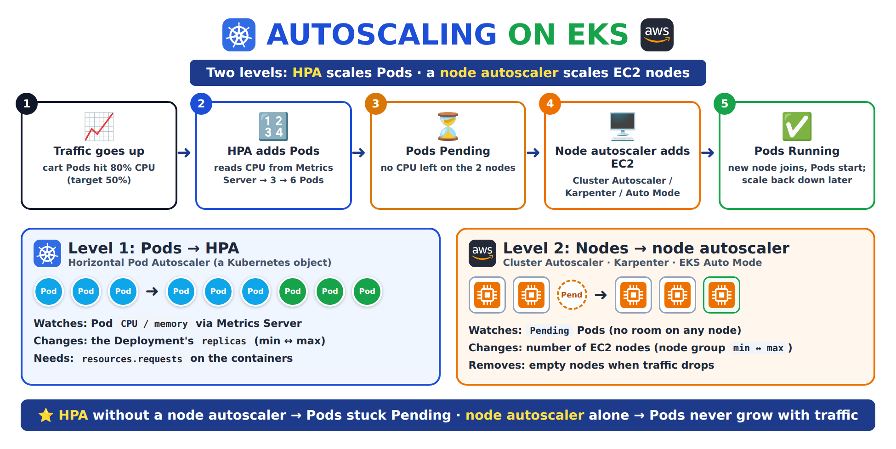

# Autoscaling on EKS: HPA for Pods, Node Groups, Cluster Autoscaler, Karpenter and Auto Mode

[← Day 23: EKS with Terraform](../README.md) · [Kubernetes notes](../../README.md)

> **In short:** On EKS, **AWS manages the control plane** and **we run the worker nodes** in a managed node group. Scaling happens at **two levels**: the **HPA** adds or removes **Pods** when CPU or memory goes up or down, and a **node autoscaler** (Cluster Autoscaler, Karpenter or EKS Auto Mode) adds or removes **EC2 nodes** when Pods have no room to run. Production uses **both**.

## About this topic

| Part | Topic | What you learn |
|---|---|---|
| **Part 1: Concepts** | Two levels of scaling, Metrics Server, HPA, node groups, node autoscalers | What each one scales, how it decides, which one real projects use |
| **Part 2: Lab** | HPA on our Day 23 EKS cluster + scaling the node group | Watch Pods scale up and down under load, then add a node |

## Table of Contents

**Part 1: Concepts**
1. [Two levels of scaling](#1-two-levels-of-scaling)
2. [Metrics Server](#2-metrics-server)
3. [HPA: scaling Pods](#3-hpa-scaling-pods)
4. [Node groups: who manages what](#4-node-groups-who-manages-what)
5. [Scaling nodes by hand](#5-scaling-nodes-by-hand)
6. [Scaling nodes automatically: Cluster Autoscaler, Karpenter, Auto Mode](#6-scaling-nodes-automatically-cluster-autoscaler-karpenter-auto-mode)
7. [How HPA and the node autoscaler work together](#7-how-hpa-and-the-node-autoscaler-work-together)
8. [Which one to use](#8-which-one-to-use)

**Part 2: Lab**

9. [Lab: HPA under load and scaling the node group](#9-lab-hpa-under-load-and-scaling-the-node-group)

**Wrap-up**

10. [What I learned](#10-what-i-learned)
11. [Commands](#11-commands)
12. [Interview Questions](#12-interview-questions)

---

# Part 1: Concepts

## 1. Two levels of scaling

**Definition:** **autoscaling** means the cluster grows when traffic goes up and shrinks when it goes down, without anyone changing numbers by hand. In Kubernetes it happens at **two levels**: more **Pods** (copies of the app) to handle the load, and more **nodes** (EC2 servers) so those Pods have CPU and memory to run on.



| Level | What grows | Who does it | Trigger |
|---|---|---|---|
| **1. Pods** | Number of replicas of a Deployment | **HPA** (Horizontal Pod Autoscaler) | Pod CPU / memory above the target |
| **2. Nodes** | Number of EC2 worker nodes | **Cluster Autoscaler**, **Karpenter** or **EKS Auto Mode** | Pods **Pending** because no node has room |

> 🛒 **Example (RoboShop):** at a sale, `cart` traffic goes up 5×. HPA raises `cart` from 3 to 15 Pods. The 2 nodes are full, so 8 Pods go Pending. The node autoscaler adds 2 EC2 nodes, and the Pods start. After the sale everything shrinks back.

> **Interview one-liner:** Kubernetes scales at two levels: HPA changes the number of Pods based on CPU or memory, and a node autoscaler (Cluster Autoscaler, Karpenter or Auto Mode) changes the number of nodes when Pods can't be scheduled.

---

## 2. Metrics Server

**Definition:** **Metrics Server** is a small add-on that collects the **current CPU and memory** use of every Pod and node from the kubelets, every 15 seconds or so. HPA reads these numbers to decide when to scale, and `kubectl top` shows them. Without it, HPA can't see any usage and does nothing.

| Without Metrics Server | With Metrics Server |
|---|---|
| `kubectl top pods` → `error: Metrics API not available` | Shows CPU and memory per Pod |
| HPA `TARGETS` shows `<unknown>/50%` | HPA shows `12%/50%` and scales |

> EKS doesn't install it by default (it's in the add-ons list from [Day 22](../../day-22-k8s-intro/README.md)). It keeps only the **latest** numbers, no history: for dashboards and history we use Prometheus.

---

## 3. HPA: scaling Pods

**Definition:** the **Horizontal Pod Autoscaler (HPA)** is a Kubernetes object that watches a Deployment's Pods and **changes its `replicas`** to keep the average CPU (or memory) near a **target** we set. It never goes below `minReplicas` or above `maxReplicas`. "Horizontal" means **more copies** of the Pod, not a bigger Pod.

### 3.1 How it decides

Every 15 seconds the HPA compares the **average usage** with the **target** and works out how many Pods are needed:

```
 desired Pods = current Pods × (current CPU % ÷ target CPU %)    (rounded up)

 Example: 3 Pods × (80% ÷ 50%) = 4.8 → 5 Pods
```

> ⚠️ The CPU % is **compared with the container's `resources.requests.cpu`**, not with the node's CPU. If a container has **no requests**, the HPA can't calculate a % and won't scale it.

### 3.2 The YAML

```yaml
apiVersion: autoscaling/v2
kind: HorizontalPodAutoscaler
metadata:
  name: cart
spec:
  scaleTargetRef:              # what to scale
    apiVersion: apps/v1
    kind: Deployment
    name: cart
  minReplicas: 3               # never fewer (keeps it available)
  maxReplicas: 15              # never more (keeps cost under control)
  metrics:
  - type: Resource
    resource:
      name: cpu
      target:
        type: Utilization
        averageUtilization: 50 # keep average CPU near 50% of requests
```

The Deployment must have **requests**:

```yaml
      containers:
      - name: cart
        image: cart:1.0
        resources:
          requests:
            cpu: 200m          # 50% target = 100m per Pod
            memory: 256Mi
```

### 3.3 Scale up fast, scale down slow

| Direction | Default behaviour | Why |
|---|---|---|
| **Up** | Right away, as soon as usage is above target | Users are waiting |
| **Down** | Waits **5 minutes** of low usage before removing Pods | Avoid removing Pods during a short dip, then adding them back (flapping) |

> 💡 Don't set `replicas` in the Deployment **and** use an HPA with Argo CD or `kubectl apply`, or every deploy resets the replica count. Let the HPA own `replicas` (remove the field or tell Argo CD to ignore it).

> **Interview one-liner:** HPA changes a Deployment's replicas between min and max to keep average CPU or memory near a target; it needs Metrics Server and resource requests, scales up quickly and waits 5 minutes before scaling down.

---

## 4. Node groups: who manages what

**Definition:** a **managed node group** is a group of EC2 worker nodes that EKS launches and updates for us. Behind it is an **EC2 Auto Scaling group** with three numbers: **min**, **desired** and **max**. AWS runs the control plane; we decide how many nodes, of which instance type, run our Pods.

| Part | Who manages it |
|---|---|
| **Control plane** (API server, etcd, scheduler) | **AWS**: we never see or scale it |
| **Worker nodes** (EC2) | **Us**, through the node group (instance type, min / desired / max) |

Our Day 23 Terraform values ([terraform.tfvars](../README.md#terraformtfvars-my-values)):

| Setting | Value | Meaning |
|---|---|---|
| `node_instance_types` | `["m7i-flex.large"]` | 2 vCPU, 8 GB each |
| `node_min_size` | `2` | Never fewer than 2 nodes |
| `node_desired_size` | `2` | Run 2 nodes **now** |
| `node_max_size` | `6` | Never more than 6 nodes |

---

## 5. Scaling nodes by hand

**Definition:** **manual node scaling** means changing the node group's **desired size** ourselves. Useful for a planned event or for testing, but in production a node autoscaler does it.

| Way | How | Use for |
|---|---|---|
| **Terraform** | Raise `node_min_size` (and desired) in `terraform.tfvars`, `terraform apply` | ✅ Permanent changes, reviewed in Git |
| **AWS CLI** | `aws eks update-nodegroup-config ... desiredSize=3` | Quick tests |
| **Console** | EKS → cluster → **Compute** → node group → **Edit** | Learning |

> ⚠️ **Terraform gotcha:** the EKS Terraform module **ignores changes to `desired_size`** after the node group is created, so an autoscaler can change it without Terraform undoing it. Changing only `node_desired_size` does nothing. To add nodes from Terraform, raise **`node_min_size`**.

---

## 6. Scaling nodes automatically: Cluster Autoscaler, Karpenter, Auto Mode

**Definition:** a **node autoscaler** watches for Pods stuck in **Pending** because no node has enough free CPU or memory, and **adds EC2 nodes** for them. When nodes stay mostly empty, it moves their Pods elsewhere and **removes** the nodes to save money. It looks at **Pod requests**, not real CPU usage.

| | **Cluster Autoscaler** | **Karpenter** ✅ | **EKS Auto Mode** |
|---|---|---|---|
| What it is | Open-source Kubernetes autoscaler | Open-source node autoscaler made by AWS | Karpenter + add-ons, **run by AWS** for us |
| How it adds nodes | Raises the node group's **desired size** (up to `max_size`) | Launches the **right-size EC2 instance** directly, no node group needed | Same as Karpenter, nothing to install |
| Instance types | Fixed by the node group | Picks the best fit (and Spot) per Pending Pod | AWS picks |
| Speed | Slower (goes through the Auto Scaling group) | Fast (about a minute) | Fast |
| Setup | Install with Helm + IAM role | Install with Helm + IAM role + NodePool YAML | Turn on Auto Mode |
| Cost | EC2 only | EC2 only | EC2 **+ Auto Mode fee** |
| Seen in | Older / simpler clusters | ✅ **Most EKS clusters today** | Teams that don't want to manage nodes |

> **Interview one-liner:** Cluster Autoscaler, Karpenter and Auto Mode all add nodes when Pods are Pending and remove empty ones; Cluster Autoscaler resizes node groups, Karpenter launches right-sized instances directly and is the common choice on EKS, and Auto Mode is AWS running it for us.

---

## 7. How HPA and the node autoscaler work together

**Definition:** HPA and the node autoscaler are **separate tools** that form a chain: HPA creates more Pods, and when those Pods can't fit, the node autoscaler creates room for them. Each one fixes a different shortage: HPA fixes "not enough **Pods**", the node autoscaler fixes "not enough **nodes**".

```
 Traffic ↑ ─► HPA: 3 → 6 Pods ─► no room: Pods Pending ─► node autoscaler adds EC2 ─► Pods Running
 Traffic ↓ ─► HPA: 6 → 3 Pods ─► nodes almost empty     ─► node autoscaler removes EC2
```

| We use only… | What happens |
|---|---|
| HPA | Pods scale until the nodes are full, then new Pods stay **Pending** |
| Node autoscaler | Pods never grow with traffic, so nodes only grow when **we** add replicas |
| **Both** ✅ | Pods follow the traffic, nodes follow the Pods |

---

## 8. Which one to use

| Need | Use |
|---|---|
| App needs more copies when busy | **HPA** on CPU (or memory) |
| Pods stuck Pending because nodes are full | **Karpenter** or **Cluster Autoscaler** (or Auto Mode) |
| Don't want to manage nodes at all | **EKS Auto Mode** (extra fee) |
| A planned event (sale tomorrow) | Raise HPA `minReplicas` and the node group `min_size` the day before |
| Learning / labs | HPA + scale the node group by hand (this lab) |

> **Real projects:** HPA on every stateless app (`cart`, `catalogue`, `frontend`), **Karpenter** for nodes, Metrics Server for HPA and Prometheus for dashboards. Databases are not scaled by HPA: they use RDS or StatefulSets.

---

# Part 2: Lab

## 9. Lab: HPA under load and scaling the node group

**Goal:** on the Day 23 EKS cluster, install Metrics Server, put an HPA on a small CPU-heavy app, load it until Pods scale up, watch them scale down, then add a worker node by hand.

**Before you start:**

| Need | Why |
|---|---|
| EKS cluster from [Day 23](../README.md#7-steps-create-the-cluster) + bastion with `kubectl` and AWS CLI | Where we run all commands |
| 2 worker nodes (`m7i-flex.large`) | Enough room for 10 small Pods |

### Step 1: Install Metrics Server

```bash
kubectl apply -f https://github.com/kubernetes-sigs/metrics-server/releases/latest/download/components.yaml
```

```bash
kubectl get deployment metrics-server -n kube-system
```

**Expected:** `READY 1/1` after about a minute.

```bash
kubectl top nodes
```

**Expected:** CPU and memory for both nodes. If you see `Metrics API not available`, wait 30 seconds and try again.

### Step 2: Create the app

```bash
vim php-apache.yaml
```

```yaml
apiVersion: apps/v1
kind: Deployment
metadata:
  name: php-apache
spec:
  replicas: 1
  selector:
    matchLabels:
      app: php-apache
  template:
    metadata:
      labels:
        app: php-apache
    spec:
      containers:
      - name: php-apache
        image: registry.k8s.io/hpa-example   # does CPU work on every request
        ports:
        - containerPort: 80
        resources:
          requests:
            cpu: 200m                        # HPA % is based on this
          limits:
            cpu: 500m
---
apiVersion: v1
kind: Service
metadata:
  name: php-apache
spec:
  selector:
    app: php-apache
  ports:
  - port: 80
```

```bash
kubectl apply -f php-apache.yaml
```

### Step 3: Create the HPA

```bash
vim php-apache-hpa.yaml
```

```yaml
apiVersion: autoscaling/v2
kind: HorizontalPodAutoscaler
metadata:
  name: php-apache
spec:
  scaleTargetRef:
    apiVersion: apps/v1
    kind: Deployment
    name: php-apache
  minReplicas: 1
  maxReplicas: 10
  metrics:
  - type: Resource
    resource:
      name: cpu
      target:
        type: Utilization
        averageUtilization: 50
```

```bash
kubectl apply -f php-apache-hpa.yaml
```

```bash
kubectl get hpa
```

**Expected:** `TARGETS cpu: 0%/50%`, `REPLICAS 1`. If it shows `<unknown>`, wait a minute for Metrics Server.

### Step 4: Send load

Open a **second terminal** on the bastion and run a Pod that calls the app in a loop:

```bash
kubectl run load-generator --rm -it --image=busybox:1.36 --restart=Never -- /bin/sh -c "while sleep 0.01; do wget -q -O- http://php-apache; done"
```

**What it does:** sends a request every 10 ms. Each request makes `php-apache` do CPU work.

### Step 5: Watch the HPA scale up

Back in the first terminal:

```bash
kubectl get hpa php-apache -w
```

**Expected:** within 1–2 minutes the CPU goes above 50% (e.g. `250%/50%`) and `REPLICAS` goes up: 1 → 4 → 7… Press `Ctrl+C`.

```bash
kubectl get pods -l app=php-apache -o wide
```

**Expected:** several `php-apache` Pods spread over both nodes.

```bash
kubectl describe hpa php-apache
```

**Expected:** Events like `New size: 5; reason: cpu resource utilization (percentage of request) above target`.

### Step 6: Stop the load and watch it scale down

In the second terminal press `Ctrl+C`. The load-generator Pod is deleted.

```bash
kubectl get hpa php-apache -w
```

**Expected:** CPU drops to `0%/50%` quickly, but `REPLICAS` stays the same for about **5 minutes**, then goes back to **1**. That's the scale-down wait.

### Step 7: Add a worker node by hand

```bash
aws eks update-nodegroup-config --cluster-name abhigna-cluster --nodegroup-name abhigna-cluster-ng-1 --scaling-config minSize=2,maxSize=6,desiredSize=3
```

```bash
kubectl get nodes -w
```

**Expected:** a 3rd node appears and becomes `Ready` in 2–3 minutes. Press `Ctrl+C`.

Set it back to 2 nodes (stops the extra EC2 bill):

```bash
aws eks update-nodegroup-config --cluster-name abhigna-cluster --nodegroup-name abhigna-cluster-ng-1 --scaling-config minSize=2,maxSize=6,desiredSize=2
```

**Expected:** after a few minutes `kubectl get nodes` shows 2 nodes again. EKS moves the Pods off the removed node first.

| Problem | Fix |
|---|---|
| HPA `TARGETS` shows `<unknown>` | Metrics Server not ready, or the container has **no `requests.cpu`** |
| `kubectl top` → `Metrics API not available` | `kubectl get pods -n kube-system -l k8s-app=metrics-server`, check its logs |
| Replicas don't go down | Normal: wait 5 minutes after the load stops |
| New Pods Pending at high replicas | Nodes are full: that's when a node autoscaler (or step 7) is needed |

### Step 8: Clean up

```bash
kubectl delete -f php-apache-hpa.yaml
```

```bash
kubectl delete -f php-apache.yaml
```

---

# Wrap-up

## 10. What I learned

**Part 1: Concepts**
- Two levels: **HPA** scales **Pods** on CPU/memory; a **node autoscaler** scales **EC2 nodes** when Pods are Pending.
- HPA needs **Metrics Server** and **resource requests**; it scales up fast and down after 5 minutes.
- AWS manages the control plane; **we** size the managed node group (min / desired / max).
- Node autoscalers: **Cluster Autoscaler** (resizes node groups), **Karpenter** (right-size EC2, most common), **Auto Mode** (AWS runs it, extra fee).

**Part 2: Lab**
- Under load, the HPA took `php-apache` from 1 Pod up to several, and back to 1 about 5 minutes after the load stopped. Changing the node group's desired size added and removed a node.

```
 Traffic ↑ ─► HPA adds Pods ─► Pending ─► node autoscaler adds EC2 ─► Running
```

---

## 11. Commands

| Command | Use |
|---|---|
| `kubectl top nodes` / `kubectl top pods` | Current CPU and memory (needs Metrics Server) |
| `kubectl get hpa` | Targets, current usage, replicas |
| `kubectl get hpa <name> -w` | Watch the HPA live |
| `kubectl describe hpa <name>` | Events: why it scaled |
| `kubectl get pods --field-selector=status.phase=Pending` | Pods waiting for room |
| `aws eks describe-nodegroup --cluster-name <c> --nodegroup-name <ng> --query nodegroup.scalingConfig` | Node group min / desired / max |
| `aws eks update-nodegroup-config ... --scaling-config minSize=2,maxSize=6,desiredSize=3` | Change node count |

---

## 12. Interview Questions

### Other Questions

**Q1. What's the difference between HPA and Cluster Autoscaler / Karpenter?**
HPA scales Pods (replicas) based on CPU or memory usage. Cluster Autoscaler and Karpenter scale nodes when Pods are Pending because no node has room. In production we use both.

**Q2. If I use EKS Auto Mode, do I still need HPA?**
Yes. Auto Mode only adds nodes for Pending Pods. Without HPA the replica count never changes with traffic, so there are no extra Pods for Auto Mode to make room for.

**Q3. Why does my HPA show `<unknown>` targets?**
Either Metrics Server isn't installed or ready, or the containers have no CPU requests, so the HPA can't calculate a percentage.

**Q4. How does HPA decide how many Pods to run?**
desired = current replicas × (current usage ÷ target), rounded up and kept between min and max. For example 3 Pods at 80% with a 50% target gives 5 Pods.

**Q5. Why doesn't HPA scale down right after the load drops?**
By default it waits 5 minutes of low usage before removing Pods, to avoid flapping during short dips.

**Q6. Who manages the EKS control plane and who manages the worker nodes?**
AWS manages the control plane. We manage the worker nodes through managed node groups (instance type, min, desired, max), usually defined in Terraform.

**Q7. How do you add more worker nodes to an EKS cluster?**
Raise the node group size in Terraform (min_size, because the module ignores desired_size changes), with `aws eks update-nodegroup-config`, or in the console. In production a node autoscaler like Karpenter does it automatically.

**Q8. Cluster Autoscaler vs Karpenter?**
Cluster Autoscaler changes the desired size of existing node groups, so instance types are fixed. Karpenter launches the best-fitting EC2 instance directly for the Pending Pods, is faster, supports Spot well, and is the common choice on EKS.

**Q9. Does a node autoscaler look at real CPU usage?**
No. It looks at Pod requests: a Pod is Pending when no node has enough unrequested CPU or memory. That's why setting correct requests matters for both HPA and node scaling.

---

**Source:** [Kubernetes docs: Horizontal Pod Autoscaling](https://kubernetes.io/docs/tasks/run-application/horizontal-pod-autoscale/) · [HPA walkthrough](https://kubernetes.io/docs/tasks/run-application/horizontal-pod-autoscale-walkthrough/) · [Metrics Server](https://github.com/kubernetes-sigs/metrics-server) · [EKS: Scale cluster compute with Karpenter and Cluster Autoscaler](https://docs.aws.amazon.com/eks/latest/userguide/autoscaling.html) · [EKS Auto Mode](https://docs.aws.amazon.com/eks/latest/userguide/automode.html) · [Karpenter](https://karpenter.sh/)
