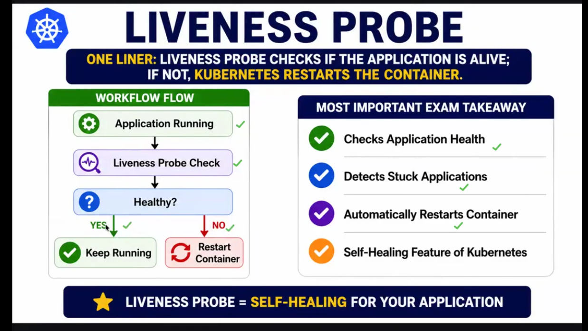
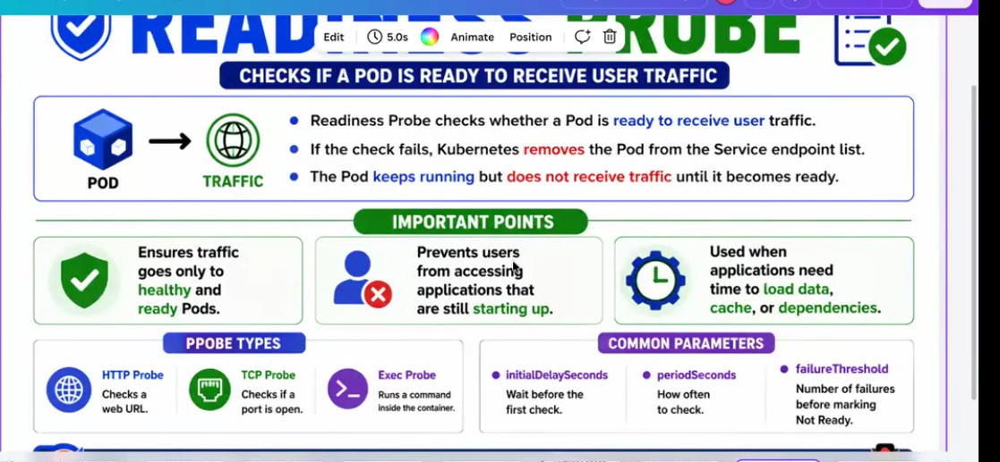
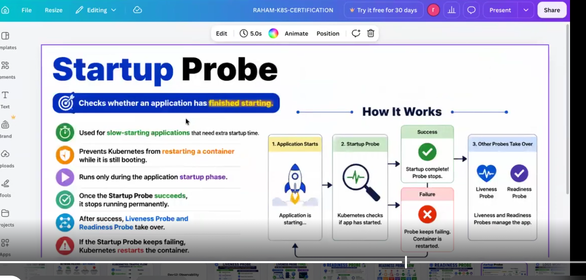
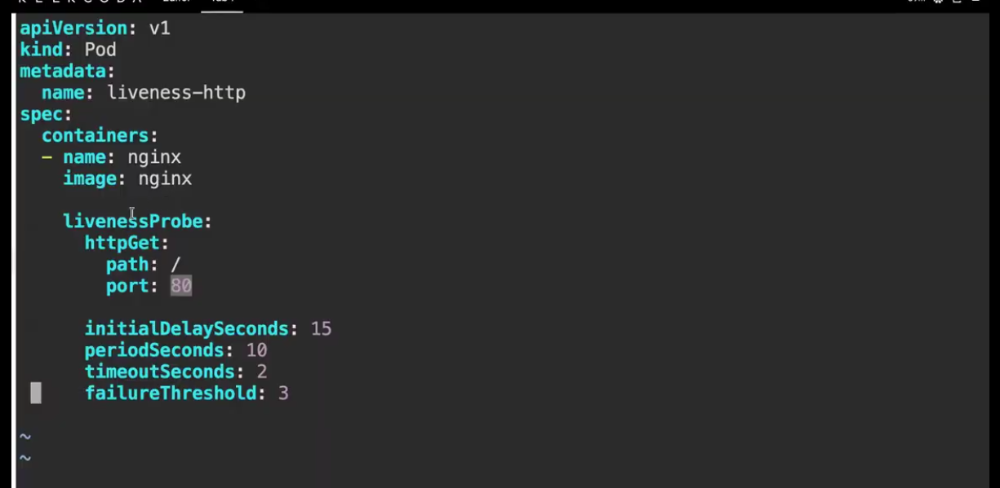
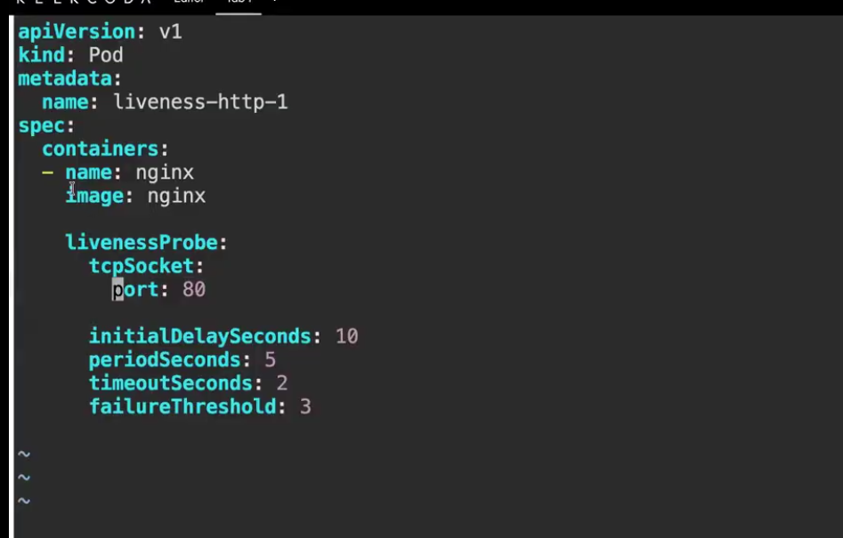
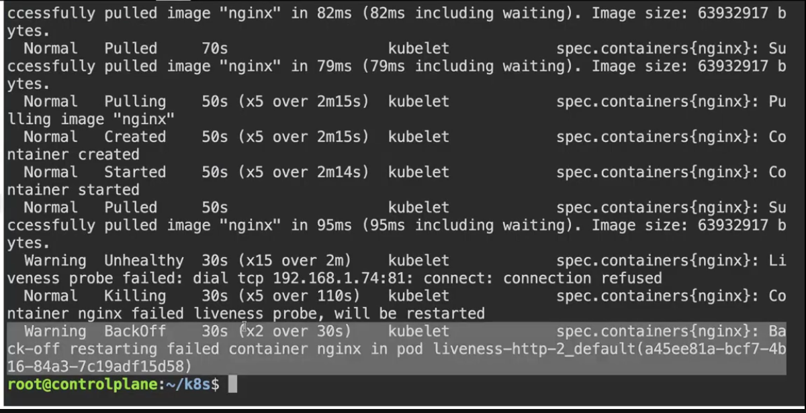
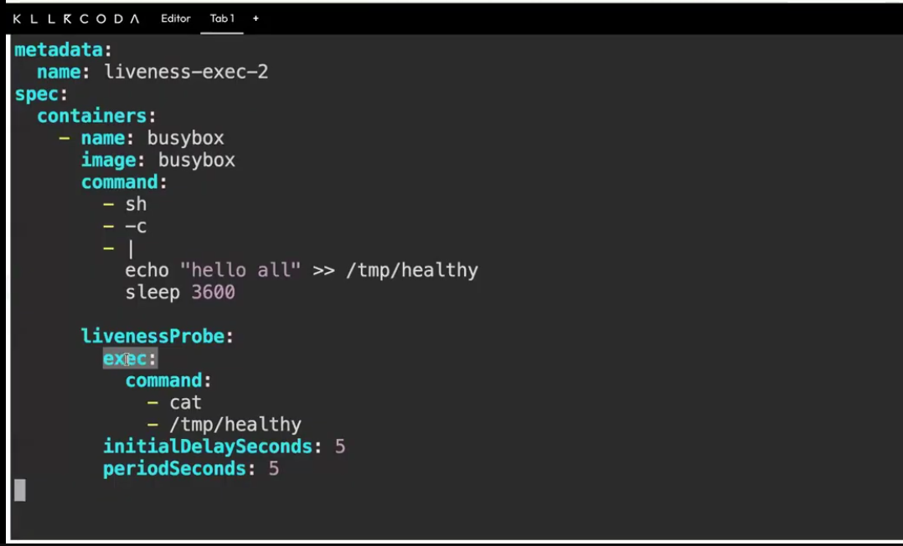

# Day 24 — Kubernetes Probes: Liveness and Readiness

[← Kubernetes notes](../README.md)

> **In short:** A container can be "running" but still broken (stuck, frozen, not ready). **Probes** let Kubernetes check the app by itself. **Liveness** = is it alive? If not, **restart** it. **Readiness** = is it ready for users? If not, **stop sending traffic** to it.

## Table of Contents

1. [What is a probe?](#1-what-is-a-probe)
2. [Liveness probe](#2-liveness-probe)
3. [Readiness probe](#3-readiness-probe)
4. [Startup probe](#4-startup-probe)
5. [Liveness vs Readiness vs Startup](#5-liveness-vs-readiness-vs-startup)
6. [How a probe checks the app (3 ways)](#6-how-a-probe-checks-the-app-3-ways)
7. [Probe timing settings](#7-probe-timing-settings)
8. [Example YAML](#8-example-yaml)
9. [Lab: liveness probe with httpGet (nginx)](#9-lab-liveness-probe-with-httpget-nginx)
10. [Lab: troubleshoot CrashLoopBackOff (wrong path, port, command)](#10-lab-troubleshoot-crashloopbackoff-wrong-path-port-command)
11. [Commands](#11-commands)
12. [Interview Questions](#12-interview-questions)

---

## 1. What is a probe?

**Definition:** A **probe** is a **health check** that the **kubelet** (on the worker node) runs on a container **again and again, every few seconds** (interval you set).

**Why?** Kubernetes already restarts a container when its process **crashes**. But if the app is **stuck** (process running, app not responding), Kubernetes can't see the problem without a probe.

| Without probes | With probes |
|---|---|
| App frozen but process alive → K8s thinks it's fine | Liveness sees no response → restarts container |
| App still starting → users get errors | Readiness says "not ready" → no traffic yet |

| Probe | Question it asks | If it fails |
|---|---|---|
| **Liveness** | Is the app **alive**? | **Restart** the container |
| **Readiness** | Is the app **ready** to take traffic? | **Remove pod from Service** (no traffic), no restart |

---

## 2. Liveness probe

**Definition:** A **liveness probe** checks **if the application is alive (healthy)** every interval of time we set. **If it gets no response, Kubernetes restarts the container.**

**How it works, step by step:**

1. App is running in the container.
2. Every `periodSeconds` (e.g. 10s), the kubelet sends the liveness check (e.g. `GET /health`).
3. **Response OK** → "yes, healthy" → **keep running**.
4. **No response / error** (for `failureThreshold` times in a row, e.g. 3) → "not healthy" → **restart the container**.

```
 Application running
        │
        ▼
 Liveness probe check  (every N seconds)
        │
        ▼
     Healthy?
     │      │
    YES     NO
     │      │
     ▼      ▼
 Keep     Restart
 running  container
```



**Key points:**

| ✅ | |
|---|---|
| Checks application health | Every interval we set |
| Detects stuck applications | Process alive but app frozen (deadlock, hang) |
| Automatically restarts container | No human needed |
| Self-healing feature of Kubernetes | App fixes itself |

> ⭐ **Liveness probe = self-healing for your application.**

> **Interview one-liner:** A liveness probe checks if the application is alive; if not, Kubernetes restarts the container.

---

## 3. Readiness probe

**Definition:** A **readiness probe** checks **whether a pod is ready to receive user traffic**.
- If the check **fails**, Kubernetes **removes the pod from the Service endpoint list**.
- The pod **keeps running** (no restart) but **does not receive traffic until it becomes ready**.



**Why do we need it after liveness?**
Liveness only says the app is **alive**. Alive is not the same as **ready**. An app can be running but still loading data, cache or a DB connection. If users are sent to it now, they get errors. Readiness makes sure **traffic goes only to pods that are ready**.

| | Alive? (liveness) | Ready? (readiness) | Gets traffic? |
|---|---|---|---|
| App starting, loading data | ✅ | ❌ | ❌ No |
| App fully started | ✅ | ✅ | ✅ Yes |
| DB connection lost for a while | ✅ | ❌ | ❌ No (comes back when ready) |
| App stuck / frozen | ❌ → restart | ❌ | ❌ No |

**Service endpoint list** = the list of pod IPs a Service sends traffic to. Only **Ready** pods are in it.

**How it works, step by step:**

1. Pod starts → **not ready yet** → not in the endpoint list → **no traffic**.
2. After `initialDelaySeconds`, the kubelet runs the readiness check every `periodSeconds`.
3. **Check passes** → pod marked **Ready** → added to the endpoint list → **gets traffic**.
4. **Check fails** `failureThreshold` times → pod marked **Not Ready** → **removed** from the endpoint list → no traffic. The pod **keeps running**.
5. Check passes again → added back → traffic comes back. **No restart at any point.**

```
 User ──► Service ──┬──► Pod 1 (Ready ✅)      gets traffic
                    ├──► Pod 2 (Ready ✅)      gets traffic
                    └──✖ Pod 3 (Not Ready ❌)  running, but NO traffic, NOT restarted
```

**Important points:**

| | |
|---|---|
| ✅ | Ensures traffic goes **only to healthy and ready pods** |
| 🚫 | Prevents users from reaching apps that are **still starting up** |
| ⏱️ | Used when apps need **time to load data, cache or dependencies** (DB, other services) |

**Probe types: the SAME 3 methods as liveness (HTTP endpoint, TCP port, EXEC command). Only the probe name changes** (`livenessProbe:` → `readinessProbe:`):

| Type | Checks | Liveness | Readiness |
|---|---|---|---|
| **HTTP** | A web URL (endpoint) returns 200–399 | `livenessProbe:` + `httpGet:` | `readinessProbe:` + `httpGet:` |
| **TCP** | A port is open | `livenessProbe:` + `tcpSocket:` | `readinessProbe:` + `tcpSocket:` |
| **Exec** | A command inside the container exits 0 | `livenessProbe:` + `exec:` | `readinessProbe:` + `exec:` |

```yaml
readinessProbe:          # only this name is different
  httpGet:               # or tcpSocket: / exec: — same as liveness
    path: /
    port: 80
```

> Same check, **different action on failure**: liveness → **restart**, readiness → **no traffic**.

**Common parameters:**

| Parameter | Meaning |
|---|---|
| `initialDelaySeconds` | Wait before the first check |
| `periodSeconds` | How often to check |
| `failureThreshold` | Number of failures before marking the pod **Not Ready** |

**Example YAML:**

```yaml
apiVersion: v1
kind: Pod
metadata:
  name: readiness-http
  labels:
    app: web
spec:
  containers:
  - name: nginx
    image: nginx
    ports:
    - containerPort: 80

    readinessProbe:           # ready? if not → NO TRAFFIC (no restart)
      httpGet:
        path: /
        port: 80
      initialDelaySeconds: 5  # wait 5s before 1st check
      periodSeconds: 5        # check every 5s
      failureThreshold: 3     # 3 fails → Not Ready
```

**How to see it:**

```bash
kubectl get pods                  # READY 0/1 = not ready (no traffic), 1/1 = ready
kubectl describe pod readiness-http
#   Warning  Unhealthy  Readiness probe failed: ...
kubectl get endpoints <service>   # only Ready pod IPs are listed
```

| `kubectl get pods` shows | Meaning |
|---|---|
| `READY 1/1`, `Running` | Ready → gets traffic |
| `READY 0/1`, `Running` | Running but **not ready** → no traffic, RESTARTS stays the same |

> Readiness failing gives **`0/1 Running`**, **not** CrashLoopBackOff, because there is no restart.

> **Interview one-liner:** A readiness probe checks whether a pod is ready to receive user traffic. If it fails, Kubernetes removes the pod from the Service endpoint list; the pod keeps running but gets no traffic until it becomes ready.

---

## 4. Startup probe

**Definition:** A **startup probe** is the **very first probe**. It checks **whether the application has finished starting**.



**Why?** Some apps (big Java apps, apps loading lots of data) take minutes to start. Without a startup probe, the **liveness probe** may check too early, fail, and **restart the container while it is still booting** → it never finishes starting → restart loop.

**Key points:**

| | |
|---|---|
| ⏱️ | Used for **slow-starting applications** that need extra startup time |
| 🛡️ | Prevents Kubernetes from **restarting a container while it is still booting** |
| ▶️ | Runs **only during the startup phase** |
| ✅ | Once it **succeeds**, it **stops running permanently** |
| 🔁 | After success, **liveness and readiness probes take over** |
| ❌ | If it **keeps failing**, Kubernetes **restarts the container** |

**How it works, step by step:**

1. **Application starts** (booting).
2. **Startup probe** checks if the app has started (liveness and readiness are **paused** for now).
3. **Success** → "startup complete" → startup probe **stops** forever.
   **Failure** (keeps failing `failureThreshold` times) → container is **restarted** → back to step 1.
4. **Other probes take over:** liveness (alive?) and readiness (ready for traffic?) manage the app from now on.

```
 App starts ──► Startup probe ──► Success ──► stops ──► Liveness + Readiness take over
      ▲               │
      │               ▼
      └──── restart ◄─ Keeps failing
```

**Same 3 methods (HTTP / TCP / EXEC). Only the name changes:** `startupProbe:`

```yaml
apiVersion: v1
kind: Pod
metadata:
  name: startup-demo
spec:
  containers:
  - name: nginx
    image: nginx

    startupProbe:              # 1st: has the app finished starting?
      httpGet:
        path: /
        port: 80
      periodSeconds: 10        # check every 10s
      failureThreshold: 30     # allow 30 x 10s = 300s (5 min) to start

    livenessProbe:             # starts only AFTER startup probe succeeds
      httpGet:
        path: /
        port: 80
      periodSeconds: 10

    readinessProbe:            # starts only AFTER startup probe succeeds
      httpGet:
        path: /
        port: 80
      periodSeconds: 5
```

**Max startup time = `failureThreshold` × `periodSeconds`** → here 30 × 10s = **5 minutes**. If the app isn't up in 5 min → restart.

> **Interview one-liner:** A startup probe is the first probe; it checks whether a slow-starting app has finished starting. Until it succeeds, liveness and readiness are paused, so Kubernetes doesn't restart the app while it boots. After it succeeds it stops, and liveness and readiness take over.

---

## 5. Liveness vs Readiness vs Startup

| | Startup | Liveness | Readiness |
|---|---|---|---|
| Order | **1st** | After startup succeeds | After startup succeeds |
| Question | Has the app **finished starting**? | Is the app **alive**? | Is the app **ready** for traffic? |
| Runs | Only during startup, then stops | Whole life of container | Whole life of container |
| On failure | **Restarts** container | **Restarts** container | **Stops traffic** to pod |
| Restart? | ✅ Yes | ✅ Yes | ❌ No |
| Fixes | Slow-starting app killed while booting | Stuck / frozen app | Loading data, temporary busy |
| Simple word | **Boot check** | **Self-healing** | **Traffic control** |
| YAML key | `startupProbe:` | `livenessProbe:` | `readinessProbe:` |
| Methods | HTTP / TCP / EXEC | HTTP / TCP / EXEC | HTTP / TCP / EXEC |

> Use **both** together: readiness keeps users away from a pod that isn't ready; liveness restarts it if it's truly stuck.

> **Order:** startup probe runs **first** → when it passes, liveness and readiness start. See [section 4](#4-startup-probe).

---

## 6. How a probe checks the app (3 ways)

> ⭐ **One-liner:** There are **three ways to check if your app is alive: HTTP, TCP, EXEC.**
> **HTTP = endpoint | TCP = port | EXEC = command**


| # | Type | Checks | Healthy if | Use for |
|---|---|---|---|---|
| 1 | **HTTP** (`httpGet`) | A **web endpoint** like `/health` | Response code **200–399** | Web apps, APIs |
| 2 | **TCP** (`tcpSocket`) | Whether a **port** is accepting connections | Port **opens** | Databases (MySQL 3306), Redis 6379 |
| 3 | **EXEC** (`exec`) | Runs a **command inside the container** | Command **exit code 0** | Apps without HTTP/port, custom checks |

### 1. HTTP probe = endpoint

The kubelet calls a URL of the app, like a browser: `GET http://<pod-ip>:8080/health`.
- Answer `200 OK` → alive ✅
- Error (500), no answer, timeout → failed ❌ → restart

```yaml
livenessProbe:
  httpGet:
    path: /health      # the endpoint
    port: 8080
  periodSeconds: 10
```

### 2. TCP probe = port

The kubelet only tries to **connect to the port**. It doesn't send a request or read a reply.
- Port accepts the connection → alive ✅
- Connection refused → failed ❌ → restart

```yaml
livenessProbe:
  tcpSocket:
    port: 3306         # the port (MySQL)
  periodSeconds: 10
```

### 3. EXEC probe = command

The kubelet **runs a command inside the container** and checks its result (exit code).
- Exit code `0` → alive ✅
- Any other exit code → failed ❌ → restart

```yaml
livenessProbe:
  exec:
    command: ["cat", "/tmp/healthy"]   # the command
  periodSeconds: 10
```

**Which one to choose?**

| My app is... | Use |
|---|---|
| A website / API with a `/health` URL | **HTTP** |
| A DB or service that only listens on a port | **TCP** |
| Something that needs a custom check (script, file) | **EXEC** |

> The same 3 types work for **readiness** and **startup** probes too; only the action on failure is different.

---

## 7. Probe timing settings

| Setting | Meaning | Default |
|---|---|---|
| `initialDelaySeconds` | Wait this long after container starts before 1st check | 0 |
| `periodSeconds` | **Interval**: check every N seconds | 10 |
| `timeoutSeconds` | Wait this long for a response | 1 |
| `failureThreshold` | Fail this many times in a row → action (restart / not ready) | 3 |
| `successThreshold` | Pass this many times → healthy again | 1 |

Example: `periodSeconds: 10` + `failureThreshold: 3` → app must fail for **~30 seconds** before restart.

---

## 8. Example YAML

```yaml
apiVersion: apps/v1
kind: Deployment
metadata:
  name: nginx-probes
spec:
  replicas: 2
  selector:
    matchLabels:
      app: nginx
  template:
    metadata:
      labels:
        app: nginx
    spec:
      containers:
        - name: nginx
          image: nginx:1.27
          ports:
            - containerPort: 80

          livenessProbe:              # alive? if not → RESTART
            httpGet:
              path: /
              port: 80
            initialDelaySeconds: 10   # wait 10s after start
            periodSeconds: 10         # check every 10s
            failureThreshold: 3       # 3 fails → restart

          readinessProbe:             # ready? if not → NO TRAFFIC
            httpGet:
              path: /
              port: 80
            initialDelaySeconds: 5
            periodSeconds: 5
```

**Liveness with `exec` (classic demo):**

```yaml
          livenessProbe:
            exec:
              command: ["cat", "/tmp/healthy"]   # file exists → healthy
            initialDelaySeconds: 5
            periodSeconds: 5
```

Delete the file inside the container (`kubectl exec <pod> -- rm /tmp/healthy`) → probe fails → container restarts → `RESTARTS` count goes up.

---

## 9. Lab: liveness probe with httpGet (nginx)

**Goal:** check if the nginx app is alive using a **liveness probe** with the **HTTP (`httpGet`)** method.



### The code: `liveness-http.yaml`

```yaml
apiVersion: v1
kind: Pod
metadata:
  name: liveness-http
spec:
  containers:
  - name: nginx
    image: nginx

    livenessProbe:
      httpGet:
        path: /
        port: 80

      initialDelaySeconds: 15
      periodSeconds: 10
      timeoutSeconds: 2
      failureThreshold: 3
```

### Line by line

| Line | Meaning |
|---|---|
| `kind: Pod`, `name: liveness-http` | Create one pod named `liveness-http` |
| `name: nginx`, `image: nginx` | One container running the nginx web server |
| `livenessProbe:` | Check if the container is **alive**; if not → restart it |
| `httpGet:` | Use the **HTTP** method (call a web endpoint) |
| `path: /` | The **endpoint** to call. `/` = nginx home page |
| `port: 80` | **nginx listens on port 80**, so we check port 80 |
| `initialDelaySeconds: 15` | Wait **15 s** after the container starts before the 1st check (give nginx time to start) |
| `periodSeconds: 10` | Then check **every 10 s** |
| `timeoutSeconds: 2` | Wait max **2 s** for an answer; slower = failed |
| `failureThreshold: 3` | **3 failures in a row** → restart the container |

### What the probe actually does

Every 10 s, the **kubelet** (on the worker node) sends this request to the container:

```
GET http://<pod-ip>:80/
```

| nginx answers | Result |
|---|---|
| **200 OK** (path `/` exists, home page returned) | ✅ Healthy → keep running |
| **404 Not Found** (path doesn't exist), **500** error, or no answer in 2 s | ❌ Failed. 3 times in a row → **restart container** |

> **Path can be anything the app really serves:** `/`, `/dev`, `/health`, `/login`... The rule: the path must return **200–399**. Default nginx serves only `/`, so `path: /health` would get **404** → nginx would be restarted again and again even though it works fine.

> **Port must match the app:** nginx works on **80**. If you put `port: 8080`, nothing listens there → probe fails → restart loop.

### Timeline

```
0s    container starts
15s   1st check  GET /  → 200 ✅
25s   2nd check  GET /  → 200 ✅
35s   ...every 10s, keeps running

If nginx breaks:
 fail 1 ❌ → fail 2 ❌ → fail 3 ❌  (~30 s)  → kubelet RESTARTS the container
```

### failureThreshold → restart → CrashLoopBackOff

**Not on the 1st restart.** CrashLoopBackOff comes when the probe **keeps failing after every restart**.

| Situation | What happens | `kubectl get pods` STATUS |
|---|---|---|
| Fails 3 times (`failureThreshold`) **once**, then OK after restart | Container restarted 1 time → healthy | `Running`, RESTARTS 1 |
| Fails **every time**, even after restarts (wrong path, wrong port, app always broken) | Restart → fail → restart → fail... K8s waits **longer each time** (10s, 20s, 40s ... max 5 min) | **`CrashLoopBackOff`**, RESTARTS keeps going up |

```
fail x3 → restart #1 → fail x3 → restart #2 (wait 10s) → fail x3 → restart #3 (wait 20s) ...
                                                         └─► STATUS: CrashLoopBackOff
```

**CrashLoopBackOff** = "the container keeps failing, so Kubernetes is **backing off** (waiting longer) before the next restart."

**Example:** `path: /health` on default nginx → always 404 → CrashLoopBackOff.

**How to fix:**

```bash
kubectl describe pod liveness-http      # Events: "Liveness probe failed: HTTP probe failed with statuscode: 404"
kubectl logs liveness-http --previous   # logs of the container BEFORE the last restart
```

Then fix the probe (correct `path` / `port`, bigger `initialDelaySeconds` if the app is slow) and re-apply.

### Steps (run where kubectl works: Killercoda control plane / EKS bastion)

**Step 1 — create the file and the pod**

```bash
vi liveness-http.yaml          # paste the YAML above
kubectl apply -f liveness-http.yaml
```

**Step 2 — check it's healthy**

```bash
kubectl get pods               # STATUS Running, RESTARTS 0
kubectl describe pod liveness-http
#   Liveness: http-get http://:80/ delay=15s timeout=2s period=10s #success=1 #failure=3
```

**Step 3 — break it (test self-healing)**

Delete nginx's home page, so `/` stops returning 200 (nginx returns **403**):

```bash
kubectl exec liveness-http -- rm /usr/share/nginx/html/index.html
```

**Step 4 — watch Kubernetes restart it**

```bash
kubectl get pods -w            # after ~30 s RESTARTS goes 0 → 1
kubectl describe pod liveness-http
#   Warning  Unhealthy  Liveness probe failed: HTTP probe failed with statuscode: 403
#   Normal   Killing    Container nginx failed liveness probe, will be restarted
```

The restarted container starts fresh from the image, so `index.html` is back → `/` returns 200 → healthy again. **That's self-healing.**

**Step 5 — clean up**

```bash
kubectl delete -f liveness-http.yaml
```

> **Interview one-liner:** I used an `httpGet` liveness probe on nginx: path `/` on port 80, first check after 15 s, then every 10 s with a 2 s timeout. After 3 failures in a row the kubelet restarts the container.

---

## 10. Lab: troubleshoot CrashLoopBackOff (wrong path, port, command)

**Goal:** in class we **broke the liveness probe on purpose** 3 ways (HTTP, TCP, EXEC) to see **CrashLoopBackOff** and learn how a DevOps engineer finds the cause.

### ⭐ First step as a DevOps engineer: `kubectl describe pod`

```bash
kubectl get pods                    # STATUS: CrashLoopBackOff, RESTARTS going up
kubectl describe pod <pod-name>     # go to the Events section at the bottom
```

The **Events** section tells you **exactly why** the probe failed:

| Event | Meaning |
|---|---|
| `Warning  Unhealthy  Liveness probe failed: ...` | **The reason** (wrong path / port / command) ⬅️ read this line |
| `Normal  Killing  Container ... failed liveness probe, will be restarted` | Kubelet restarted the container |
| `Warning  BackOff  Back-off restarting failed container` | It keeps failing → **CrashLoopBackOff** |

### Test 1: HTTP probe, wrong path

Same `liveness-http` pod as [section 9](#9-lab-liveness-probe-with-httpget-nginx), but with a path nginx doesn't have:

```yaml
    livenessProbe:
      httpGet:
        path: /health     # ❌ wrong: default nginx has no /health page
        port: 80
```

`kubectl describe pod` shows:

```
Warning  Unhealthy  Liveness probe failed: HTTP probe failed with statuscode: 404
```

**Fix:** use a path the app really serves (`path: /`).

### Test 2: TCP probe, wrong port

Correct TCP probe (nginx listens on port 80):



```yaml
apiVersion: v1
kind: Pod
metadata:
  name: liveness-http-1
spec:
  containers:
  - name: nginx
    image: nginx

    livenessProbe:
      tcpSocket:
        port: 80               # ✅ nginx port
      initialDelaySeconds: 10  # wait 10s before 1st check
      periodSeconds: 5         # check every 5s
      timeoutSeconds: 2
      failureThreshold: 3      # 3 fails (~15s) → restart
```

Then we created `liveness-http-2` with **`port: 81`** ❌ (nothing listens on 81). `kubectl describe pod`:



```
Warning  Unhealthy  Liveness probe failed: dial tcp 192.168.1.74:81: connect: connection refused
Normal   Killing    Container nginx failed liveness probe, will be restarted
Warning  BackOff    Back-off restarting failed container nginx in pod liveness-http-2
```

`connection refused` on port **81** → wrong port. **Fix:** `port: 80`.

### Test 3: EXEC probe, wrong command

Correct EXEC probe: the container creates `/tmp/healthy`, the probe reads it with `cat`.



```yaml
apiVersion: v1
kind: Pod
metadata:
  name: liveness-exec-2
spec:
  containers:
    - name: busybox
      image: busybox
      command:                  # what the container runs
        - sh
        - -c
        - |
          echo "hello all" >> /tmp/healthy   # create the file
          sleep 3600                         # keep container alive 1 hour
      livenessProbe:
        exec:
          command:              # probe runs: cat /tmp/healthy
            - cat
            - /tmp/healthy      # ✅ file exists → exit 0 → healthy
        initialDelaySeconds: 5
        periodSeconds: 5
```

Then we changed the probe to read a file that doesn't exist: **`/tmp/health`** ❌


`cat /tmp/health` → file not found → exit code 1 → probe fails. `kubectl describe pod`:

```
Warning  Unhealthy  Liveness probe failed: cat: can't open '/tmp/health': No such file or directory
```

**Fix:** correct the command (`/tmp/healthy`).

### Summary: CrashLoopBackOff from a liveness probe

| Probe | What we broke | `describe pod` error | Fix |
|---|---|---|---|
| **HTTP** | Wrong **path** (`/health`) | `HTTP probe failed with statuscode: 404` | Path the app serves (`/`) |
| **TCP** | Wrong **port** (81) | `dial tcp <ip>:81: connect: connection refused` | App's real port (80) |
| **EXEC** | Wrong **command** (`cat /tmp/health`) | `cat: can't open '/tmp/health': No such file or directory` | Correct command / file |
| Any | App too slow to start | Fails in the first seconds only | Increase `initialDelaySeconds` |

### Troubleshooting steps (in order)

1. `kubectl get pods` → see `CrashLoopBackOff` and RESTARTS count.
2. `kubectl describe pod <pod>` → read the **Events**: `Liveness probe failed: ...` tells you path, port or command.
3. `kubectl logs <pod> --previous` → app logs from **before** the last restart (did the app itself crash?).
4. Fix the YAML (path / port / command / delay).
5. Pod probe settings can't be edited in place → `kubectl delete pod <pod>` then `kubectl apply -f <file>.yaml`.
6. `kubectl get pods -w` → `Running`, RESTARTS stops going up ✅

> **Interview one-liner:** When a pod is in CrashLoopBackOff, I first run `kubectl describe pod` and read the Events. A liveness probe failure shows the exact reason: 404 for a wrong path, connection refused for a wrong port, or a command error for a wrong exec command. Then I check `kubectl logs --previous`, fix the YAML and re-apply.

---

## 11. Commands

| Command | Use |
|---|---|
| `kubectl apply -f deploy.yaml` | Create the deployment with probes |
| `kubectl get pods` | `READY 1/1` = readiness passing; `RESTARTS` = liveness restarts |
| `kubectl get pods -w` | Watch status change live |
| `kubectl describe pod <pod>` | Events: `Liveness probe failed`, `Readiness probe failed` |
| `kubectl get endpoints <svc>` | Only **ready** pods are listed |

---

## 12. Interview Questions

### ⭐ Very Important

**Q1. What is a liveness probe?**
It checks if the application is alive at an interval we set. If it gets no response, Kubernetes restarts the container; if it gets a response, the container keeps running. Liveness probe = self-healing for your application.

**Q2. What happens when a liveness probe fails?**
After `failureThreshold` failures in a row, the kubelet restarts the container. The pod's `RESTARTS` count goes up.

**Q3. What are the 3 ways to check if your app is alive (probe types)?**
HTTP checks a web endpoint like `/health` (200–399 = healthy). TCP checks whether a port is accepting connections. EXEC runs a command inside the container and checks the result (exit 0 = healthy). HTTP = endpoint, TCP = port, EXEC = command.

**Q4. Explain the `liveness-http` probe: path `/`, port 80, initialDelaySeconds 15.**
Every 10 s the kubelet sends `GET http://<pod-ip>:80/` to nginx (nginx listens on 80). A 200–399 answer means healthy. The first check waits 15 s so nginx can start. If it fails 3 times in a row (no answer within 2 s, or an error like 404), the container is restarted. The path can be any endpoint the app serves (`/`, `/dev`, `/health`).

**Q5. What happens if the liveness probe never gets a response?**
After `failureThreshold` failures in a row the container is restarted. If it keeps failing after every restart, Kubernetes waits longer between restarts (10s, 20s, 40s ... up to 5 min) and the pod shows **CrashLoopBackOff**. Check `kubectl describe pod` events and `kubectl logs --previous`, then fix the path, port or initial delay.

**Q6. A pod is in CrashLoopBackOff. What is your first step and what can cause it with liveness probes?**
First `kubectl describe pod <pod>` and read the Events (`Liveness probe failed: ...`). Common causes: wrong path in httpGet (404), wrong port in httpGet/tcpSocket (connection refused), wrong command in exec (e.g. file not found), or too short `initialDelaySeconds`. Then check `kubectl logs --previous`, fix the YAML and re-create the pod.

**Q7. What is a readiness probe?**
It checks whether a pod is ready to receive user traffic. If the check fails, Kubernetes removes the pod from the Service endpoint list. The pod keeps running but does not receive traffic until it becomes ready. Used when apps need time to load data, cache or dependencies.

**Q8. If a readiness probe fails, is the pod restarted?**
No. It shows `READY 0/1` and `Running`, is removed from the Service endpoints, and gets traffic back when the check passes again. Only a liveness failure restarts the container.

**Q9. Do readiness probes use different check methods from liveness?**
No. Both use the same 3 methods: HTTP (endpoint), TCP (port), EXEC (command). Only the key name changes (`livenessProbe:` / `readinessProbe:` / `startupProbe:`) and the action on failure (restart vs no traffic).

**Q10. What is a startup probe?**
The very first probe. It checks whether the application has finished starting. Used for slow-starting apps so Kubernetes doesn't restart them while booting. Once it succeeds it stops, and liveness and readiness take over. If it keeps failing, the container is restarted.

**Q11. What is the order of the 3 probes?**
Startup first. Liveness and readiness are paused until startup succeeds, then both run for the life of the container.

### Other Questions

**Q12. Difference between liveness and readiness probes?**
Liveness failure → container restart (self-healing). Readiness failure → traffic stops to that pod, no restart (traffic control).

**Q13. Why do we need a liveness probe if Kubernetes already restarts crashed containers?**
A crash stops the process, which K8s sees. A stuck app (deadlock, hang) keeps the process alive, so only a liveness probe can detect it.

**Q14. What can go wrong with a badly set liveness probe?**
If `initialDelaySeconds` is too short or the timeout too small, a healthy but slow app gets restarted again and again (restart loop / CrashLoopBackOff).

---

**Source:** [Kubernetes docs: Liveness, Readiness and Startup Probes](https://kubernetes.io/docs/concepts/configuration/liveness-readiness-startup-probes/) · [Configure probes](https://kubernetes.io/docs/tasks/configure-pod-container/configure-liveness-readiness-startup-probes/)
