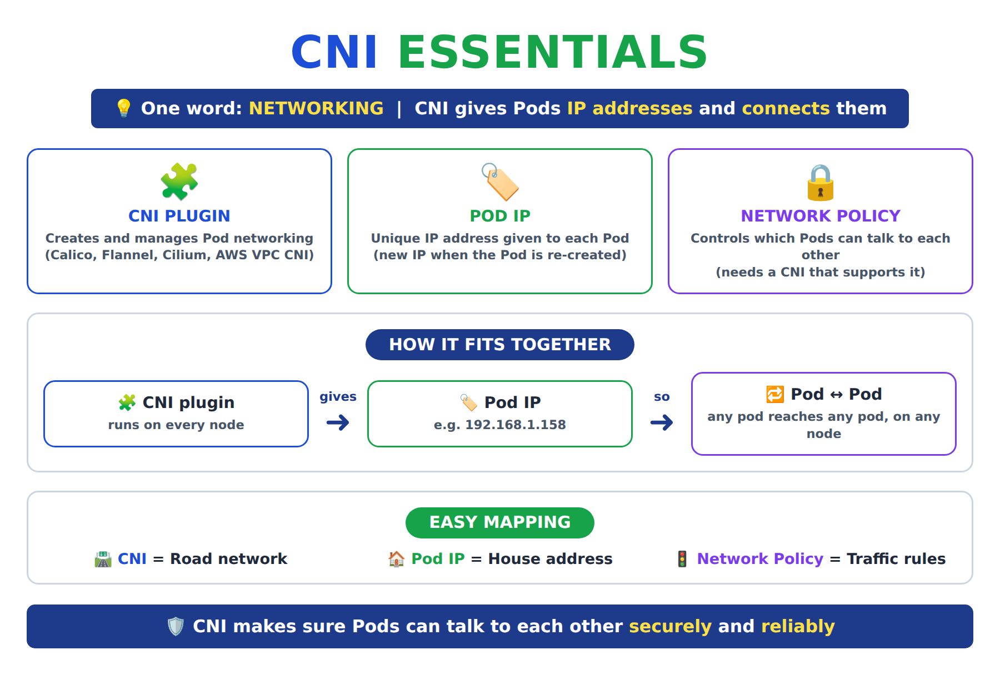
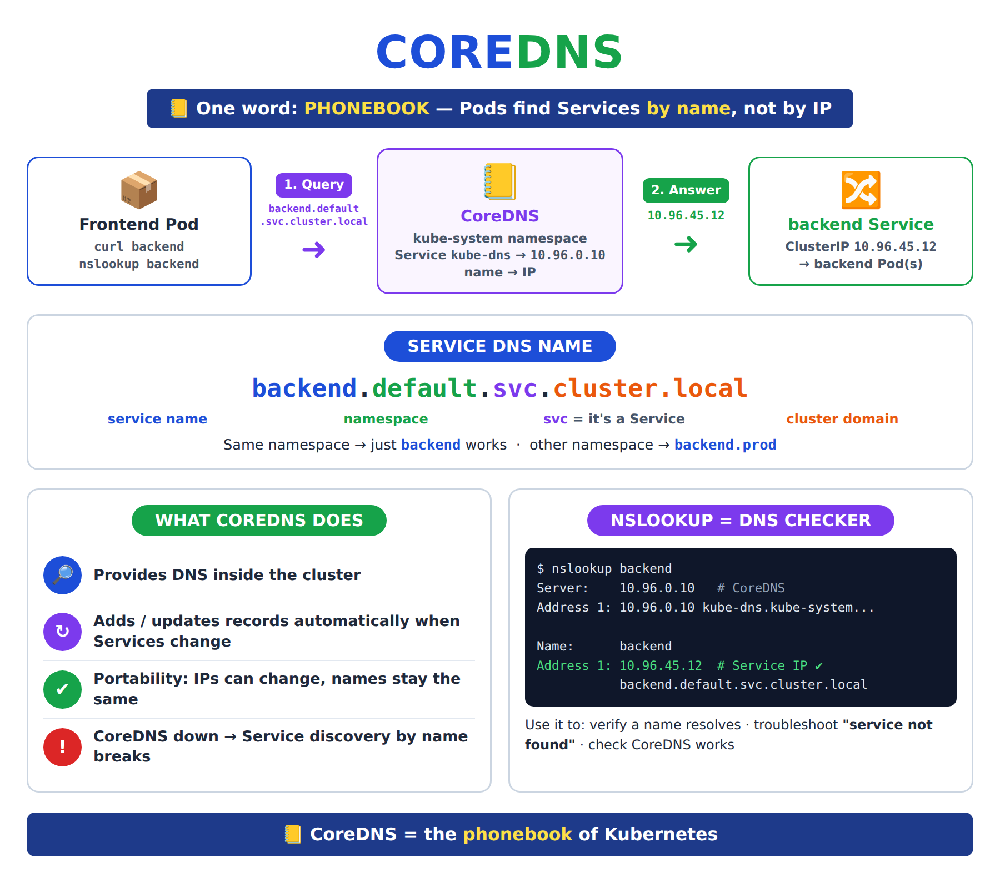
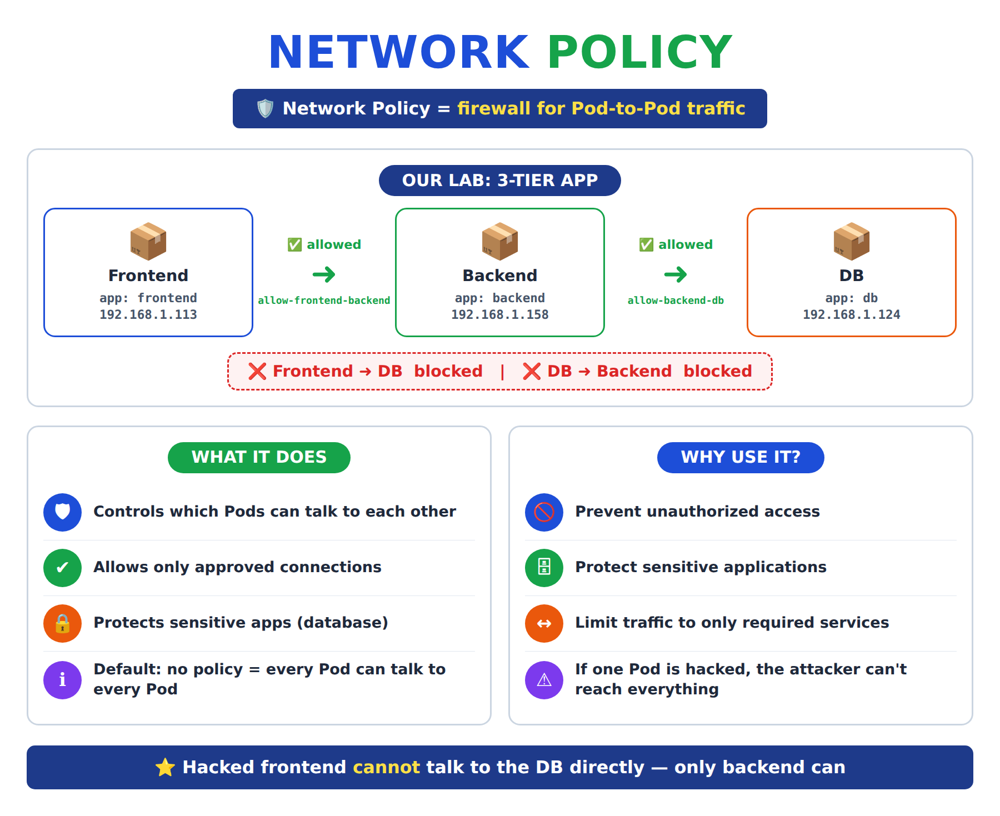
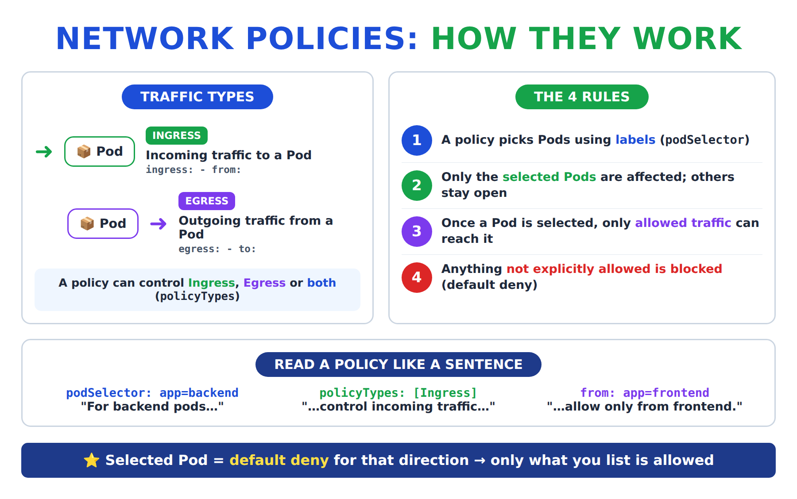

# Day 25 — Kubernetes Networking: CNI, CoreDNS (DNS), Services, nslookup and Network Policies

[← Kubernetes notes](../README.md)

> **In short:** **CNI** gives every Pod an **IP address** and connects all Pods together. Pod IPs change, so a **Service** gives a fixed IP and **CoreDNS** lets Pods find it **by name** (like a phonebook). For users outside, production apps use an **Ingress** (one load balancer) in front of **ClusterIP** Services. **nslookup** checks that a name resolves. By default every Pod can talk to every Pod. A **Network Policy** is a **firewall** that allows only the traffic we want (frontend → backend → db).

## About this class

Here we learn how Pods get IPs and talk to each other, how they find each other by name, and how to lock that traffic down.

| Part | Topic | What you learn |
|---|---|---|
| **Part 1: Concepts** | CNI, CoreDNS, Services, nslookup, Network Policy | What each one is and why we need it |
| **Part 2: Lab** | 3-tier app: frontend, backend, db | Create pods and Services, test DNS with nslookup, then block traffic with 2 Network Policies |
| **Part 3: More policy patterns** | Default deny, egress + DNS | Two common policies you'll see in real clusters and the CKA exam |

## Table of Contents

**Part 1: Concepts**
1. [CNI: how Pods get IPs and talk](#1-cni-how-pods-get-ips-and-talk)
2. [CoreDNS: the phonebook of Kubernetes](#2-coredns-the-phonebook-of-kubernetes)
3. [Services: a fixed name for Pods](#3-services-a-fixed-name-for-pods)
4. [nslookup: the DNS checker](#4-nslookup-the-dns-checker)
5. [Network Policy: a firewall for Pods](#5-network-policy-a-firewall-for-pods)

**Part 2: Lab**
6. [Lab: DNS and Network Policies step by step](#6-lab-dns-and-network-policies-step-by-step)

**Part 3: More policy patterns**
7. [Default deny and egress with DNS](#7-default-deny-and-egress-with-dns)

**Wrap-up**
8. [What I learned](#8-what-i-learned)
9. [Commands](#9-commands)
10. [Interview Questions](#10-interview-questions)

---

# Part 1: Concepts

## 1. CNI: how Pods get IPs and talk

**Definition:** **CNI (Container Network Interface)** is the **networking plugin** of Kubernetes. It **gives every Pod an IP address** and **connects Pods** so they can talk to each other, even across nodes.

> ⭐ **One word: NETWORKING.** CNI gives Pods IP addresses and connects them.



**Why?** Kubernetes itself doesn't create Pod networking. It hands that job to a CNI plugin. Without a CNI, nodes stay `NotReady` and Pods get no IP.

**3 main pieces:**

| Piece | Definition | Easy mapping |
|---|---|---|
| **CNI plugin** | Program on every node that creates and manages Pod networking | 🛣️ Road network |
| **Pod IP** | Unique IP address given to each Pod (e.g. `192.168.1.158`) | 🏠 House address |
| **Network Policy** | Rules for which Pods can talk to which | 🚦 Traffic rules |

**Popular CNI plugins:**

| Plugin | Supports Network Policy? | Where you see it |
|---|---|---|
| **Calico** | ✅ Yes | Very common in self-managed (kubeadm) clusters; can also run on EKS |
| **Cilium** | ✅ Yes | Modern clusters (eBPF) |
| **Flannel** | ❌ No (only connects Pods) | Simple / learning clusters |
| **AWS VPC CNI** | ✅ Yes (turn on network policy in the add-on) | EKS: Pods get real VPC IPs |

> ⚠️ A Network Policy is only a **rule**. The **CNI enforces it**. With a CNI that doesn't support policies (Flannel), you can create policies but **nothing is blocked**.

**Problem: Pod IPs change.** Delete and re-create a Pod and it gets a **new IP**. So apps should never call each other by Pod IP. They use a **Service** (fixed IP) and its **name** → that's where DNS comes in.

> **Interview one-liner:** CNI is the networking plugin that gives each Pod an IP and connects Pods across nodes; examples are Calico, Cilium, Flannel and AWS VPC CNI.

---

## 2. CoreDNS: the phonebook of Kubernetes

**Definition:** **CoreDNS** is the **DNS server inside the cluster**. It turns a **Service name** (like `backend`) into the **Service IP**, so Pods find each other **by name** instead of remembering IPs.

> ⭐ **One word: PHONEBOOK.** Name in → IP out.



**How it works, step by step:**

1. The frontend Pod runs `curl backend`.
2. The Pod asks CoreDNS: "what's the IP of `backend`?" (every Pod's `/etc/resolv.conf` points to CoreDNS).
3. CoreDNS answers with the **Service IP** (ClusterIP), e.g. `10.96.45.12`.
4. The request goes to the Service → the Service forwards it to a backend Pod.

```
 frontend Pod ──"backend?"──► CoreDNS ──"10.96.45.12"──► frontend Pod ──► backend Service ──► backend Pod
```

**Service DNS name format:**

```
<service>.<namespace>.svc.cluster.local
 backend . default   .svc.cluster.local
```

| Part | Meaning |
|---|---|
| `backend` | Service name |
| `default` | Namespace |
| `svc` | It's a Service |
| `cluster.local` | Cluster domain (default) |

| You are calling from... | Name that works |
|---|---|
| The **same** namespace | `backend` (short name is enough) |
| A **different** namespace | `backend.default` (add the namespace) |
| Anywhere (full name, FQDN) | `backend.default.svc.cluster.local` |

**Where CoreDNS lives:**

| Thing | Value |
|---|---|
| Namespace | `kube-system` |
| Pods | Deployment `coredns` (2 replicas), label `k8s-app=kube-dns` |
| Service | `kube-dns`, IP usually `10.96.0.10`, port **53** |
| Config | ConfigMap `coredns` (the `Corefile`) |

**`/etc/resolv.conf` inside every Pod** (written by the kubelet):

```
nameserver 10.96.0.10                                          # CoreDNS Service IP
search default.svc.cluster.local svc.cluster.local cluster.local   # why the short name "backend" works
```

**Key points:**

| | |
|---|---|
| 🔎 | Provides DNS **inside** the cluster |
| ↻ | Adds and updates records **automatically** when Services are created or deleted |
| ✅ | Portability: Pod/Service IPs can change, **names stay the same** |
| ❗ | CoreDNS down → **Service discovery by name breaks** (calls by IP still work) |

> **Interview one-liner:** CoreDNS is the cluster DNS server in kube-system; it resolves Service names like `backend.default.svc.cluster.local` to the Service IP, so Pods talk by name instead of IP.

---

## 3. Services: a fixed name for Pods

**Definition:** a **Service** is a **fixed name + IP** in front of a group of Pods (picked by labels). It sends traffic only to the **Ready** Pods. Pod IPs change, the Service name doesn't, and **CoreDNS** turns that name into the Service IP.

```
 frontend ──► "backend" (Service) ──► Ready backend Pods
```

| Type | Who can reach it | Use for |
|---|---|---|
| **ClusterIP** (default) | Only Pods inside the cluster | ✅ Every app (this is what our lab uses) |
| **NodePort** | Outside, via `node-ip:3xxxx` | ❌ Testing / on-prem |
| **LoadBalancer** | Internet, via its own cloud load balancer | ⚠️ Non-HTTP apps |
| **Ingress** (not a Service type) | Internet, via one ALB for all apps | ✅ All websites and APIs |

> 📘 **Full step-by-step guide with an EKS lab:** [Services: ClusterIP, NodePort, LoadBalancer, Ingress and traffic flow](../day-25-services-types-and-traffic-flow/README.md)

> **Interview one-liner:** A Service gives temporary Pods a fixed name and IP and sends traffic only to Ready Pods; in production every app is ClusterIP and one Ingress (an ALB on EKS) is the public door.

---

## 4. nslookup: the DNS checker

**Definition:** **nslookup** is a command that **asks a DNS server for the IP of a name**. Run inside a Pod, it shows whether a **Service name resolves** through CoreDNS.

> ⭐ **nslookup = DNS checker for Kubernetes Services.** It helps a Pod find another Service by name.

**Why use it?**

| | Use |
|---|---|
| ✅ | Verify a Service name resolves to the **correct IP** |
| ↔️ | Check communication between applications |
| ❗ | Troubleshoot **"service not found"** / `could not resolve host` errors |
| ⚙️ | Check that **CoreDNS works** in the cluster |

**How to read the output:**

```
Server:    10.96.0.10                          ← who answered: CoreDNS
Address 1: 10.96.0.10 kube-dns.kube-system.svc.cluster.local

Name:      backend                             ← the name we asked for
Address 1: 10.96.45.12 backend.default.svc.cluster.local   ← the Service IP ✅
```

| Output | Meaning |
|---|---|
| `Address: 10.96.x.x` | ✅ Name resolves: DNS is fine |
| `can't resolve 'backend'` / `NXDOMAIN` | ❌ No Service with that name **in that namespace** (typo, wrong namespace, Service not created) |
| `connection timed out; no servers could be reached` | ❌ CoreDNS itself is down or blocked (check CoreDNS Pods, or an egress policy blocking port 53) |

> 💡 The `nginx` image has **no** `nslookup`. Use a small test Pod with **`busybox:1.28`** (later busybox versions have a buggy nslookup).

> **Interview one-liner:** I use `nslookup <service>` from a busybox Pod to check that a Service name resolves through CoreDNS; NXDOMAIN means wrong name or namespace, a timeout means CoreDNS is down or blocked.

---

## 5. Network Policy: a firewall for Pods

**Definition:** A **Network Policy** is a Kubernetes object that acts as a **firewall for Pod traffic**. It decides **which Pods can talk to which Pods** (and on which ports).

> ⭐ **Network Policy = firewall for Pod communication.**



**Why?** By default, **every Pod can talk to every Pod** in the whole cluster. If a hacker gets into the frontend, they can go straight to the database. A Network Policy allows only the paths the app really needs.

| | Without policies | With policies |
|---|---|---|
| frontend → backend | ✅ allowed | ✅ allowed (needed) |
| backend → db | ✅ allowed | ✅ allowed (needed) |
| frontend → db | ✅ allowed 😱 | ❌ **blocked** |
| db → backend | ✅ allowed | ❌ **blocked** |

**Why use Network Policies?**

| | |
|---|---|
| 🚫 | Prevent unauthorized access |
| 🗄️ | Protect sensitive applications (databases) |
| ↔️ | Limit communication to only the required services |
| ⚠️ | Reduce security risk inside the cluster: one hacked Pod can't reach everything |

### Traffic types: Ingress and Egress



| Type | Definition | YAML |
|---|---|---|
| **Ingress** | Traffic **coming in to** the selected Pod | `ingress:` → `- from:` |
| **Egress** | Traffic **going out from** the selected Pod | `egress:` → `- to:` |

A policy can control **Ingress, Egress or both** (listed in `policyTypes`).

### The 4 rules (how policies work)

1. A policy picks Pods using **labels** (`podSelector`).
2. Only the **selected Pods** are affected. Other Pods stay fully open.
3. Once a Pod is selected, **only allowed traffic** can reach it.
4. Anything **not explicitly allowed is blocked** (default deny for that direction).

> Policies only **allow**. There is no "deny" rule. Several policies on the same Pod **add up** (union of all allows).

### Anatomy of a policy

```yaml
apiVersion: networking.k8s.io/v1
kind: NetworkPolicy
metadata:
  name: allow-frontend-backend
spec:
  podSelector:              # WHO is protected
    matchLabels:
      app: backend
  policyTypes:              # WHICH direction is controlled
  - Ingress
  ingress:                  # WHO is allowed in
  - from:
    - podSelector:
        matchLabels:
          app: frontend
```

**Read it like a sentence:** "For pods with `app: backend`, control **incoming** traffic, and allow it **only from** pods with `app: frontend`."

| Field | Meaning |
|---|---|
| `spec.podSelector` | The Pods this policy **protects** (by label). `{}` = all Pods in the namespace |
| `policyTypes` | `Ingress`, `Egress` or both |
| `ingress.from` | Allowed **sources**: `podSelector`, `namespaceSelector` or `ipBlock` |
| `egress.to` | Allowed **destinations** |
| `ports` (optional) | Allow only these ports, e.g. `- port: 80` |

> **Interview one-liner:** A NetworkPolicy is a firewall for Pods: it selects Pods by label and allows only the listed ingress/egress traffic; everything else to those Pods is blocked. It only works if the CNI (e.g. Calico, Cilium) enforces it.

---

# Part 2: Lab

## 6. Lab: DNS and Network Policies step by step

**Goal:** build a 3-tier app (frontend, backend, db), reach Pods by **name** through CoreDNS, then allow only **frontend → backend → db**.

**Where:** any cluster whose CNI enforces Network Policies: **EKS** with the VPC CNI network policy option turned on, or a self-managed cluster with **Calico** / **Cilium**. Run the commands where `kubectl` is set up (e.g. the bastion for EKS).

```
 frontend ──✅──► backend ──✅──► db
     └───────────❌──────────────┘
```

### Step 1: Check the cluster and the CNI

```bash
kubectl get nodes
```

**Expected:** all nodes are `Ready`.

```bash
kubectl get pods -n kube-system
```

**What it does:** lists the system Pods. Look for the CNI (`aws-node-*` on EKS, or `calico-*` / `cilium-*`) and DNS (`coredns-*`).

**Expected:** CNI Pods and 2 `coredns` Pods are `Running`.

### Step 2: Create the 3 Pods

```bash
vim pods.yaml
```

```yaml
apiVersion: v1
kind: Pod
metadata:
  name: frontend
  namespace: default
  labels:
    app: frontend          # policies find Pods by this label
spec:
  containers:
  - name: frontend
    image: nginx:latest
---
apiVersion: v1
kind: Pod
metadata:
  name: backend
  namespace: default
  labels:
    app: backend
spec:
  containers:
  - name: backend
    image: nginx:latest
---
apiVersion: v1
kind: Pod
metadata:
  name: db
  namespace: default
  labels:
    app: db
spec:
  containers:
  - name: db
    image: nginx:latest    # nginx stands in for a real database
```

```bash
kubectl apply -f pods.yaml
```

```bash
kubectl get pods -o wide --show-labels
```

**What it does:** shows each Pod's **IP** (given by the CNI), node and labels.

**Expected:**

```
NAME       READY   STATUS    IP              NODE     LABELS
backend    1/1     Running   192.168.1.158   node01   app=backend
db         1/1     Running   192.168.1.124   node01   app=db
frontend   1/1     Running   192.168.1.113   node01   app=frontend
```

> Your IPs will be different. Write down the **backend** IP for the next step.

### Step 3: Test Pod to Pod by IP (no policies yet)

```bash
kubectl exec -it frontend -- curl 192.168.1.158
```

**What it does:** runs `curl` **inside** the frontend Pod and calls the backend Pod's IP.

**Expected:** the nginx page: `<title>Welcome to nginx!</title>` ✅. With no policies, **everything is open**.

### Step 4: Create Services so we can use names

Pod IPs change when a Pod is re-created, so we put a **Service** in front of backend and db.

```bash
kubectl expose pod backend --port=80 --name=backend
```

```bash
kubectl expose pod db --port=80 --name=db
```

```bash
kubectl get svc
```

**Expected:** `backend` and `db` with `TYPE ClusterIP` and a `CLUSTER-IP` like `10.96.x.x` (this IP doesn't change). ClusterIP = internal only, which is right for backend and db ([section 3](#3-services-a-fixed-name-for-pods)).

### Step 5: Call by name (CoreDNS at work)

```bash
kubectl exec -it frontend -- curl -sI backend
```

**What it does:** calls `backend` **by name**. CoreDNS turns `backend` into the Service IP. `-sI` shows only the response headers.

**Expected:** `HTTP/1.1 200 OK` ✅

### Step 6: Check DNS with nslookup

nginx has no `nslookup`, so we start a small test Pod:

```bash
kubectl run dns-test --image=busybox:1.28 --restart=Never -- sleep 3600
```

```bash
kubectl exec -it dns-test -- nslookup backend
```

**Expected:**

```
Server:    10.96.0.10
Address 1: 10.96.0.10 kube-dns.kube-system.svc.cluster.local

Name:      backend
Address 1: 10.96.x.x backend.default.svc.cluster.local
```

The `backend` IP matches `kubectl get svc` ✅. The full name is `backend.default.svc.cluster.local`.

```bash
kubectl exec -it dns-test -- cat /etc/resolv.conf
```

**Expected:** `nameserver 10.96.0.10` (CoreDNS) and `search default.svc.cluster.local svc.cluster.local cluster.local`.

```bash
kubectl get svc -n kube-system kube-dns
```

**Expected:** the `kube-dns` Service with the same IP as `nameserver` (`10.96.0.10`). That's CoreDNS.

**If nslookup fails:**

| Error | Cause | Fix |
|---|---|---|
| `can't resolve 'backend'` | Service missing, typo, or another namespace | `kubectl get svc -A`; use `backend.<namespace>` |
| `connection timed out; no servers could be reached` | CoreDNS Pods down | `kubectl get pods -n kube-system -l k8s-app=kube-dns`, `kubectl logs -n kube-system -l k8s-app=kube-dns` |
| Works by IP, fails by name | DNS problem, not network | Check CoreDNS Pods and the `kube-dns` Service |

### Step 7: Policy 1: only frontend can reach backend

```bash
vim allow-frontend-backend.yaml
```

```yaml
apiVersion: networking.k8s.io/v1
kind: NetworkPolicy
metadata:
  name: allow-frontend-backend
  namespace: default
spec:
  podSelector:
    matchLabels:
      app: backend         # protect the backend Pods
  policyTypes:
  - Ingress                # control incoming traffic
  ingress:
  - from:
    - podSelector:
        matchLabels:
          app: frontend    # allow only from frontend
```

```bash
kubectl apply -f allow-frontend-backend.yaml
```

```bash
kubectl get networkpolicy
```

**Expected:** `allow-frontend-backend` with `POD-SELECTOR app=backend`.

**Test: frontend → backend (allowed):**

```bash
kubectl exec -it frontend -- curl -sI --max-time 5 backend
```

**Expected:** `HTTP/1.1 200 OK` ✅

**Test: db → backend (blocked):**

```bash
kubectl exec -it db -- curl -sI --max-time 5 backend
```

**Expected:** no answer for 5 s, then `command terminated with exit code 28` (curl timeout) ❌. The policy **drops** the traffic, so it **times out**.

> 💡 `--max-time 5` stops curl after 5 s; without it, a blocked call just hangs.

### Step 8: Policy 2: only backend can reach db

```bash
vim allow-backend-db.yaml
```

```yaml
apiVersion: networking.k8s.io/v1
kind: NetworkPolicy
metadata:
  name: allow-backend-db
  namespace: default
spec:
  podSelector:
    matchLabels:
      app: db              # protect the db Pods
  policyTypes:
  - Ingress
  ingress:
  - from:
    - podSelector:
        matchLabels:
          app: backend     # allow only from backend
```

```bash
kubectl apply -f allow-backend-db.yaml
```

**Test: backend → db (allowed):**

```bash
kubectl exec -it backend -- curl -sI --max-time 5 db
```

**Expected:** `HTTP/1.1 200 OK` ✅

**Test: frontend → db (blocked):**

```bash
kubectl exec -it frontend -- curl -sI --max-time 5 db
```

**Expected:** `command terminated with exit code 28` ❌. Even a hacked frontend can't reach the database.

### Step 9: Final result

| From → To | Result | Why |
|---|---|---|
| frontend → backend | ✅ 200 OK | Allowed by `allow-frontend-backend` |
| backend → db | ✅ 200 OK | Allowed by `allow-backend-db` |
| frontend → db | ❌ timeout | db only allows backend |
| db → backend | ❌ timeout | backend only allows frontend |
| anyone → frontend | ✅ open | No policy selects frontend, so it stays open |

```bash
kubectl describe networkpolicy allow-backend-db
```

**What it does:** shows the policy in plain words: `PodSelector: app=db`, `Allowing ingress traffic: From: PodSelector: app=backend`.

**Troubleshooting Network Policies:**

| Problem | Cause | Fix |
|---|---|---|
| Policy created but **nothing is blocked** | CNI doesn't enforce policies (e.g. Flannel) | Use Calico / Cilium; on EKS enable network policy in the VPC CNI add-on |
| **Allowed** traffic is blocked too | Label in `podSelector` doesn't match the Pod | `kubectl get pods --show-labels`, fix the label (typos like `fronted`) |
| Works by IP, fails by name after an **egress** policy | Egress blocks DNS (port 53 to CoreDNS) | Allow egress to port 53 ([Part 3](#7-default-deny-and-egress-with-dns)) |
| `connection refused` (not a timeout) | Not a policy: app not listening on that port | Check `containerPort` / Service `targetPort` |
| Policy in the wrong namespace | A policy only works in **its own** namespace | Create it in the Pods' namespace (`-n`) |

> **Timeout = blocked by policy. Connection refused = nothing listening on that port.**

### Step 10: Clean up

```bash
kubectl delete -f allow-frontend-backend.yaml -f allow-backend-db.yaml
```

```bash
kubectl delete svc backend db
```

```bash
kubectl delete -f pods.yaml
```

```bash
kubectl delete pod dns-test
```

---

# Part 3: More policy patterns

## 7. Default deny and egress with DNS

### Default deny all ingress

**Definition:** a **default deny** policy selects **all Pods** in a namespace and allows **nothing** in. You then add small "allow" policies for each path you need.

```yaml
apiVersion: networking.k8s.io/v1
kind: NetworkPolicy
metadata:
  name: default-deny-ingress
  namespace: default
spec:
  podSelector: {}          # {} = ALL Pods in this namespace
  policyTypes:
  - Ingress                # no "ingress:" rules = nothing allowed in
```

> ⭐ Best practice: **default deny first, then allow only what's needed** (zero trust).

### Egress: allow only db + DNS

**Definition:** an **egress** policy controls where a Pod is allowed to **send** traffic.

When you control egress, **remember DNS**. The Pod must still reach CoreDNS on **port 53**, or every call by name fails.

```yaml
apiVersion: networking.k8s.io/v1
kind: NetworkPolicy
metadata:
  name: backend-egress
  namespace: default
spec:
  podSelector:
    matchLabels:
      app: backend
  policyTypes:
  - Egress
  egress:
  - to:                    # 1. backend may call db on port 80
    - podSelector:
        matchLabels:
          app: db
    ports:
    - port: 80
  - to:                    # 2. backend may ask CoreDNS (any namespace) on port 53
    - namespaceSelector: {}
      podSelector:
        matchLabels:
          k8s-app: kube-dns
    ports:
    - port: 53
      protocol: UDP
    - port: 53
      protocol: TCP
```

| Source / destination selector | Meaning |
|---|---|
| `podSelector` | Pods with this label, **same namespace** |
| `namespaceSelector` | All Pods in namespaces with this label |
| `namespaceSelector` + `podSelector` in **one** item | Pods with that label **in** those namespaces (AND) |
| `ipBlock: cidr: 10.0.0.0/16` | An IP range (e.g. outside the cluster) |

---

# Wrap-up

## 8. What I learned

**Part 1: Concepts**
- **CNI** gives Pods IPs and connects them (Calico, Cilium, Flannel, AWS VPC CNI). Pod IPs change.
- **CoreDNS** (kube-system, Service `kube-dns`, `10.96.0.10`) turns `backend` into the Service IP. Full name: `<svc>.<ns>.svc.cluster.local`.
- **Services** give temporary Pods a fixed name + IP and send traffic only to Ready Pods. Production: every app is ClusterIP + one Ingress (ALB). Full guide: [Services](../day-25-services-types-and-traffic-flow/README.md).
- **nslookup** from a `busybox:1.28` Pod checks DNS: NXDOMAIN = wrong name/namespace, timeout = CoreDNS down or blocked.
- **Network Policy** = firewall for Pods. Selects Pods by label, allows only listed traffic, everything else to them is blocked. Needs a CNI that enforces it.

**Part 2: Lab**
- Created frontend/backend/db, called by IP, then by name through Services and CoreDNS.
- 2 ingress policies → only frontend → backend → db works. Blocked calls **time out** (exit code 28).

**Part 3: More patterns**
- `podSelector: {}` + no rules = default deny. With egress policies, always allow DNS on port 53.

```
 CNI (Pod IPs) ──► Service (fixed IP) ──► CoreDNS (name → IP) ──► Network Policy (who may talk)
```

---

## 9. Commands

| Command | Use |
|---|---|
| `kubectl get pods -o wide --show-labels` | Pod IPs, nodes and labels |
| `kubectl get pods -n kube-system` | CNI and CoreDNS Pods |
| `kubectl expose pod backend --port=80 --name=backend` | Create a Service for a Pod (ClusterIP by default) |
| `kubectl get svc` | Service `TYPE`, `CLUSTER-IP`, `EXTERNAL-IP` (load balancer DNS) |
| `kubectl get ingress` | Ingress rules and the ALB address |
| `kubectl get endpointslices -l kubernetes.io/service-name=backend` | Which Pod IPs a Service is sending traffic to |
| `kubectl port-forward svc/web 8080:80` | Reach a Service from your machine for debugging |
| `kubectl exec -it frontend -- curl -sI --max-time 5 backend` | Test a connection by name |
| `kubectl run dns-test --image=busybox:1.28 --restart=Never -- sleep 3600` | Test Pod with `nslookup` |
| `kubectl exec -it dns-test -- nslookup backend` | Check a name resolves |
| `kubectl exec -it dns-test -- cat /etc/resolv.conf` | See which DNS server the Pod uses |
| `kubectl get svc -n kube-system kube-dns` | CoreDNS Service IP |
| `kubectl logs -n kube-system -l k8s-app=kube-dns` | CoreDNS logs |
| `kubectl get networkpolicy` (`netpol`) | List policies |
| `kubectl describe networkpolicy <name>` | Read a policy in plain words |

---

## 10. Interview Questions

### Other Questions

**Q1. What is CNI in Kubernetes?**
The Container Network Interface plugin that gives each Pod an IP and connects Pods across nodes. Examples: Calico, Cilium, Flannel, AWS VPC CNI.

**Q2. What is CoreDNS and where does it run?**
The cluster DNS server. It runs as the `coredns` Deployment in `kube-system`, behind the `kube-dns` Service (usually `10.96.0.10`), and resolves Service names to Service IPs.

**Q3. What is the full DNS name of a Service?**
`<service>.<namespace>.svc.cluster.local`, e.g. `backend.default.svc.cluster.local`. In the same namespace the short name `backend` works because of the `search` line in `/etc/resolv.conf`.

**Q4. A Pod can't reach `backend` by name. How do you troubleshoot?**
Run `nslookup backend` from a busybox Pod. NXDOMAIN → check the Service exists in that namespace (`kubectl get svc -A`). Timeout → check CoreDNS Pods and logs in kube-system, and any egress policy blocking port 53. If it works by IP but not by name, it's DNS, not the network.

**Q5. What is a Network Policy?**
A firewall for Pods. It selects Pods by label and allows only the listed ingress/egress traffic; everything else to the selected Pods is blocked.

**Q6. What is the default behavior with no Network Policy?**
All Pods can talk to all Pods in the cluster, in every namespace.

**Q7. Ingress vs Egress in a Network Policy?**
Ingress controls traffic coming **into** the selected Pods (`from`); egress controls traffic going **out** of them (`to`).

**Q8. You created a Network Policy but traffic isn't blocked. Why?**
The CNI doesn't enforce policies (e.g. Flannel), the `podSelector` labels don't match the Pods, or the policy is in a different namespace.

**Q9. How do you allow only the backend to reach the database?**
A policy with `podSelector: app=db`, `policyTypes: [Ingress]`, and `ingress.from.podSelector: app=backend`.

**Q10. After adding an egress policy, the app can't resolve any names. Why?**
Egress now blocks everything not listed, including DNS. Add an egress rule to CoreDNS (`k8s-app: kube-dns`) on port 53 UDP and TCP.

**Q11. Blocked call: timeout or connection refused?**
A Network Policy drops packets, so the call **times out**. `connection refused` means the destination is reachable but nothing listens on that port.

**Q12. Why do we need Services if Pods already have IPs?**
Pods are temporary: every restart, deploy or scale event gives new IPs. A Service gives one stable name and IP, finds Pods by label, and sends traffic only to Ready Pods.

> More Service and Ingress questions: [Services interview questions](../day-25-services-types-and-traffic-flow/README.md#10-interview-questions)

---

**Source:** [Kubernetes docs: Network Policies](https://kubernetes.io/docs/concepts/services-networking/network-policies/) · [DNS for Services and Pods](https://kubernetes.io/docs/concepts/services-networking/dns-pod-service/) · [Debugging DNS resolution](https://kubernetes.io/docs/tasks/administer-cluster/dns-debugging-resolution/) · [Network plugins (CNI)](https://kubernetes.io/docs/concepts/extend-kubernetes/compute-storage-net/network-plugins/) · [Service types](https://kubernetes.io/docs/concepts/services-networking/service/#publishing-services-service-types) · [Ingress](https://kubernetes.io/docs/concepts/services-networking/ingress/) · [AWS Load Balancer Controller](https://kubernetes-sigs.github.io/aws-load-balancer-controller/)
