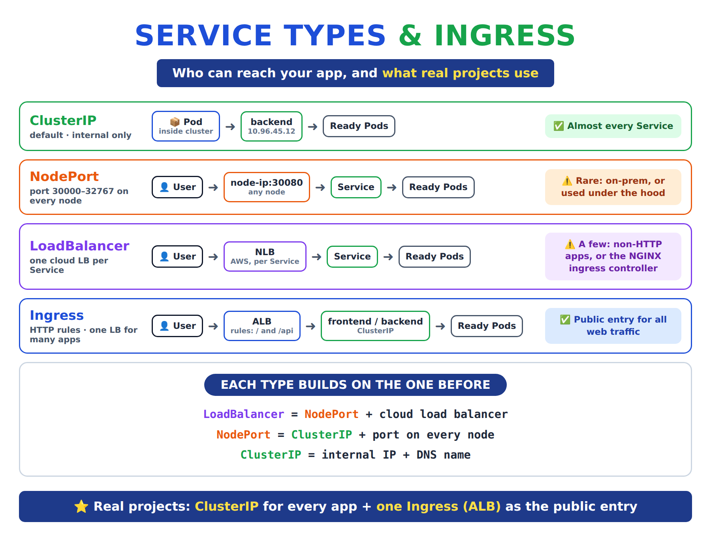
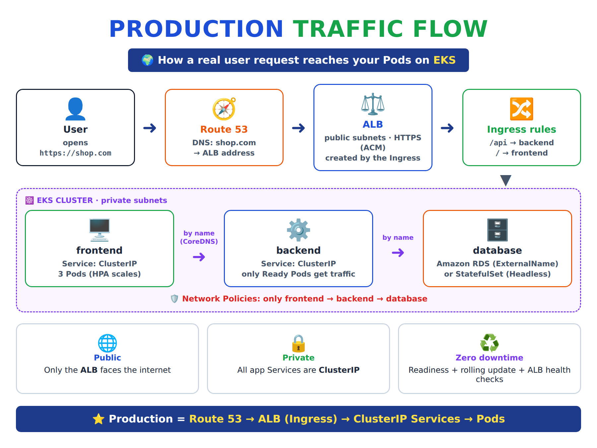

# Day 25 — Kubernetes Services: Types (ClusterIP, NodePort, LoadBalancer), Ingress and Traffic Flow

[← Kubernetes notes](../README.md)

> **In short:** Pods are temporary and their IPs change, so a **Service** gives them **one fixed IP + DNS name** and sends traffic only to **Ready** Pods. **ClusterIP** = inside the cluster only. **NodePort** = a port on every node. **LoadBalancer** = a cloud load balancer per Service. **Ingress** = HTTP rules behind **one** load balancer for many apps. In real projects: **ClusterIP for every app + one Ingress (ALB) as the public entry**. Traffic: **DNS → load balancer → Ingress rule → Service (Ready Pods) → Pod**.

## About this class

Here we learn how users on the internet actually reach an app running in Kubernetes, and which Service type real projects use.

| Part | Topic | What you learn |
|---|---|---|
| **Part 1: Concepts** | Services, ClusterIP, NodePort, LoadBalancer, Ingress, traffic flow | What each one is, when to use it, what production uses, how a request reaches a Pod |
| **Part 2: Lab** | One app exposed 4 ways on EKS | Create each type, test it, see the AWS load balancers it creates, clean up |

## Table of Contents

**⭐ [Start here: Services explained simply](#start-here-services-explained-simply)** (beginner, 7 steps)

**Part 1: Concepts**
1. [What is a Service and why we need it](#1-what-is-a-service-and-why-we-need-it)
2. [The 3 Service types: ClusterIP, NodePort, LoadBalancer](#2-the-3-service-types-clusterip-nodeport-loadbalancer)
3. [Ingress: one load balancer for many apps](#3-ingress-one-load-balancer-for-many-apps)
4. [Which one to use when (and what real projects use)](#4-which-one-to-use-when-and-what-real-projects-use)
5. [How traffic flows in production](#5-how-traffic-flows-in-production)

**Part 2: Lab**
6. [Lab: expose one app 4 ways on EKS](#6-lab-expose-one-app-4-ways-on-eks)

**Wrap-up**
7. [What I learned](#7-what-i-learned)
8. [Commands](#8-commands)
9. [Interview Questions](#9-interview-questions)

---

# Start here: Services explained simply

New to Services? Read this first. It's the whole idea in 7 short steps, with a simple example. The parts after it go deeper.

### Step 1: The problem

Your app runs in **Pods**. Pods are **temporary**:

- A Pod crashes → a new one comes up with a **new IP**
- You deploy a new version → **all Pods get new IPs**
- You run 3 copies → **3 different IPs**

So if the frontend wants to call the backend, **which IP should it use?** It can't know.

### Step 2: The fix is a Service

**Definition:** a **Service** is a **fixed name + fixed IP** that never changes. Behind it, Kubernetes keeps a list of the **healthy (Ready) Pods** and sends each request to one of them.

```
 frontend ──► "backend" (Service, never changes) ──► Pod 1 / Pod 2 / Pod 3
```

> 📞 **Example:** a company's **phone extension**. You dial "backend" and whoever is free picks up. You don't care which employee it is.

### Step 3: The 3 Service types answer one question: who can reach this app?

**ClusterIP: "only inside the cluster"**

- Gets an internal IP + a name (`backend`)
- **Only Pods inside the cluster** can call it. Nobody from the internet can.
- It's the **default**, and what we use for **almost every app**

> 📞 **Example:** an **internal phone extension**. It works only inside the office.

**NodePort: "open a door on every server"**

- Everything ClusterIP has, **plus** a port (30000–32767) opened on **every node**
- Outsiders can reach `node-ip:30080`
- **Problem:** node IPs change, users won't type weird port numbers, and there's no HTTPS and no single stable address

> 🚪 **Example:** a **side door with a weird number on every building**. It works, but you never give this address to customers.

**Use it for:** quick testing, or on-prem clusters. **Rare in real cloud projects.**

**LoadBalancer: "give this app its own public front door"**

- Everything NodePort has, **plus** a **cloud load balancer** (an **NLB** on AWS) with a public address
- We only write the YAML. AWS creates the load balancer **automatically** (through the controller).
- **Problem:** **one load balancer per Service**. 10 apps = 10 load balancers = 10 bills.

> 🏢 **Example:** giving **every department its own reception desk** on the street. It works, but it's expensive.

**Use it for:** non-website apps (TCP/UDP, e.g. a game server or MQTT) that must be public.

### Step 4: For websites, we use Ingress

For websites and APIs we want **one** public front door for **all** apps, which sends each request to the right app by URL path. That's an **Ingress**:

```
 shop.com/api  → backend
 shop.com/     → frontend
```

> 🛎️ **Example:** **one main reception for the whole company**. The receptionist asks "which department?" and sends you there.

But an Ingress is **only a list of rules**, like a note on paper. It doesn't listen on any port by itself.

### Step 5: The Ingress controller builds the reception

- The **AWS Load Balancer Controller** is a small program (Pods) that we **install once** per cluster with Helm.
- It reads our Ingress rules and **creates an ALB in AWS**.
- The **ALB is the real door**: it receives users and routes by path.
- The controller only **builds and updates** the ALB. User traffic never goes through the controller.

> 🛎️ **Example:** the controller is the **building manager** who sets up the reception desk. The **ALB is the receptionist** who actually talks to visitors.

⚠️ The **nginx inside a frontend Pod is not an Ingress controller**. It's just a web server for that app's pages. The controller is a separate thing we install.

### Step 6: No NodePort needed. The ALB goes straight to Pods

On EKS every Pod gets a **real VPC IP**, so the ALB sends traffic **directly to the Ready Pod IPs**. We don't create any NodePort or LoadBalancer Service for this.

The **ClusterIP Service** still matters: it **groups the Ready Pods**, and the controller gives that list to the ALB (and updates it when Pods change).

```
 User types shop.com
      │
      ▼
 Route 53 (DNS): "shop.com = this ALB"
      │
      ▼
 ALB (public, HTTPS)          ← created from the Ingress by the controller
   /api → backend
   /    → frontend
      │
      ▼
 Ready frontend / backend Pods    ← their Services are ClusterIP
      │
      ▼
 backend calls "database" by name
```

**What we write in a real project:**

| Thing | What we write |
|---|---|
| frontend Service | `type: ClusterIP` |
| backend Service | `type: ClusterIP` |
| Ingress | rules `/api` and `/` → creates **one ALB** |
| AWS Load Balancer Controller | install **once** per cluster with Helm |
| NodePort / LoadBalancer Services | **none** |

### Step 7: Cheat sheet

| Type | Who can reach it | Creates in AWS | When to use |
|---|---|---|---|
| **ClusterIP** | Only Pods inside the cluster | Nothing | ✅ **Every app** (default) |
| **NodePort** | Outside, via `node-ip:3xxxx` | Nothing | ❌ Testing / on-prem only |
| **LoadBalancer** | Internet, via its own NLB | **1 NLB per Service** | ⚠️ Non-HTTP apps, NGINX ingress controller |
| **Ingress** (not a Service type) | Internet, via one ALB | **1 ALB for many apps** | ✅ **All websites and APIs** |

**The whole story in 6 lines:**

1. **Pods** run the app (their IPs keep changing).
2. A **ClusterIP Service** groups the Ready Pods under one name, e.g. `backend`.
3. An **Ingress** holds the rules: `/api` → backend, `/` → frontend.
4. The **controller** (Pods we install once) reads the rules.
5. The controller **creates an ALB** in AWS and gives it the Ready Pod IPs.
6. The **ALB** receives users and routes by path straight to those Pods.

### Why learn NodePort and LoadBalancer if we rarely write them?

| Reason | Why |
|---|---|
| **They're the foundation** | ClusterIP → NodePort → LoadBalancer → Ingress. Each builds on the one before. |
| **Used under the hood** | The NGINX Ingress Controller is exposed by a **LoadBalancer** Service; ALB `instance` mode sends traffic through **NodePorts**. |
| **Some real cases need them** | Non-HTTP apps → **LoadBalancer (NLB)**. On-prem clusters → **NodePort** behind a hardware load balancer. |
| **Testing and debugging** | A NodePort (or `kubectl port-forward`) opens an app quickly without an Ingress. |
| **Interviews** | "ClusterIP vs NodePort vs LoadBalancer" is one of the most asked Kubernetes questions. |

> 🎯 **Interview answer:** "ClusterIP is internal, NodePort opens a port on every node, and LoadBalancer creates a cloud load balancer per Service. In production we keep all apps as ClusterIP and expose web traffic through one Ingress, which on EKS becomes an ALB. We use LoadBalancer only for non-HTTP apps or for the NGINX ingress controller, and NodePort mostly for testing or on-prem."

---

# Part 1: Concepts

## 1. What is a Service and why we need it

**Definition:** A **Service** gives a group of Pods **one fixed IP and DNS name**, and sends traffic only to the Pods that are **Ready**.

**Why?** Pods are **temporary**. Every restart, deploy, scale-up or node failure creates new Pods with **new IPs**. Apps can't chase changing IPs, so they call the **Service name** (e.g. `backend`) instead.

| Problem without a Service | How a Service fixes it |
|---|---|
| Pod IPs change on every restart / deploy | **Fixed IP + DNS name** that never changes |
| 3 replicas = 3 IPs. Which one do I call? | **One address**, traffic **load-balanced** across all Pods |
| Pods scale up and down (HPA) | Service finds Pods **by label** and updates **automatically** |
| A starting or broken Pod still gets requests | Only **Ready** Pods get traffic (readiness probe) |
| Rolling update replaces every Pod | Traffic keeps flowing to Ready Pods → **zero downtime** |
| Users outside can't reach Pod IPs | Service types / Ingress **expose** the app safely |

```
 caller ──► backend Service (fixed IP 10.96.45.12) ──┬──► Pod 1 (Ready ✅)
                                                     ├──► Pod 2 (Ready ✅)
                                                     └──✖ Pod 3 (Not Ready, skipped)
```

**How it works (who does what):**

| Who | Job |
|---|---|
| **Service `selector`** | Picks the Pods by label (e.g. `app: backend`) |
| **Readiness probe** (kubelet) | Decides if each Pod is Ready |
| **EndpointSlices** | The list of **Ready** Pod IPs behind the Service |
| **kube-proxy** | Writes rules (iptables / IPVS) on every node: Service IP → one Ready Pod IP |
| **CoreDNS** | Service name → Service IP (`backend.default.svc.cluster.local`) |

> ⚠️ A Service is **not a running program**, so it doesn't "check" health. The **readiness probe** decides, and only Ready Pods are kept in the list.

> **Interview one-liner:** Pods are temporary and their IPs change, so a Service gives a stable IP and DNS name and load-balances across the Ready Pods it selects by label.

---

## 2. The 3 Service types: ClusterIP, NodePort, LoadBalancer

**Definition:** the Service **type** decides **who can reach** the Service: only Pods inside the cluster, or users outside.



Each type **builds on the one before**:

```
 LoadBalancer  =  NodePort + a cloud load balancer in front
 NodePort      =  ClusterIP + a port opened on every node
 ClusterIP     =  internal IP + DNS name
```

| | **ClusterIP** | **NodePort** | **LoadBalancer** |
|---|---|---|---|
| **Who can reach it** | Only Pods **inside** the cluster | Outside, via `<any-node-ip>:30000-32767` | Outside, via a **cloud load balancer** address |
| **Example address** | `backend:80` | `10.0.1.15:30080` | `a1b2c3.elb.amazonaws.com` |
| **Creates in AWS** | Nothing | Nothing (you open the port in the security group) | An **NLB**, billed per hour |
| **Good** | Safe, simple, default | No cloud needed | Real public address, health checks |
| **Bad** | Not reachable from outside | Odd port, node IPs change, no failover | **One load balancer per Service** = expensive |

### ClusterIP: inside the cluster only

**Definition:** the **default** type. The Service gets an **internal IP** (e.g. `10.96.45.12`) and a DNS name, reachable **only from inside** the cluster.

```yaml
apiVersion: v1
kind: Service
metadata:
  name: backend
spec:
  type: ClusterIP       # default, can be left out
  selector:
    app: backend        # send traffic to Pods with this label
  ports:
  - port: 80            # Service port
    targetPort: 80      # container port
```

> ⭐ In real projects, **almost every Service is ClusterIP**: frontend, backend, workers, internal databases.

### NodePort: a port on every node

**Definition:** opens the **same port (30000–32767) on every node**. Traffic to `<any-node-ip>:<nodePort>` goes to the Service, then to the Pods.

```yaml
apiVersion: v1
kind: Service
metadata:
  name: web-nodeport
spec:
  type: NodePort
  selector:
    app: web
  ports:
  - port: 80
    targetPort: 80
    nodePort: 30080     # opened on every node (30000-32767)
```

```
 User ──► <node-ip>:30080 ──► Service ──► Ready Pod
```

**Why it's rare in production:** users would need a **node IP** and a **high port**. Node IPs change when nodes are replaced or scaled, and if that node dies the address breaks.

**Where it's still used:** on-prem clusters behind your own hardware load balancer, and **under the hood** (an ALB with `target-type: instance` sends traffic to NodePorts).

### LoadBalancer: a cloud load balancer per Service

**Definition:** asks the **cloud** to create a **real load balancer** with an external address that forwards to the Service.

```yaml
apiVersion: v1
kind: Service
metadata:
  name: web-nlb
  annotations:
    service.beta.kubernetes.io/aws-load-balancer-type: external           # handled by AWS Load Balancer Controller
    service.beta.kubernetes.io/aws-load-balancer-scheme: internet-facing  # public
    service.beta.kubernetes.io/aws-load-balancer-nlb-target-type: ip      # NLB → Pod IPs
spec:
  type: LoadBalancer
  selector:
    app: web
  ports:
  - port: 80
    targetPort: 80
```

```
 User ──► NLB (a1b2c3.elb.amazonaws.com) ──► Ready Pod
```

**Why not for every app?** 10 apps = **10 load balancers** = 10 bills (about $16/month each on AWS, plus traffic) and 10 HTTPS setups. It also has **no path routing**.

### `Service type: LoadBalancer` vs a load balancer

They are **not the same thing**: one is a Kubernetes request, the other is the real AWS resource created from it.

| | `Service type: LoadBalancer` | Load balancer |
|---|---|---|
| What it is | A **Kubernetes object** (YAML) | A **real AWS resource** (ALB / NLB / CLB) |
| Who makes it | You, with `kubectl apply` | A **controller** creates it automatically |
| Where it lives | Inside the cluster | In your AWS account (EC2 → Load Balancers) |
| Costs money | No | **Yes**, billed per hour |

**You never create the load balancer by hand.** Apply the YAML → the controller creates it → its address appears in `EXTERNAL-IP`. Delete the Service → the load balancer is deleted.

| You write | AWS creates | Layer |
|---|---|---|
| `Service type: LoadBalancer` + AWS LB Controller annotations | **NLB** (Network Load Balancer) | 4: TCP / UDP |
| `Service type: LoadBalancer`, no annotations (old built-in controller) | **Classic LB** (old, avoid) | 4 |
| **Ingress** with `ingressClassName: alb` | **ALB** (Application Load Balancer) | 7: HTTP paths, hosts, HTTPS |

> A `Service type: LoadBalancer` **can't** give you an ALB. To get an ALB, you write an **Ingress**.

> **Interview one-liner:** ClusterIP is internal only, NodePort opens a port on every node, and LoadBalancer asks the cloud for a load balancer per Service; `type: LoadBalancer` is the YAML request, the NLB is what AWS creates from it.

---

## 3. Ingress: one load balancer for many apps

**Definition:** an **Ingress** is a set of **HTTP routing rules** (by **path** or **host**) in front of many **ClusterIP** Services, all behind **one** load balancer.

**Ingress controller:** the Ingress is only **rules (YAML)**. A **controller** is needed to run them. Without one, an Ingress does nothing.

```yaml
apiVersion: networking.k8s.io/v1
kind: Ingress
metadata:
  name: shop
  annotations:
    alb.ingress.kubernetes.io/scheme: internet-facing   # public ALB
    alb.ingress.kubernetes.io/target-type: ip           # ALB → Pod IPs directly
spec:
  ingressClassName: alb          # run by the AWS Load Balancer Controller
  rules:
  - host: shop.example.com
    http:
      paths:
      - path: /api               # shop.example.com/api → backend
        pathType: Prefix
        backend:
          service:
            name: backend
            port:
              number: 80
      - path: /                  # everything else → frontend
        pathType: Prefix
        backend:
          service:
            name: frontend
            port:
              number: 80
```

**The 2 common Ingress controllers:**

| | **AWS Load Balancer Controller** (most common on EKS) | **NGINX Ingress Controller** |
|---|---|---|
| Public entry | **ALB**, created from the Ingress | **NLB**, created from **one** `Service type: LoadBalancer` |
| Who applies the `/` and `/api` rules | The **ALB itself** (outside the cluster) | **ingress-nginx Pods** (inside the cluster) |
| Hops | ALB → app Pod | NLB → ingress-nginx Pod → app Pod |
| App Services | ClusterIP | ClusterIP |
| Runs on | EKS | Any cluster (EKS, on-prem, other clouds) |

**Why it's the production choice:**

| ✅ |
|---|
| **One** load balancer for many apps → much lower cost |
| Routing by **path** (`/api`, `/`) and **host** (`shop.com`, `admin.shop.com`) |
| **HTTPS** in one place (ACM certificate on the ALB) |
| All app Services stay **ClusterIP**: nothing else is public |

### Two different "nginx"

The **NGINX Ingress Controller** and the **nginx in your frontend Pod** are different things. They just use the same software.

| | NGINX Ingress Controller | nginx in the frontend Pod |
|---|---|---|
| Job | **Router**: sends `/` → frontend, `/api` → backend | **Web server**: sends back your `index.html`, CSS, JS |
| Has your web pages? | ❌ No | ✅ Yes |
| Namespace | `ingress-nginx` | Your app namespace |
| Service type | **LoadBalancer** (the only public one) | **ClusterIP** |

```
 With NGINX Ingress:  User ──► NLB ──► ingress-nginx Pod (router) ──► frontend Pod (nginx = your page ✅)
 With ALB:            User ──► ALB (router)                       ──► frontend Pod (nginx = your page ✅)
```

> **Interview one-liner:** An Ingress is HTTP routing rules for many ClusterIP Services behind one load balancer; on EKS the AWS Load Balancer Controller turns it into an ALB, while the NGINX Ingress Controller runs the rules in its own Pods behind one LoadBalancer Service.

---

## 4. Which one to use when (and what real projects use)

**Definition:** choosing a type = deciding **who must reach the app** and **what protocol** it speaks (HTTP or plain TCP/UDP).

| Situation | Use |
|---|---|
| Internal apps: backend APIs, databases, caches, queues | **ClusterIP** |
| Websites and HTTP/HTTPS APIs for users | ✅ **Ingress** (one ALB) + ClusterIP Services |
| A non-HTTP app that must be public (TCP/UDP: MQTT, game server) | **LoadBalancer** → NLB |
| Only other VPCs / VPN should reach it | LoadBalancer or Ingress with `scheme: internal` |
| On-prem cluster with your own hardware load balancer | **NodePort** behind it |
| Quick debugging from your machine | `kubectl port-forward svc/<name> 8080:80` (no Service change) |

**What real projects actually use:**

```
 ✅ ClusterIP     → almost every Service (frontend, backend, workers, internal DBs)
 ✅ Ingress       → the public entry for all web traffic (ONE ALB for many apps)
 ⚠️ LoadBalancer  → only a few: non-HTTP apps, or to expose the NGINX ingress controller
 ❌ NodePort      → almost never set by hand (used under the hood, or on-prem)
```

**"If every app is ClusterIP, who listens to the internet?"** The **ALB**, created by the **Ingress**. It is the only public piece. On EKS the **VPC CNI** gives Pods **real VPC IPs**, so the ALB (in the same VPC) sends traffic **straight to the Pod IPs**. It only uses the ClusterIP Service to **find** the Ready Pods.

```
 Internet ──► ALB (public, listens on 443) ──► Pod IP 10.0.3.25 directly
                       ▲
                       └── reads Ready Pod IPs from the ClusterIP Service's EndpointSlices
```

> **Interview one-liner:** In production every app Service is ClusterIP, one Ingress (an ALB on EKS) is the public entry for web traffic, LoadBalancer is only for non-HTTP apps or the ingress controller, and NodePort is almost never set by hand.

---

## 5. How traffic flows in production

**Definition:** the **traffic flow** is the path a user's request takes from typing `shop.com` to a **Ready Pod** answering.



### EKS with an ALB (most common)

```
 User types https://shop.com/api/products
    │
    ▼
 ① Route 53 (DNS) ........ "shop.com = this ALB"
    │
    ▼
 ② ALB (public subnet) ... created by the Ingress
    │                      ends HTTPS (ACM certificate)
    │                      rule: /api → backend
    ▼
 ③ backend Service ....... ClusterIP: EndpointSlices list only Ready Pod IPs
    │                      (the ALB reads this list)
    ▼
 ④ backend Pod ........... ALB sends straight to the Pod IP
    │
    ▼
 ⑤ backend calls "db" .... CoreDNS: name → IP, kube-proxy: → one Ready db Pod
                           (or an ExternalName Service → Amazon RDS)
```

For `https://shop.com/` the rule `/` sends the request to a **frontend Pod**, and the **nginx inside that Pod** sends back the web page.

| Step | What happens | Who does it |
|---|---|---|
| 1 | `shop.com` → load balancer address | **Route 53** |
| 2 | HTTPS ends; the **path** picks the app | **ALB** running the **Ingress** rules |
| 3 | Which Pods are Ready? | **EndpointSlices**, based on the **readiness probe** |
| 4 | Request goes to **one Ready Pod** | ALB → Pod IP (`target-type: ip`) |
| Inside the cluster | frontend calls `backend` by name → one Ready Pod | **CoreDNS** + **kube-proxy** |

### Same flow with the NGINX Ingress Controller

```
 User ──► Route 53 ──► NLB ──► ingress-nginx Pods ──► frontend / backend Service ──► Pods
                       ▲       (router, applies       (ClusterIP)
                       │        Ingress rules)
       one "Service type: LoadBalancer" for ingress-nginx only
```

### What keeps it running

| Need | How |
|---|---|
| **Zero downtime deploys** | Rolling update + readiness probe: new Pods get traffic only when Ready |
| **More users** | HPA adds Pods → Service and ALB targets update automatically |
| **Node / AZ failure** | Replicas spread over nodes and AZs; the ALB stops sending to dead targets |
| **Security** | Only the ALB is public; app Services are ClusterIP in private subnets; Network Policies between apps |
| **Cost** | **One** ALB shared by many apps |

> ⭐ **Remember in one line:** **DNS → load balancer → Ingress rule → Service (Ready Pods only) → Pod.**

> **Interview one-liner:** Route 53 points the domain to an ALB created by an Ingress; the ALB ends HTTPS and routes by path to the right ClusterIP Service's Ready Pods, and those Pods call other Services by name through CoreDNS.

---

# Part 2: Lab

## 6. Lab: expose one app 4 ways on EKS

**Goal:** run one nginx app and expose it as **ClusterIP**, **NodePort**, **LoadBalancer (NLB)** and **Ingress (ALB)**, then see what each one creates.

**Before you start:**

| Need | Why |
|---|---|
| EKS cluster + bastion with `kubectl` (Day 23) | Where we run all commands |
| **AWS Load Balancer Controller** installed ([install guide](https://kubernetes-sigs.github.io/aws-load-balancer-controller/latest/deploy/installation/)) | Creates the NLB (step 5) and the ALB (step 6) |
| Public subnets tagged `kubernetes.io/role/elb = 1` | The controller puts internet-facing load balancers there |

> ⚠️ Steps 5 and 6 create **real AWS load balancers that cost money**. Do the clean-up (step 8) when you finish.

### Step 1: Create the app

```bash
vim web.yaml
```

```yaml
apiVersion: apps/v1
kind: Deployment
metadata:
  name: web
spec:
  replicas: 2
  selector:
    matchLabels:
      app: web
  template:
    metadata:
      labels:
        app: web               # every Service below finds Pods by this label
    spec:
      containers:
      - name: nginx
        image: nginx
        ports:
        - containerPort: 80
        readinessProbe:        # only Ready Pods get traffic
          httpGet:
            path: /
            port: 80
          periodSeconds: 5
```

```bash
kubectl apply -f web.yaml
```

```bash
kubectl get pods -o wide
```

**Expected:** 2 `web` Pods, `1/1 Running`, each with a VPC IP (e.g. `10.0.3.25`).

### Step 2: ClusterIP (inside only)

```bash
kubectl expose deployment web --port=80
```

**What it does:** creates a **ClusterIP** Service named `web` (the default type).

```bash
kubectl get svc web
```

**Expected:** `TYPE ClusterIP`, a `CLUSTER-IP` like `172.20.x.x`, `EXTERNAL-IP <none>`.

```bash
kubectl get endpointslices -l kubernetes.io/service-name=web
```

**Expected:** the 2 Pod IPs from step 1. This is the list of **Ready** Pods the Service sends to.

```bash
kubectl run tmp --image=busybox:1.28 --rm -it --restart=Never -- wget -qO- web
```

**What it does:** starts a temporary Pod **inside** the cluster and calls the Service **by name**.

**Expected:** the nginx page `<title>Welcome to nginx!</title>` ✅. From outside the cluster, the ClusterIP can't be reached.

### Step 3: NodePort (a port on every node)

```bash
kubectl expose deployment web --name=web-nodeport --type=NodePort --port=80
```

```bash
kubectl get svc web-nodeport
```

**Expected:** `PORT(S) 80:3xxxx/TCP`. The `3xxxx` number is the **NodePort**, opened on **every** node.

```bash
kubectl get nodes -o wide
```

**What it does:** shows each node's `INTERNAL-IP`.

```bash
curl http://<node-internal-ip>:<nodePort>
```

**Expected:** the nginx page ✅ (the bastion is in the same VPC). If it **hangs**, the node security group doesn't allow that port from the bastion: allow TCP 30000–32767 from the bastion's security group.

> This is why NodePort is rare in production: users would need a node IP and port 3xxxx.

### Step 4: Check what's in AWS so far

```bash
aws elbv2 describe-load-balancers --query "LoadBalancers[].{Name:LoadBalancerName,Type:Type}" --output table
```

**Expected:** no new load balancers. **ClusterIP and NodePort create nothing in AWS.**

### Step 5: LoadBalancer (NLB per Service)

```bash
vim web-nlb.yaml
```

```yaml
apiVersion: v1
kind: Service
metadata:
  name: web-nlb
  annotations:
    service.beta.kubernetes.io/aws-load-balancer-type: external
    service.beta.kubernetes.io/aws-load-balancer-scheme: internet-facing
    service.beta.kubernetes.io/aws-load-balancer-nlb-target-type: ip
spec:
  type: LoadBalancer
  selector:
    app: web
  ports:
  - port: 80
    targetPort: 80
```

```bash
kubectl apply -f web-nlb.yaml
```

```bash
kubectl get svc web-nlb -w
```

**Expected:** `EXTERNAL-IP` changes from `<pending>` to `k8s-default-webnlb-xxxx.elb.us-east-1.amazonaws.com`. Press `Ctrl+C`.

```bash
curl http://<EXTERNAL-IP>
```

**Expected:** the nginx page ✅ from the internet. The first 2–3 minutes may fail while the NLB starts and its DNS spreads.

### Step 6: Ingress (ALB for many apps)

```bash
vim web-ingress.yaml
```

```yaml
apiVersion: networking.k8s.io/v1
kind: Ingress
metadata:
  name: web
  annotations:
    alb.ingress.kubernetes.io/scheme: internet-facing
    alb.ingress.kubernetes.io/target-type: ip
spec:
  ingressClassName: alb
  rules:
  - http:
      paths:
      - path: /
        pathType: Prefix
        backend:
          service:
            name: web          # the ClusterIP Service from step 2
            port:
              number: 80
```

```bash
kubectl apply -f web-ingress.yaml
```

```bash
kubectl get ingress web -w
```

**Expected:** `ADDRESS` fills in with `k8s-default-web-xxxx.us-east-1.elb.amazonaws.com`. Press `Ctrl+C`.

```bash
curl http://<ADDRESS>
```

**Expected:** the nginx page ✅. The Ingress points at the **ClusterIP** Service `web`. No NodePort or LoadBalancer Service is needed.

### Step 7: See the result in AWS

```bash
aws elbv2 describe-load-balancers --query "LoadBalancers[].{Name:LoadBalancerName,Type:Type}" --output table
```

**Expected:** 2 load balancers:

| Name starts with | Type | Created by |
|---|---|---|
| `k8s-default-webnlb-...` | `network` | `Service type: LoadBalancer` (step 5) |
| `k8s-default-web-...` | `application` | `Ingress` (step 6) |

> With 10 apps, step 5 would mean **10 NLBs**. Step 6 can serve all 10 apps with **one ALB** (one Ingress rule per path or host).

**Troubleshooting:**

| Problem | Cause | Fix |
|---|---|---|
| `EXTERNAL-IP` stays `<pending>` | AWS Load Balancer Controller not installed / not running | `kubectl get deploy -n kube-system aws-load-balancer-controller` |
| Ingress `ADDRESS` stays empty | Wrong `ingressClassName`, or no tagged public subnets | `kubectl describe ingress web` (Events), `kubectl logs -n kube-system deploy/aws-load-balancer-controller` |
| ALB returns **503** | No Ready Pods behind the Service | `kubectl get endpointslices -l kubernetes.io/service-name=web`, check readiness |
| NodePort `curl` hangs | Node security group blocks 30000–32767 | Allow it from the bastion's security group |
| curl to NLB/ALB fails right after creation | Load balancer still provisioning, DNS not ready | Wait 2–3 minutes and retry |

### Step 8: Clean up (stops the AWS bill)

Delete the Ingress and the LoadBalancer Service **first**, so the controller deletes the ALB and NLB in AWS.

```bash
kubectl delete -f web-ingress.yaml
```

```bash
kubectl delete -f web-nlb.yaml
```

```bash
kubectl delete svc web web-nodeport
```

```bash
kubectl delete -f web.yaml
```

```bash
aws elbv2 describe-load-balancers --query "LoadBalancers[].LoadBalancerName" --output table
```

**Expected:** no `k8s-default-...` load balancers left ✅.

> ⚠️ Destroying the whole cluster with Terraform **before** deleting Ingresses and LoadBalancer Services can leave the ALB/NLB behind (Terraform didn't create them) and block VPC deletion. Delete them with `kubectl` first.

---

# Wrap-up

## 7. What I learned

**Part 1: Concepts**
- A **Service** = fixed IP + DNS name for temporary Pods. It sends only to **Ready** Pods (readiness probe → EndpointSlices → kube-proxy).
- **ClusterIP** = internal, **NodePort** = port on every node, **LoadBalancer** = one cloud load balancer per Service. Each builds on the one before.
- `Service type: LoadBalancer` is the **YAML request**; the **NLB** is the AWS resource a controller creates from it.
- **Ingress** = HTTP path/host rules for many ClusterIP Services behind **one** load balancer (ALB on EKS). The NGINX Ingress Controller is a **router**, not your website.
- **Production:** ClusterIP for every app + one Ingress as the public entry. LoadBalancer only for non-HTTP apps or the ingress controller.

**Part 2: Lab**
- ClusterIP and NodePort create nothing in AWS. A LoadBalancer Service created an **NLB**; an Ingress created an **ALB**. Delete them with `kubectl` before destroying the cluster.

```
 User ──► Route 53 ──► ALB (Ingress rules) ──► ClusterIP Service (Ready Pods) ──► Pod
```

---

## 8. Commands

| Command | Use |
|---|---|
| `kubectl expose deployment web --port=80` | ClusterIP Service (default) |
| `kubectl expose deployment web --name=web-nodeport --type=NodePort --port=80` | NodePort Service |
| `kubectl get svc` | `TYPE`, `CLUSTER-IP`, `EXTERNAL-IP`, `PORT(S)` (shows the NodePort) |
| `kubectl get endpointslices -l kubernetes.io/service-name=web` | Ready Pod IPs behind a Service |
| `kubectl get ingress` | Ingress rules and the ALB `ADDRESS` |
| `kubectl describe ingress <name>` | Events: why the ALB wasn't created |
| `kubectl port-forward svc/web 8080:80` | Reach a Service from your machine for debugging |
| `aws elbv2 describe-load-balancers` | See the NLB / ALB created in AWS |

---

## 9. Interview Questions

### Other Questions

**Q1. Why do we need Services if Pods already have IPs?**
Pods are temporary: restarts, deploys and scaling give new IPs, and replicas have many IPs. A Service gives one stable IP and DNS name, load-balances across the Pods it selects by label, and skips Pods that aren't Ready.

**Q2. What's the difference between ClusterIP, NodePort and LoadBalancer?**
ClusterIP is internal, NodePort opens a port on every node, and LoadBalancer creates a cloud load balancer per Service. In production we keep all apps as ClusterIP and expose web traffic through one Ingress, which on EKS becomes an ALB. We use LoadBalancer only for non-HTTP apps or for the NGINX ingress controller, and NodePort mostly for testing or on-prem.

**Q3. Is `Service type: LoadBalancer` the same as a load balancer?**
No. `type: LoadBalancer` is a Kubernetes object (YAML). A controller reads it and creates the real AWS load balancer (an NLB with the AWS Load Balancer Controller) and writes its address into `EXTERNAL-IP`.

**Q4. How do you expose a web app to users in production?**
With an Ingress. On EKS the AWS Load Balancer Controller creates one ALB that ends HTTPS (ACM certificate) and routes by host/path to ClusterIP Services. All app Services stay ClusterIP.

**Q5. If every app Service is ClusterIP, how does internet traffic get in?**
Through the ALB created by the Ingress, the only public piece. With the VPC CNI, Pods have VPC IPs, so the ALB sends traffic straight to the Ready Pod IPs it reads from the Service's EndpointSlices.

**Q6. Why not use a LoadBalancer Service for every app?**
Each one creates its own billed load balancer, so 10 apps means 10 load balancers and 10 HTTPS setups, with no path routing. One Ingress shares a single ALB. LoadBalancer is still right for non-HTTP (TCP/UDP) apps.

**Q7. Why is NodePort rarely used in production?**
Users would need a node IP and a high port. Node IPs change when nodes are replaced or scaled, and there's no single stable, health-checked address.

**Q8. What is an Ingress controller? Name two.**
The component that runs Ingress rules. The AWS Load Balancer Controller turns them into an ALB; the NGINX Ingress Controller runs them in its own Pods behind one LoadBalancer Service.

**Q9. Does a Service check which Pod is healthy?**
No. The kubelet runs each Pod's readiness probe. Only Ready Pods stay in the Service's EndpointSlices, and kube-proxy (or the ALB) sends traffic only to them.

**Q10. Walk me through what happens when a user opens your app.**
Route 53 resolves the domain to the ALB; the ALB ends HTTPS and matches the Ingress path rule; it sends the request to a Ready Pod of that ClusterIP Service; the Pod calls other Services by name through CoreDNS and kube-proxy.

---

**Source:** [Kubernetes docs: Service](https://kubernetes.io/docs/concepts/services-networking/service/) · [Ingress](https://kubernetes.io/docs/concepts/services-networking/ingress/) · [AWS Load Balancer Controller](https://kubernetes-sigs.github.io/aws-load-balancer-controller/) · [EKS: network load balancing](https://docs.aws.amazon.com/eks/latest/userguide/network-load-balancing.html) · [EKS: application load balancing](https://docs.aws.amazon.com/eks/latest/userguide/alb-ingress.html)
