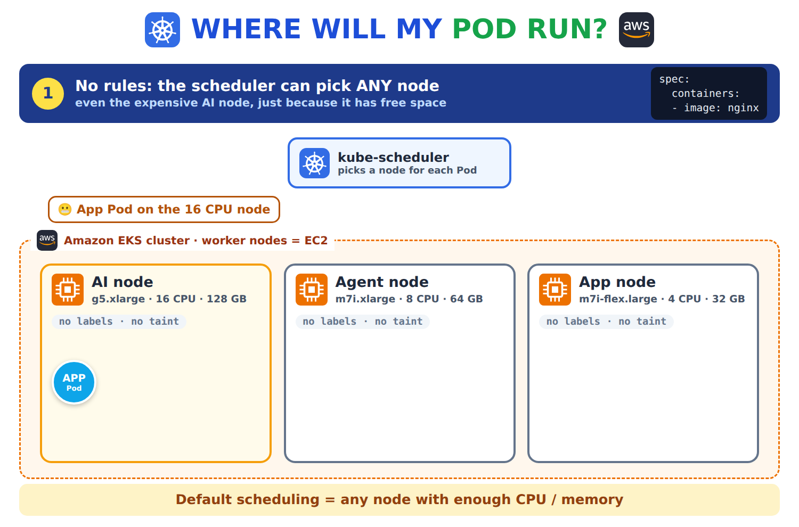
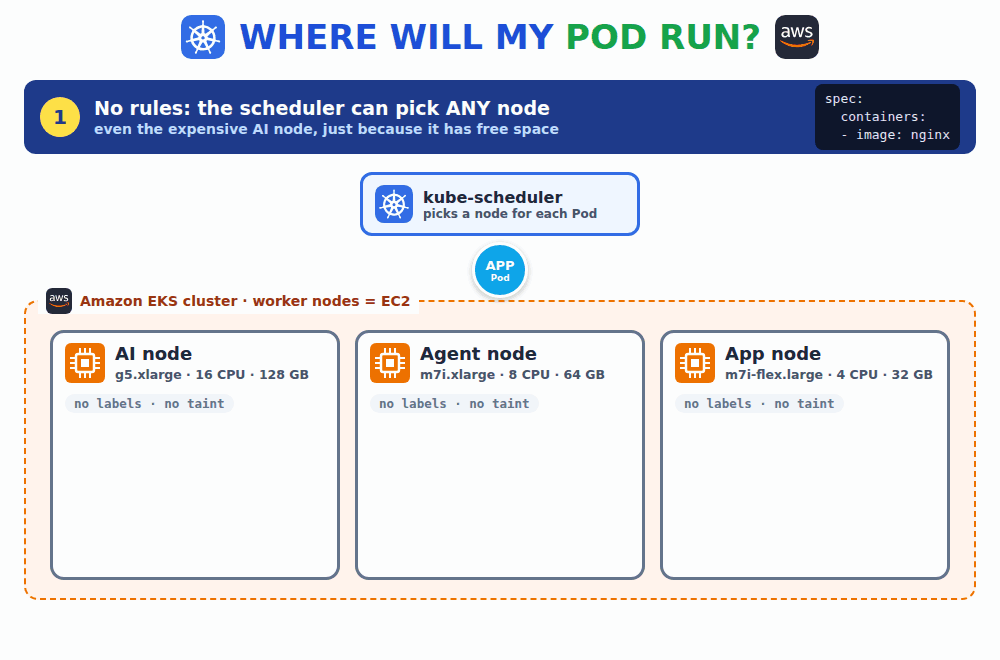
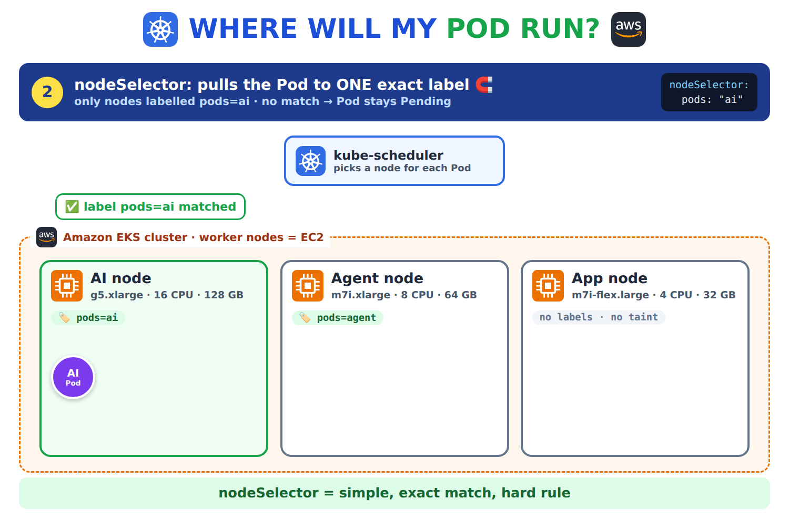
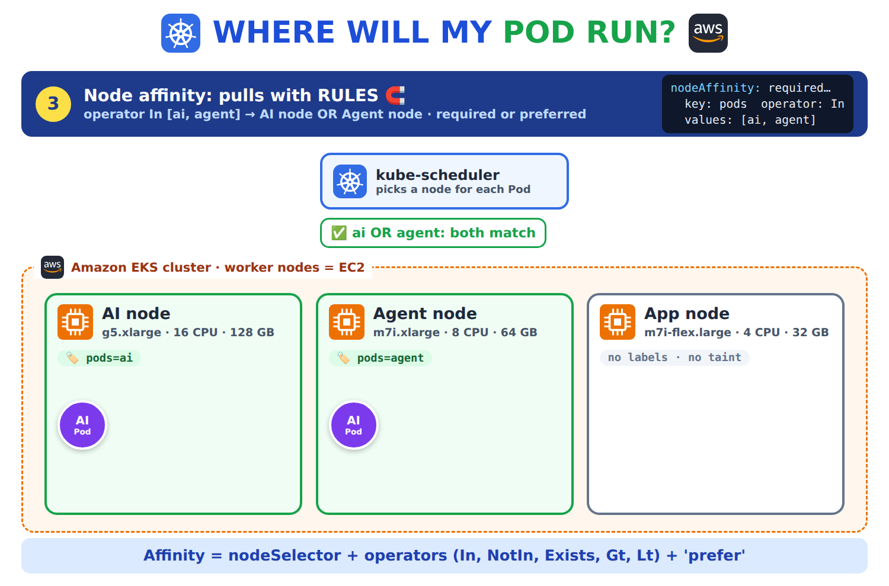
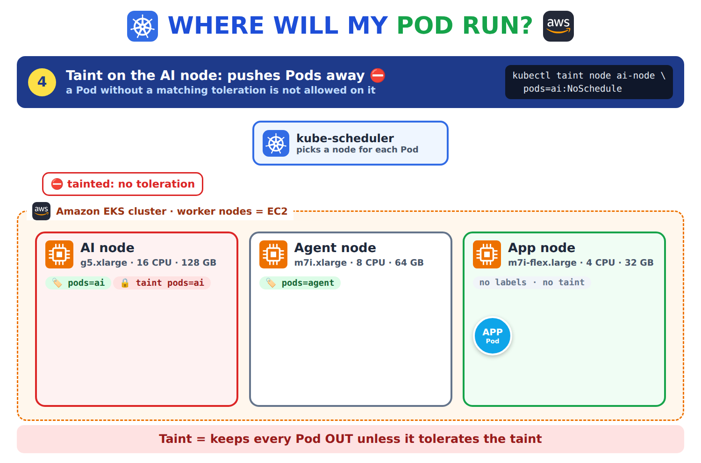
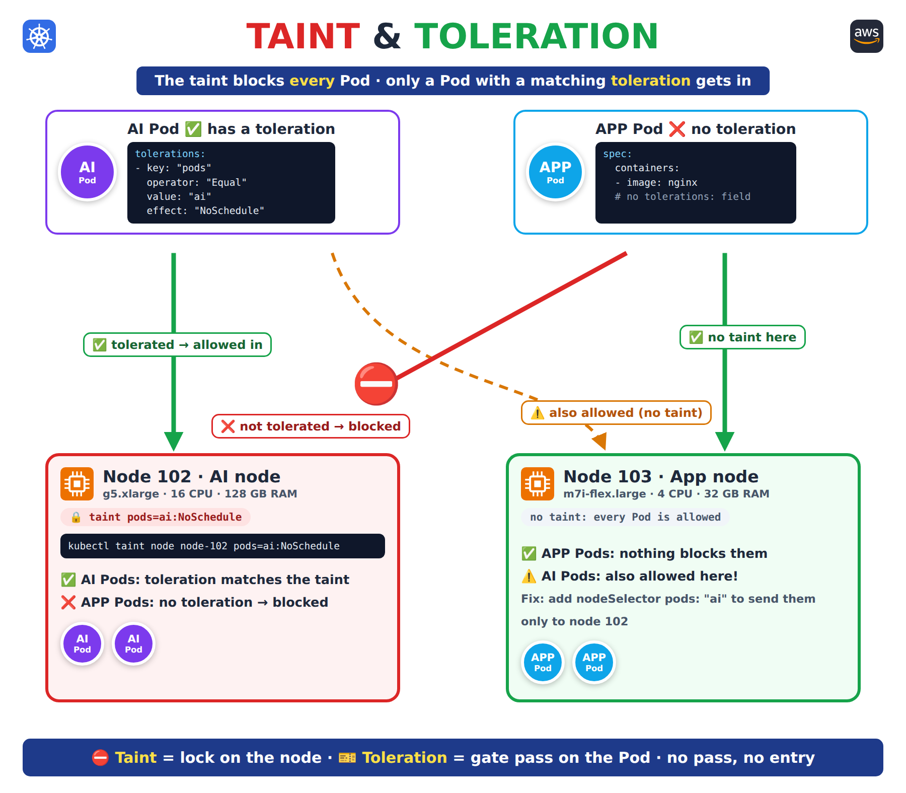
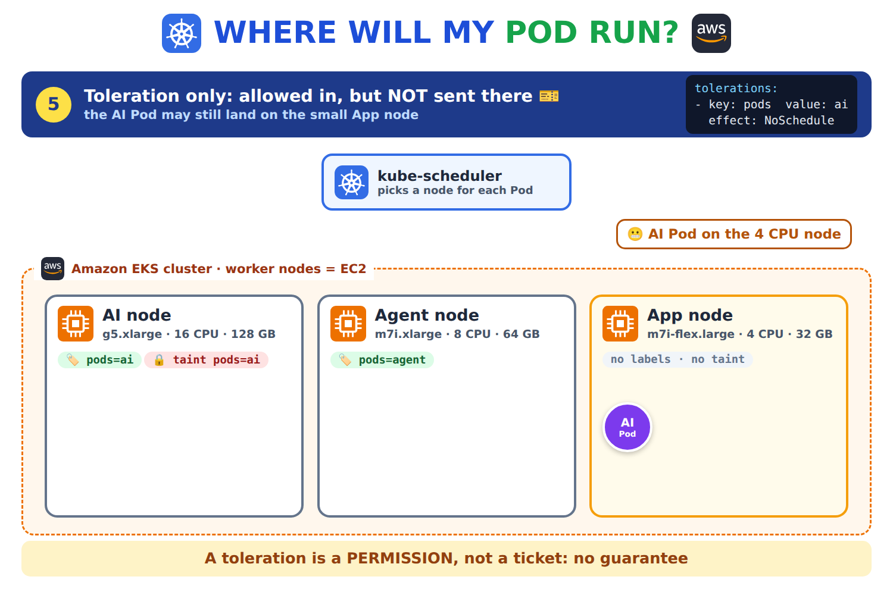
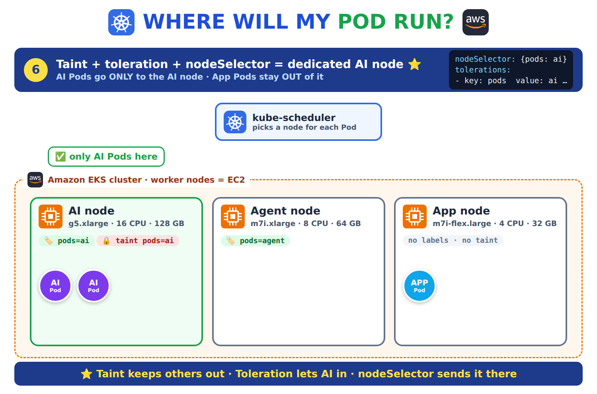
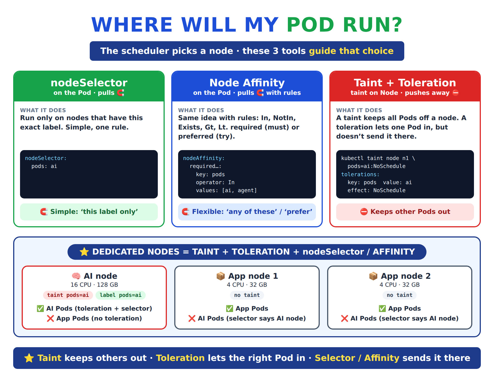
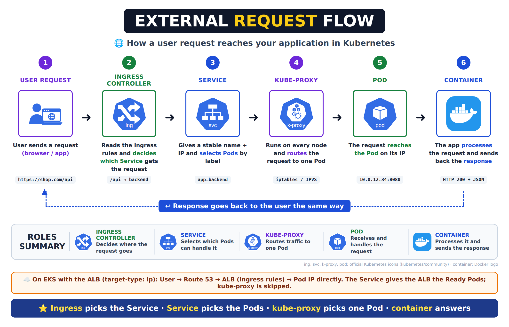

# Day 26 — Kubernetes Scheduling and Ingress Rules: Taints and Tolerations, nodeSelector, Node Affinity, Host and Path Routing

[← Kubernetes notes](../README.md)

> **In short:** Kubernetes decides **which node** each Pod runs on. **nodeSelector** and **node affinity** pull a Pod **towards** nodes with certain labels. **Taints** push all Pods **away** from a node, and a **toleration** lets one chosen Pod in. To give an app its own nodes (for example AI Pods on big GPU nodes), we use **both**. **Ingress rules** then decide which app gets each user request, by **host** (`api.shop.com`) or **path** (`shop.com/api`).

## About this class

Here we learn how to control **where Pods run** and **where user requests go**.

| Part | Topic | What you learn |
|---|---|---|
| **Part 1: Scheduling** | Labels, nodeSelector, node affinity, taints and tolerations, Pod affinity / anti-affinity, topology spread | What each one is, how they differ, when to use which |
| **Part 2: Ingress rules** | Host and path rules (summary) | Full guide in the [Ingress notes](../ingress/README.md) |
| **Part 3: Lab** | 2-node EKS cluster | Place Pods with each tool |

## Table of Contents

**Part 1: Scheduling (where Pods run)**
1. [How Kubernetes picks a node](#1-how-kubernetes-picks-a-node)
   - [Pod placement rules](#pod-placement-rules)
2. [Node labels](#2-node-labels)
3. [nodeSelector](#3-nodeselector)
4. [Node affinity](#4-node-affinity)
5. [Taints and tolerations](#5-taints-and-tolerations)
6. [Dedicated nodes: using them together](#6-dedicated-nodes-using-them-together)
   - [Scenario: AI Pods must run only on the big node](#scenario-ai-pods-must-run-only-on-the-big-node)
7. [Other Pod placement rules](#7-other-pod-placement-rules)
   - [7.1 topologyKey](#71-topologykey-what-near-and-away-mean) · [7.2 Pod affinity](#72-pod-affinity) · [7.3 Pod anti-affinity](#73-pod-anti-affinity) · [7.4 Topology spread constraints](#74-topology-spread-constraints) · [7.5 nodeName](#75-nodename)
8. [Which one to use](#8-which-one-to-use)
   - [8.1 Do I need all three?](#81-do-i-need-all-three)
   - [8.2 Scenario questions: which rule to use?](#82-scenario-questions-which-rule-to-use)

**Part 2: Ingress rules (where requests go)**

9. [Ingress rules](#9-ingress-rules)

**Part 3: Lab**

10. [Lab: control Pod placement on EKS](#10-lab-control-pod-placement-on-eks)

**Wrap-up**

11. [What I learned](#11-what-i-learned)
12. [Commands](#12-commands)
13. [Interview Questions](#13-interview-questions)

---

# Part 1: Scheduling (where Pods run)

## 1. How Kubernetes picks a node

**Definition:** **scheduling** is the step where Kubernetes chooses **which node** a new Pod will run on. The **kube-scheduler** (a control plane component) looks at every node, removes the ones that can't run the Pod (not enough CPU or memory, wrong labels, a taint the Pod doesn't accept), then gives the remaining nodes a score and picks the best one. If no node is left, the Pod stays **Pending**.

```
 New Pod ──► kube-scheduler
               1. Filter: drop nodes that can't run it (CPU / memory, labels, taints)
               2. Score:  rank the nodes that are left
               3. Bind:   the Pod runs on the best node
               (no node left → Pod stays Pending)
```

By default the scheduler can put a Pod on **any** node. That's fine for most apps, but sometimes we need control:

| Need | Example |
|---|---|
| The app needs special hardware | AI / ML Pods need **GPU** or big-memory nodes |
| Expensive nodes should run only one kind of app | Normal web Pods shouldn't fill up the GPU nodes |
| The app must stay in one zone or node type | A Pod that needs a disk in `us-east-1a`, or ARM (Graviton) nodes |



### Pod placement rules

**Definition:** **Pod placement rules** are rules we add to Pods or nodes to control **which node** the scheduler picks for each Pod. The official name is **scheduling constraints**, and the Kubernetes docs cover them under "Assigning Pods to Nodes".

> We use **Pod placement rules** to control where Pods run. **nodeSelector** and **node affinity** attract Pods to labelled nodes. **Taints** repel Pods from a node, and **tolerations** let specific Pods in. For a dedicated node, we combine a **taint**, a **toleration** and a **nodeSelector**.



> 🎬 The animation plays 6 scenes on an EKS cluster with 3 EC2 nodes: **1** no rules, **2** nodeSelector, **3** node affinity, **4** taint, **5** toleration only, **6** all together.

| Group | Rule | Set on | What it does |
|---|---|---|---|
| **Attract** | **nodeSelector** | Pod | **Pulls** the Pod to nodes with one exact label |
| **Attract** | **Node affinity** | Pod | **Pulls** the Pod to nodes using rules (`In`, `NotIn`, `Exists`…), must or prefer |
| **Repel** | **Taint** | Node | **Pushes away** every Pod that doesn't tolerate it |
| **Allow** | **Toleration** | Pod | Lets this Pod onto a tainted node (an exception to the taint) |

> There are a few more Pod placement rules that work with **other Pods** instead of node labels: Pod affinity, Pod anti-affinity, topology spread constraints and nodeName. See [section 7](#7-other-pod-placement-rules).

> **Interview one-liner:** The kube-scheduler filters out nodes that can't run a Pod and scores the rest; nodeSelector and node affinity pull a Pod towards labelled nodes, while taints push Pods away from a node unless they have a matching toleration.

---

## 2. Node labels

**Definition:** a **label** is a `key=value` tag we put on any Kubernetes object. On a **node**, a label describes what that node is, for example `pods=ai` or `disktype=ssd`. nodeSelector and node affinity both work by matching these node labels, so labelling the nodes is always the first step.

Every node already has some labels from Kubernetes and EKS:

| Label | Example value | Meaning |
|---|---|---|
| `kubernetes.io/hostname` | `ip-10-0-1-23.ec2.internal` | The node's name |
| `kubernetes.io/arch` | `amd64` / `arm64` | CPU type |
| `node.kubernetes.io/instance-type` | `m7i-flex.large` | EC2 instance type |
| `topology.kubernetes.io/zone` | `us-east-1a` | Availability zone |
| `eks.amazonaws.com/nodegroup` | `general` | EKS node group name |

We add our own labels with `kubectl label`:

```bash
kubectl label node <node-name> pods=ai
```

> ⚠️ **Real projects:** a label added with `kubectl` is lost when EKS replaces the node (upgrade, scale-down, crash). So in real projects we set labels (and taints) on the **node group** in Terraform, and every new node gets them automatically ([section 6](#6-dedicated-nodes-using-them-together)).

---

## 3. nodeSelector

**Definition:** **nodeSelector** is a field in the Pod spec that lists node labels. The Pod is scheduled **only** on a node that has **all** of those labels with exactly those values. It is the simplest way to send a Pod to a group of nodes. If no node has the label, the Pod stays **Pending**.

```yaml
apiVersion: apps/v1
kind: Deployment
metadata:
  name: movies
  labels:
    app: paytm
spec:
  replicas: 5
  selector:
    matchLabels:
      app: paytm
  template:
    metadata:
      labels:
        app: paytm
    spec:
      containers:
      - name: cont1
        image: nginx
      nodeSelector:            # same level as containers
        pods: "ai"             # only nodes labelled pods=ai
```

**Result:** all 5 Pods run on the node(s) labelled `pods=ai`.



| Good | Limits |
|---|---|
| Very simple, one line per label | Only **exact match** (`key = value`). No "this OR that", no "NOT" |
| Easy to read | Only **hard** rules: no label → Pod is Pending. No "prefer" |

> **Interview one-liner:** nodeSelector schedules a Pod only on nodes that have the exact labels listed; it's simple but supports only exact matches and hard rules.

---

## 4. Node affinity

**Definition:** **node affinity** is a more powerful version of nodeSelector. It also matches node labels, but with **rules**: a label can be **one of several values** (`In`), **not** a value (`NotIn`), just **exist** (`Exists`), or be **greater / less than** a number (`Gt`, `Lt`). And each rule can be **required** (the Pod must follow it) or **preferred** (the scheduler tries, but runs the Pod elsewhere if it can't).

### 4.1 The two types

| Type | Meaning | If no node matches |
|---|---|---|
| `requiredDuringSchedulingIgnoredDuringExecution` | **Must** match (a hard rule, like nodeSelector) | Pod stays **Pending** |
| `preferredDuringSchedulingIgnoredDuringExecution` | **Try** to match (a soft rule, with a `weight` 1–100) | Pod runs on **any other node** |

The long names read in two parts:

| Part | Meaning |
|---|---|
| `requiredDuringScheduling` / `preferredDuringScheduling` | The rule is checked **when the Pod is placed** |
| `IgnoredDuringExecution` | If someone **changes the node's labels later**, Pods already running there **stay**. They aren't moved |

### 4.2 Operators

| Operator | Matches nodes where… | Example |
|---|---|---|
| `In` | the label's value is **one of** the list | `pods In [ai, agent]` |
| `NotIn` | the label's value is **none of** the list | `pods NotIn [ai]` (keep off AI nodes) |
| `Exists` | the label is there (any value) | `gpu Exists` |
| `DoesNotExist` | the label isn't there | `spot DoesNotExist` |
| `Gt` / `Lt` | the value is **greater / less than** a number | `cpu-count Gt 8` |

### 4.3 Required example: run on AI or agent nodes

```yaml
apiVersion: apps/v1
kind: Deployment
metadata:
  name: movies
spec:
  replicas: 4
  selector:
    matchLabels:
      app: paytm
  template:
    metadata:
      labels:
        app: paytm
    spec:
      containers:
      - name: nginx
        image: nginx:latest
      affinity:
        nodeAffinity:
          requiredDuringSchedulingIgnoredDuringExecution:
            nodeSelectorTerms:
            - matchExpressions:
              - key: pods
                operator: In
                values:
                - ai
                - agent
```

**Result:** the 4 Pods run only on nodes labelled `pods=ai` **or** `pods=agent`. nodeSelector can't say "or".



### 4.4 Preferred example: try the big nodes first

```yaml
      affinity:
        nodeAffinity:
          preferredDuringSchedulingIgnoredDuringExecution:
          - weight: 80                 # 1–100: higher = stronger wish
            preference:
              matchExpressions:
              - key: pods
                operator: In
                values:
                - ai
```

**Result:** Pods go to a `pods=ai` node if one has room; if not, they still run on another node instead of staying Pending.

> **Interview one-liner:** Node affinity is a flexible nodeSelector: it supports operators like In, NotIn and Exists, and can be required (must match, else Pending) or preferred (try to match, else run anywhere). IgnoredDuringExecution means running Pods aren't moved if node labels change later.

---

## 5. Taints and tolerations

### 5.1 Taint

**Definition:** a **taint** is a mark we put on a **node** that tells the scheduler "**don't put Pods here**". Every Pod is kept off that node, unless the Pod has a matching **toleration**. A **nodeSelector** or **node affinity** on a Pod **pulls** it towards nodes with a matching **label**; a taint does the opposite and **pushes** Pods **away** from the node. A taint has a `key=value` and an **effect**.

```bash
kubectl taint node <node-name> pods=ai:NoSchedule
```

| Part | Value |
|---|---|
| key | `pods` |
| value | `ai` |
| effect | `NoSchedule` |



**The 3 effects:**

| Effect | New Pods without a toleration | Pods already running on the node |
|---|---|---|
| `NoSchedule` | **Not** placed here | Stay |
| `PreferNoSchedule` | Avoided if possible (soft) | Stay |
| `NoExecute` | **Not** placed here | **Evicted** (removed) |

**Remove a taint:** the same command with a **`-` at the end**:

```bash
kubectl taint node <node-name> pods=ai:NoSchedule-
```

### 5.2 Toleration

**Definition:** a **toleration** is a field in the **Pod** spec that says "**I accept this taint**". A Pod with a matching toleration is **allowed** onto the tainted node. It does **not** force the Pod to go there: the Pod can still land on any other node.

```yaml
    spec:
      containers:
      - name: nginx
        image: nginx
      tolerations:
      - key: "pods"
        operator: "Equal"          # key AND value must match the taint
        value: "ai"
        effect: "NoSchedule"
```

| `operator` | Matches when |
|---|---|
| `Equal` (default) | key, value and effect all match the taint |
| `Exists` | the key (and effect) match; any value. No `value:` field |

> 🔑 **Important:** a toleration is a **permission, not a ticket**. Without nodeSelector or affinity, a tolerating Pod may still be placed on a normal node. This is why "pod-1 tolerates node-01's taint" **doesn't guarantee** pod-1 runs on node-01.

**Example:** node 102 (AI node) is tainted `pods=ai:NoSchedule`, node 103 (App node) has no taint.



| Pod | Toleration? | Node 102 (tainted) | Node 103 (no taint) |
|---|---|---|---|
| **AI Pod** | ✅ Yes | ✅ Allowed in: the toleration matches the taint | ⚠️ Also allowed: nothing blocks it here |
| **App Pod** | ❌ No | ❌ Blocked by the taint | ✅ Allowed |

> To stop AI Pods from also landing on node 103, add a **nodeSelector** ([section 6](#6-dedicated-nodes-using-them-together)).

### 5.3 Where you see taints already

| Taint | Where | Why |
|---|---|---|
| `node-role.kubernetes.io/control-plane:NoSchedule` | Control plane node of a **self-managed** cluster (kubeadm) | Keeps app Pods off the control plane. Remove it with `-` only on a small test cluster |
| `node.kubernetes.io/not-ready:NoExecute` | Any node that stops responding | Kubernetes adds it itself, so Pods move to healthy nodes (after about 5 minutes) |
| `node.kubernetes.io/disk-pressure:NoSchedule` | A node low on disk | No new Pods until space is freed |

> On **EKS** the control plane is managed by AWS and isn't one of our nodes, so `kubectl get nodes` shows only worker nodes.

> **Interview one-liner:** A taint on a node keeps away every Pod that doesn't have a matching toleration; NoSchedule blocks new Pods, PreferNoSchedule avoids them, NoExecute also evicts running ones. A toleration only allows a Pod onto the node, it doesn't send it there.

---

## 6. Dedicated nodes: using them together

**Definition:** a **dedicated node** (or node group) is a node reserved for **one kind of workload**, for example GPU nodes only for AI Pods. To make that work we need two things at the same time: **other Pods must stay out** (taint + toleration) and **the AI Pods must go in** (nodeSelector or node affinity). One without the other isn't enough.

### Scenario: AI Pods must run only on the big node

We have 2 kinds of nodes and 2 kinds of Pods:

| Node | Size | Should run |
|---|---|---|
| **AI node** | 16 CPU · 128 GB RAM (expensive) | **Only** AI Pods |
| **App node** | 4 CPU · 32 GB RAM | App Pods (web, APIs) |

#### Step 1: Taint the AI node → no Pod can come in, not even AI Pods

```bash
kubectl taint node ai-node pods=ai:NoSchedule
```

A taint blocks **every** Pod. It doesn't know which Pods are "AI Pods". It blocks all of them, unless a Pod carries a matching **toleration**.

```
 AI node (taint pods=ai)
   App Pod  ❌ blocked
   AI Pod   ❌ blocked (it has no toleration yet)
```

#### Step 2: Add a toleration to the AI Pods → they are allowed in, but not sent there

```yaml
      tolerations:
      - key: "pods"
        operator: "Equal"
        value: "ai"
        effect: "NoSchedule"
```

The toleration is like a **gate pass**: the AI Pod *may* enter the AI node. But the scheduler can still put it on any other node, because the other nodes have no taint and anyone can go there.

```
 AI Pod (toleration) ──► AI node   ✅ allowed
                     ──► App node  ✅ also allowed  ← the problem
```



#### Step 3: Label the node + nodeSelector on the Pod → the Pod goes only to the AI node

First we put a **label** on the node:

```bash
kubectl label node ai-node pods=ai
```

Then, in the AI Pod's YAML (the Deployment), we add a **nodeSelector** with the same key and value:

```yaml
      nodeSelector:
        pods: "ai"
```

**How the Pod finds the right node:** the Pod doesn't move by itself. The **kube-scheduler** places it:

1. The scheduler reads the Pod's `nodeSelector`: "I need a node with `pods=ai`".
2. It checks the **labels of every node**.
3. It drops every node without that label. Only the AI node is left.
4. It checks the taint: the AI node has one, and the Pod has a matching toleration, so it's allowed.
5. The Pod runs on the AI node.

```
 Pod says:  nodeSelector pods=ai
                 │  scheduler compares it with the node labels
                 ▼
 AI node    label pods=ai   ✅ match     → taint? Pod tolerates ✅ → Pod runs here
 App node   no label        ❌ no match  → skipped
```



#### All three together

| Piece | Where | Job |
|---|---|---|
| **Taint** `pods=ai:NoSchedule` | Node | Blocks **all** Pods |
| **Toleration** | AI Pod YAML | Gate pass: the AI Pod is **allowed** past the taint |
| **Label** `pods=ai` | Node | A name tag the scheduler can search for |
| **nodeSelector** `pods: "ai"` | AI Pod YAML | "Put me **only** on a node with this label" |

**Result:** App Pods can't enter the AI node (taint, no pass). AI Pods can enter it (pass) and can't go anywhere else (nodeSelector).

> 💡 The **taint** and the **label** are **separate things** on the node, even though both say `pods=ai`. The taint is checked against the **toleration**; the label is checked against the **nodeSelector**. They only look the same because we chose the same words.

**What if we leave one out?**

| We use only… | What goes wrong |
|---|---|
| Taint + toleration | Other Pods stay off ✅, but AI Pods may still land on the small nodes ❌ |
| Label + nodeSelector | AI Pods go to the AI node ✅, but other Pods can also fill it up ❌ |
| Taint + label + nodeSelector (no toleration) | AI Pods are sent to the AI node but blocked by the taint → **Pending** ❌ |
| **All of them** | The AI node runs **only** AI Pods, and AI Pods run **only** there ✅ |



**The full AI Deployment:**

```yaml
apiVersion: apps/v1
kind: Deployment
metadata:
  name: ai-model
spec:
  replicas: 3
  selector:
    matchLabels:
      app: ai-model
  template:
    metadata:
      labels:
        app: ai-model
    spec:
      containers:
      - name: model
        image: nginx
      nodeSelector:
        pods: "ai"                 # go ONLY to nodes labelled pods=ai
      tolerations:
      - key: "pods"                # gate pass for the taint pods=ai:NoSchedule
        operator: "Equal"
        value: "ai"
        effect: "NoSchedule"
```

**In real projects on EKS** the label and taint are set on the **node group** in Terraform, so every new node in the group gets them:

```hcl
  eks_managed_node_groups = {
    ai = {
      instance_types = ["g5.xlarge"]        # GPU nodes
      labels = {
        pods = "ai"
      }
      taints = {
        ai = {
          key    = "pods"
          value  = "ai"
          effect = "NO_SCHEDULE"            # EKS spells effects in capitals
        }
      }
    }
  }
```

> **Interview one-liner:** For dedicated nodes we taint and label the node group; the workload gets a toleration so it's allowed in and a nodeSelector or node affinity so it's sent there, while every other Pod is kept out by the taint.

---

## 7. Other Pod placement rules

Sections 2–6 place a Pod by looking at **node labels**. The rules below place a Pod by looking at **other Pods**, spread Pods out evenly, or pin a Pod to one node by name.

| Rule | Set on | What it does | Example |
|---|---|---|---|
| **Pod affinity** | Pod | Run **near** Pods with a certain label (same node or zone) | `cart` Pods next to the `redis` cache |
| **Pod anti-affinity** | Pod | Run **away from** Pods with a certain label | 3 `frontend` replicas on 3 different nodes |
| **Topology spread constraints** | Pod | Spread Pods **evenly** across nodes or zones | 6 replicas → 2 in each of 3 AZs |
| **nodeName** | Pod | Put the Pod on **one named node**, skipping the scheduler | Debugging only |

### 7.1 topologyKey: what "near" and "away" mean

**Definition:** **topologyKey** is the node label that defines a "place" for Pod affinity, anti-affinity and spread rules. Nodes with the same value for that label count as the same place.

| topologyKey | One "place" = | Use it for |
|---|---|---|
| `kubernetes.io/hostname` | One **node** | Same node / different nodes |
| `topology.kubernetes.io/zone` | One **Availability Zone** (`us-east-1a`…) | Same AZ / different AZs |

Both labels are already on every EKS node, so we don't add them ourselves.

### 7.2 Pod affinity

**Definition:** **Pod affinity** is a rule on a Pod that says "run me on the same node (or zone) as Pods that have this label". It **attracts** a Pod to **other Pods**, not to a node label.

**When to use:** two services talk to each other a lot and we want low latency, for example RoboShop's `cart` service and its `redis` cache.

```yaml
      affinity:
        podAffinity:
          preferredDuringSchedulingIgnoredDuringExecution:
            - weight: 100
              podAffinityTerm:
                labelSelector:
                  matchLabels:
                    app: redis
                topologyKey: kubernetes.io/hostname
```

**What it does:** the scheduler tries to put each `cart` Pod on a node that already runs a Pod labelled `app=redis`. Like node affinity, it can be **required** (must, else Pending) or **preferred** (try first).

### 7.3 Pod anti-affinity

**Definition:** **Pod anti-affinity** is a rule on a Pod that says "**don't** run me on the same node (or zone) as Pods that have this label". It **repels** a Pod from **other Pods**.

**When to use:** spread the replicas of one app over different nodes, so one node crash doesn't take down every replica. This is the most common use in real projects.

```yaml
      affinity:
        podAntiAffinity:
          preferredDuringSchedulingIgnoredDuringExecution:
            - weight: 100
              podAffinityTerm:
                labelSelector:
                  matchLabels:
                    app: frontend
                topologyKey: kubernetes.io/hostname
```

**What it does:** each `frontend` Pod avoids nodes that already run a `frontend` Pod, so 3 replicas on 3 nodes land on 3 different nodes.

> ⚠️ With **required** anti-affinity, 3 replicas and only 2 nodes, the 3rd Pod stays **Pending** (every node already has one). That's why **preferred** is used more often.

### 7.4 Topology spread constraints

**Definition:** **topology spread constraints** spread a set of Pods **evenly** across nodes or zones. `maxSkew` is the largest allowed difference in Pod count between any two places.

**When to use:** high availability across Availability Zones. If one AZ goes down, the other AZs still have their share of Pods.

```yaml
      topologySpreadConstraints:
        - maxSkew: 1
          topologyKey: topology.kubernetes.io/zone
          whenUnsatisfiable: ScheduleAnyway
          labelSelector:
            matchLabels:
              app: frontend
```

| Field | Meaning |
|---|---|
| `maxSkew: 1` | Zones may differ by at most 1 Pod (6 replicas in 3 AZs → 2, 2, 2) |
| `topologyKey` | Spread across zones (or `kubernetes.io/hostname` for nodes) |
| `whenUnsatisfiable` | `DoNotSchedule` = hard rule, extra Pods stay Pending. `ScheduleAnyway` = soft rule, try to stay even |
| `labelSelector` | Which Pods are counted |

> 💡 **Anti-affinity vs spread:** anti-affinity only says "not together", so it allows at most one Pod per place (if required). Spread constraints keep counts **even** and still allow many Pods per place, so they're the better choice for apps with many replicas.

### 7.5 nodeName

**Definition:** **nodeName** is a field in the Pod spec that puts the Pod directly on the named node. The scheduler is skipped completely, so taints, labels and resource checks aren't applied by the scheduler.

```yaml
spec:
  nodeName: ip-10-0-1-25.ec2.internal
```

**When to use:** almost never, only for quick debugging on one node. On EKS, nodes are replaced during upgrades and scaling, so the node name changes and the Pod can't run. Use nodeSelector instead.

> **Interview one-liner:** Pod affinity runs a Pod near other Pods, Pod anti-affinity keeps it away from them, and topology spread constraints spread Pods evenly across nodes or zones using a topologyKey; nodeName pins a Pod to one node and skips the scheduler, so it's only for debugging.

---

## 8. Which one to use

| Need | Use |
|---|---|
| Send Pods to nodes with one exact label | **nodeSelector** |
| "This value **or** that value", "**not** this", or "label exists" | **Node affinity (required)** |
| "Try these nodes, but run anywhere if they're full" | **Node affinity (preferred)** |
| Keep **all other** Pods off a node | **Taint** |
| Let a system Pod run everywhere, even on tainted nodes (logging, monitoring agents) | **Toleration** with `operator: Exists` |
| Reserve nodes for one app (GPU, AI, licensed software) | **Taint + toleration + nodeSelector/affinity** |
| Move Pods off a node now (maintenance) | Taint with **`NoExecute`** (or `kubectl drain`) |
| Run a Pod near another app's Pods (low latency) | **Pod affinity** |
| Keep replicas of one app on different nodes | **Pod anti-affinity** |
| Spread many replicas evenly across AZs | **Topology spread constraints** |

> **Real projects:** most apps use **none** of these and run on the general node group. They're used for special nodes: GPU/AI, Spot vs On-Demand, ARM (Graviton), or isolating noisy apps. A simple rule to remember: **affinity/nodeSelector attract, taints repel**.

### 8.1 Do I need all three?

**nodeSelector** decides where **my** Pod goes. A **taint** decides who **else** is allowed on the node. The **toleration** is only needed when the node has a taint.

| Node has taint? | Pod has nodeSelector | Pod has toleration | Result |
|---|---|---|---|
| No | ✅ | – | ✅ Runs on the AI node, but App Pods can also land there |
| Yes | ✅ | ❌ | ❌ **Pending**: sent to the AI node but not allowed in (`untolerated taint`) |
| Yes | ❌ | ✅ | ⚠️ Can land on the AI node **or** any other node: not guaranteed |
| Yes | ✅ | ✅ | ✅ Runs **only** on the AI node, and **only** AI Pods are there |

> 💡 "Only on the AI node" holds as long as the AI node has free CPU and memory. If it's full, extra AI Pods don't fall back to another node: they stay **Pending** until space frees up or a new AI node is added.

### 8.2 Scenario questions: which rule to use?

**Scenario 1: AI Pods must run on the AI node. Other Pods may share that node.**
- **Use:** nodeSelector only.
- **Why:** nodeSelector sends the AI Pods to the node labelled `pods=ai`. The node has no taint, so no toleration is needed, and other Pods are free to use spare space there.

```yaml
      nodeSelector:
        pods: "ai"
```

**Scenario 2: AI Pods must run only on the AI node, and no other Pods are allowed on it (strict).**
- **Use:** taint on the node + toleration on the AI Pods + nodeSelector on the AI Pods.
- **Why:** the taint keeps every other Pod out, the toleration lets the AI Pods past the taint, and nodeSelector makes sure they go there and nowhere else. This is how GPU/AI node groups are set up in real projects.

```bash
kubectl taint node ai-node pods=ai:NoSchedule
```

```yaml
      nodeSelector:
        pods: "ai"
      tolerations:
      - key: "pods"
        operator: "Equal"
        value: "ai"
        effect: "NoSchedule"
```

**Scenario 3: AI Pods can run on the AI node or the Agent node.**
- **Use:** node affinity (required) with `operator: In`.
- **Why:** nodeSelector can only match one exact value. Affinity's `In` means "any of these values".

```yaml
      affinity:
        nodeAffinity:
          requiredDuringSchedulingIgnoredDuringExecution:
            nodeSelectorTerms:
            - matchExpressions:
              - key: pods
                operator: In
                values: ["ai", "agent"]
```

**Scenario 4: Run on the big nodes if they have room, but never stay Pending.**
- **Use:** node affinity (preferred).
- **Why:** a preferred rule is a wish, not a must. The scheduler tries the matching nodes first; if they're full, the Pod runs on any other node.

```yaml
      affinity:
        nodeAffinity:
          preferredDuringSchedulingIgnoredDuringExecution:
          - weight: 80
            preference:
              matchExpressions:
              - key: pods
                operator: In
                values: ["ai"]
```

**Scenario 5: This app must never run on Spot nodes (they can be taken away by AWS at any time).**
- **Use:** node affinity (required) with `operator: NotIn`.
- **Why:** "anywhere **except** these nodes" needs `NotIn`. EKS labels every node with its capacity type.

```yaml
              - key: eks.amazonaws.com/capacityType
                operator: NotIn
                values: ["SPOT"]
```

**Scenario 6: The app image is built only for ARM, so it must run on Graviton nodes.**
- **Use:** nodeSelector on the built-in label `kubernetes.io/arch`.
- **Why:** every node already has this label. No need to add our own.

```yaml
      nodeSelector:
        kubernetes.io/arch: arm64
```

**Scenario 7: A logging/monitoring agent must run on every node, even the tainted AI node.**
- **Use:** toleration with `operator: Exists` (on a DaemonSet).
- **Why:** `Exists` with no key tolerates **every** taint, so the agent isn't kept off any node. A DaemonSet already puts one Pod on each node, so no nodeSelector is needed.

```yaml
      tolerations:
      - operator: "Exists"
```

**Scenario 8: Keep normal Pods off a node, but I don't care where the tolerating Pods run.**
- **Use:** taint on the node + toleration on the allowed Pods (no nodeSelector).
- **Why:** the taint blocks everyone else. The allowed Pods can use this node **or** any other: that's fine here, because we only wanted to block the rest.

**Scenario 9: I need to do maintenance on a node and move all its Pods off now.**
- **Use:** `kubectl drain` (or a taint with `NoExecute`).
- **Why:** `NoSchedule` only stops **new** Pods. `drain` (or `NoExecute`) also moves the Pods already running there, and the Deployments recreate them on other nodes.

```bash
kubectl drain <node-name> --ignore-daemonsets
```

**Scenario 10: My Pod is stuck in Pending. Which rule is the problem?**
- **Use:** `kubectl describe pod <pod>` and read the Events.

| Event message | Cause | Fix |
|---|---|---|
| `didn't match Pod's node affinity/selector` | No node has the label the Pod asks for | Label the node, or fix the nodeSelector / affinity |
| `had untolerated taint {pods: ai}` | The only matching node is tainted | Add the matching toleration to the Pod |
| `Insufficient cpu` / `Insufficient memory` | The matching nodes are full | Add nodes, or lower the Pod's requests |

**Quick summary:**

| I want… | Use |
|---|---|
| My Pod on one kind of node | nodeSelector |
| My Pod on one of several kinds / not on some | Node affinity (required, `In` / `NotIn`) |
| My Pod preferably on some nodes | Node affinity (preferred) |
| Other Pods off a node | Taint (+ toleration for the allowed ones) |
| A node only for my Pods, and my Pods only there | Taint + toleration + nodeSelector |
| An agent on every node, even tainted ones | Toleration `operator: Exists` |
| Empty a node now | `kubectl drain` |

---

# Part 2: Ingress rules (where requests go)

## 9. Ingress rules

**Definition:** **Ingress rules** are the part of an Ingress (`spec.rules`) that decide **which Service** gets each HTTP request, by the request's **host** (`api.shop.com`) and **path** (`/api`). One load balancer can then serve many apps.

| Rule type | Example |
|---|---|
| Host-based | `app.shop.com` → frontend, `api.shop.com` → api |
| Path-based | `shop.com/blog` → blog, `shop.com/` → frontend |

**How a user request reaches the Pod:**



> 📘 **Full guide:** why we need Ingress, Ingress controllers, how a user request reaches the Pod, pathType, rewrite, HTTPS and a two-app ALB lab: [**Kubernetes Ingress**](../ingress/README.md).

---

# Part 3: Lab

## 10. Lab: control Pod placement on EKS

**Goal:** on a 2-node EKS cluster, make node 1 an "AI node", then place Pods with nodeSelector, node affinity and taints.

**Before you start:**

| Need | Why |
|---|---|
| EKS cluster with **2 nodes** + bastion with `kubectl` ([Day 23](../day-23-eks-terraform-helm-argocd/README.md)) | Where we run all commands |

### Step 1: See the nodes, their labels and taints

```bash
kubectl get nodes
```

**Expected:** 2 nodes, `STATUS Ready`, names like `ip-10-0-1-23.ec2.internal`.

```bash
kubectl get nodes --show-labels
```

**What it does:** shows every label on each node (hostname, zone, instance type, node group).

```bash
kubectl describe nodes | grep -i taints
```

**Expected:** `Taints: <none>` for both nodes.

### Step 2: Save the node names

```bash
NODE1=$(kubectl get nodes -o jsonpath='{.items[0].metadata.name}')
```

```bash
NODE2=$(kubectl get nodes -o jsonpath='{.items[1].metadata.name}')
```

```bash
echo $NODE1 $NODE2
```

**What it does:** stores both names so the next commands can use `$NODE1` and `$NODE2`.

### Step 3: Label node 1 as the AI node

```bash
kubectl label node $NODE1 pods=ai
```

```bash
kubectl get nodes -L pods
```

**Expected:** a `PODS` column with `ai` for node 1 and empty for node 2.

### Step 4: nodeSelector

```bash
vim selector.yaml
```

```yaml
apiVersion: apps/v1
kind: Deployment
metadata:
  name: movies
spec:
  replicas: 5
  selector:
    matchLabels:
      app: movies
  template:
    metadata:
      labels:
        app: movies
    spec:
      containers:
      - name: cont1
        image: nginx
      nodeSelector:
        pods: "ai"
```

```bash
kubectl apply -f selector.yaml
```

```bash
kubectl get pods -l app=movies -o wide
```

**Expected:** all 5 Pods are `Running` and the `NODE` column is **node 1** for every one.

**Try it:** change `pods: "ai"` to `pods: "gpu"` (no node has it) and apply again.

```bash
kubectl get pods -l app=movies
```

**Expected:** the new Pods stay **Pending** (the old ones keep running, because a rolling update waits for new Pods). `kubectl describe pod <name>` on a Pending Pod shows `0/2 nodes are available: 2 node(s) didn't match Pod's node affinity/selector`.

```bash
kubectl delete -f selector.yaml
```

### Step 5: Node affinity (required, In)

```bash
vim affinity.yaml
```

```yaml
apiVersion: apps/v1
kind: Deployment
metadata:
  name: movies
spec:
  replicas: 4
  selector:
    matchLabels:
      app: movies
  template:
    metadata:
      labels:
        app: movies
    spec:
      containers:
      - name: nginx
        image: nginx:latest
      affinity:
        nodeAffinity:
          requiredDuringSchedulingIgnoredDuringExecution:
            nodeSelectorTerms:
            - matchExpressions:
              - key: pods
                operator: In
                values:
                - ai
                - agent
```

```bash
kubectl apply -f affinity.yaml
```

```bash
kubectl get pods -l app=movies -o wide
```

**Expected:** all 4 Pods on **node 1** (`pods=ai`, which is in the list).

Now label node 2 with the other value:

```bash
kubectl label node $NODE2 pods=agent
```

```bash
kubectl rollout restart deployment movies
```

```bash
kubectl get pods -l app=movies -o wide
```

**Expected:** the new Pods can now run on **both** nodes (the scheduler usually spreads them): `ai` **or** `agent` both match. nodeSelector can't do this.

```bash
kubectl delete -f affinity.yaml
```

```bash
kubectl label node $NODE2 pods-
```

**What it does:** `pods-` (key with a `-`) removes the label from node 2.

### Step 6: Taint node 1

```bash
kubectl taint node $NODE1 pods=ai:NoSchedule
```

```bash
kubectl describe node $NODE1 | grep -i taints
```

**Expected:** `Taints: pods=ai:NoSchedule`.

```bash
kubectl create deployment web --image=nginx --replicas=4
```

```bash
kubectl get pods -l app=web -o wide
```

**Expected:** all 4 Pods on **node 2**. They have no toleration, so node 1 is off limits.

### Step 7: Dedicated node: toleration + nodeSelector

```bash
vim ai.yaml
```

```yaml
apiVersion: apps/v1
kind: Deployment
metadata:
  name: ai-model
spec:
  replicas: 3
  selector:
    matchLabels:
      app: ai-model
  template:
    metadata:
      labels:
        app: ai-model
    spec:
      containers:
      - name: model
        image: nginx
      nodeSelector:
        pods: "ai"
      tolerations:
      - key: "pods"
        operator: "Equal"
        value: "ai"
        effect: "NoSchedule"
```

```bash
kubectl apply -f ai.yaml
```

```bash
kubectl get pods -o wide
```

**Expected:**

| Pods | Node | Why |
|---|---|---|
| `ai-model-*` (3) | node 1 | Toleration lets them in, nodeSelector sends them there |
| `web-*` (4) | node 2 | The taint keeps them off node 1 |

**Try it:** remove the `nodeSelector` lines from `ai.yaml`, apply, and run `kubectl get pods -o wide` again. The `ai-model` Pods can now land on **either** node: a toleration alone doesn't send a Pod to the tainted node.

### Step 8: Clean up the scheduling part

```bash
kubectl delete -f ai.yaml
```

```bash
kubectl delete deployment web
```

```bash
kubectl taint node $NODE1 pods=ai:NoSchedule-
```

```bash
kubectl label node $NODE1 pods-
```

**Expected:** `kubectl describe nodes | grep -i taints` shows `<none>` again.

---

# Wrap-up

## 11. What I learned

**Part 1: Scheduling**
- The **kube-scheduler** filters nodes and scores the rest. No node fits → Pod is **Pending**.
- **nodeSelector** = exact label match, hard rule. **Node affinity** = rules (`In`, `NotIn`, `Exists`, `Gt`, `Lt`), **required** or **preferred**.
- **Taint** on a node keeps Pods away. **Toleration** on a Pod lets it in but doesn't send it there.
- **Dedicated nodes** = taint + toleration + nodeSelector/affinity, set on the EKS node group in Terraform.
- **Pod affinity** = near other Pods, **Pod anti-affinity** = away from them, **topology spread** = even across nodes/AZs. **nodeName** skips the scheduler (debugging only).

**Part 2: Ingress rules**
- Rules match **host** and **path** and send each request to a ClusterIP Service. Full guide: [Ingress notes](../ingress/README.md).

**Part 3: Lab**
- nodeSelector put all Pods on the labelled node, affinity spread them over `ai` **or** `agent`, a taint kept normal Pods off, and toleration + nodeSelector made a dedicated node.

```
 Scheduling:  affinity / nodeSelector ──► pull 🧲   taint ──► push ⛔   toleration ──► allow ✅
 Requests:    User ──► ALB ──► Ingress rule (host / path) ──► ClusterIP Service ──► Pods
```

---

## 12. Commands

| Command | Use |
|---|---|
| `kubectl get nodes --show-labels` | All labels on each node |
| `kubectl get nodes -L pods` | Show the `pods` label as a column |
| `kubectl label node <node> pods=ai` | Add a label |
| `kubectl label node <node> pods-` | Remove the label `pods` |
| `kubectl taint node <node> pods=ai:NoSchedule` | Add a taint |
| `kubectl taint node <node> pods=ai:NoSchedule-` | Remove the taint |
| `kubectl describe node <node> \| grep -i taints` | See a node's taints |
| `kubectl get pods -o wide` | Which node each Pod runs on |
| `kubectl describe pod <pod>` | Events: why a Pod is Pending |

---

## 13. Interview Questions

### Other Questions

**Q1. How do you control where Pods run in Kubernetes?**
We use Pod placement rules (officially called scheduling constraints). nodeSelector and node affinity attract Pods to labelled nodes. Taints repel Pods from a node, and tolerations let specific Pods in. For a dedicated node, we combine a taint, a toleration and a nodeSelector.

**Q2. What's the difference between nodeSelector and node affinity?**
Both send Pods to nodes by label. nodeSelector only supports exact matches and is always a hard rule. Node affinity supports operators (In, NotIn, Exists, DoesNotExist, Gt, Lt) and can be required (must match, else Pending) or preferred (try to match, else run anywhere).

**Q3. What's the difference between taints/tolerations and node affinity?**
Node affinity is set on the Pod and pulls it towards certain nodes. A taint is set on the node and pushes away every Pod that doesn't tolerate it. Affinity attracts, taints repel.

**Q4. If a Pod has a toleration for a node's taint, will it always run on that node?**
No. A toleration only allows the Pod onto the tainted node; the scheduler can still place it on any other node. To make sure it lands there, add a nodeSelector or node affinity too.

**Q5. How do you reserve nodes only for one workload, like GPU or AI Pods?**
Label and taint the node group (in Terraform on EKS), then give the workload a matching toleration so it's allowed in and a nodeSelector or node affinity so it's sent there. The taint keeps every other Pod off those nodes.

**Q6. What are the taint effects?**
NoSchedule: new Pods without a toleration aren't placed. PreferNoSchedule: the scheduler avoids the node if it can. NoExecute: new Pods aren't placed and running Pods without a toleration are evicted.

**Q7. What does `IgnoredDuringExecution` mean in node affinity?**
The rule is checked only when the Pod is scheduled. If the node's labels change later, Pods already running there aren't moved.

**Q8. Why don't app Pods run on the control plane node?**
In self-managed clusters the control plane node has the taint `node-role.kubernetes.io/control-plane:NoSchedule`. On EKS the control plane is managed by AWS and isn't a node in the cluster at all.

**Q9. A Pod is stuck in Pending. How do you check if scheduling rules are the cause?**
Run `kubectl describe pod` and read the Events: messages like "didn't match Pod's node affinity/selector" or "had untolerated taint" show the cause. Then compare with `kubectl get nodes --show-labels` and the node taints.

**Q10. If I add only a nodeSelector for the AI node, is that enough?**
It's enough to make AI Pods run on the AI node, but other Pods can still land there. For a strict dedicated node, also taint the node and give the AI Pods a matching toleration. If the node is tainted and the Pod has only a nodeSelector, the Pod stays Pending.


**Q11. What's the difference between node affinity and Pod affinity?**
Node affinity places a Pod based on node labels. Pod affinity places a Pod based on which other Pods already run on a node or zone (using topologyKey), for example cart Pods next to redis.

**Q12. How do you make sure replicas of one app don't all run on the same node?**
Use Pod anti-affinity with topologyKey `kubernetes.io/hostname` (usually preferred, so extra replicas aren't Pending), or topology spread constraints with maxSkew 1 to keep them evenly spread across nodes or AZs.

**Q13. What is nodeName and why isn't it used in production?**
nodeName puts a Pod directly on one named node and skips the scheduler. On EKS nodes are replaced during upgrades and scaling, so the name changes and the Pod can't run; nodeSelector or affinity is used instead.
---

**Source:** [Kubernetes docs: Assigning Pods to Nodes](https://kubernetes.io/docs/concepts/scheduling-eviction/assign-pod-node/) · [Taints and Tolerations](https://kubernetes.io/docs/concepts/scheduling-eviction/taint-and-toleration/)
