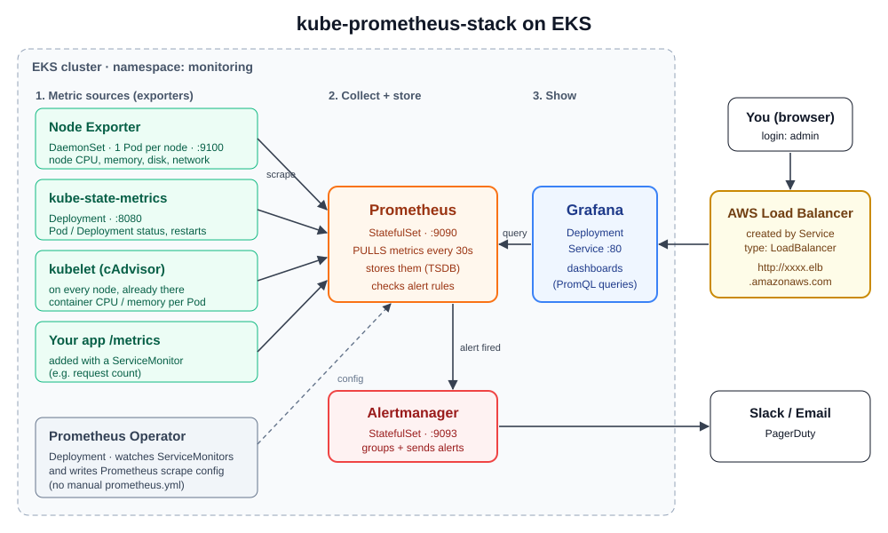

# Day 27 — Kubernetes Monitoring: Prometheus + Grafana with kube-prometheus-stack (Helm) on EKS

[← Kubernetes notes](../README.md)

> **In short:** one Helm chart, **kube-prometheus-stack**, installs a full monitoring setup into the cluster: **Prometheus** (collects metrics), **Grafana** (dashboards), **Alertmanager** (alerts), **Node Exporter** (node metrics) and **kube-state-metrics** (object status). We don't write any of its YAML. We only set a few values, such as making Grafana's Service a **LoadBalancer**, so AWS gives us a public URL to open it.

## About this class

Here we learn how to **watch a Kubernetes cluster**: how busy the nodes and Pods are, and when something breaks.

| Part | Topic | What you learn |
|---|---|---|
| **Part 1: Concepts** | Monitoring in K8s, what's inside kube-prometheus-stack, how metrics flow, Metrics Server vs Prometheus, how to open the UIs | What each component does and why it runs as that kind |
| **Part 2: Lab** | Install the stack on EKS with Helm, open Grafana on an AWS load balancer, open Prometheus safely | Full setup, step by step |
| **Part 3: Grafana** | Built-in dashboards, data sources, importing dashboards, adding Loki | How to actually use what we installed |

## Table of Contents

**Part 1: Concepts**
1. [What is monitoring in Kubernetes?](#1-what-is-monitoring-in-kubernetes)
2. [What is kube-prometheus-stack?](#2-what-is-kube-prometheus-stack)
3. [How the metrics flow](#3-how-the-metrics-flow)
4. [Metrics Server vs Prometheus](#4-metrics-server-vs-prometheus)
5. [How to open Grafana and Prometheus](#5-how-to-open-grafana-and-prometheus)

**Part 2: Lab**

6. [Lab: kube-prometheus-stack on EKS](#6-lab-kube-prometheus-stack-on-eks)

**Part 3: Grafana**

7. [Built-in dashboards](#7-built-in-dashboards)
8. [Data sources](#8-data-sources)
9. [Import a dashboard from grafana.com](#9-import-a-dashboard-from-grafanacom)

**Wrap-up**

10. [Clean up](#10-clean-up)
11. [What I learned](#11-what-i-learned)
12. [Commands](#12-commands)
13. [Interview Questions](#13-interview-questions)

---

# Part 1: Concepts

## 1. What is monitoring in Kubernetes?

**Definition:** **monitoring** means collecting numbers (**metrics**) about the cluster all the time, such as CPU, memory, restarts and requests, so we can **see** them on dashboards and **get alerted** when something goes wrong.

On a single EC2 server we installed Node Exporter + Prometheus + Grafana by hand ([Day 10](../../day-10-12-monitoring/day-10-intro/README.md)). In Kubernetes that doesn't work well:

| Problem in K8s | Why it's hard by hand |
|---|---|
| Pods come and go, and IPs change | A fixed list of targets in `prometheus.yml` goes stale |
| Nodes scale up and down | A new node needs its own Node Exporter |
| Many layers to watch | Nodes, Pods, containers, Deployments, the control plane |

**Solution:** install everything with **one Helm chart** that already knows how to find Pods and nodes automatically.

## 2. What is kube-prometheus-stack?

**Definition:** **kube-prometheus-stack** is a community Helm chart (`prometheus-community/kube-prometheus-stack`) that installs a ready monitoring setup for Kubernetes: Prometheus, Grafana, Alertmanager, Node Exporter, kube-state-metrics, the Prometheus Operator, and ready-made dashboards and alert rules.

**We don't write these YAMLs.** The chart authors already wrote every Deployment, DaemonSet and StatefulSet. We only change values (for example, the Grafana Service type).

| Component | K8s kind (chosen by the chart) | Port | Job |
|---|---|---|---|
| **Prometheus** | StatefulSet (created by the Operator) | 9090 | **Pulls** metrics from all targets and stores them |
| **Grafana** | Deployment | 80 (Service) | Dashboards; queries Prometheus with PromQL |
| **Alertmanager** | StatefulSet (created by the Operator) | 9093 | Groups alerts and sends them to Slack / Email / PagerDuty |
| **Node Exporter** | **DaemonSet** (1 Pod per node) | 9100 | Node CPU, memory, disk, network |
| **kube-state-metrics** | Deployment | 8080 | Status of K8s objects: Pod phase, restarts, desired vs ready replicas |
| **Prometheus Operator** | Deployment | 443 | Watches `ServiceMonitor` objects and writes Prometheus's scrape config for us |

Why those kinds:
- **Node Exporter → DaemonSet:** it must read **each node's** metrics, so it needs exactly one Pod on every node. A new node gets one automatically.
- **Prometheus / Alertmanager → StatefulSet:** they keep data (metrics, alert state), so they need a stable name.
- **Grafana → Deployment:** it's a stateless web UI.

**ServiceMonitor:** a small YAML that tells Prometheus *"scrape the Pods behind this Service, on this port and path"*. The Operator turns it into scrape config, so there's no `prometheus.yml` to edit by hand.

## 3. How the metrics flow



| Step | What happens |
|---|---|
| 1. Expose | Node Exporter, kube-state-metrics, kubelet (cAdvisor) and our apps show metrics on a `/metrics` page |
| 2. Collect | Prometheus **pulls** (scrapes) every target every 30 s and stores the numbers with a timestamp |
| 3. Show | Grafana runs PromQL queries against Prometheus and draws dashboards |
| 4. Alert | Prometheus checks alert rules, and Alertmanager sends the notification |
| 5. Open | Grafana's Service `type: LoadBalancer` → AWS creates a load balancer → we open it in the browser |

## 4. Metrics Server vs Prometheus

Both deal with metrics, but they're different tools. A cluster usually has **both**.

**Definition:** **Metrics Server** keeps only the **current** CPU and memory of Pods and nodes (no history). It feeds `kubectl top` and the HPA. Full notes: [Autoscaling: Metrics Server](../day-23-eks-terraform-helm-argocd/autoscaling-hpa-nodes/README.md#2-metrics-server).

| | Metrics Server | Prometheus |
|---|---|---|
| Keeps | Only the latest value | History (days or weeks) |
| Metrics | CPU, memory | Thousands: CPU, memory, disk, network, restarts, app metrics |
| Used by | `kubectl top`, HPA | Grafana dashboards, alerts |
| Dashboards / alerts | ❌ | ✅ |

## 5. How to open Grafana and Prometheus

All Services in the stack are **ClusterIP** by default, so they're only reachable inside the cluster. To open a UI from the laptop:

| Way | How | Use it for |
|---|---|---|
| **LoadBalancer** | Service `type: LoadBalancer` → AWS creates a load balancer with a public DNS name | ✅ This lab: Grafana on EKS |
| **Ingress (ALB) + HTTPS** | One ALB with host rules, e.g. `grafana.mycompany.com` ([Ingress notes](../ingress/README.md)) | ✅ Real projects (TLS, login, one LB for many tools) |
| **port-forward** | `kubectl port-forward` + SSH tunnel through the bastion | ✅ Prometheus / Alertmanager: admin tools, never public |
| NodePort | `<node-public-IP>:30xxx` + open the port in the security group | Single-node test clusters only (EKS nodes are in private subnets) |

> On EKS we **don't open any security group port by hand** for the LoadBalancer. Kubernetes creates the load balancer and adds the needed rules itself.

---

# Part 2: Lab

## 6. Lab: kube-prometheus-stack on EKS

**Goal:** install the full monitoring stack with Helm, open Grafana on an AWS load balancer, and see live dashboards for our nodes and Pods.

**Before you start:**

| Need | Why |
|---|---|
| EKS cluster + bastion with `kubectl` and `helm` ([Day 23](../day-23-eks-terraform-helm-argocd/README.md)) | We run every command on the bastion |
| Public subnets tagged `kubernetes.io/role/elb = 1` | So AWS knows where to put the load balancer (the Day 23 Terraform VPC already has this) |

### Step 1: Check the cluster and Helm

```bash
kubectl get nodes
```

**Expected:** 2 nodes, `Ready`.

```bash
helm version
```

**Expected:** `version.BuildInfo{Version:"v3...`

### Step 2 (optional): Metrics Server for `kubectl top`

Skip this if `kubectl top nodes` already works.

```bash
kubectl apply -f https://github.com/kubernetes-sigs/metrics-server/releases/latest/download/high-availability-1.21+.yaml
```

```bash
kubectl top nodes
```

**Expected:** CPU and memory for each node (after about 1 minute).

### Step 3: Create the namespace

```bash
kubectl create namespace monitoring
```

**What it does:** keeps all monitoring Pods apart from the apps.

### Step 4: Add the Helm repos

```bash
helm repo add prometheus-community https://prometheus-community.github.io/helm-charts
```

```bash
helm repo add grafana https://grafana.github.io/helm-charts
```

```bash
helm repo update
```

**What it does:** `prometheus-community` has the stack. `grafana` has Grafana's own charts (Loki and others) for extra tools later. Charts can be searched on [artifacthub.io](https://artifacthub.io/).

### Step 5: Write the values file

```bash
vim monitoring-values.yaml
```

```yaml
grafana:
  service:
    type: LoadBalancer      # AWS creates a load balancer → public URL for Grafana
```

**Why a values file and not `kubectl patch`?** If we patch the Service after install, the next `helm upgrade` changes it back to ClusterIP. A setting in the values file stays on every upgrade.

### Step 6: Install the stack

```bash
helm install kube-prom-stack prometheus-community/kube-prometheus-stack -n monitoring -f monitoring-values.yaml
```

**Expected:** `STATUS: deployed`, plus NOTES with commands to get the Grafana password.

### Step 7: Check the Pods

```bash
kubectl get pods -n monitoring -o wide
```

**Expected** (all `Running` after 1–2 min):

| Pod | Count | Note |
|---|---|---|
| `alertmanager-kube-prom-stack-kube-prome-alertmanager-0` | 1 | StatefulSet (`-0`) |
| `prometheus-kube-prom-stack-kube-prome-prometheus-0` | 1 | StatefulSet (`-0`) |
| `kube-prom-stack-grafana-...` | 1 | `3/3` containers |
| `kube-prom-stack-kube-prome-operator-...` | 1 | |
| `kube-prom-stack-kube-state-metrics-...` | 1 | |
| `kube-prom-stack-prometheus-node-exporter-...` | **2** | one per node, see the `NODE` column |

### Step 8: Check the Services

```bash
kubectl get svc -n monitoring
```

**Expected:**

| Service | TYPE | PORT |
|---|---|---|
| `kube-prom-stack-grafana` | **LoadBalancer**, EXTERNAL-IP `xxxx.us-east-1.elb.amazonaws.com` | 80 |
| `kube-prom-stack-kube-prome-prometheus` | ClusterIP | 9090 |
| `kube-prom-stack-kube-prome-alertmanager` | ClusterIP | 9093 |
| `kube-prom-stack-kube-state-metrics` | ClusterIP | 8080 |
| `kube-prom-stack-prometheus-node-exporter` | ClusterIP | 9100 |
| `kube-prom-stack-kube-prome-operator` | ClusterIP | 443 |
| `prometheus-operated`, `alertmanager-operated` | ClusterIP `None` (headless) | 9090 / 9093 |

### Step 9: Get the Grafana admin password

```bash
kubectl get secret kube-prom-stack-grafana -n monitoring -o jsonpath="{.data.admin-password}" | base64 -d ; echo
```

**What it does:** the chart stores a password in a Secret. Secrets are base64-encoded, so `base64 -d` decodes it.

### Step 10: Open Grafana

```bash
kubectl get svc kube-prom-stack-grafana -n monitoring -o jsonpath='{.status.loadBalancer.ingress[0].hostname}' ; echo
```

Open `http://<that-hostname>` in the laptop browser (wait 2–3 min for the DNS name to start working).

Log in with **Username:** `admin` and **Password:** the value from Step 9.

### Step 11: Open Prometheus (private, through the bastion)

Prometheus has no login, so we **don't** put it on a public load balancer. We use an SSH tunnel instead.

On the **laptop**, open a new terminal:

```bash
ssh -i ~/.ssh/abhigna-eks-key.pem -L 9090:localhost:9090 ubuntu@<bastion-public-ip>
```

Then in that SSH session (**bastion**):

```bash
kubectl port-forward -n monitoring svc/kube-prom-stack-kube-prome-prometheus 9090:9090
```

Open `http://localhost:9090` on the laptop → **Status → Targets**.

**Expected:** targets like `node-exporter`, `kube-state-metrics`, `kubelet`, `apiserver`, all **UP**.

```
laptop:9090 ──SSH tunnel──► bastion:9090 ──port-forward──► Prometheus Service :9090
```

### Troubleshooting

| Problem | Cause | Fix |
|---|---|---|
| Grafana `EXTERNAL-IP` stays `<pending>` | No public subnets tagged for load balancers | Tag public subnets `kubernetes.io/role/elb = 1`; `kubectl describe svc kube-prom-stack-grafana -n monitoring` |
| URL doesn't open right away | Load balancer DNS still starting | Wait 2–3 min |
| Grafana went back to ClusterIP | Service was patched, then `helm upgrade` reset it | Put `grafana.service.type` in the values file (Step 5) |
| Pods `Pending` | Nodes are full | `kubectl describe pod <pod> -n monitoring`; add a node or use a bigger instance type |
| Login fails | Wrong password | Run Step 9 again (copy it without spaces) |

---

# Part 3: Grafana

## 7. Built-in dashboards

**Definition:** a **dashboard** is a page of panels (graphs, tables), and each panel runs a PromQL query. The stack ships about 25 ready dashboards.

Grafana → **Dashboards**:

| Dashboard | Shows |
|---|---|
| **Kubernetes / Compute Resources / Cluster** | CPU and memory of the whole cluster, per namespace |
| **Kubernetes / Compute Resources / Namespace (Pods)** | Every Pod in one namespace |
| **Kubernetes / Compute Resources / Pod** | One Pod: CPU, CPU throttling, memory vs requests / limits |
| **Kubernetes / Networking / Workload** | Network in / out per Deployment (e.g. `coredns` in `kube-system`) |
| **Kubernetes / Persistent Volumes** | PVC size and usage |
| **Node Exporter / Nodes** | One node: CPU, memory, disk space, disk I/O, network |

Choose **Data source**, **namespace** and **pod** (or **instance** for nodes) at the top of the dashboard.

### Try it: watch a new Pod appear

```bash
kubectl run pod1 --image nginx
```

Open **Kubernetes / Compute Resources / Pod** → namespace `default` → pod `pod1`.

**Expected:** **No data** at first. After 1–2 minutes the graphs fill in, because Prometheus scrapes every 30 s and needs a few samples to draw a rate.

```bash
kubectl delete pod pod1
```

## 8. Data sources

**Definition:** a **data source** is where Grafana reads data from. Grafana itself stores no metrics; it only asks a data source.

Grafana → **Connections → Data sources**. The stack has **already added** these two for us:

| Data source | URL | Default |
|---|---|---|
| **Prometheus** | `http://kube-prom-stack-kube-prome-prometheus.monitoring:9090/` | ✅ |
| **Alertmanager** | `http://kube-prom-stack-kube-prome-alertmanager.monitoring:9093/` | |

The URL format is the Service DNS name `<service>.<namespace>:<port>` ([Day 25: CoreDNS](../day-25-dns-network-policy/README.md)). Grafana reaches Prometheus **inside** the cluster, so no load balancer is needed between them.

> On a VM setup we added the Prometheus data source by hand ([Day 10](../../day-10-12-monitoring/day-10-intro/README.md)). With kube-prometheus-stack, we don't need to.

### Adding another data source (example: Loki for logs)

**Connections → Data sources → Add new data source** shows every type Grafana supports:

| Category | Data source | Gives you |
|---|---|---|
| Metrics | Prometheus | Numbers over time |
| Logs | **Loki**, Elasticsearch | Log lines from Pods |
| Traces | Jaeger, Tempo | One request's path through many services |

**Metrics + logs + traces** are the 3 pillars of observability.

To add **Loki**:
1. Install Loki in the cluster first (Helm chart from the `grafana` repo added in Step 4). Loki basics: [Day 12](../../day-10-12-monitoring/day-12-pushgateway-loki/README.md).
2. **Add new data source → Loki**.
3. **URL:** `http://<loki-service>.<namespace>:3100`
4. **Save & test** → `Data source successfully connected`.

## 9. Import a dashboard from grafana.com

**Definition:** [grafana.com/grafana/dashboards](https://grafana.com/grafana/dashboards/) has thousands of free dashboards made by the community. Each has an **ID**.

1. Grafana → **Dashboards → New → Import**
2. Enter the ID → **Load**
3. Choose data source **Prometheus** → **Import**

| ID | Dashboard |
|---|---|
| `1860` | Node Exporter Full (very detailed node view) |
| `15757` | Kubernetes / Views / Global |
| `15760` | Kubernetes / Views / Pods |

---

# Wrap-up

## 10. Clean up

**Delete the stack before `terraform destroy`.** The Grafana load balancer was created by Kubernetes, not Terraform, so Terraform can't delete it and it blocks the VPC from being destroyed.

```bash
helm uninstall kube-prom-stack -n monitoring
```

```bash
kubectl delete namespace monitoring
```

```bash
kubectl get svc -A | grep LoadBalancer
```

**Expected:** no Grafana load balancer left.

> The chart also adds CRDs (`ServiceMonitor`, `PrometheusRule`, ...), which `helm uninstall` keeps. They cost nothing, and they're deleted with the cluster.

## 11. What I learned

**Part 1: Concepts**
- **kube-prometheus-stack** = one Helm chart for Prometheus, Grafana, Alertmanager, Node Exporter, kube-state-metrics and the Operator. We write **values**, not YAML.
- **Node Exporter = DaemonSet** (one per node), **Prometheus / Alertmanager = StatefulSet** (keep data), **Grafana = Deployment** (stateless UI).
- Prometheus **pulls** metrics. A **ServiceMonitor** tells it what to scrape, and the Operator writes the config.
- **Metrics Server** = current CPU/memory for `kubectl top` + HPA. **Prometheus** = history + dashboards + alerts.

**Part 2: Lab**
- Grafana Service `type: LoadBalancer` set **in the values file** → AWS load balancer → public URL. No manual security group rules on EKS.
- Prometheus stays private: port-forward + SSH tunnel through the bastion.

**Part 3: Grafana**
- Built-in dashboards for cluster, namespace, Pod and node. The Prometheus and Alertmanager data sources are added automatically.
- More data sources (Loki for logs, Tempo/Jaeger for traces) via **Add new data source**. Community dashboards via **Import** + ID.

```
 exporters ──scrape──► Prometheus ──query──► Grafana ◄── AWS LB ◄── browser
                           │
                           └── alert ──► Alertmanager ──► Slack / Email
```

---

## 12. Commands

| Command | Use |
|---|---|
| `helm repo add prometheus-community https://prometheus-community.github.io/helm-charts` | Add the chart repo |
| `helm install kube-prom-stack prometheus-community/kube-prometheus-stack -n monitoring -f monitoring-values.yaml` | Install the stack |
| `helm upgrade kube-prom-stack prometheus-community/kube-prometheus-stack -n monitoring -f monitoring-values.yaml` | Apply changed values |
| `helm show values prometheus-community/kube-prometheus-stack` | See every setting the chart has |
| `kubectl get pods -n monitoring -o wide` | Stack Pods and their nodes |
| `kubectl get svc -n monitoring` | Services + Grafana LB address |
| `kubectl get secret kube-prom-stack-grafana -n monitoring -o jsonpath="{.data.admin-password}" \| base64 -d` | Grafana admin password |
| `kubectl port-forward -n monitoring svc/kube-prom-stack-kube-prome-prometheus 9090:9090` | Open Prometheus privately |
| `kubectl get servicemonitors -A` | What Prometheus is told to scrape |
| `kubectl top nodes` / `kubectl top pods` | Current CPU/memory (Metrics Server) |
| `helm uninstall kube-prom-stack -n monitoring` | Remove the stack + its load balancer |

---

## 13. Interview Questions

### Other Questions

**Q1. How do you monitor a Kubernetes cluster?**
We install kube-prometheus-stack with Helm. It deploys Prometheus to collect metrics, Node Exporter on every node, kube-state-metrics for object status, Grafana for dashboards and Alertmanager for alerts. We only customize `values.yaml`; we don't write the YAML ourselves.

**Q2. Why does Node Exporter run as a DaemonSet?**
It has to read each node's own CPU, memory and disk, so exactly one Pod must run on every node. A DaemonSet does that and automatically adds a Pod when a new node joins.

**Q3. What's the difference between Node Exporter and kube-state-metrics?**
Node Exporter gives **machine** metrics (node CPU, memory, disk, network). kube-state-metrics gives the **state of Kubernetes objects** (Pod phase, restarts, desired vs available replicas). We need both.

**Q4. What's the difference between Metrics Server and Prometheus?**
Metrics Server keeps only the current CPU and memory and feeds `kubectl top` and the HPA. Prometheus stores history for thousands of metrics and powers dashboards and alerts.

**Q5. What is a ServiceMonitor?**
A custom resource from the Prometheus Operator. It tells Prometheus which Service to scrape and on which port and path. The Operator turns it into scrape config automatically, so we never edit `prometheus.yml` by hand.

**Q6. How do you expose Grafana on EKS?**
For a lab, set the Grafana Service to `type: LoadBalancer` in the Helm values, and AWS creates a load balancer. In production, we put it behind an Ingress (ALB) with HTTPS and SSO login. Prometheus and Alertmanager stay internal and are reached with port-forward.

**Q7. Why set the Service type in the values file instead of `kubectl patch`?**
A patch is outside Helm, so the next `helm upgrade` resets the Service to what the chart says. A value in `values.yaml` survives every upgrade and is tracked in Git.

**Q8. Does Prometheus push or pull?**
It pulls: it scrapes each target's `/metrics` endpoint on an interval (30 s in this stack). Only short-lived jobs push, through the Pushgateway.

**Q9. A new Pod shows "No data" in Grafana. Why?**
Prometheus hasn't scraped it enough times yet. Rate-based panels need a few samples, so it takes 1–2 minutes. If it stays empty, check Prometheus **Status → Targets** and the dashboard's namespace and pod filters.

**Q10. Do you need to add the Prometheus data source in Grafana by hand?**
Not with kube-prometheus-stack. It adds Prometheus (default) and Alertmanager automatically, using in-cluster Service DNS names like `kube-prom-stack-kube-prome-prometheus.monitoring:9090`.

**Q11. Why can't `terraform destroy` finish after installing the stack?**
The Grafana load balancer was created by Kubernetes, not Terraform, and it still sits in the VPC subnets. Run `helm uninstall` first (it deletes the Service and its load balancer), then destroy.
