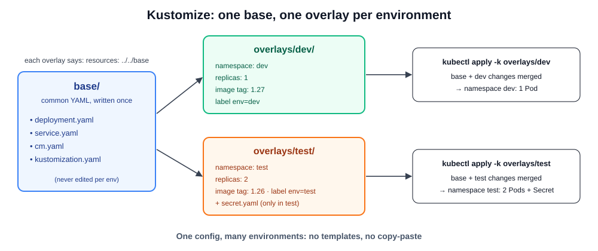
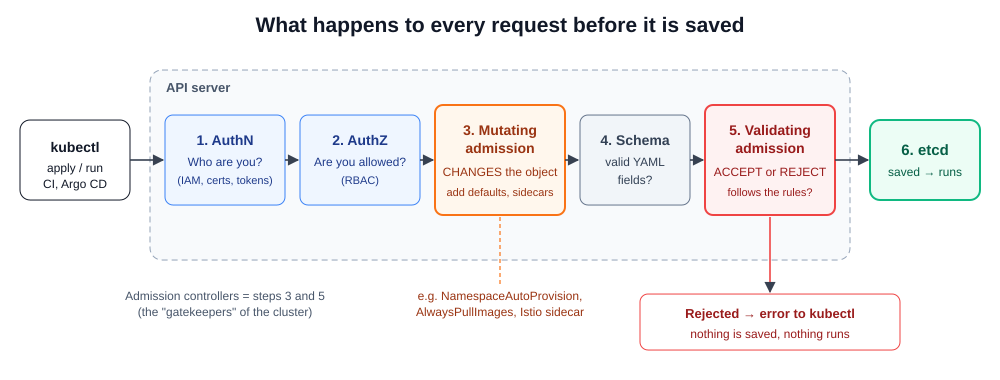

# Day 28 — Kustomize, Admission Controllers and CRDs

[← Kubernetes notes](../README.md)

> **In short:** **Kustomize** lets us keep **one base** of YAML and make small changes per environment (dev, test, prod) **without editing or copying** the original files. **Admission controllers** are gatekeepers inside the API server: they can **change** or **reject** every request before it's saved. **CRDs** add **new object types** to Kubernetes (like `ServiceMonitor` or `Application`), so tools can be managed with YAML just like Pods.

## About this class

Here we learn three tools that real clusters use every day: one to **manage YAML for many environments**, one to **enforce rules**, and one to **extend Kubernetes**.

| Part | Topic | What you learn |
|---|---|---|
| **Part 1: Kustomize** | Base + overlays, `kustomization.yaml`, Kustomize vs Helm | Deploy the same app to dev and test with different settings |
| **Part 2: Admission controllers** | Mutating vs validating, built-in plugins, EKS vs self-managed, custom policies | How the API server checks and changes requests |
| **Part 3: CRDs** | Custom resources, CRD + controller (operator), real use cases | Create our own object type and see how tools use CRDs |

## Table of Contents

**Part 1: Kustomize**
1. [What is Kustomize?](#1-what-is-kustomize)
2. [Base and overlays](#2-base-and-overlays)
3. [kustomization.yaml: what we can change](#3-kustomizationyaml-what-we-can-change)
4. [Kustomize vs Helm](#4-kustomize-vs-helm)
5. [Lab: one app, two environments on EKS](#5-lab-one-app-two-environments-on-eks)

**Part 2: Admission controllers**

6. [What is an admission controller?](#6-what-is-an-admission-controller)
7. [Mutating vs validating](#7-mutating-vs-validating)
8. [Built-in admission controllers](#8-built-in-admission-controllers)
9. [EKS vs self-managed clusters](#9-eks-vs-self-managed-clusters)
10. [Lab: admission controllers](#10-lab-admission-controllers)

**Part 3: CRDs**

11. [What is a CRD?](#11-what-is-a-crd)
12. [CRD + controller = operator](#12-crd--controller--operator)
13. [Real-world use cases](#13-real-world-use-cases)
14. [Lab: create our own CRD](#14-lab-create-our-own-crd)

**Wrap-up**

15. [What I learned](#15-what-i-learned)
16. [Commands](#16-commands)
17. [Interview Questions](#17-interview-questions)

---

# Part 1: Kustomize

## 1. What is Kustomize?

**Definition:** **Kustomize** is a tool, built into `kubectl`, that **customizes Kubernetes YAML without editing the original files**. We write the common YAML once (the **base**) and keep only the differences for each environment in small files (the **overlays**).

**The problem it solves:**

| Without Kustomize | With Kustomize |
|---|---|
| Copy `deployment.yaml` into `dev/`, `test/`, `prod/` | One `deployment.yaml` in `base/` |
| Change the image → edit 3 copies, forget one | Change it once in base, or once per overlay |
| Copies slowly drift apart | Each overlay shows **only** what's different |

**One word: customize.** One config, many environments (dev, test, prod).

## 2. Base and overlays



| Term | Definition | Example |
|---|---|---|
| **Base** | The common YAML that every environment shares | Deployment, Service, ConfigMap |
| **Overlay** | One folder per environment, which points to the base and adds only its changes | `overlays/dev` → namespace `dev`, 1 replica |
| **`kustomization.yaml`** | The main file in every folder. Lists the resources and the changes to apply | `resources: [../../base]`, `replicas: ...` |

**Folder structure:**

```
kustomize/
├── base/
│   ├── deployment.yaml
│   ├── service.yaml
│   ├── cm.yaml
│   └── kustomization.yaml      ← lists the files above
└── overlays/
    ├── dev/
    │   ├── kustomization.yaml  ← base + dev changes
    │   └── namespace.yaml
    └── test/
        ├── kustomization.yaml  ← base + test changes
        ├── namespace.yaml
        └── secret.yaml         ← only test has it
```

**How it works:** `kubectl apply -k overlays/dev` reads the dev `kustomization.yaml` → loads the base → applies the dev changes → sends the final YAML to the cluster. The files in `base/` never change on disk.

## 3. kustomization.yaml: what we can change

| Field | What it does | Example |
|---|---|---|
| `resources` | Files or folders to include | `- ../../base`, `- namespace.yaml` |
| `namespace` | Puts every object in this namespace | `namespace: dev` |
| `replicas` | Changes the replica count of a Deployment | `name: my-app`, `count: 2` |
| `images` | Changes an image tag without touching the Deployment | `name: nginx`, `newTag: "1.27"` |
| `labels` | Adds labels to every object | `env: dev` |
| `namePrefix` / `nameSuffix` | Adds text to every object's name | `dev-my-app` |
| `configMapGenerator` / `secretGenerator` | Creates a ConfigMap/Secret from literals or files, with a hash in the name | `app-config-7g8h9k` |
| `patches` | Changes any field of any object (a small YAML or JSON patch) | Bigger CPU limits in prod |

> **Real-world tip:** `configMapGenerator` adds a hash to the name (`app-config-7g8h9k`). When the config changes, the name changes, so the Deployment rolls out new Pods automatically. A plain `cm.yaml` doesn't do that.

## 4. Kustomize vs Helm

Both manage YAML for many environments, but in different ways.

| | Kustomize | Helm |
|---|---|---|
| Style | **Patches** plain YAML | **Templates** with `{{ .Values.x }}` |
| Install | Built into `kubectl` (`-k`) | Separate `helm` binary |
| Files | Real, valid YAML you can read | Templates aren't valid YAML until rendered |
| Packaging / sharing | ❌ No packages, no versions | ✅ Charts with versions, repos (Artifact Hub) |
| Release history / rollback | ❌ | ✅ `helm history`, `helm rollback` |
| Best for | **Our own apps**, small per-env changes | **Third-party apps** (Prometheus, Argo CD) and reusable charts |
| Argo CD support | ✅ | ✅ |

**In real projects:** many teams use **Helm for third-party tools** and **Kustomize for their own app manifests**. Some even run Kustomize on top of a Helm chart's output.

## 5. Lab: one app, two environments on EKS

**Goal:** deploy the same nginx app to `dev` (1 replica) and `test` (2 replicas, its own Secret) from one base, without copying any YAML.

**Before you start:**

| Need | Why |
|---|---|
| EKS cluster + bastion with `kubectl` ([Day 23](../day-23-eks-terraform-helm-argocd/README.md)) | We run all commands on the bastion |

`kubectl` has Kustomize built in, so there's nothing to install.

### Step 1: Create the folders

```bash
mkdir -p kustomize/base kustomize/overlays/dev kustomize/overlays/test
```

```bash
cd kustomize
```

### Step 2: Write the base

```bash
vim base/deployment.yaml
```

```yaml
apiVersion: apps/v1
kind: Deployment
metadata:
  name: my-app
spec:
  replicas: 1
  selector:
    matchLabels:
      app: my-app
  template:
    metadata:
      labels:
        app: my-app
    spec:
      containers:
        - name: my-app
          image: nginx:1.27
          ports:
            - containerPort: 80
```

```bash
vim base/service.yaml
```

```yaml
apiVersion: v1
kind: Service
metadata:
  name: my-app-service
spec:
  type: ClusterIP
  selector:
    app: my-app
  ports:
    - port: 80
      targetPort: 80
```

> We use **ClusterIP**, not a NodePort like `30001`. A nodePort number is **cluster-wide**, so dev and test can't both use `30001` (see troubleshooting).

```bash
vim base/kustomization.yaml
```

```yaml
apiVersion: kustomize.config.k8s.io/v1beta1
kind: Kustomization
resources:
  - deployment.yaml
  - service.yaml
```

### Step 3: Write the dev overlay

```bash
vim overlays/dev/namespace.yaml
```

```yaml
apiVersion: v1
kind: Namespace
metadata:
  name: dev
```

```bash
vim overlays/dev/kustomization.yaml
```

```yaml
apiVersion: kustomize.config.k8s.io/v1beta1
kind: Kustomization
namespace: dev            # every object goes into namespace dev
resources:
  - ../../base            # take everything from base
  - namespace.yaml
replicas:
  - name: my-app
    count: 1
images:
  - name: nginx
    newTag: "1.27"
labels:
  - pairs:
      env: dev
```

### Step 4: Write the test overlay

```bash
vim overlays/test/namespace.yaml
```

```yaml
apiVersion: v1
kind: Namespace
metadata:
  name: test
```

```bash
vim overlays/test/kustomization.yaml
```

```yaml
apiVersion: kustomize.config.k8s.io/v1beta1
kind: Kustomization
namespace: test
resources:
  - ../../base
  - namespace.yaml
replicas:
  - name: my-app
    count: 2              # test gets 2 Pods
images:
  - name: nginx
    newTag: "1.26"        # test runs a different version
labels:
  - pairs:
      env: test
```

### Step 5: See the final YAML (nothing is applied yet)

```bash
kubectl kustomize overlays/dev
```

**Expected:** the Namespace, Service and Deployment, all with `namespace: dev`, `replicas: 1`, `image: nginx:1.27`, label `env: dev`.

```bash
kubectl kustomize overlays/test
```

**Expected:** the same objects with `namespace: test`, `replicas: 2`, `image: nginx:1.26`.

### Step 6: Apply both environments

```bash
kubectl apply -k overlays/dev
```

**Expected:**
```
namespace/dev created
service/my-app-service created
deployment.apps/my-app created
```

```bash
kubectl apply -k overlays/test
```

```bash
kubectl get deploy -A -l app=my-app -o wide
```

**Expected:** `my-app` in `dev` (1/1, `nginx:1.27`) and in `test` (2/2, `nginx:1.26`), both from the same base.

### Step 7: Add a ConfigMap to the base (both environments get it)

`--dry-run=client -o yaml` writes the YAML to a file without creating anything:

```bash
kubectl create configmap app-config --from-literal=user=admin --dry-run=client -o yaml > base/cm.yaml
```

Add it to the base resources:

```bash
vim base/kustomization.yaml
```

```yaml
resources:
  - deployment.yaml
  - service.yaml
  - cm.yaml
```

```bash
kubectl apply -k overlays/dev
```

**Expected:** `configmap/app-config created`, and everything else `unchanged`. Apply the test overlay too, and the ConfigMap appears in `test` as well.

### Step 8: Add a Secret only to test

```bash
kubectl create secret generic app-secret --from-literal=password=test123 --dry-run=client -o yaml > overlays/test/secret.yaml
```

```bash
vim overlays/test/kustomization.yaml
```

Add `secret.yaml` under `resources`:

```yaml
resources:
  - ../../base
  - namespace.yaml
  - secret.yaml
```

```bash
kubectl apply -k overlays/test
```

**Expected:** `secret/app-secret created`.

```bash
kubectl get secret app-secret -n dev
```

**Expected:** `NotFound`. Only the test overlay has it.

### Step 9: Clean up

```bash
kubectl delete -k overlays/dev
```

```bash
kubectl delete -k overlays/test
```

**What it does:** deletes exactly the objects that overlay created, including the namespace.

### Troubleshooting

| Problem | Cause | Fix |
|---|---|---|
| `nodePort: Invalid value: 30001: provided port is already allocated` | Base Service has a fixed `nodePort`, and the 2nd overlay tries to take the same port | Use ClusterIP (or Ingress) in base; or patch a different `nodePort` per overlay |
| `accumulating resources: ... no such file` | Wrong path in `resources` | Overlays point to `../../base` (2 levels up) |
| A new file in base isn't applied | File not listed in `base/kustomization.yaml` | Add it under `resources` |
| `error: ... must build at directory` | `-k` was given a file, not a folder | `kubectl apply -k overlays/dev` (folder) |

---

# Part 2: Admission controllers

## 6. What is an admission controller?

**Definition:** an **admission controller** is a piece of code inside the **API server** that checks every request to **create, update or delete** an object, **after** you've logged in (authentication) and been allowed (authorization), but **before** the object is saved in etcd. It can **change** the object or **reject** the request.



| Step | Question | Fails with |
|---|---|---|
| 1. Authentication | Who are you? | `Unauthorized` |
| 2. Authorization (RBAC) | Are you allowed to do this? | `Forbidden` |
| 3. **Mutating admission** | Should we change or add anything? | — |
| 4. Schema validation | Are the fields valid? | `unknown field` |
| 5. **Validating admission** | Does it follow the cluster's rules? | `denied the request` |
| 6. etcd | Saved → controllers and the scheduler act on it | — |

**Why we need them:** RBAC only says *who* may create a Pod. Admission controllers decide *what kind* of Pod is acceptable: no `latest` tag, must have resource limits, must stay within the namespace quota, and so on.

## 7. Mutating vs validating

| Type | Definition | Example |
|---|---|---|
| **Mutating** | **Changes** the object before it's saved | `NamespaceAutoProvision` creates a missing namespace. `AlwaysPullImages` sets `imagePullPolicy: Always`. Istio adds a sidecar container. |
| **Validating** | Only **accepts or rejects**, never changes | `ResourceQuota` rejects a Pod that would exceed the namespace quota. `NamespaceExists` rejects requests to a missing namespace. |

Mutating always runs **first**, so the validating step checks the **final** object.

## 8. Built-in admission controllers

Kubernetes ships with many controllers (called **plugins**). Each is switched on with the API server flag `--enable-admission-plugins`.

| Plugin | Type | What it does | Real use |
|---|---|---|---|
| **NamespaceLifecycle** | Validating | Rejects new objects in a namespace being deleted or that doesn't exist; protects `default`, `kube-system`, `kube-public` from deletion | ✅ Always on (recommended) |
| **NamespaceExists** | Validating | Rejects requests to a namespace that doesn't exist | Covered by NamespaceLifecycle |
| **NamespaceAutoProvision** | Mutating | **Creates** the namespace if it doesn't exist | ⚠️ Rarely used: a typo like `-n prdo` silently creates a new namespace |
| **ResourceQuota** | Validating | Rejects objects that would break a namespace's `ResourceQuota` | ✅ Must be on if you use quotas |
| **LimitRanger** | Mutating + validating | Adds default CPU/memory requests and limits from a `LimitRange` | ✅ Common |
| **PersistentVolumeClaimResize** | Validating | Allows a PVC to grow only if its StorageClass has `allowVolumeExpansion: true` | ✅ Common |
| **AlwaysPullImages** | Mutating + validating | Forces `imagePullPolicy: Always`, so private images can't be reused without credentials | Multi-tenant clusters |
| **Priority** | Mutating + validating | Fills in the Pod priority from `priorityClassName`; rejects an unknown class | ✅ Common |
| **PodSecurity** | Validating | Enforces Pod Security Standards (`privileged`, `baseline`, `restricted`) per namespace | ✅ Security |
| **NodeRestriction** | Validating | A kubelet may only change its own node and its own Pods | ✅ Always on |
| **MutatingAdmissionWebhook / ValidatingAdmissionWebhook** | Both | Call **our own** webhook service (Kyverno, OPA Gatekeeper, Istio) | ✅ Custom rules |
| **AlwaysDeny** | Validating | Rejects everything | ❌ Deprecated, no real use |

Full list: [kubernetes.io → Admission Controllers](https://kubernetes.io/docs/reference/access-authn-authz/admission-controllers/).

## 9. EKS vs self-managed clusters

| | Self-managed (kubeadm) | EKS |
|---|---|---|
| Where the API server runs | **Static Pod** on our control plane node | AWS-managed, we can't log in |
| Change plugins | Edit `/etc/kubernetes/manifests/kube-apiserver.yaml` | ❌ Not possible. AWS turns on a fixed, recommended set |
| Custom rules | Plugins, webhooks, policies | **Webhooks** (Kyverno, OPA Gatekeeper) or **ValidatingAdmissionPolicy** |

**Static Pod (why editing that file works):** on a kubeadm control plane, the kubelet watches `/etc/kubernetes/manifests/`. Every YAML in that folder (etcd, kube-apiserver, kube-controller-manager, kube-scheduler) runs as a Pod that the kubelet manages directly. Save a change to `kube-apiserver.yaml` and the kubelet recreates the API server Pod with the new flags. Drop a new Pod YAML there and it runs too.

**ValidatingAdmissionPolicy** (built in since Kubernetes 1.30): write a validating rule as a small YAML with a **CEL** expression. No webhook server to run, and it works on EKS.

## 10. Lab: admission controllers

### Lab A (EKS): block images without a version tag

**Goal:** reject any Deployment whose image has no tag or uses `:latest`, using a built-in ValidatingAdmissionPolicy.

#### Step 1: Write the policy

```bash
vim no-latest-policy.yaml
```

```yaml
apiVersion: admissionregistration.k8s.io/v1
kind: ValidatingAdmissionPolicy
metadata:
  name: no-latest-tag
spec:
  failurePolicy: Fail
  matchConstraints:
    resourceRules:
      - apiGroups: ["apps"]
        apiVersions: ["v1"]
        operations: ["CREATE", "UPDATE"]
        resources: ["deployments"]
  validations:
    - expression: "object.spec.template.spec.containers.all(c, c.image.contains(':') && !c.image.endsWith(':latest'))"
      message: "Every image needs a version tag (not :latest)."
---
apiVersion: admissionregistration.k8s.io/v1
kind: ValidatingAdmissionPolicyBinding
metadata:
  name: no-latest-tag-binding
spec:
  policyName: no-latest-tag
  validationActions: ["Deny"]
  matchResources:
    namespaceSelector:
      matchLabels:
        policy: strict        # only namespaces with this label
```

| Part | Meaning |
|---|---|
| `matchConstraints` | Which requests to check: create/update of Deployments |
| `expression` (CEL) | Every container image must contain `:` and must not end with `:latest` |
| Binding `namespaceSelector` | Turn it on only for namespaces labelled `policy=strict` |

```bash
kubectl apply -f no-latest-policy.yaml
```

#### Step 2: Test it

```bash
kubectl create namespace strict-demo
```

```bash
kubectl label namespace strict-demo policy=strict
```

```bash
kubectl create deployment bad --image=nginx -n strict-demo
```

**Expected:** `denied request: ... Every image needs a version tag (not :latest).`

```bash
kubectl create deployment good --image=nginx:1.27 -n strict-demo
```

**Expected:** `deployment.apps/good created`.

#### Step 3: Clean up

```bash
kubectl delete namespace strict-demo
```

```bash
kubectl delete -f no-latest-policy.yaml
```

### Lab B (self-managed kubeadm cluster only): NamespaceAutoProvision

**Goal:** see a mutating plugin create a missing namespace. This only works where we own the control plane node.

#### Step 1: Without the plugin

```bash
kubectl run pod1 --image nginx -n team-a
```

**Expected:** `Error from server (NotFound): namespaces "team-a" not found`. NamespaceLifecycle rejected it.

#### Step 2: Turn on the plugin (on the control plane node)

```bash
sudo vim /etc/kubernetes/manifests/kube-apiserver.yaml
```

Find the `--enable-admission-plugins` line and add `NamespaceAutoProvision`:

```yaml
    - --enable-admission-plugins=NodeRestriction,NamespaceAutoProvision
```

Save. The kubelet sees the change and recreates the API server Pod (1–2 minutes, during which `kubectl` may fail).

```bash
kubectl get pods -n kube-system | grep kube-apiserver
```

**Expected:** `Running` with a small `AGE`.

#### Step 3: Try again

```bash
kubectl run pod1 --image nginx -n team-a
```

**Expected:** `pod/pod1 created`. The namespace was created automatically:

```bash
kubectl get ns team-a
```

#### Step 4: Undo it

Remove `,NamespaceAutoProvision` from the same line, save, and wait for the API server to restart. Then delete the test namespace:

```bash
kubectl delete ns team-a
```

> ⚠️ A typo in `kube-apiserver.yaml` stops the API server and `kubectl` stops working. Keep a backup copy **outside** the manifests folder before editing: `sudo cp /etc/kubernetes/manifests/kube-apiserver.yaml ~/kube-apiserver.yaml.bak`

---

# Part 3: CRDs

## 11. What is a CRD?

**Definition:** a **CRD (Custom Resource Definition)** adds a **new object type** (a new `kind`) to the Kubernetes API. Once it's installed, we can write YAML for that kind and use `kubectl get / describe / delete` on it, just like a Pod.

```
Built-in kinds:     Pod, Deployment, Service, ConfigMap ...
+ CRDs installed:   ServiceMonitor, Application, Certificate, DBInstance ...
```

| Term | Definition | Example |
|---|---|---|
| **CRD** | The definition of the new type (its name and fields) | `servicemonitors.monitoring.coreos.com` |
| **Custom Resource (CR)** | One object of that type | A ServiceMonitor named `backend` |

## 12. CRD + controller = operator

A CRD only **stores** objects. Something has to **act** on them: a **controller** (a Pod that watches the API server). A CRD together with its controller is called an **operator**.

```
kubectl apply -f servicemonitor.yaml
        │
        ▼
API server stores it (the CRD makes this kind valid)
        │ watch
        ▼
Controller Pod (Prometheus Operator) ──► does the work: updates Prometheus scrape config
```

It's the same idea as built-in objects: we write a `Deployment`, and the built-in Deployment controller creates the Pods.

## 13. Real-world use cases

| Use case | Tool (installs CRD + controller) | We write | Result |
|---|---|---|---|
| Monitoring ([Day 27](../day-27-monitoring-prometheus-grafana/README.md)) | kube-prometheus-stack | `ServiceMonitor`, `PrometheusRule` | Prometheus scrapes our app and fires alerts |
| GitOps | Argo CD | `Application` | Git folder synced to the cluster |
| **Infra creation (EKS, EC2)** | AWS Controllers for Kubernetes (**ACK**), Crossplane | `kind: Cluster` (eks), `kind: Instance` (ec2) | AWS creates the resource |
| **Databases (RDS)** | ACK RDS controller, Crossplane | `kind: DBInstance` | A real RDS database, managed from YAML |
| **API gateway / Ingress** | Gateway API, AWS Load Balancer Controller | `Gateway`, `HTTPRoute`, `TargetGroupBinding` | Load balancers and routing rules |
| HTTPS certificates | cert-manager | `Certificate`, `ClusterIssuer` | Free TLS certificates, renewed automatically |
| Node autoscaling | Karpenter | `NodePool`, `EC2NodeClass` | The right EC2 nodes are added when Pods are Pending |

**Why teams use CRDs:**
- **Everything is YAML**, so tools and even AWS resources live in Git and go through Argo CD.
- **One way to work:** `kubectl`, RBAC and namespaces work the same for every tool.
- **Self-service:** app teams create their own ServiceMonitor or Certificate without asking the platform team.
- **Automation:** the operator keeps watching and fixing (renews certificates, re-creates deleted resources).

> A kind exists only after its CRD is installed. On a fresh cluster, `kubectl api-resources | grep -i rds` finds nothing for RDS. Only after installing the ACK RDS controller does `dbinstances` appear.

## 14. Lab: create our own CRD

**Goal:** add a new kind `Website` to the cluster, create objects of it, and see that the schema validates them. Then see that **nothing else happens** without a controller.

### Step 1: See the existing kinds

```bash
kubectl api-resources | head -20
```

```bash
kubectl get crds
```

**Expected:** the CRDs already in the cluster (EKS adds a few. More appear if Argo CD or kube-prometheus-stack is installed).

### Step 2: Write the CRD

```bash
vim website-crd.yaml
```

```yaml
apiVersion: apiextensions.k8s.io/v1
kind: CustomResourceDefinition
metadata:
  name: websites.demo.example.com      # <plural>.<group>
spec:
  group: demo.example.com
  scope: Namespaced
  names:
    kind: Website
    plural: websites
    singular: website
    shortNames: ["ws"]
  versions:
    - name: v1
      served: true
      storage: true
      schema:
        openAPIV3Schema:               # the fields a Website may have
          type: object
          properties:
            spec:
              type: object
              required: ["domain"]
              properties:
                domain:
                  type: string
                replicas:
                  type: integer
                  minimum: 1
                  maximum: 5
      additionalPrinterColumns:        # extra columns in kubectl get
        - name: Domain
          type: string
          jsonPath: .spec.domain
        - name: Replicas
          type: integer
          jsonPath: .spec.replicas
```

```bash
kubectl apply -f website-crd.yaml
```

```bash
kubectl api-resources | grep -i website
```

**Expected:** `websites   ws   demo.example.com/v1   true   Website`. Kubernetes now knows a new kind.

### Step 3: Create a Website object (a custom resource)

```bash
vim my-shop.yaml
```

```yaml
apiVersion: demo.example.com/v1
kind: Website
metadata:
  name: my-shop
spec:
  domain: shop.example.com
  replicas: 3
```

```bash
kubectl apply -f my-shop.yaml
```

```bash
kubectl get websites
```

**Expected:**
```
NAME      DOMAIN             REPLICAS   AGE
my-shop   shop.example.com   3          5s
```

`kubectl get ws` works too (short name).

### Step 4: The schema rejects bad objects

Change `replicas: 3` to `replicas: 10` in `my-shop.yaml`:

```bash
kubectl apply -f my-shop.yaml
```

**Expected:** `spec.replicas: Invalid value: 10: spec.replicas in body should be less than or equal to 5`.

### Step 5: Notice what did NOT happen

```bash
kubectl get pods
```

**Expected:** no website Pods. The CRD only **stores** the `Website` object. To get real Pods, someone has to write a **controller** that watches `Website` objects and creates Deployments. That's exactly what tools like Argo CD and the Prometheus Operator ship with their CRDs.

### Step 6: Clean up

```bash
kubectl delete -f website-crd.yaml
```

**What it does:** deletes the CRD **and every `Website` object** with it. That's why Helm never deletes CRDs on `helm uninstall`.

---

# Wrap-up

## 15. What I learned

**Part 1: Kustomize**
- **Base** = shared YAML. **Overlay** = one folder per environment with only the differences. `kustomization.yaml` ties them together.
- `kubectl kustomize <dir>` shows the final YAML. `kubectl apply -k <dir>` applies it.
- Helm for third-party charts. Kustomize for our own manifests per environment.

**Part 2: Admission controllers**
- Every request: authentication → authorization → **mutating** → schema → **validating** → etcd.
- Mutating **changes** objects, validating **accepts or rejects** them.
- Self-managed: edit `kube-apiserver.yaml` (a static Pod). EKS: fixed plugins, so custom rules go in **ValidatingAdmissionPolicy** or webhooks (Kyverno, OPA Gatekeeper).

**Part 3: CRDs**
- A **CRD** adds a new kind. A **controller** acts on it. Together they're an **operator**.
- Real tools are mostly CRDs: ServiceMonitor, Application, Certificate, NodePool, and AWS resources (EKS, RDS) through ACK or Crossplane.

```
 Kustomize:   base ──► overlay (dev / test / prod) ──► kubectl apply -k
 Admission:   request ──► AuthN ──► AuthZ ──► mutate ──► validate ──► etcd
 CRD:         CRD (new kind) + controller (does the work) = operator
```

---

## 16. Commands

| Command | Use |
|---|---|
| `kubectl kustomize overlays/dev` | Show the final YAML (no apply) |
| `kubectl apply -k overlays/dev` | Apply an overlay |
| `kubectl delete -k overlays/dev` | Delete everything that overlay created |
| `kubectl create cm <name> --from-literal=k=v --dry-run=client -o yaml > cm.yaml` | Generate YAML without creating the object |
| `kubectl get validatingadmissionpolicies` | List admission policies |
| `kubectl get pods -n kube-system \| grep kube-apiserver` | API server static Pod (self-managed) |
| `kubectl api-resources` | Every kind the cluster knows (built-in + CRDs) |
| `kubectl get crds` | Installed CRDs |
| `kubectl explain <kind>.spec` | Fields of any kind, including custom ones |

---

## 17. Interview Questions

### Other Questions

**Q1. What is Kustomize and why do we use it?**
A tool built into kubectl that customizes plain YAML per environment without editing the original files. We keep one base and an overlay per environment (dev, test, prod) holding only the differences: namespace, replicas, image tags, labels or patches.

**Q2. What's the difference between Kustomize and Helm?**
Helm uses templates and values, packages apps as versioned charts, and tracks releases with rollback. Kustomize patches plain YAML with no templating and no packaging. Teams often use Helm for third-party tools and Kustomize for their own app manifests.

**Q3. What is `kustomization.yaml`?**
The main Kustomize file in every base and overlay folder. It lists the resources to include and the changes to apply, such as `namespace`, `replicas`, `images`, `labels`, generators and patches.

**Q4. Why use `configMapGenerator` instead of a plain ConfigMap YAML?**
It adds a content hash to the ConfigMap name. When the config changes, the name changes, so the Deployment's Pods roll out automatically and pick up the new values.

**Q5. What is an admission controller?**
Code in the API server that intercepts requests after authentication and authorization but before the object is saved in etcd. It can change the object (mutating) or accept/reject it (validating).

**Q6. What's the difference between mutating and validating admission controllers?**
Mutating ones modify the object, for example by adding default limits, setting `imagePullPolicy` or injecting a sidecar. Validating ones only accept or reject it. Mutating runs first, so validation checks the final object.

**Q7. How do you enable an admission plugin?**
On a self-managed cluster, add it to `--enable-admission-plugins` in `/etc/kubernetes/manifests/kube-apiserver.yaml`; the kubelet restarts the API server static Pod. On EKS you can't change API server flags, so we use ValidatingAdmissionPolicy or webhook tools like Kyverno or OPA Gatekeeper.

**Q8. How would you block `latest` image tags in a cluster?**
With a ValidatingAdmissionPolicy (CEL rule on container images) or a Kyverno / OPA Gatekeeper policy, bound to the namespaces that need it. Requests that break the rule are rejected before anything is saved.

**Q9. What is a static Pod?**
A Pod the kubelet runs directly from a YAML file in `/etc/kubernetes/manifests/`, without the scheduler. On kubeadm clusters, the control plane components (API server, etcd, scheduler, controller manager) run this way.

**Q10. What is a CRD?**
A Custom Resource Definition. It extends the Kubernetes API with a new kind, so we can create, list and delete objects of that kind with kubectl, just like built-in objects.

**Q11. What's the difference between a CRD and an operator?**
The CRD defines the new kind and only stores its objects. An operator is the CRD plus a controller that watches those objects and does the real work, like the Prometheus Operator updating scrape config from ServiceMonitors.

**Q12. Give real-world examples of CRDs.**
ServiceMonitor (Prometheus), Application (Argo CD), Certificate (cert-manager), NodePool (Karpenter), and DBInstance or EKS Cluster through AWS Controllers for Kubernetes or Crossplane to create AWS resources from YAML.

**Q13. Why doesn't `helm uninstall` delete CRDs?**
Deleting a CRD deletes every custom resource of that kind in the whole cluster. To avoid accidental data loss, Helm leaves CRDs in place.
