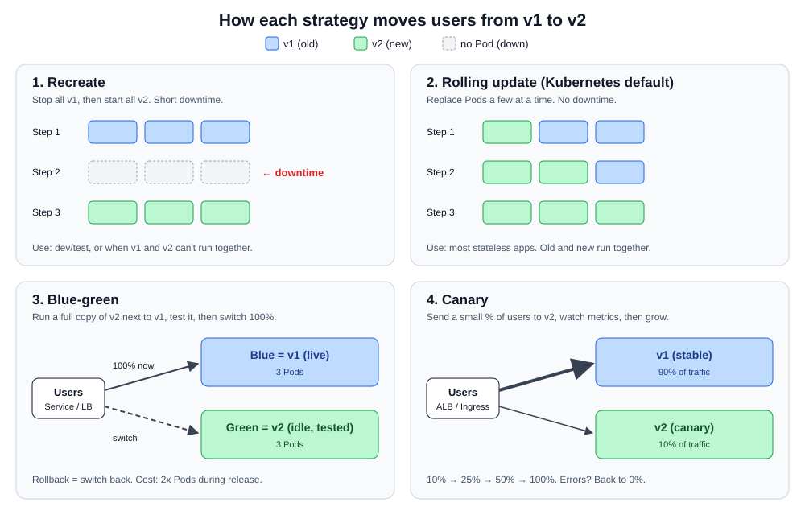

# Deployment Strategies: Recreate, Rolling Update, Blue-Green and Canary

[← Kubernetes notes](../README.md)

> **In short:** A **deployment strategy** is the plan for **how a new version replaces the old one** in production. **Recreate** stops everything and starts the new version (downtime). **Rolling update** swaps Pods a few at a time (Kubernetes default). **Blue-green** runs a full second copy and switches all traffic at once. **Canary** sends a small % of users to the new version first and grows it only if metrics look good.

## About this topic

| Part | Topic | What you learn |
|---|---|---|
| **Part 1: Concepts** | Why strategies matter, Recreate, Rolling, Blue-green, Canary, A/B and Shadow, comparison, tools | What each strategy is, how traffic moves, when to pick which |
| **Part 2: Lab** | All 4 strategies on EKS, plus an ALB weighted canary | Run each strategy with plain YAML and watch traffic move |

> Related: Deployment basics and `kubectl rollout` are in [Day 22](../day-22-k8s-intro/README.md). Ingress and the ALB controller are in the [Ingress guide](../ingress/README.md).

## Table of Contents

**Part 1: Concepts**
1. [What is a deployment strategy?](#1-what-is-a-deployment-strategy)
2. [Recreate](#2-recreate)
3. [Rolling update](#3-rolling-update)
4. [Blue-green](#4-blue-green)
5. [Canary](#5-canary)
6. [Other strategies: A/B testing and Shadow](#6-other-strategies-ab-testing-and-shadow)
7. [Comparison: which one to pick](#7-comparison-which-one-to-pick)
8. [Tools used in real projects](#8-tools-used-in-real-projects)

**Part 2: Lab**

9. [Lab setup](#9-lab-setup)
10. [Lab A: Recreate](#10-lab-a-recreate)
11. [Lab B: Rolling update and rollback](#11-lab-b-rolling-update-and-rollback)
12. [Lab C: Blue-green with a Service switch](#12-lab-c-blue-green-with-a-service-switch)
13. [Lab D: Canary with replica count](#13-lab-d-canary-with-replica-count)
14. [Lab E: Canary with ALB weights (production way)](#14-lab-e-canary-with-alb-weights-production-way)
15. [Clean up](#15-clean-up)

**Wrap-up**

16. [What I learned](#16-what-i-learned)
17. [Commands](#17-commands)
18. [Interview Questions](#18-interview-questions)

---

# Part 1: Concepts

## 1. What is a deployment strategy?

**Definition:** A **deployment strategy** is the method we use to **replace the running version of an app (v1) with a new version (v2)**. It decides how many users see v2, when they see it, and how fast we can go back if v2 is broken. Example: "release `payment:2.4` to 10% of users first, then to everyone".

**Why it matters:** every release is a risk. The strategy controls **3 things**:

| Question | What it affects |
|---|---|
| Is there **downtime**? | Users get errors while we deploy |
| How many users does a **bad release** hit? | Blast radius |
| How fast is **rollback**? | Time to recover (MTTR) |



## 2. Recreate

**Definition:** **Recreate** **stops all old Pods first, then starts the new Pods**. For a short time no Pod is running, so users get errors (downtime). In Kubernetes it's `strategy.type: Recreate` on a Deployment.

```
v1 v1 v1  →  (nothing)  →  v2 v2 v2
```

| ✅ Good | ❌ Bad |
|---|---|
| Simple, no extra resources | Downtime |
| v1 and v2 **never run together** | Rollback = another downtime |

**When to use:** dev/test, or when two versions **can't run at the same time** (e.g. the app locks a shared file or needs an old-to-new DB change that breaks v1).

## 3. Rolling update

**Definition:** A **rolling update** **replaces old Pods with new ones a few at a time**, so some Pods are always serving traffic. It's the **default** strategy of a Kubernetes Deployment. Two settings control the speed: `maxSurge` and `maxUnavailable`.

| Setting | Definition | Example (replicas: 4) |
|---|---|---|
| `maxSurge` | How many **extra** Pods may exist above `replicas` during the update | `1` → up to 5 Pods |
| `maxUnavailable` | How many Pods may be **not ready** during the update | `0` → always 4 ready |

**Safest setting:** `maxSurge: 1`, `maxUnavailable: 0`. A new Pod must pass its **readiness probe** before an old one is removed ([Day 24 probes](../day-24-probes/README.md)).

| ✅ Good | ❌ Bad |
|---|---|
| No downtime, no extra cost (just +1 Pod) | v1 and v2 run **together** for a while |
| Built into Kubernetes | Can't choose **which** users get v2 |
| `kubectl rollout undo` to go back | Rollback is another rolling update (not instant) |

**When to use:** most stateless apps. This is what most teams use day to day.

## 4. Blue-green

**Definition:** **Blue-green** keeps **two full environments**: **blue** (current version, live) and **green** (new version, idle). We deploy v2 to green, test it, then **switch 100% of traffic** to green in one step. Blue stays running so rollback is just switching back. Example: the Service selector changes from `version: blue` to `version: green`.

```
Before:  Users ──▶ Blue (v1)        Green (v2, being tested)
After:   Users ──▶ Green (v2)       Blue (v1, kept for rollback)
```

**Where the switch happens:**

| Level | How |
|---|---|
| Kubernetes Service | Change the `selector` label |
| Load balancer (ALB) | Point the listener to the other target group |
| DNS (Route 53) | Change the record / weights |

| ✅ Good | ❌ Bad |
|---|---|
| **Instant** switch and **instant rollback** | **2x resources** during the release |
| Test v2 fully before users see it | All users move at once: a bug hits everyone |
| Only one version serves users at a time | Database must work with **both** versions |

**When to use:** releases that need a fast, clean cutover and easy rollback (e.g. big releases, migrations).

## 5. Canary

**Definition:** **Canary** sends a **small share of real traffic** (e.g. 5–10%) to the new version first. We watch error rate, latency and logs. If it's healthy we increase it step by step (10% → 25% → 50% → 100%); if not, we send it back to 0%. The name comes from the canary birds miners used as an early warning.

```
Users ──▶ 90% ──▶ v1 (stable)
     └──▶ 10% ──▶ v2 (canary)   watch metrics → grow or roll back
```

**Two ways to split traffic in Kubernetes:**

| Way | How | Precise? |
|---|---|---|
| **Replica ratio** | 9 Pods v1 + 1 Pod v2 behind the same Service | Roughly (~10%), tied to Pod count |
| **Weighted routing** | ALB weighted target groups, NGINX canary annotations, Istio | Exact %, any Pod count |

| ✅ Good | ❌ Bad |
|---|---|
| Bad release hits **few users** | Slower release |
| Tested with **real traffic** | Needs good **monitoring** to decide |
| Cheap: only a few extra Pods | v1 and v2 run together |

**When to use:** critical, high-traffic services (payments, login) where a bad release is expensive.

## 6. Other strategies: A/B testing and Shadow

| Strategy | Definition | Goal |
|---|---|---|
| **A/B testing** | Route users to v1 or v2 **by a rule** (header, cookie, country, device), not randomly. E.g. mobile users get the new checkout page | Business test: which version sells more |
| **Shadow (mirroring)** | Copy live traffic to v2 too, but **users only get v1's response**. v2's answers are thrown away | Test v2 with real load, zero user risk |

> **One line:** canary tests **stability** with a % of users; A/B tests a **business feature** with chosen users; shadow tests with **copied** traffic.

## 7. Comparison: which one to pick

| | Recreate | Rolling | Blue-green | Canary |
|---|---|---|---|---|
| **Downtime** | Yes | No | No | No |
| **Extra resources** | None | +1 Pod or so | **2x** | A few Pods |
| **Users hit by a bad release** | All | Grows as it rolls | All (at switch) | **Few** |
| **Rollback speed** | Slow (redeploy) | Medium (`rollout undo`) | **Instant** | **Instant** (weight → 0) |
| **v1 and v2 together?** | No | Yes | No (for users) | Yes |
| **Built into K8s Deployment?** | ✅ | ✅ (default) | ❌ (labels + Service) | ❌ (replicas or Ingress) |
| **Best for** | Dev/test | Most apps | Big cutovers | Critical services |

**Database rule (any strategy where versions overlap):** make schema changes **backward compatible**. Add the new column first, deploy code that uses it, remove the old column in a later release. Otherwise rollback breaks.

## 8. Tools used in real projects

**Definition:** Doing blue-green or canary by hand means editing labels and weights yourself. **Progressive delivery** tools automate it: they shift traffic in steps, check metrics, and roll back on their own.

| Tool | What it does |
|---|---|
| **Argo Rollouts** | A `Rollout` CRD that replaces `Deployment`; does blue-green and canary with steps, pauses and Prometheus checks. Works with Argo CD |
| **Flagger** | Same idea, works with Flux, Istio, NGINX, ALB |
| **AWS CodeDeploy** | Blue-green / canary for EC2, ECS and Lambda |
| **Service mesh (Istio)** | Exact % and header-based routing (canary, A/B, shadow) |

Example of an Argo Rollouts canary (just to see the shape):

```yaml
strategy:
  canary:
    steps:
      - setWeight: 10
      - pause: { duration: 5m }   # watch metrics
      - setWeight: 50
      - pause: { duration: 5m }
      - setWeight: 100
```

---

# Part 2: Lab

We run all four strategies on EKS with plain YAML. The app is `hashicorp/http-echo`, which just returns a text like `v1` or `v2`, so we can see which version answered.

## 9. Lab setup

**Prereqs:** an EKS cluster and `kubectl` from the bastion ([Day 23](../day-23-eks-terraform-helm-argocd/README.md)). Lab E also needs the AWS Load Balancer Controller ([Ingress guide](../ingress/README.md)).

**Step 1: Create a namespace**

```bash
kubectl create namespace deploy-lab
```

**Step 2: Start a client Pod (we curl from inside the cluster)**

```bash
kubectl run client -n deploy-lab --image=curlimages/curl:8.10.1 --command -- sleep 36000
```

**Expected:** `pod/client created`. Check it is `Running`:

```bash
kubectl get pods -n deploy-lab
```

## 10. Lab A: Recreate

**Step 1: Create the file**

```bash
vim recreate.yaml
```

```yaml
apiVersion: apps/v1
kind: Deployment
metadata:
  name: web
  namespace: deploy-lab
spec:
  replicas: 3
  strategy:
    type: Recreate              # stop all old Pods, then start new ones
  selector:
    matchLabels:
      app: web
  template:
    metadata:
      labels:
        app: web
    spec:
      containers:
        - name: web
          image: hashicorp/http-echo:1.0
          args: ["-text=v1"]
          ports:
            - containerPort: 5678
---
apiVersion: v1
kind: Service
metadata:
  name: web
  namespace: deploy-lab
spec:
  selector:
    app: web
  ports:
    - port: 80
      targetPort: 5678
```

**Step 2: Deploy v1**

```bash
kubectl apply -f recreate.yaml
```

**Step 3: Test**

```bash
kubectl exec -n deploy-lab client -- curl -s web
```

**Expected:** `v1`

**Step 4: Watch Pods in a second terminal**

```bash
kubectl get pods -n deploy-lab -l app=web -w
```

**Step 5: Release v2.** In `recreate.yaml` change `-text=v1` to `-text=v2`, then:

```bash
kubectl apply -f recreate.yaml
```

**Expected (in the watch):** all 3 old Pods go `Terminating` **first**, then 3 new Pods start. If you curl during that gap you get a connection error (`Failed to connect`), because the Service has no Pods behind it. That gap is the downtime.

**Step 6: Remove it before the next lab**

```bash
kubectl delete -f recreate.yaml
```

## 11. Lab B: Rolling update and rollback

**Step 1: Create the file**

```bash
vim rolling.yaml
```

Now `replicas: 4`, a `RollingUpdate` strategy and a readiness probe:

```yaml
apiVersion: apps/v1
kind: Deployment
metadata:
  name: web
  namespace: deploy-lab
spec:
  replicas: 4
  strategy:
    type: RollingUpdate
    rollingUpdate:
      maxSurge: 1               # 1 extra Pod at a time
      maxUnavailable: 0         # never drop below 4 ready Pods
  selector:
    matchLabels:
      app: web
  template:
    metadata:
      labels:
        app: web
    spec:
      containers:
        - name: web
          image: hashicorp/http-echo:1.0
          args: ["-text=v1"]
          ports:
            - containerPort: 5678
          readinessProbe:       # new Pod gets traffic only when ready
            httpGet:
              path: /
              port: 5678
---
apiVersion: v1
kind: Service
metadata:
  name: web
  namespace: deploy-lab
spec:
  selector:
    app: web
  ports:
    - port: 80
      targetPort: 5678
```

**Step 2: Deploy v1**

```bash
kubectl apply -f rolling.yaml
```

**Step 3: Release v2.** Change `-text=v1` to `-text=v2`, then:

```bash
kubectl apply -f rolling.yaml
```

**Step 4: Watch the rollout**

```bash
kubectl rollout status deployment/web -n deploy-lab
```

**Expected:** `Waiting for deployment "web" rollout to finish: 1 out of 4 new replicas have been updated...` until all 4 are done.

**Step 5: Curl many times during the rollout**

```bash
kubectl exec -n deploy-lab client -- sh -c 'for i in $(seq 1 20); do curl -s web; sleep 0.5; done'
```

**Expected:** a mix of `v1` and `v2`, **never an error**. Both versions run together.

**Step 6: Roll back**

```bash
kubectl rollout undo deployment/web -n deploy-lab
```

**Expected:** another rolling update, back to `v1`.

**Step 7: Remove it**

```bash
kubectl delete -f rolling.yaml
```

## 12. Lab C: Blue-green with a Service switch

The trick: **two Deployments** with a `version` label, and **one Service** whose selector picks which one is live.

**Step 1: Create the file**

```bash
vim blue-green.yaml
```

```yaml
apiVersion: apps/v1
kind: Deployment
metadata:
  name: web-blue
  namespace: deploy-lab
spec:
  replicas: 3
  selector:
    matchLabels:
      app: web
      version: blue
  template:
    metadata:
      labels:
        app: web
        version: blue
    spec:
      containers:
        - name: web
          image: hashicorp/http-echo:1.0
          args: ["-text=v1 (blue)"]
          ports:
            - containerPort: 5678
---
apiVersion: apps/v1
kind: Deployment
metadata:
  name: web-green
  namespace: deploy-lab
spec:
  replicas: 3
  selector:
    matchLabels:
      app: web
      version: green
  template:
    metadata:
      labels:
        app: web
        version: green
    spec:
      containers:
        - name: web
          image: hashicorp/http-echo:1.0
          args: ["-text=v2 (green)"]
          ports:
            - containerPort: 5678
---
apiVersion: v1
kind: Service
metadata:
  name: web                     # live traffic
  namespace: deploy-lab
spec:
  selector:
    app: web
    version: blue               # ← the switch
  ports:
    - port: 80
      targetPort: 5678
---
apiVersion: v1
kind: Service
metadata:
  name: web-preview             # only for testing green
  namespace: deploy-lab
spec:
  selector:
    app: web
    version: green
  ports:
    - port: 80
      targetPort: 5678
```

**Step 2: Deploy both colors**

```bash
kubectl apply -f blue-green.yaml
```

**Step 3: Users see blue**

```bash
kubectl exec -n deploy-lab client -- curl -s web
```

**Expected:** `v1 (blue)`

**Step 4: Test green before the switch (no users here)**

```bash
kubectl exec -n deploy-lab client -- curl -s web-preview
```

**Expected:** `v2 (green)`

**Step 5: Switch live traffic to green**

```bash
kubectl patch service web -n deploy-lab -p '{"spec":{"selector":{"app":"web","version":"green"}}}'
```

**Step 6: Check**

```bash
kubectl exec -n deploy-lab client -- curl -s web
```

**Expected:** `v2 (green)` on **every** request, switched in one step.

**Step 7: Rollback = switch back**

```bash
kubectl patch service web -n deploy-lab -p '{"spec":{"selector":{"app":"web","version":"blue"}}}'
```

**Expected:** `v1 (blue)` again, instantly. In real life, once green is stable for a while, scale blue to 0; it becomes the target for the next release.

**Step 8: Remove it**

```bash
kubectl delete -f blue-green.yaml
```

## 13. Lab D: Canary with replica count

The trick: **two Deployments** share the label `app: web`, and the Service selects **only** `app: web`. Traffic splits by Pod count: 4 stable + 1 canary ≈ 20% canary.

**Step 1: Create the file**

```bash
vim canary.yaml
```

```yaml
apiVersion: apps/v1
kind: Deployment
metadata:
  name: web-stable
  namespace: deploy-lab
spec:
  replicas: 4
  selector:
    matchLabels:
      app: web
      track: stable
  template:
    metadata:
      labels:
        app: web
        track: stable
    spec:
      containers:
        - name: web
          image: hashicorp/http-echo:1.0
          args: ["-text=v1"]
          ports:
            - containerPort: 5678
---
apiVersion: apps/v1
kind: Deployment
metadata:
  name: web-canary
  namespace: deploy-lab
spec:
  replicas: 1
  selector:
    matchLabels:
      app: web
      track: canary
  template:
    metadata:
      labels:
        app: web
        track: canary
    spec:
      containers:
        - name: web
          image: hashicorp/http-echo:1.0
          args: ["-text=v2"]
          ports:
            - containerPort: 5678
---
apiVersion: v1
kind: Service
metadata:
  name: web
  namespace: deploy-lab
spec:
  selector:
    app: web                    # both stable and canary Pods
  ports:
    - port: 80
      targetPort: 5678
```

**Step 2: Deploy**

```bash
kubectl apply -f canary.yaml
```

**Step 3: Count answers from 50 requests**

```bash
kubectl exec -n deploy-lab client -- sh -c 'for i in $(seq 1 50); do curl -s web; done' | sort | uniq -c
```

**Expected:** about `40 v1` and `10 v2` (roughly 20%, it's random).

**Step 4: Canary looks good → grow it**

```bash
kubectl scale deployment web-canary -n deploy-lab --replicas=4
```

Run Step 3 again: about 50/50.

**Step 5: Promote.** Update `web-stable` to `-text=v2` in the file and apply, then remove the canary:

```bash
kubectl scale deployment web-canary -n deploy-lab --replicas=0
```

**Rollback (if the canary is bad):** the same command, scale the canary to 0. Users go back to 100% v1.

**Limit:** the % depends on Pod count. For 1% you'd need 99 stable Pods. That's why production uses weighted routing (Lab E).

**Step 6: Remove it**

```bash
kubectl delete -f canary.yaml
```

## 14. Lab E: Canary with ALB weights (production way)

The ALB splits traffic by **exact weight** between two target groups, no matter how many Pods each has.

```
Internet ──▶ ALB ──▶ 90% ──▶ web-stable Service ──▶ v1 Pods
                └──▶ 10% ──▶ web-canary Service ──▶ v2 Pods
```

**Step 1: Create the file**

```bash
vim alb-canary.yaml
```

```yaml
apiVersion: apps/v1
kind: Deployment
metadata:
  name: web-stable
  namespace: deploy-lab
spec:
  replicas: 2
  selector:
    matchLabels: { app: web, track: stable }
  template:
    metadata:
      labels: { app: web, track: stable }
    spec:
      containers:
        - name: web
          image: hashicorp/http-echo:1.0
          args: ["-text=v1"]
          ports:
            - containerPort: 5678
---
apiVersion: apps/v1
kind: Deployment
metadata:
  name: web-canary
  namespace: deploy-lab
spec:
  replicas: 2
  selector:
    matchLabels: { app: web, track: canary }
  template:
    metadata:
      labels: { app: web, track: canary }
    spec:
      containers:
        - name: web
          image: hashicorp/http-echo:1.0
          args: ["-text=v2"]
          ports:
            - containerPort: 5678
---
apiVersion: v1
kind: Service
metadata:
  name: web-stable
  namespace: deploy-lab
spec:
  selector: { app: web, track: stable }
  ports:
    - port: 80
      targetPort: 5678
---
apiVersion: v1
kind: Service
metadata:
  name: web-canary
  namespace: deploy-lab
spec:
  selector: { app: web, track: canary }
  ports:
    - port: 80
      targetPort: 5678
---
apiVersion: networking.k8s.io/v1
kind: Ingress
metadata:
  name: web
  namespace: deploy-lab
  annotations:
    alb.ingress.kubernetes.io/scheme: internet-facing
    alb.ingress.kubernetes.io/target-type: ip
    # action "weighted": 90% stable, 10% canary
    alb.ingress.kubernetes.io/actions.weighted: >
      {"type":"forward","forwardConfig":{"targetGroups":[
        {"serviceName":"web-stable","servicePort":"80","weight":90},
        {"serviceName":"web-canary","servicePort":"80","weight":10}]}}
spec:
  ingressClassName: alb
  rules:
    - http:
        paths:
          - path: /
            pathType: Prefix
            backend:
              service:
                name: weighted          # must match the action name
                port:
                  name: use-annotation  # tells the controller to read the annotation
```

**Step 2: Deploy**

```bash
kubectl apply -f alb-canary.yaml
```

**Step 3: Get the ALB address (takes 2–3 minutes)**

```bash
kubectl get ingress web -n deploy-lab
```

**Step 4: Count answers (from the bastion or your laptop)**

```bash
for i in $(seq 1 100); do curl -s http://<ALB-DNS>; echo; done | sort | uniq -c
```

**Expected:** about `90 v1` and `10 v2`, even though both have 2 Pods.

**Step 5: Shift more traffic.** Change the weights to `50` / `50` in the file, then:

```bash
kubectl apply -f alb-canary.yaml
```

**Rollback:** set the canary weight to `0` and apply. Promote: set it to `100`, then update stable to v2.

| Problem | Fix |
|---|---|
| `ADDRESS` stays empty | Check the controller: `kubectl logs -n kube-system deploy/aws-load-balancer-controller` |
| `503` from the ALB | Pods not Ready, or wrong `serviceName` in the annotation |
| Ingress error `use-annotation` | Backend name must equal the action name (`weighted`) |

## 15. Clean up

Delete the Ingress first so the controller removes the ALB (it costs money):

```bash
kubectl delete -f alb-canary.yaml
```

```bash
kubectl delete namespace deploy-lab
```

---

# Wrap-up

## 16. What I learned

**Concepts**
- A deployment strategy decides **downtime**, **blast radius** and **rollback speed**.
- **Recreate** = all down, then all up (downtime). **Rolling** = a few at a time (K8s default).
- **Blue-green** = two full copies, switch 100% at once, instant rollback, 2x cost.
- **Canary** = small % first, watch metrics, grow. Best for critical services.
- Overlapping versions need **backward-compatible** DB changes.
- Real projects automate blue-green/canary with **Argo Rollouts** or **Flagger**.

**Lab**
- Recreate and Rolling are just `strategy.type` on a Deployment.
- Blue-green in K8s = change the **Service selector**.
- Canary by **replica ratio** is rough; **ALB weights** give exact %.

```
Recreate ─▶ Rolling ─▶ Blue-green ─▶ Canary
less safe, simpler           safer, needs more tooling
```

## 17. Commands

| Command | What it does |
|---|---|
| `kubectl rollout status deployment/web` | Watch a rolling update |
| `kubectl rollout history deployment/web` | List revisions |
| `kubectl rollout undo deployment/web` | Go back to the previous revision |
| `kubectl rollout pause / resume deployment/web` | Stop / continue a rollout halfway |
| `kubectl patch service web -p '{"spec":{"selector":{...}}}'` | Blue-green switch |
| `kubectl scale deployment web-canary --replicas=N` | Grow or kill a canary |

## 18. Interview Questions

### Other Questions

**Q1. What deployment strategies do you know?**
Recreate, rolling update, blue-green and canary, plus A/B testing and shadow. Recreate has downtime; rolling replaces Pods gradually; blue-green switches all traffic between two full environments; canary sends a small % of traffic to the new version first.

**Q2. What is the default strategy of a Kubernetes Deployment?**
`RollingUpdate`, with `maxSurge: 25%` and `maxUnavailable: 25%` by default. The other built-in type is `Recreate`.

**Q3. What do `maxSurge` and `maxUnavailable` mean?**
`maxSurge` is how many extra Pods can exist above `replicas` during the update; `maxUnavailable` is how many can be not ready. `maxSurge: 1, maxUnavailable: 0` gives zero downtime with only one extra Pod.

**Q4. How does a rolling update avoid downtime?**
It starts a new Pod, waits until its readiness probe passes, adds it to the Service endpoints, then removes an old Pod. Without a readiness probe, traffic can reach Pods that aren't ready yet.

**Q5. Blue-green vs canary?**
Blue-green moves **all** users at once to a fully tested copy, with instant rollback but 2x resources. Canary moves a **small %** of real users first and grows step by step based on metrics, so a bad release hits fewer users, but it's slower and needs good monitoring.

**Q6. How do you do blue-green in Kubernetes?**
Two Deployments with different `version` labels and one Service. Test green through a preview Service, then patch the live Service selector from `blue` to `green`. Rollback is patching it back. At the AWS level we can switch ALB target groups or Route 53 records instead.

**Q7. How do you do a canary in Kubernetes?**
Simple way: a stable and a canary Deployment sharing a label behind one Service; the split follows the replica ratio. Production way: weighted routing (ALB weighted target groups, NGINX canary annotations or Istio), usually automated with Argo Rollouts or Flagger.

**Q8. What metrics decide if a canary is promoted?**
Error rate (5xx), latency (p95/p99), saturation (CPU, memory), and business metrics like successful payments, compared against the stable version. If they get worse, set the canary weight to 0.

**Q9. Which strategy would you use for a payment service?**
Canary, with automated metric checks (Argo Rollouts + Prometheus), so a bad release only affects a few % of payments and rolls back automatically.

**Q10. How do you handle database changes with rolling, blue-green or canary?**
Both versions run against the same database, so changes must be backward compatible (expand and contract): add new columns/tables first, deploy code that uses them, and remove old ones only in a later release.

**Q11. When would you use Recreate?**
In dev/test, or when two versions can't run at the same time, for example because of a breaking schema change or a singleton that holds a lock. Accept the short downtime or schedule a maintenance window.

**Q12. What is the difference between canary and A/B testing?**
Canary checks **technical** health with a random % of users. A/B testing routes users **by a rule** (cookie, header, region) to compare **business** results like conversion.
