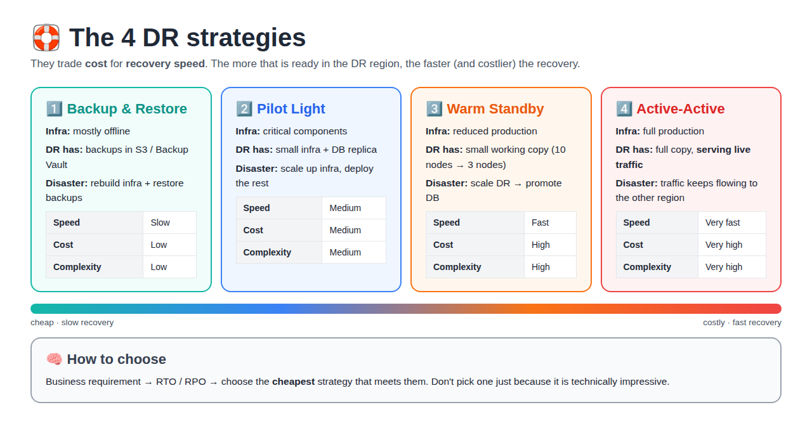

# Disaster Recovery (DR): Short and Simple

## What is Disaster Recovery?

**Definition:** Disaster Recovery (DR) is the plan, setup and steps to **bring your application and its data back** after a big failure, so the business can keep running.

**What is a disaster?** Something that takes down far more than one server:

| Type | Example |
|---|---|
| Region / data centre outage | AWS Mumbai region goes down |
| Data loss | Someone runs `DROP TABLE` or deletes an S3 bucket |
| Cyber attack | Ransomware encrypts the database |
| Bad change | A wrong deployment or Terraform run breaks production |
| Natural event | Flood or fire at the data centre |

**Why we need DR:**
- Downtime = **lost money** (no orders) and angry customers
- Lost data = **lost orders and payments** that may never come back
- Many companies (banks, healthcare) **must** have DR by law/compliance

**How DR works (the idea):**

```
Normal:    Users ──▶ PRIMARY region (app + DB)      ── copies data ──▶  DR region
Disaster:  Users ──▶ DR region  (app brought up from the copies)
```

**Two questions decide every DR design:**
- **RPO:** how much data can we lose?
- **RTO:** how long can we be down?

The answers pick one of **4 strategies**, from cheap and slow to costly and instant. The deciding factor is **what is already running in the DR region**.



---

## 1. Key words

| Word | Simple definition |
|---|---|
| **Disaster** | A big failure: a whole region down, data deleted, ransomware |
| **DR (Disaster Recovery)** | The plan and setup to bring the app and data back after a disaster |
| **Primary region** | Where the app normally runs (e.g. Mumbai `ap-south-1`) |
| **DR region** | The backup location (e.g. Singapore `ap-southeast-1`) |
| **RPO** (Recovery Point Objective) | Max **data** you can lose, in time. *"How old can my last copy be?"* |
| **RTO** (Recovery Time Objective) | Max **downtime**. *"How fast must the app be back?"* |
| **Failover** | Switching users from the primary to the DR region |
| **Failback** | Moving back to the primary after it is fixed |
| **HA vs DR** | HA = survive a small failure (1 server / 1 AZ) automatically. DR = survive losing a whole region |

### RPO vs RTO in one example

```
10:00 last backup ─────── 11:30 💥 disaster ─────── 13:00 app back
      └── RPO: 1h30m of DATA lost ──┘└── RTO: 1h30m of DOWNTIME ──┘
```

- **RPO → data loss** (orders placed 10:00–11:30 are gone)
- **RTO → business loss** (no one can order 11:30–13:00)
- The **business** sets the targets; **DevOps** builds to meet them and tests them.

| | RPO | RTO |
|---|---|---|
| **Question** | How much **data** can we lose? | How long can we be **down**? |
| **Looks** | Backward: disaster → last good copy | Forward: disaster → app back up |
| **Loss type** | Data loss (saved orders gone) | Business loss (no new orders) |
| **Controlled by** | How **often** data is copied | How **ready** the DR region is |

### Questions to set RTO and RPO

**Definition:** Questions you ask the **app owner** to find the right RTO and RPO for an app.

**RTO questions (downtime):**

| Ask | Meaning |
|---|---|
| Impact if the app is down? Does it get worse over time? | What breaks, and how fast it hurts |
| Money lost per hour? | Cost of downtime |
| Reputation cost? | Public notices, e.g. company homepage down |
| Any SLA with customers? | Uptime already promised |
| Compliance / regulatory rules? | A law may fix the recovery time |
| Dependencies? | Which apps it needs, and which apps need it |

**RPO questions (data loss):** the same questions (impact, money, reputation, SLA, compliance), plus:

| Ask | Meaning |
|---|---|
| Do other apps use this app's data? What RPO do they need? | Their RPO limits yours |
| Can lost data be recreated? How long would it take? | If it can be re-imported, a bigger RPO is OK |
| How often does the data change? | Changes every second (payments) → small RPO. Once a day (reports) → daily backup is enough |

> **One line:** big loss per hour → small RTO/RPO → costly strategy (warm / active-active). Small loss → bigger RTO/RPO → cheap strategy (backup & restore).

---

## 2. The 4 DR Strategies

AWS groups DR into **4 strategies**. They trade **cost** for **recovery speed**.

### 1️⃣ Backup & Restore

**Definition:** Take backups and **rebuild** the environment when a disaster happens.

```
PRIMARY REGION
      │
      ▼
   Backups
      │
      ▼
S3 / Backup Vault   (other region · nothing running)
```

- **On disaster:** rebuild infra (Terraform) → restore data from backups → deploy app → switch DNS
- **AWS examples:** AWS Backup, S3, EBS snapshots, RDS snapshots, S3 Object Lock, cross-region backups
- **Advantages:** low cost, simple, good for less-critical workloads
- **Disadvantages:** slow recovery, more recovery work, higher RTO

> **Interview answer:** "Backup and restore means keeping recoverable backups in another location and rebuilding the infrastructure and application when a disaster occurs."

### 2️⃣ Pilot Light

**Definition:** Keep the **critical components ready**, but don't run the full production environment.

```
PRIMARY                     DR REGION
EKS + Database              Small infrastructure
      │                     +
      └── replication ───▶  Database replica
```

- **On disaster:** scale up the infrastructure and deploy the rest of the environment, promote the DB, switch DNS
- **Critical components** = data (DB replica) + core infra (VPC, small cluster). The app is **not serving** traffic yet.
- **Name meaning:** like a gas stove pilot flame: small flame always on, turn it up when needed

> **Interview answer:** "Pilot light keeps critical infrastructure and data ready in the DR region so the environment can be activated quickly during a disaster."

### 3️⃣ Warm Standby

**Definition:** Run a **smaller working version** of production in the DR region.

```
PRIMARY  10 nodes
            │ replication
            ▼
DR        3 nodes   (already running)
```

- **On disaster:** scale DR (3 → 10 nodes) → promote database → switch DNS
- **DB in DR is read-only** until promoted, so before failover it serves only reads / test traffic

> **Interview answer:** "Warm standby maintains a scaled-down but functional version of production that can be scaled during failover."

#### Pilot Light vs Warm Standby (most confused)

| | Pilot Light | Warm Standby |
|---|---|---|
| What runs in DR | Critical components only (small infra + DB replica) | Small **working** copy of the full app |
| Can take traffic right now? | ❌ No, deploy/scale the rest first | ✅ Yes, at low capacity |
| On disaster | Scale up + deploy the rest | Only scale up |

### 4️⃣ Active-Active

**Definition:** **Both environments actively serve production traffic.**

```
            GLOBAL DNS
                │
     ┌──────────┴──────────┐
  REGION A              REGION B
     │                     │
    EKS                   EKS
     │                     │
  Database              Database
```

- **On disaster:** traffic keeps flowing through the other region
- **Advantages:** very fast recovery, no break for users if one region fails
- **Disadvantages:** highest cost, highest complexity, data consistency challenges (both DBs take writes), more operations work
- **DB for writes in both regions:** DynamoDB Global Tables

> **Interview answer:** "Active-active runs workloads in multiple locations simultaneously so traffic can continue through another location if one fails."

---

## 3. Comparison Table

| Strategy | Infrastructure | Recovery Speed | Cost | Complexity |
|---|---|---|---|---|
| Backup & Restore | Mostly offline | Slow | Low | Low |
| Pilot Light | Critical components | Medium | Medium | Medium |
| Warm Standby | Reduced production | Fast | High | High |
| Active-Active | Full production | Very fast | Very high | Very high |

> These are **relative** comparisons. Actual recovery times depend on the workload and implementation.
> For a rough idea, the AWS whitepaper gives RPO/RTO of: hours · tens of minutes · minutes · near zero.

---

## 4. How to choose a strategy

```
Business need → RTO / RPO target → Budget → Strategy
```

Don't pick the most impressive one. Pick the **cheapest one that meets the RTO/RPO**.

| App | Down 1 hour = ? | Strategy |
|---|---|---|
| Internal HR tool | Fine | Backup & Restore |
| Company website / blog | Annoying | Pilot Light |
| Food delivery / e-commerce | Lost orders | Warm Standby |
| Payments / UPI / banking | Not allowed | Active/Active |

---

## 5. Failover steps (pilot / warm)

```
1. Health check fails (Route 53 / alarm)
2. Promote DB replica → writer
3. Scale app up (ASG / EKS nodes / terraform apply)
4. Switch DNS to DR region (Route 53 failover)
5. Test + monitor
```


**Failback:** later, copy data back DR → primary and switch DNS back in a planned window.

---

## 6. What AWS docs add (official tips)

| Tip | Why |
|---|---|
| Deploy with **IaC** (Terraform / CloudFormation) | Rebuild in the DR region fast and without mistakes |
| Replication is **not** a backup | If data is deleted/corrupted, the deletion is copied too → also keep point-in-time backups |
| Use **AWS Backup** cross-region / cross-account copies | Protects even if the account is hacked |
| **Manual trigger, automated steps** | Auto failover on a false alarm also loses data; make the manual failover "one button" |
| Check **service quotas** in the DR region | You can't scale up if limits are low |
| **Test DR regularly** | An untested DR plan is just a guess |

**AWS services to remember:** AWS Backup · RDS read replicas · Aurora Global Database · DynamoDB Global Tables · S3 Cross-Region Replication · Route 53 health checks · AWS Elastic Disaster Recovery (DRS).

---

## 7. Interview Questions

### ⭐ Very Important (asked in class)

**Q1. Explain the 4 DR strategies.**
Backup & Restore (keep backups, rebuild on disaster: slow, low cost) → Pilot Light (critical components ready: small infra + DB replica: medium) → Warm Standby (smaller working copy, scale up and promote DB: fast) → Active-Active (both regions serve traffic: very fast, very high cost). Faster recovery costs more.

**Q2. How do you choose a DR strategy?**
Start from the business's RTO/RPO, then the budget. Choose the cheapest strategy that meets the target. Don't choose one just because it is technically impressive.

### Other Questions

**Q1. RPO vs RTO?** RPO = max data loss (time since last copy). RTO = max downtime.

**Q2. Pilot Light vs Warm Standby?** Pilot light: only critical components ready, deploy/scale the rest. Warm standby: small working copy already runs, only scale up.

**Q3. HA vs DR?** HA = one server/AZ fails, handled inside the region. DR = whole region lost, move to another region.

**Q4. Is replication enough for DR?** No. A deletion or corruption is replicated too, so you also need point-in-time backups.

**Q5. Failover vs failback?** Failover = move to DR. Failback = return to primary after it is fixed.

---

## Detailed notes (optional, read only if needed)

- [RTO and RPO Explained (detailed)](./rto-rpo-explained/README.md)
- [Migration Strategies (6 R's / AWS 7 Rs)](../migration-strategies/README.md)

**Source:** [AWS whitepaper: Disaster Recovery of Workloads on AWS](https://docs.aws.amazon.com/whitepapers/latest/disaster-recovery-workloads-on-aws/disaster-recovery-options-in-the-cloud.html)
