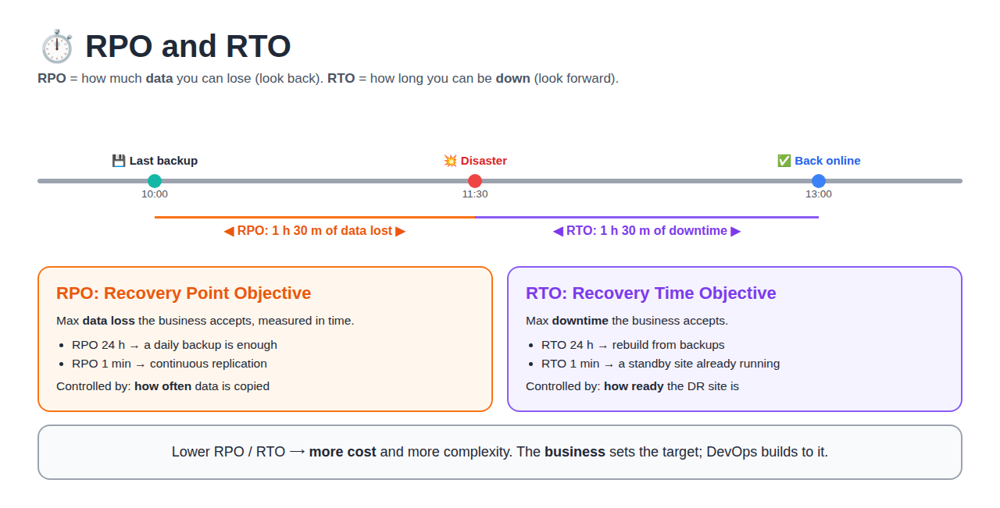
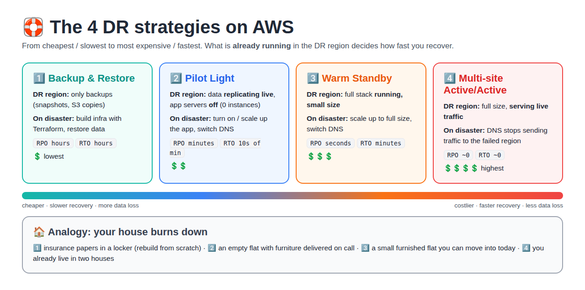

# Day 1 — Disaster Recovery (DR) Strategies

[← All notes](../README.md)

> **In short:** DR is **not just backup**. DR is the ability to bring back **infrastructure, applications and data** within the time (**RTO**) and data-loss (**RPO**) limits the business agreed on. On AWS there are **4 strategies**, from cheap and slow (Backup & Restore) to expensive and instant (Multi-site Active/Active). **Terraform** is what lets you rebuild the infrastructure in another region quickly.

## Table of Contents

1. [Quick Definitions](#quick-definitions)
2. [What Can Go Wrong (Types of Disasters)](#what-can-go-wrong-types-of-disasters)
3. [RPO and RTO](#rpo-and-rto)
4. [Backup vs High Availability vs DR](#backup-vs-high-availability-vs-dr)
5. [The 4 DR Strategies on AWS](#the-4-dr-strategies-on-aws)
6. [Which Strategy for Which App?](#which-strategy-for-which-app)
7. [AWS Services for DR (per layer)](#aws-services-for-dr-per-layer)
8. [Failover and Failback](#failover-and-failback)
9. [Terraform's Role in DR](#terraforms-role-in-dr)
10. [DR for Kubernetes (short)](#dr-for-kubernetes-short)
11. [DR Plan, Runbook and Testing](#dr-plan-runbook-and-testing)
12. [Example: DR for RoboShop](#example-dr-for-roboshop)
13. [Common Mistakes](#common-mistakes)
14. [Interview Questions](#interview-questions)
15. [Interview One-Liners](#interview-one-liners)

## Quick Definitions

**Disaster Recovery (DR)** = the plan, tools and steps to **restore** service after a **major failure** (region down, data deleted, ransomware).

**RPO (Recovery Point Objective)** = the **maximum data loss** accepted, measured in time. "We can lose at most 15 minutes of orders."

**RTO (Recovery Time Objective)** = the **maximum downtime** accepted. "We must be back within 1 hour."

**Primary site / region** = where the app runs normally.

**DR site / region** = the second location used when the primary fails.

**Failover** = **switching** traffic from the primary to the DR site.

**Failback** = **switching back** to the primary after it is fixed.

**Replication** = **continuously copying** data to another place (seconds behind).

**Backup** = a **point-in-time copy** of data (snapshot), taken on a schedule.

**High Availability (HA)** = surviving **small** failures (a server or an AZ) **automatically**, inside one region.

**Business Continuity Plan (BCP)** = the company-wide plan to keep the business running; DR is the **IT part** of it.

## What Can Go Wrong (Types of Disasters)

| Type | Example | What saves you |
|------|---------|----------------|
| **Hardware / server failure** | EC2 host dies | HA: Auto Scaling, multiple instances |
| **AZ failure** | One data center loses power | HA: Multi-AZ (ALB, ASG, RDS Multi-AZ) |
| **Region failure** | Whole AWS region has an outage | **DR**: second region |
| **Human error** | `terraform destroy` on prod, `DROP TABLE`, `rm -rf` | **Backups** (point-in-time restore), IaC to rebuild |
| **Data corruption / bad deploy** | A bug writes wrong data for 2 hours | **Backups** from **before** the bug (replication copies the bad data too!) |
| **Security incident** | Ransomware, leaked keys, deleted account resources | **Immutable backups** in a **separate account** (AWS Backup Vault Lock) |
| **Natural disaster** | Flood, earthquake | Second region far away |

> **Key point:** replication protects against **losing a site**; only **backups** protect against **bad data** (deletes, corruption, ransomware), because replication copies mistakes instantly.

## RPO and RTO



```
   last backup            disaster                 back online
       │◀──── RPO ────────▶│◀──────── RTO ──────────▶│
       10:00               11:30                     13:00
   (data after 10:00 lost)  (users can't use the app)
```

| | RPO | RTO |
|---|-----|-----|
| Question | How much **data** can we lose? | How long can we be **down**? |
| Looks | **Back** in time from the disaster | **Forward** in time from the disaster |
| Improved by | Copying data **more often** (backup → replication) | Keeping the DR site **more ready** (cold → warm → hot) |
| Example target | 15 min | 1 h |

**Who decides?** The **business** (product owner, management), based on how much an hour of downtime or lost data **costs**. DevOps designs and **tests** a setup that meets it.

> Interview tip: always ask "what are the RPO and RTO?" before choosing a DR design.

## Backup vs High Availability vs DR

| | Backup | High Availability (HA) | Disaster Recovery (DR) |
|---|--------|------------------------|------------------------|
| Protects against | Data loss, deletes, corruption | Server / AZ failure | Region / site failure, major incidents |
| Scope | Data | Inside **one region** (Multi-AZ) | **Another region** (or account) |
| Automatic? | Restore is manual | Yes, seconds | Partly; often a decision + runbook |
| Example | Daily RDS snapshot | ALB + ASG across 3 AZs, RDS Multi-AZ | Pilot light in a second region |

> **You need all three.** HA without backups can't undo a `DROP TABLE`. Backups without DR take hours to restore in a new region.

## The 4 DR Strategies on AWS



| # | Strategy | What runs in the DR region | On disaster | RPO | RTO | Cost |
|---|----------|----------------------------|-------------|-----|-----|------|
| 1 | **Backup & Restore** | Nothing; only **backups** (snapshots, AMIs, S3 copies) | Create infra (**Terraform**), restore data | Hours | Hours (up to 24 h) | 💲 |
| 2 | **Pilot Light** | **Data** replicating live (DB replica); app servers **off** | Start/scale the app tier, promote the DB, switch DNS | Minutes | Tens of minutes | 💲💲 |
| 3 | **Warm Standby** | **Full stack running at small size** | Scale up to production size, switch DNS | Seconds | Minutes | 💲💲💲 |
| 4 | **Multi-site Active/Active** | **Full size**, already **serving traffic** | Stop sending traffic to the failed region | Near zero | Near zero | 💲💲💲💲 |

### 1. Backup & Restore

```
Primary (Mumbai)                       DR (Singapore)
 EC2 + RDS + S3  ── snapshots copied ──▶ snapshots / AMIs / S3 copies   (no servers)
```

- Schedule backups (**AWS Backup**), **copy them to the DR region** (and ideally another account).
- Keep the infra as **Terraform code**, so the whole stack can be created in the DR region with one `apply`.
- Restore takes time: create the VPC, restore the DB from a snapshot (big DBs = hours), deploy the app.
- **Use for:** internal tools, dev/test, apps that can be down for hours.

### 2. Pilot Light

> Named after the small flame in a gas heater: always on, so the full heater lights up quickly.

```
Primary (Mumbai)                       DR (Singapore)
 ALB → ASG (4) → RDS writer ─ replication ─▶ RDS read replica   (core data is LIVE)
                                            ASG desired = 0     (app is OFF)
```

- The **core** (databases) is always running and replicating. The **app tier** is defined (launch template, ASG, Terraform) but **switched off**.
- Failover: **promote** the read replica to a writer → set ASG desired from 0 to 4 → switch Route 53.
- **Use for:** most business apps where 10–30 min of downtime is acceptable.

### 3. Warm Standby

```
Primary (Mumbai)                       DR (Singapore)
 ALB → ASG (10) → DB writer ─ replication ─▶ ALB → ASG (2) → DB replica   (small but WORKING)
```

- A **smaller, fully working** copy. You can even send test traffic to it any time.
- Failover: **scale up** (2 → 10) + switch DNS. No "start from zero" step.
- **Difference from pilot light:** pilot light **can't serve** requests until you start the app; warm standby **can** (at low capacity).
- **Use for:** important customer-facing apps (e-commerce, banking front-ends).

### 4. Multi-site Active/Active

```
              Route 53 (latency / weighted routing)
               ├──▶ Mumbai:    full stack ─┐
               └──▶ Singapore: full stack ─┴─ data replicated both ways
```

- Both regions serve users **all the time**. If one fails, Route 53 health checks stop sending traffic there.
- Needs data that can be **written in both regions**: DynamoDB Global Tables, Aurora Global Database (one writer, fast promotion), conflict handling.
- **Use for:** payments, trading, very large consumer apps where minutes of downtime cost a lot.
- **Active/Passive** (hot standby) = same full size in the DR region but **not** serving traffic until failover.

## Which Strategy for Which App?

Companies usually put apps into **tiers** and pick a strategy per tier, not one for everything:

| Tier | Example app | Target RPO / RTO | Strategy |
|------|-------------|------------------|----------|
| Tier 1 (critical) | Payments, checkout | ~0 / minutes | Warm standby or active/active |
| Tier 2 (important) | Product catalogue, user accounts | Minutes / < 1 h | Pilot light |
| Tier 3 (normal) | Internal dashboards, reports | Hours / < 24 h | Backup & restore |
| Tier 4 (low) | Dev / test environments | 24 h+ | Backup & restore (or rebuild from IaC only) |

**Decision questions:**

1. What do 1 hour of downtime and 1 hour of lost data **cost** the business?
2. What are the agreed **RPO / RTO** (SLA with customers)?
3. Does a **law / compliance** rule require a second region or a retention period?
4. Is the extra **monthly cost** of a standby lower than the expected loss?

## AWS Services for DR (per layer)

| Layer | Service | DR use |
|-------|---------|--------|
| **Backups (all)** | **AWS Backup** | Central backup plans for EC2, EBS, RDS, DynamoDB, EFS…; **cross-region and cross-account copy**; **Vault Lock** = backups no one can delete |
| Compute | **AMIs** (copy to DR region), **Launch Templates**, **Auto Scaling Groups** | Start the same servers in the DR region |
| Compute | **AWS Elastic Disaster Recovery (DRS)** | Continuous block-level replication of servers; launch them in the DR region in minutes (RPO seconds) |
| Block storage | **EBS snapshots** (copy cross-region) | Restore volumes |
| Object storage | **S3 Cross-Region Replication (CRR)**, versioning | Objects copied to a bucket in the DR region; versioning protects against overwrite/delete |
| Relational DB | **RDS cross-region read replica**, cross-region automated backups | Promote the replica to a writer on failover |
| Relational DB | **Aurora Global Database** | Replication to other regions with ~1 s lag; promote a secondary region in about a minute |
| NoSQL | **DynamoDB Global Tables** | Multi-region, multi-writer (active/active) |
| Cache | ElastiCache Global Datastore | Redis replicated across regions |
| DNS / traffic | **Route 53** failover / latency / weighted routing + **health checks** | Send users to the healthy region |
| Traffic | **Global Accelerator** | Static IPs, fast failover between regions |
| Secrets / config | Secrets Manager **replica secrets**, SSM parameters | DR region apps need the same secrets |
| Infrastructure | **Terraform** (or CloudFormation) | Rebuild the same infra in any region from code |

## Failover and Failback


**Route 53 failover routing:**

| Record | Routing | Health check | Answered when |
|--------|---------|--------------|---------------|
| `app.example.com` → Mumbai ALB | Failover **PRIMARY** | Yes | Primary is healthy |
| `app.example.com` → Singapore ALB | Failover **SECONDARY** | Optional | Primary is **unhealthy** |

**Failover steps (pilot light / warm standby):**

| # | Step | Command / action |
|---|------|------------------|
| 1 | **Detect** + decide | Alarm / health check fails; incident lead declares DR (avoid failing over for a 2-minute blip) |
| 2 | **Data** | Promote the DB replica: `aws rds promote-read-replica` (or Aurora global "failover") |
| 3 | **Compute** | Scale the ASG up / `terraform apply -var="dr_capacity=4"` |
| 4 | **Traffic** | Route 53 failover (automatic with health checks) or update the record |
| 5 | **Verify** | Health checks, smoke tests, error rates in monitoring |
| 6 | **Communicate** | Status page, stakeholders |

**Failback** = moving back to the primary region **later**, in a **planned window**:
re-create replication from DR → primary, wait until in sync, short freeze, switch DNS back, rebuild the DR copy.

> **Low DNS TTL** (e.g. 60 s) on these records, so clients pick up the new answer quickly.

## Terraform's Role in DR

| Without IaC | With Terraform |
|-------------|----------------|
| Rebuild the DR region by clicking, from memory, during an outage | `terraform apply` with the DR region's variables |
| Primary and DR slowly drift apart | Same **modules** for both regions → identical setups |
| Nobody knows what existed | The code **is** the documentation |

### Two regions with provider aliases

```hcl
provider "aws" {
  region = "ap-south-1"            # primary (Mumbai)
}

provider "aws" {
  alias  = "dr"
  region = "ap-southeast-1"        # DR (Singapore)
}

module "app_primary" {
  source        = "./modules/app"
  desired_count = 4
}

module "app_dr" {
  source        = "./modules/app"
  providers     = { aws = aws.dr }
  desired_count = var.dr_capacity  # 0 = pilot light, 1-2 = warm standby
}
```

Failover = `terraform apply -var="dr_capacity=4"`.

### Route 53 failover record in Terraform

```hcl
resource "aws_route53_health_check" "primary" {
  fqdn              = aws_lb.primary.dns_name
  type              = "HTTPS"
  resource_path     = "/health"
  failure_threshold = 3
  request_interval  = 30
}

resource "aws_route53_record" "app_primary" {
  zone_id         = var.zone_id
  name            = "app.example.com"
  type            = "A"
  set_identifier  = "primary"
  health_check_id = aws_route53_health_check.primary.id

  failover_routing_policy {
    type = "PRIMARY"
  }

  alias {
    name                   = aws_lb.primary.dns_name
    zone_id                = aws_lb.primary.zone_id
    evaluate_target_health = true
  }
}
# + the same record with set_identifier = "secondary", type = "SECONDARY", pointing to the DR ALB
```

### Don't forget the Terraform state

| Risk | Fix |
|------|-----|
| State bucket is **in the failed region** → can't run Terraform during DR | S3 **versioning** + **replication** of the state bucket to the DR region; or keep the DR stack's state in the DR region |
| State deleted / corrupted | S3 versioning → restore an old version |
| Two people apply during the incident | State locking (DynamoDB table or S3 native locking) |

> Also store **AMIs, container images (ECR replication), secrets and DNS** where the DR region can reach them. IaC alone isn't enough if the images and data live only in the failed region.

## DR for Kubernetes (short)

| What | How |
|------|-----|
| Cluster itself | Recreate with **Terraform** (EKS module) in the DR region |
| Apps (manifests) | **GitOps** (Argo CD / Flux): point the new cluster at the same Git repo |
| Cluster resources + volumes | **Velero** backups to S3 (replicated), restore into the new cluster |
| Container images | **ECR cross-region replication** |
| Self-managed clusters | Back up **etcd** (EKS manages etcd for you) |

## DR Plan, Runbook and Testing

**DR plan** = who does what, for which apps, with which RPO/RTO. **Runbook** = the exact step-by-step commands for failover and failback.

| Must have | Why |
|-----------|-----|
| RPO / RTO per app (tier list) | Defines the design |
| Owners + contact list | Who declares DR, who executes |
| Step-by-step runbook (commands, not ideas) | Under stress, people follow steps |
| Where backups are and how to restore them | Restores fail when nobody has done one |
| Communication plan | Customers, management, status page |

**Testing (the part most teams skip):**

| Test | What happens |
|------|--------------|
| **Restore test** | Regularly restore a backup into a test environment and check the data |
| **Tabletop exercise** | Team walks through the runbook on paper |
| **DR drill / game day** | Really fail over to the DR region (planned), measure the **actual** RPO/RTO |
| **Chaos engineering** | Inject failures on purpose (AWS Fault Injection Service) |

> **"A backup you've never restored is not a backup."** A DR plan you've never tested is a hope, not a plan.

## Example: DR for RoboShop

My RoboShop project ([shellscript-roboshop-v1](https://github.com/Abhignadumpala/shellscript-roboshop-v1)) runs on EC2 in one region. A pilot-light DR design:

| Component | Primary (Mumbai) | DR (Singapore) | On failover |
|-----------|------------------|----------------|-------------|
| Infrastructure | EC2 + SGs + Route 53 (shell scripts today) | **Terraform** code ready, nothing running | `terraform apply` |
| MongoDB (products, users) | EC2 | Backups (`mongodump`) to **S3 with CRR** | Restore |
| MySQL (shipping) | EC2 → better **RDS** | **RDS cross-region read replica** | Promote replica |
| Redis (carts) | EC2 | None (carts are temporary data) | Start empty |
| RabbitMQ (orders queue) | EC2 | None → better **Amazon MQ** | Start empty; un-sent orders are the RPO risk |
| App servers | 6 EC2 | AMIs copied, ASG = 0 | Scale up |
| DNS | Route 53 | Failover record to the DR frontend | Health check switches |

> Shows why real projects move databases to **managed services**: cross-region replicas and backups are a setting, not a script.

## Common Mistakes

| Mistake | Better |
|---------|--------|
| "We have Multi-AZ, so we have DR" | Multi-AZ = HA in **one region**; a region outage takes it all down |
| "We have replication, so we don't need backups" | Replication copies **deletes and corruption** too |
| Backups in the **same account and region** | Copy to **another region + account**, use Vault Lock against ransomware |
| Never testing restores | Scheduled restore tests + DR drills |
| DR region missing AMIs, images, secrets, quotas | Replicate them; request **service quotas** in the DR region in advance |
| Terraform state only in the primary region | Replicate the state bucket |
| Manual, undocumented failover | Runbook + automation, practiced in drills |
| Same RPO/RTO for every app | Tier the apps; pay for fast DR only where it matters |

## Interview Questions

**1. What is the difference between RPO and RTO?**

RPO = maximum **data loss** accepted (time between the last good copy and the disaster). RTO = maximum **downtime** accepted (time from the disaster until service is back). RPO is improved by copying data more often; RTO by keeping the DR site more ready.

**2. Explain the 4 DR strategies on AWS.**

| Strategy | DR region | RPO / RTO | Cost |
|----------|-----------|-----------|------|
| Backup & Restore | Only backups | Hours / hours | Lowest |
| Pilot Light | Data replicating, app off | Minutes / tens of minutes | Low |
| Warm Standby | Full stack, small size | Seconds / minutes | Medium |
| Multi-site Active/Active | Full size, serving traffic | ~0 / ~0 | Highest |

**3. How does Terraform help in DR?**

The whole infrastructure is code, so it can be **recreated in another region** with the same modules and different variables (provider alias for the DR region). It also keeps primary and DR **identical** and lets a pilot light scale up with one `apply`. The **state** must be replicated too, or Terraform is unusable when the primary region is down.

More practice questions → [interview-questions/](interview-questions/README.md)

## Interview One-Liners

- **DR** = restoring infra, apps and data after a major failure within the agreed **RTO** and **RPO**; not just backup.
- **RPO** = how much data you can lose; **RTO** = how long you can be down.
- **HA ≠ DR**: HA survives server/AZ failures in one region automatically; DR survives losing the region.
- **Replication ≠ backup**: replication copies deletes and corruption; backups let you go back in time.
- **Backup & Restore** = cheapest, hours; **Pilot Light** = data live, app off; **Warm Standby** = small full copy running; **Active/Active** = both regions serve traffic.
- **Failover** = switch to DR (Route 53 failover routing + health checks, promote the DB replica, scale up); **failback** = planned move back.
- **Terraform in DR** = same modules + provider alias per region; replicate the **state bucket** too.
- **AWS Backup** = central backups with cross-region/cross-account copy; **Vault Lock** protects against ransomware.
- **Test it**: restore tests and DR drills measure the real RPO/RTO; an untested backup isn't a backup.
- **Tier your apps**: pay for fast DR only for critical services.
