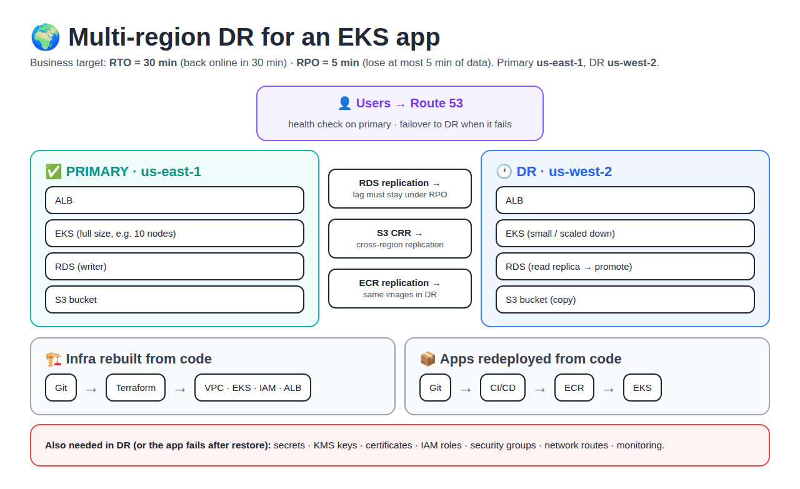
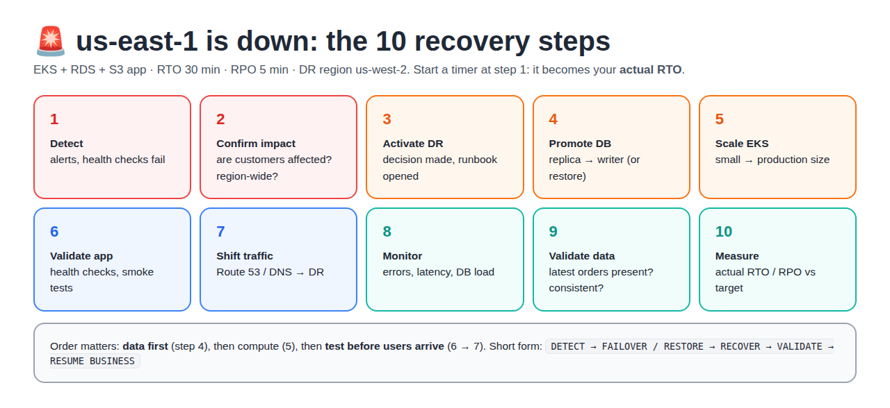
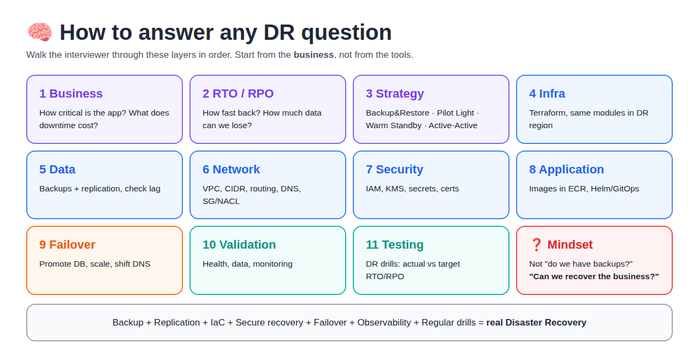

# Day 2 — DR Design for DevOps (EKS, Multi-Region, Interview Framework)

[← All notes](../README.md) · [Day 1: the basics and the 4 strategies](../day-1-dr-strategies/README.md)

> **In short:** DR is **not just backup**. It is a **tested** way to bring back **infrastructure, applications and data** within the business's **RTO** and **RPO**. Day 1 covered the basics. Day 2 is about **designing** DR for a real EKS app and **explaining** it in interviews.

## Table of Contents

1. [What is Disaster Recovery?](#1-what-is-disaster-recovery)
2. [RTO and RPO](#2-rto-and-rpo)
3. [The 4 DR Strategies (recap)](#3-the-4-dr-strategies-recap)
4. [How to Choose a Strategy](#4-how-to-choose-a-strategy)
5. [Real DR Architecture for EKS](#5-real-dr-architecture-for-eks)
6. [Multi-Region Connectivity](#6-multi-region-connectivity)
7. [Database DR](#7-database-dr)
8. [HA vs DR](#8-ha-vs-dr)
9. [Kubernetes / EKS DR](#9-kubernetes--eks-dr)
10. [Infrastructure as Code for DR](#10-infrastructure-as-code-for-dr)
11. [DNS Failover](#11-dns-failover)
12. [Secrets and Security in DR](#12-secrets-and-security-in-dr)
13. [Monitoring During DR](#13-monitoring-during-dr)
14. [DR Testing (DR Drills)](#14-dr-testing-dr-drills)
15. [Real-World Exercise: Region Down](#15-real-world-exercise-region-down)
16. [Interview: "Design DR for an EKS app"](#16-interview-design-dr-for-an-eks-app)
17. [Senior DR Framework](#17-senior-dr-framework)
18. [Cheat Sheet and One-Liners](#18-cheat-sheet-and-one-liners)

---

## 1. What is Disaster Recovery?

**Definition:** Disaster Recovery (DR) means **restoring business-critical apps and data after a major failure**.

**Disaster** = any failure too big for normal HA to handle by itself.

| Disaster | Simple example |
|----------|----------------|
| Region failure | All of us-east-1 is down |
| Database failure | The RDS instance is lost |
| Data corruption | A bug writes wrong data |
| Ransomware | An attacker encrypts your data |
| Accidental deletion | Someone runs `terraform destroy` on prod |
| Network failure | A region can't be reached |
| Application failure | A bad release takes the app down |

**The recovery flow:**

```
DISASTER → DETECT → FAILOVER / RESTORE → RECOVER → VALIDATE → RESUME BUSINESS
```

| Step | Meaning |
|------|---------|
| Detect | Notice the failure (alerts, health checks) |
| Failover / Restore | Move to the DR site, or restore from backup |
| Recover | Bring the app and data fully back |
| Validate | Check the app works and the data is correct |
| Resume | Customers use the app again |

## 2. RTO and RPO

**RTO (Recovery Time Objective)** = **how quickly** the app must be back. Example: RTO 30 min → the business is down for at most 30 minutes.

**RPO (Recovery Point Objective)** = **how much data** (measured in time) the business can lose. Example: RPO 5 min → we lose at most the last 5 minutes of data.

**Memory trick:**

```
RTO → TIME to recover       (downtime)
RPO → DATA you can lose     (data loss)
```

**Who sets them?** The **business**. DevOps builds a setup that meets them.

**Example: an e-commerce app**

```
USERS → Route 53 → ALB → EKS → RDS → S3        RTO = 30 min, RPO = 5 min
```

If the whole region fails, a second region must **already be planned and tested**. You can't design DR during the outage.

## 3. The 4 DR Strategies (recap)

**Definition:** a **DR strategy** = how much of production you keep ready in the DR location. More ready means faster recovery and higher cost.

```
BACKUP & RESTORE → PILOT LIGHT → WARM STANDBY → ACTIVE-ACTIVE
Recovery speed ↑    Cost ↑    Complexity ↑
```

| Strategy | Definition (simple) | During a disaster | Speed | Cost |
|----------|--------------------|-------------------|-------|------|
| **Backup & Restore** | Only backups are kept in another place | Create infra → restore DB → deploy app → update DNS | Slow | Low |
| **Pilot Light** | Data is replicated and core infra is ready, but the app is **off** | Scale infra → start app → promote DB → update DNS | Medium | Medium |
| **Warm Standby** | A **smaller running copy** of production (e.g. 10 nodes → 3) | Scale DR → promote DB → shift traffic | Fast | High |
| **Active-Active** | **Both regions serve traffic** all the time | Traffic simply goes to the healthy region | Very fast | Very high |

These are relative comparisons. Real recovery times depend on the app.

**AWS examples for Backup & Restore:** AWS Backup, S3, EBS snapshots, RDS snapshots, S3 Object Lock, cross-region backups.

**Active-Active downsides:** highest cost and complexity, and **data consistency** is hard (two regions writing at once).

Details and diagrams: [Day 1, section 5](../day-1-dr-strategies/README.md#the-4-dr-strategies-on-aws).

## 4. How to Choose a Strategy

**Rule:** choose by **business need**, not by what is technically impressive.

```
Business requirement → RTO / RPO → App criticality → Budget → Architecture → DR strategy
```

| App criticality | Example | Strategy |
|-----------------|---------|----------|
| Low | Internal reports | Backup & Restore |
| Medium | Internal HR portal | Pilot Light |
| High | Customer website | Warm Standby |
| Mission critical | Payments | Active-Active |

## 5. Real DR Architecture for EKS

**Definition:** **multi-region DR** = a second AWS region with the same setup, kept in sync, ready to take traffic.



| Layer | Primary (us-east-1) | DR (us-west-2) | How it's kept in sync |
|-------|--------------------|----------------|-----------------------|
| DNS | Route 53 | Route 53 | Health check + failover record |
| Load balancer | ALB | ALB | Terraform |
| Compute | EKS (full size) | EKS (small or off) | Terraform + GitOps |
| Database | RDS writer | RDS replica | Cross-region replication |
| Storage | S3 | S3 | **CRR** (Cross-Region Replication) |
| Images | ECR | ECR | ECR replication |

Two pipelines rebuild everything from Git:

```
Infrastructure:  Git → Terraform → AWS (VPC, EKS, IAM, ALB)
Application:     Git → CI/CD → Container registry (ECR) → EKS
```

## 6. Multi-Region Connectivity

**Definition:** a secure **network path between two regions** (or to on-prem), so services and replication can talk during DR.

```
AWS Region A ── VPN / Peering / Transit Gateway / Direct Connect ── AWS Region B
```

| Check | Why it matters |
|-------|----------------|
| **CIDR** | VPC IP ranges must **not overlap**, or peering/routing fails |
| Routing | Route tables must know the other region's range |
| DNS | Names must resolve in the DR region too |
| Security Groups / NACLs / firewall | Same rules must exist in DR (remember RoboShop: a missing SG rule = timeout) |
| Encryption | Data crossing regions must be encrypted |
| Latency / bandwidth | Affects replication lag, and so the RPO |

## 7. Database DR

**Definition:** protecting the **data**, so it can be failed over or restored. Often **more important than the app**: you can redeploy the app, but you can't recreate lost data.

```
Primary DB ── replication ──→ DR DB
```

| Term | Meaning |
|------|---------|
| **Replication lag** | How far the replica is behind the primary. Lag 2 min → you lose about 2 min of data on failover. Must stay under the RPO |
| **Data consistency** | All data matches (no half-written orders) after failover |
| **Promote** | Make the replica the new writer |
| **Backup** | A point-in-time copy. Needed because replication also copies mistakes (`DROP TABLE`) |
| **Encryption** | The DR copy must be encrypted, and the KMS key must exist in DR |

| AWS option | What it protects |
|------------|------------------|
| RDS Multi-AZ | AZ failure (this is **HA**, not region DR) |
| RDS cross-region read replica | Region failure |
| Aurora Global Database | Region failure, about 1 s lag, fast promote |
| DynamoDB Global Tables | Active-active, writes in many regions |
| AWS Backup | Scheduled, cross-region and cross-account backups |
| S3 CRR | Copies objects to another region |

## 8. HA vs DR

**HA (High Availability)** = the app **keeps running** when a **small part** fails (a server or an AZ), automatically, inside one region.

**DR (Disaster Recovery)** = the app **comes back** after a **big failure** (a whole region, data loss).

| | HA | DR |
|--|----|----|
| Protects from | Instance or AZ failure | Region failure, corruption, ransomware |
| Scope | Multi-AZ, one region | Multi-region |
| Example | App in AZ-A and AZ-B behind an ALB | Region A → Region B |
| Downtime | Almost none | Within RTO |

**Interview answer:** "Multi-AZ mainly improves high availability, while multi-region DR is designed to recover from bigger failures such as a regional outage."

## 9. Kubernetes / EKS DR

**Definition:** being able to rebuild the **cluster and everything around it** in another region.

**Wrong idea:** "I just need to back up the Pods." Pods are temporary and get recreated anyway. What matters is what **creates** them and the **data** they use.

| Protect | Where it lives |
|---------|----------------|
| Terraform code | Git |
| Helm charts, K8s manifests, config | Git (GitOps: Argo CD / Flux) |
| Container images | ECR (with replication) |
| Secrets | Secrets Manager (replicated) / External Secrets |
| Persistent data (PVs) | EBS snapshots / Velero |
| Databases, object storage | RDS replicas, S3 CRR |
| Cluster config, IAM, networking, monitoring | Terraform |

```
Git ─┬─ Terraform
     ├─ Helm
     ├─ Kubernetes manifests
     ├─ Configuration
     └─ Application code
```

If it's all in Git, a new cluster can be rebuilt from Git.

## 10. Infrastructure as Code for DR

**Definition:** **IaC** = infrastructure written as code (Terraform), so it can be **recreated the same way, quickly**.

| Manual rebuild (slow, error-prone) | With IaC (fast, consistent) |
|-------------------------------------|------------------------------|
| Engineer → Console → VPC → Subnets → EKS → IAM → LB | Git → `terraform apply` → VPC, EKS, IAM, networking, monitoring |
| Hours, under stress, easy to miss a step | Minutes, same every time |

**Interview answer:** "IaC reduces DR recovery time because the environment can be recreated consistently instead of being rebuilt by hand."

Terraform example (provider alias, state in DR): [Day 1, section 9](../day-1-dr-strategies/README.md#terraforms-role-in-dr).

## 11. DNS Failover

**Definition:** **DNS failover** = DNS automatically sends users to the **DR region** when the primary's **health check** fails.

```
Normal:   app.example.com → Route 53 → Primary region
Failure:  Primary ❌ → health check fails → Route 53 → DR region → Users
```

**Health check** = Route 53 calls a URL (e.g. `/health`) every few seconds. Too many failures → marked unhealthy.

**Low TTL** (e.g. 60 s) means clients pick up the new IP quickly.

## 12. Secrets and Security in DR

**Definition:** everything the app needs to **authenticate, decrypt and talk securely** must also exist in DR.

| Item | What breaks if it's missing |
|------|-----------------------------|
| IAM roles | Pods/EC2 can't call AWS |
| KMS keys | Encrypted DB/S3 can't be read |
| Secrets Manager | App can't log in to the DB |
| Certificates (ACM is per region) | HTTPS fails |
| Security Groups, Network Policies, RBAC | Traffic blocked or access denied |

**A common DR failure:**

```
Infrastructure restored → App starts → Secret missing → App fails
```

**Rule:** security is **part of DR**, not something added after recovery.

## 13. Monitoring During DR

**Definition:** watching **both regions** to detect the disaster, check that DR is ready, and confirm recovery worked.

| Area | Watch |
|------|-------|
| Infrastructure | CPU, memory, disk, network |
| Application | Request rate, error rate, latency, availability |
| Database | Connections, **replication lag**, storage, CPU, query latency |
| DR readiness | Backup success, replication health, failover health, recovery time, recovery point |

**Key idea:** alert on **"backup failed"** and **"replication lag > RPO"** *before* a disaster, not after.

## 14. DR Testing (DR Drills)

**Definition:** a **DR drill** = practising the recovery on purpose, to prove it works and measure it.

> A DR strategy that has never been tested is only a plan.

**What to test, in this order:**

```
Backup restore → Database failover → Application failover → DNS failover → Region failure simulation → Rollback (failback)
```

**What to measure:**

| | Target | Actual (from the drill) |
|--|--------|-------------------------|
| RTO | 30 min | e.g. 42 min → gap, fix it |
| RPO | 5 min | e.g. 3 min → OK |

## 15. Real-World Exercise: Region Down

**Setup:** EKS + RDS + S3 · RTO 30 min · RPO 5 min · Primary us-east-1 · DR us-west-2. Disaster: **us-east-1 ❌**



| # | Step | What you do |
|---|------|-------------|
| 1 | Detect | Alerts fire, health checks fail |
| 2 | Confirm impact | Customers affected? Whole region or one service? |
| 3 | Activate DR | Decide to fail over, open the runbook |
| 4 | Promote / recover DB | Replica → writer (or restore from backup) |
| 5 | Scale EKS | DR cluster from small → production size |
| 6 | Validate app | Health checks, smoke tests |
| 7 | Shift traffic | Route 53 / DNS → DR region |
| 8 | Monitor | Errors, latency, DB load |
| 9 | Validate data | Latest data present and consistent |
| 10 | Measure | Actual RTO/RPO vs target |

**Runbook** = the written step-by-step guide for these steps, so nobody has to think from scratch during an outage.

## 16. Interview: "Design DR for an EKS app"

**Strong answer (5 parts):**

1. **Requirements:** "First I understand the business RTO and RPO, then choose a strategy: backup & restore, pilot light, warm standby or active-active."
2. **Build:** "Infrastructure is reproducible with Terraform, and apps are deployed with GitOps. Critical data is replicated with the right DB and storage replication."
3. **Dependencies:** "The DR region has the networking, IAM, secrets, security controls and observability it needs."
4. **Failover:** "During a disaster I promote the database, scale EKS, shift traffic through DNS, then validate app health and data, and measure the actual RTO and RPO."
5. **Testing:** "I run regular DR drills, because a recovery plan is only reliable once it has been tested."

## 17. Senior DR Framework

**Definition:** a fixed **order of thinking** for any DR question. Start from the **business**, not from the tools.



```
BUSINESS → RTO/RPO → STRATEGY → INFRASTRUCTURE → DATA → NETWORK → SECURITY → APPLICATION → FAILOVER → VALIDATION → TESTING
```

**Mindset:**

| Don't ask | Ask |
|-----------|-----|
| "Do we have backups?" | "**Can we recover the business?**" |

```
BACKUP + REPLICATION + AUTOMATED INFRA (IaC) + SECURE RECOVERY + FAILOVER + OBSERVABILITY + REGULAR DR TESTING
= REAL DISASTER RECOVERY
```

## 18. Cheat Sheet and One-Liners

| Term | One line |
|------|----------|
| RTO | How quickly must I recover? |
| RPO | How much data can I lose? |
| Backup & Restore | Cheapest, slowest recovery |
| Pilot Light | Critical parts ready, app off |
| Warm Standby | Smaller working copy running |
| Active-Active | Both regions serve traffic |
| IaC | Recreate the infrastructure |
| Replication | Protect the data continuously |
| DNS / global traffic | Move the users |
| Monitoring | Detect and validate |
| DR drill | Prove the strategy works |

**Interview one-liners:**

- "A good DR strategy isn't just backups. It's a **tested** recovery setup that restores infrastructure, apps and data within the business RTO and RPO."
- "Multi-AZ is HA. Multi-region is DR."
- "In EKS DR you don't back up Pods. You keep Terraform, Helm, images, secrets and data recoverable."
- "Replication lag decides your real RPO."
- "If the secrets and KMS keys aren't in the DR region, the restored app won't start."
- "An untested DR plan is only a plan."
