# Day 2 — Service Discovery, Alertmanager

[← Day 1](../day-1-intro/README.md) · [All notes](../README.md)

- **Service discovery:** Prometheus finds EC2 servers to monitor **automatically** (by region/tags).
- **Alertmanager:** sends **email / Slack** alerts when a rule is hit, e.g. CPU > 90% (port 9093).

## What is Service Discovery?

**Service discovery** = Prometheus **automatically finds** the servers to monitor, instead of us
typing each server IP into `prometheus.yml` by hand.

## The Problem — Static Targets

On Day 1 we added the worker IP **manually**:

```yaml
- targets: ["<amazon-vm-ip>:9100"]
```

- New server added → edit `prometheus.yml` → **restart** Prometheus.
- Server deleted or IP changed → Prometheus still points to the **old IP** → shows **DOWN**.
- With **auto scaling** (servers come and go every few minutes), doing this by hand is impossible.

## The Fix — Service Discovery

Prometheus **asks the platform** (AWS, Kubernetes…) "which servers are running right now?" and
**updates its targets by itself**.

```
Static:            you ──type IPs──► prometheus.yml ──restart──► Prometheus

Service discovery: AWS / Kubernetes ──list of running servers──► Prometheus (auto-updates)
```

|                  | Static targets       | Service discovery       |
| ---------------- | -------------------- | ----------------------- |
| **Add a server** | Edit file + restart  | Found **automatically** |
| **IP changes**   | Breaks (target DOWN) | Picks up the new IP     |
| **Auto scaling** | Not practical        | Works                   |
| **Good for**     | Few fixed servers    | Cloud / Kubernetes      |

## Lab — Scale Out: Add a Second Server (Manual Way)

**Scenario:** load increases → we need **one more VM** running the Amazon app.

> **Real time:** an **Auto Scaling Group** creates new VMs **automatically** when CPU % goes up.
> For now, we copy the VM **by hand** to see the problem.

```
amazon-prod (VM 1) ──"Launch more like this"──► amazon-prod copy (VM 2)
      │                                                  │
      └────────────── both must be monitored ────────────┘
```

### Step 1 — Copy the VM

```
EC2 → select amazon-prod VM → Actions → Images and templates → Launch more like this → Launch
```

Creates a **copy** with the **same configuration** (AMI, type, security group, user data → Amazon
app).

### Step 2 — Install Node Exporter on the New VM

SSH into the **new VM** → run the same `node-exporter` script as Day 1 → port **9100** is already
open (same security group).

### Step 3 — Add the New IP to Prometheus

On the monitoring server:

```bash
vim /etc/prometheus/prometheus.yml
```

```yaml
- targets: ["<vm-1-ip>:9100", "<vm-2-ip>:9100"] # add the new VM's IP
```

```bash
systemctl restart prometheus.service
```

Check: **Status → Targets** → both VMs **UP**.

### Step 4 — Grafana Dashboard for the New VM

Import dashboard **1860** again, but Grafana does **not** allow duplicates:

| Field    | Rule                                         | Example                       |
| -------- | -------------------------------------------- | ----------------------------- |
| **Name** | Must be **different** for each dashboard     | `Node Exporter - amazon-vm-2` |
| **UID**  | Must be **different** — same one is rejected | `amazon-vm-2`                 |

```
Dashboards → Import → 1860 → Load → change Name + UID → select Prometheus → Import
```

### Why This Is a Problem

Every new VM = install Node Exporter + **edit `prometheus.yml`** + **restart** + new dashboard — by
hand. With auto scaling creating VMs automatically, we can't keep up → **service discovery** solves
the Prometheus part.

## EC2-Based Service Discovery

When an **Auto Scaling Group** creates many VMs, adding each one to monitoring **by hand is
practically impossible**.

**Purpose of service discovery:** **discover the servers** and make sure they are **added to
monitoring automatically** — based on their **tags**.

```
Auto Scaling Group ──creates──► VM 1, VM 2, VM 3 … (tag: Name=amazon-prod, Node Exporter :9100)
                                        ▲
                                        │ "which EC2s are running?" (EC2 read permission)
                                        │
                     prometheus-monitoring-server (IAM role: prometheus-role)
```

### Steps

| #   | Step                                                                                           | Where                          |
| --- | ---------------------------------------------------------------------------------------------- | ------------------------------ |
| 1   | Create IAM role **prometheus-role** (EC2 read-only)                                            | IAM                            |
| 2   | Attach the role to the **monitoring server**                                                   | EC2                            |
| 3   | Install **Node Exporter on all nodes** (ASG + launch template / user data) + monitoring server | Worker VMs + monitoring server |
| 4   | Add `ec2_sd_configs` to `prometheus.yml`                                                       | Monitoring server              |
| 5   | Restart Prometheus                                                                             | Monitoring server              |

### Step 1 — Create the IAM Role

Prometheus needs **permission to read EC2** to know which servers exist.

```
IAM → Roles → Create role
   ▼
Trusted entity: AWS service → EC2
   ▼
Permission: AmazonEC2ReadOnlyAccess
   ▼
Role name: prometheus-role → Create
```

### Step 2 — Attach the Role to the Monitoring Server

```
EC2 → select prometheus-monitoring-server → Actions → Security → Modify IAM role
   ▼
Select prometheus-role → Update IAM role
```

### Step 3 — Node Exporter on All Nodes

Put the Node Exporter script in the **launch template user data** → every VM the ASG creates gets
Node Exporter **automatically**.

**Also install Node Exporter on the monitoring server** and allow port **9100** in `monitoring-sg`.
Service discovery finds **every EC2 in the region — including the monitoring server** — and without
Node Exporter that server **cannot be monitored** (its target shows **DOWN**).

| Server                       | Node Exporter | Port 9100 allowed in |
| ---------------------------- | ------------- | -------------------- |
| Worker VMs (Amazon app)      | ✅            | Worker SG            |
| prometheus-monitoring-server | ✅            | `monitoring-sg`      |

### Step 4 — Configure Prometheus

```bash
vim /etc/prometheus/prometheus.yml
```

Add this job under `scrape_configs:`

```yaml
scrape_configs:
  - job_name: "ec2-discovery"

    ec2_sd_configs:
      - region: us-east-1 # region where the VMs run
        port: 9100 # Node Exporter port

    relabel_configs:
      - source_labels: [__meta_ec2_private_ip]
        target_label: instance # show the VM's private IP as the instance name
```

| Line              | Meaning                                             |
| ----------------- | --------------------------------------------------- |
| `ec2_sd_configs`  | Find targets from **AWS EC2** (not a fixed IP list) |
| `region`          | Which AWS region to look in                         |
| `port: 9100`      | Scrape Node Exporter on each VM                     |
| `relabel_configs` | Rename labels — here, show the **private IP**       |

**In simple:** we use service discovery for region **us-east-1** on port **9100**. Every EC2 in
us-east-1 has a **private IP**, so **all EC2s in that region are found and added** as targets.
`relabel_configs` takes each VM's **private IP** (`__meta_ec2_private_ip`) and shows it as the
**instance** name, so we can tell the VMs apart.

```
us-east-1: VM-1 (10.0.1.11), VM-2 (10.0.1.12), VM-3 (10.0.1.13)
                │ ec2_sd_configs finds all of them
                ▼
targets: 10.0.1.11:9100, 10.0.1.12:9100, 10.0.1.13:9100   (instance = private IP)
```

**Only monitor VMs with a tag** (e.g. `Name=amazon-prod`):

```yaml
ec2_sd_configs:
  - region: us-east-1
    port: 9100
    filters:
      - name: tag:Name
        values: [amazon-prod]
```

### Step 5 — Restart Prometheus and Check

> After **any config change**, restart the service.

```bash
systemctl restart prometheus
systemctl daemon-reload
systemctl status prometheus # must show: active (running)
```

**Check:** Prometheus → **Status → Targets** → `ec2-discovery` now shows **multiple targets instead
of 1** — all VMs added **automatically**. A new VM from the ASG appears **without editing the file
again**.

> Prometheus uses the **private IP**, so the workers' security group must allow **9100** from the
> monitoring server.

## Alertmanager

**Alertmanager** = sends **alerts** (email, Slack…) when a **condition** we give is true — e.g.
**CPU > 90%** → trigger an alarm.

| Field          | Value                            |
| -------------- | -------------------------------- |
| **Purpose**    | Send alerts when a rule fires    |
| **Sends to**   | Email, Slack, PagerDuty, mobile  |
| **Port**       | **9093**                         |
| **Install on** | **prometheus-monitoring-server** |

```
Node Exporter ──metrics──► Prometheus ──checks rule (CPU > 50%)──► fires ──► Alertmanager :9093 ──► Email / Slack
```

**Who does what:**

- **Prometheus** checks the **rules** (the conditions).
- **Alertmanager** **sends** the alert (email, Slack).

### Steps

| #   | Step                                                      | Where                      |
| --- | --------------------------------------------------------- | -------------------------- |
| 1   | Install **Prometheus + Alertmanager**, open port **9093** | Monitoring server          |
| 2   | Install **Node Exporter**                                 | Web server(s)              |
| 3   | Create `rules/` folder + write the **rules file**         | Monitoring server          |
| 4   | Add **`rule_files`** — where the rules file is            | Monitoring server          |
| 5   | Add **`alerting`** — where Alertmanager is                | Monitoring server          |
| 6   | Restart Prometheus + check status                         | Monitoring server          |
| 7   | Add load with `stress` → check alerts                     | Web server + Prometheus UI |
| 8   | Check the alert in **Alertmanager**                       | Alertmanager UI            |
| 9   | Connect **Slack** → alerts go to the team                 | Slack + monitoring server  |

### Step 1 — Install Alertmanager

Install on the **same monitoring server** (where Prometheus is), as root. Then **allow port 9093**
(My IP) in `monitoring-sg`.

```bash
ssh -i <key.pem> ubuntu@<monitoring-public-ip>
sudo su -
vim alertmanager.sh # paste the script below, save (Esc → :wq)
sh alertmanager.sh
```

```bash
#!/bin/bash
set -e   # stop the script if any command fails

# variables
VERSION="0.25.0"
CONFIG_DIR="/etc/alertmanager"
DATA_DIR="/var/lib/alertmanager"

# download and extract
cd /tmp
wget https://github.com/prometheus/alertmanager/releases/download/v${VERSION}/alertmanager-${VERSION}.linux-amd64.tar.gz
tar -xf alertmanager-${VERSION}.linux-amd64.tar.gz

# move the binaries (alertmanager + amtool)
mv alertmanager-${VERSION}.linux-amd64/alertmanager /usr/local/bin/
mv alertmanager-${VERSION}.linux-amd64/amtool /usr/local/bin/

# create a user for the service (no login) — skip if it exists
id alertmanager || useradd -rs /bin/false alertmanager

# create directories for config and data
mkdir -p ${CONFIG_DIR} ${DATA_DIR}

# default config (Slack is added later in Step 9)
cat <<EOF > ${CONFIG_DIR}/alertmanager.yml
route:
  receiver: "default"

receivers:
  - name: "default"
EOF

# give the folders to the alertmanager user
chown -R alertmanager: ${CONFIG_DIR} ${DATA_DIR}

# clean up
rm -rf /tmp/alertmanager-${VERSION}.linux-amd64*

# create the systemd service
cat <<EOF > /etc/systemd/system/alertmanager.service
[Unit]
Description=Alertmanager
After=network.target

[Service]
User=alertmanager
Group=alertmanager
Type=simple
ExecStart=/usr/local/bin/alertmanager \
  --config.file=${CONFIG_DIR}/alertmanager.yml \
  --storage.path=${DATA_DIR}
Restart=always

[Install]
WantedBy=multi-user.target
EOF

# start Alertmanager
systemctl daemon-reload
systemctl enable alertmanager
systemctl start alertmanager
systemctl status alertmanager --no-pager
```

| Script step              | What it does                                       |
| ------------------------ | -------------------------------------------------- |
| `set -e`                 | Stop on the first error                            |
| `VERSION=…`              | Change the version in one place                    |
| `alertmanager`, `amtool` | Alertmanager server + CLI to check config / alerts |
| `id … \|\| useradd`      | Create the user only if it doesn't exist           |
| `/etc/alertmanager`      | Config (`alertmanager.yml`)                        |
| `/var/lib/alertmanager`  | Data (silences, notification state)                |
| `Restart=always`         | Auto-restart if it crashes                         |

**Check:**

```bash
systemctl status alertmanager --no-pager   # active (running)
curl -s localhost:9093/-/ready             # OK
```

Browser: `http://<monitoring-public-ip>:9093` → Alertmanager UI.

| Port | Type       | Source | Where           |
| ---- | ---------- | ------ | --------------- |
| 9093 | Custom TCP | My IP  | `monitoring-sg` |

> Prometheus → Alertmanager uses `localhost:9093` (same server) → no extra SG rule needed for that.

### Step 2 — Node Exporter on the Web Server

Same script as Day 1 (already done if service discovery is set up).

### Step 3 — Write the Rules File

```bash
mkdir /etc/prometheus/rules
vim /etc/prometheus/rules/cpu_alert.yml
```

```yaml
groups:
  - name: cpu-alerts # group name
    rules:
      - alert: HighCPUUsage # alert name
        expr: 100 - (avg by(instance) (rate(node_cpu_seconds_total{mode="idle"}[1m])) * 100) > 50
        for: 1m # condition must stay true for 1 minute
        labels:
          severity: warning
        annotations:
          summary: "High CPU on {{ $labels.instance }}"
          description: "CPU usage > 50% on {{ $labels.instance }}"
```

| Field         | Meaning                                                 |
| ------------- | ------------------------------------------------------- |
| `name`        | Group of rules → **cpu-alerts**                         |
| `alert`       | Alert name → **HighCPUUsage**                           |
| `expr`        | Condition → CPU used = 100 − idle % → **> 50%**         |
| `for: 1m`     | Wait **1 minute** — if CPU is **still high**, then fire |
| `severity`    | How serious → `warning`                                 |
| `annotations` | Message → "High CPU on **&lt;server IP&gt;**"           |

**In simple:** if CPU is **> 50% for 1 minute** (still the same or increasing after waiting), the
alert fires: **"High CPU on &lt;server&gt;"**.

> We use **50%** to test easily with `stress`; in real time it's usually **90%**.

### Step 4 — Tell Prometheus About the Rules File (`rule_files`)

Writing the rules file is **not enough** — **how does Prometheus know about it?** In
`prometheus.yml` we mention **where the rules file comes from** and **its name**.

```bash
vim /etc/prometheus/prometheus.yml
```

```yaml
global:
  scrape_interval: 15s # collect metrics every 15 s
  evaluation_interval: 15s # check the rules every 15 s

rule_files:
  - "rules/cpu_alert.yml" # folder/file name — relative to /etc/prometheus/
```

### Step 5 — Tell Prometheus Where Alertmanager Is (`alerting`)

To **send** alerts, Prometheus must know where **Alertmanager** is. Add the `alerting` block in the
same file:

```yaml
alerting:
  alertmanagers:
    - static_configs:
        - targets:
            - "localhost:9093" # localhost = this monitoring server (Alertmanager is installed here)
```

> **localhost** = the **monitoring server** where Alertmanager is installed.

**Full `prometheus.yml`** — my lab file (`/etc/prometheus/prometheus.yml` on the monitoring server):

```yaml
global:
  scrape_interval: 15s # collect metrics every 15 s
  evaluation_interval: 15s # check the rules every 15 s

rule_files:
  - "rules/cpu_alert.yml" # folder/file name — relative to /etc/prometheus/

alerting:
  alertmanagers:
    - static_configs:
        - targets:
            - "localhost:9093" # Alertmanager on this same monitoring server

scrape_configs:
  - job_name: "ec2-discovery"

    ec2_sd_configs:
      - region: us-east-1 # region where the VMs run
        port: 9100 # Node Exporter port

    relabel_configs:
      - source_labels: [__meta_ec2_private_ip]
        target_label: instance # show the VM's private IP as the instance name
```

```
prometheus.yml
├── global          → how often to scrape + check rules
├── rule_files      → WHAT to alert on   (rules/cpu_alert.yml)
├── alerting        → WHERE to send it   (Alertmanager localhost:9093)
└── scrape_configs  → WHO to collect from (all EC2s found in us-east-1 on :9100)
```

| Block                 | Tells Prometheus                       |
| --------------------- | -------------------------------------- |
| `evaluation_interval` | How often to check the rules           |
| `rule_files`          | **Where the rules file is** + its name |
| `alerting`            | **Where Alertmanager is** (port 9093)  |
| `scrape_configs`      | Which servers to collect metrics from  |

### Step 6 — Restart and Check Status

```bash
promtool check config /etc/prometheus/prometheus.yml # optional: checks config + rules
systemctl restart prometheus.service
systemctl status prometheus.service # must show: active (running)
```

### Step 7 — Add Load and Check Alerts

On **any monitored server**, install `stress` and add CPU load:

```bash
apt update && apt install stress -y
stress -c 10 # 10 CPU workers → CPU goes above 50%
```

Then check in the **Prometheus console** (`http://<monitoring-ip>:9090`):

| Page                 | You see                                        |
| -------------------- | ---------------------------------------------- |
| **Status → Rules**   | All rules loaded on this server (`cpu-alerts`) |
| **Alerts**           | `HighCPUUsage` → **Pending** → **Firing**      |
| Alertmanager `:9093` | The fired alert arrives here                   |

| State        | Meaning                                        |
| ------------ | ---------------------------------------------- |
| **Inactive** | Condition false — all good                     |
| **Pending**  | CPU > 50%, waiting for `for: 1m`               |
| **Firing**   | Still > 50% after 1 min → sent to Alertmanager |

Stop with `Ctrl + C` → CPU drops → alert goes back to **Inactive**.

### Step 8 — Check in Alertmanager

Open `http://<monitoring-ip>:9093` → the **HighCPUUsage** alert is shown there.

```
Prometheus (Firing) ──► Alertmanager :9093 (alert listed) ──► Slack (next step)
```

### Step 9 — Send Alerts to Slack

In real time, **team members** must get alerts **immediately** → we send them to a **Slack
channel**.

**A. Create a Slack channel and add the team**

```
Slack → devops workspace → Channels → + Create channel → name: #alertchannel → Create
   ▼
Add people → add your team members
```

Everyone in this channel gets the alerts.

**B. Create a Slack app with an incoming webhook**

**Webhook** = a URL that lets Alertmanager **post messages** into the channel.

```
https://api.slack.com/apps → Create New App → From scratch (blank app)
   ▼
App name: alert-manager · Workspace: devops (where alerts should go) → Create App
   ▼
Incoming Webhooks → turn the toggle ON
   ▼
Add New Webhook → select channel #alertchannel → Allow
   ▼
Copy the Webhook URL → paste it in alertmanager.yml (next step)
```

| Setting   | Value                      |
| --------- | -------------------------- |
| App name  | `alert-manager`            |
| Workspace | `devops`                   |
| Feature   | Incoming Webhooks → **ON** |
| Channel   | `#alertchannel`            |

> The **webhook URL is a secret** — anyone who has it can post to your channel. **Never push it to
> GitHub.**

**C. Give the webhook to Alertmanager**

Copy the webhook URL from Slack → paste it into **`api_url`** in the Alertmanager config. This is
how Alertmanager knows **which Slack channel** to send alerts to.

```
Slack webhook URL ──copy──► alertmanager.yml → api_url: "<webhook-url>"
```

```bash
vim /etc/alertmanager/alertmanager.yml
```

```yaml
global:
  resolve_timeout: 5m # mark alert "resolved" if not seen for 5 min

route: # WHO gets the alert
  receiver: "slack-notifications" # default receiver
  routes:
    - match:
        severity: warning # alerts with severity=warning…
      receiver: "slack-notifications" # …go to Slack

receivers: # HOW to send it
  - name: "slack-notifications"
    slack_configs:
      - api_url: "<your-slack-webhook-url>" # paste the copied webhook URL
        channel: "#alertchannel"
        text: |
          ALERT: {{ .CommonAnnotations.summary }}
          {{ .CommonAnnotations.description }}
```

| Block             | In simple                                                  |
| ----------------- | ---------------------------------------------------------- |
| `resolve_timeout` | After 5 min without the alert → marked **resolved**        |
| `route`           | **Which alerts go where** — `severity: warning` → Slack    |
| `receivers`       | **How to send** — Slack webhook + channel                  |
| `text`            | The message — uses `summary` + `description` from the rule |

`severity: warning` comes from the **rules file** (`labels: severity: warning`) → that's how the
alert is matched to Slack.

**D. Restart both services**

```bash
systemctl restart prometheus.service
systemctl restart alertmanager.service
```

**E. Test** — add load on the web server:

```bash
apt update && apt install stress -y && stress -c 10
```

After ~1 minute, Slack `#alertchannel` gets:

```
ALERT: High CPU on 10.0.1.11
CPU usage > 50% on 10.0.1.11
```

### Full Alert Flow

```
Web server CPU > 50% for 1 min
   ▼
Prometheus rule HighCPUUsage → Firing
   ▼
Alertmanager :9093 → route (severity: warning)
   ▼
Slack #alertchannel → team gets the message
```

### References

- [Alertmanager configuration (routes)](https://prometheus.io/docs/alerting/latest/configuration/#route)
- [Alerting rules](https://prometheus.io/docs/prometheus/latest/configuration/alerting_rules/)
- [Slack / PagerDuty / Gmail integration guide](https://grafana.com/blog/step-by-step-guide-to-setting-up-prometheus-alertmanager-with-slack-pagerduty-and-gmail/)

## Hands-On — My Lab Run (2026-10-10)

| Server                         | Private IP    | Runs                                   |
| ------------------------------ | ------------- | -------------------------------------- |
| Monitoring (`ip-172-31-13-45`) | 172.31.13.45  | Prometheus + Grafana + Alertmanager + Node Exporter |
| worker1                        | 172.31.0.57   | Amazon app + Node Exporter             |
| worker2                        | 172.31.4.189  | Amazon app + Node Exporter             |
| worker3                        | 172.31.14.182 | Amazon app + Node Exporter             |

```
worker1, worker2, worker3 (:9100) ◄── EC2 SD (IAM role) ── Prometheus :9090 ── rule fires ──► Alertmanager :9093
                                                               │
                                                               └──► Grafana :3000
```

### Part A — Scale Out + EC2 Service Discovery

**1. Create 2 more workers** → worker1 → **Actions → Image and templates → Launch more like this** (×2).

> "Launch more like this" copies **settings** (AMI, type, SG, key, user data) — **not** installed
> software → install **Node Exporter** on each new VM again.

Set a name on each VM:

```bash
hostnamectl set-hostname worker3
exec bash   # prompt shows the new name
```

**2. Attach the IAM role** → monitoring server → **Actions → Security → Modify IAM role** →
`prometheus-role` (AmazonEC2ReadOnlyAccess) → **Update IAM role**.

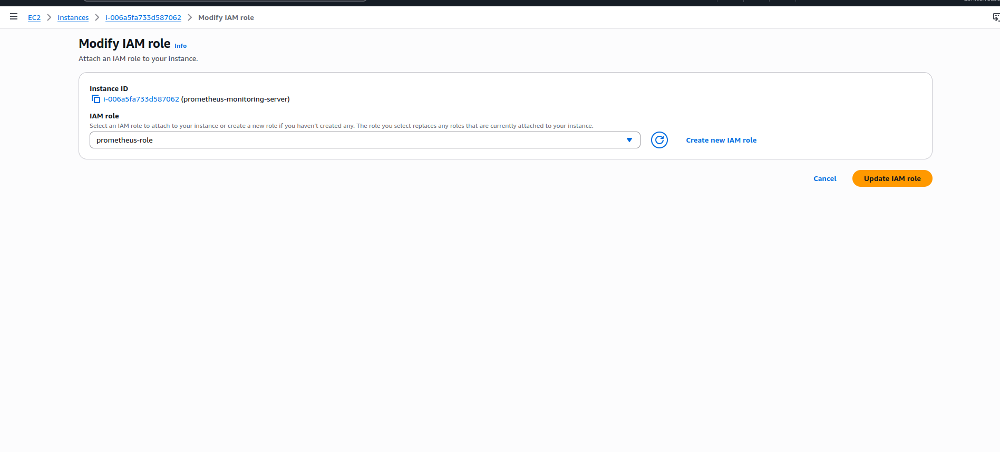

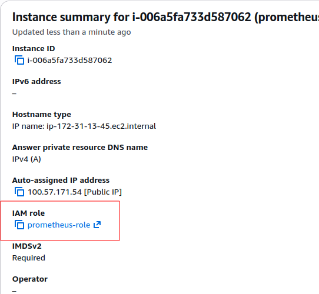

**3. Add `ec2-discovery` to `prometheus.yml`** → restart → logs: **"Completed loading of
configuration file"**.

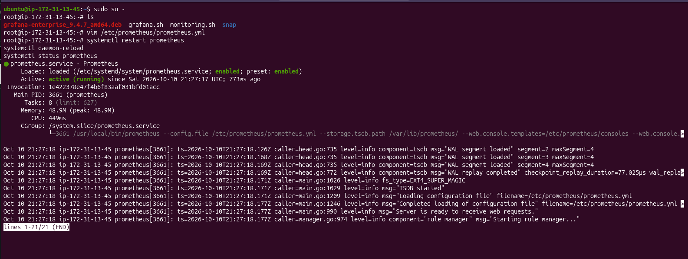

**4. Targets → `ec2-discovery (4/4 up)`** — no IPs typed by hand.

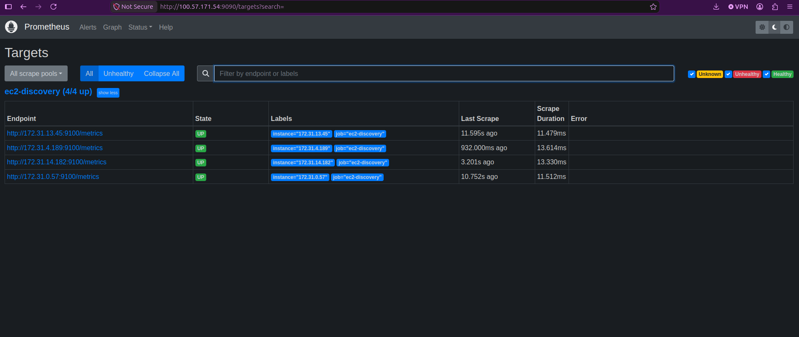

> EC2 SD finds **all** my VMs in `us-east-1` — also the monitoring server (172.31.13.45) because it
> has Node Exporter too. How only **my** VMs? Prometheus asks the **AWS API** with the IAM role →
> AWS returns only **my account's** instances.

### Part B — Alertmanager

**5. Install Alertmanager** (script in Step 1) → `active (running)`.

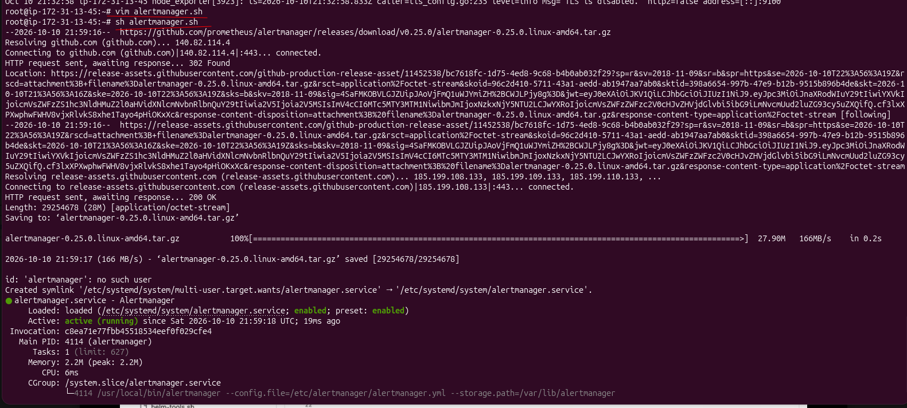

**6. Open port 9093** in the monitoring server SG.

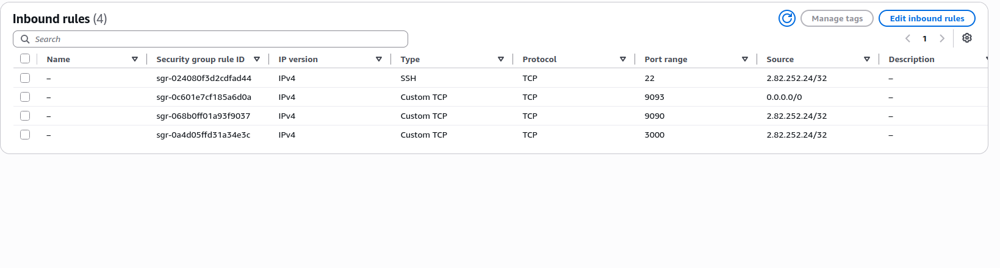

> I opened 9093 to `0.0.0.0/0` — better: **My IP** only, like 9090 and 3000.

**7. Write the rule** → `mkdir /etc/prometheus/rules` → `vim /etc/prometheus/rules/cpu_alert.yml`

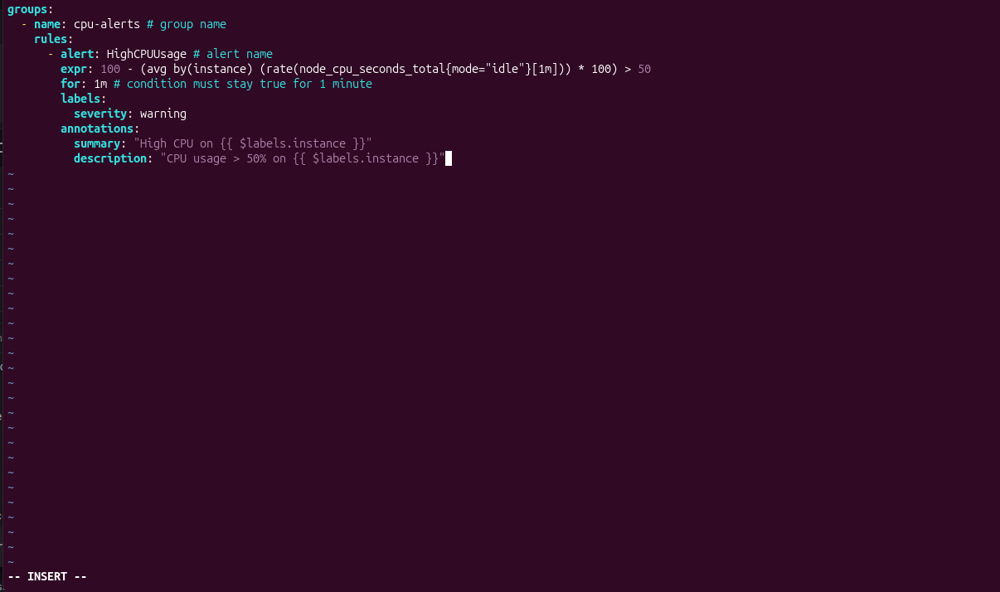

**8. Tell Prometheus** → add `rule_files` …

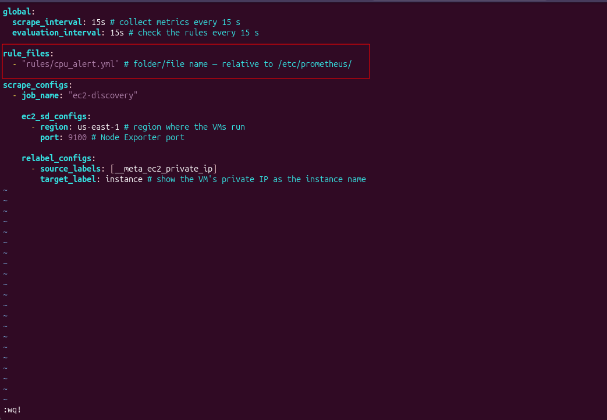

… and `alerting` (where Alertmanager is).

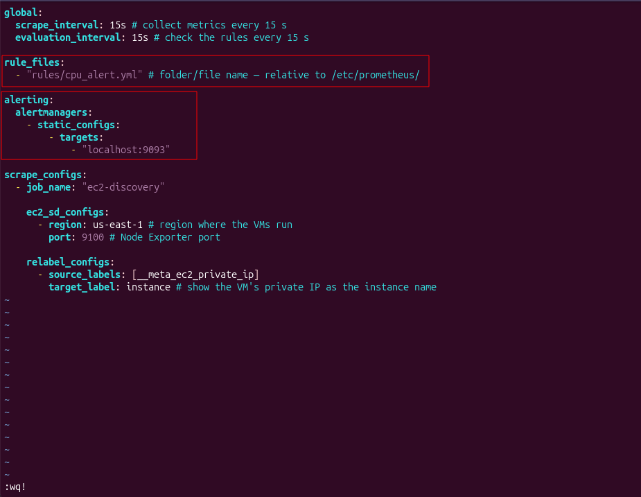

**9. Restart Prometheus** → **"Starting rule manager…"** = rules loaded.

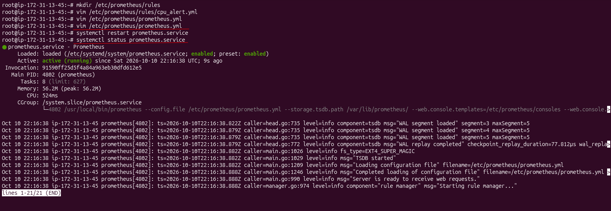

### Part C — Test the Alert

**10. Add load on worker1**

```bash
stress -c 10 --timeout 180   # no live output — it runs silently; watch the browser
```

> Want to see CPU live? Open a 2nd SSH tab → `top`.

**11. Prometheus → Alerts** → `HighCPUUsage` **FIRING** on `instance=172.31.0.57`, value **100**.

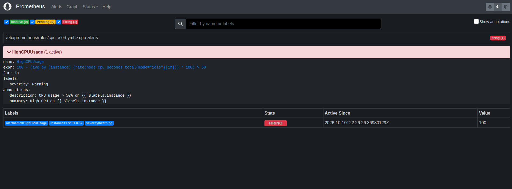

```
Inactive (green) ──CPU > 50%──► Pending (yellow) ──true for 1m──► Firing (red) ──► Alertmanager
```

**12. Grafana** — first it showed **no spike**: I had picked the **monitoring server** (172.31.13.45).

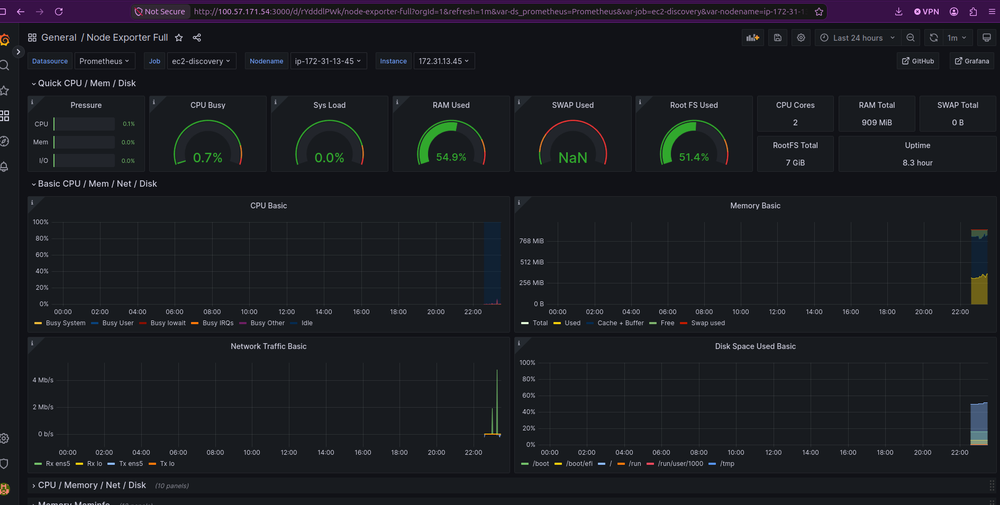

Switched to **Job `ec2-discovery` → Nodename `worker1` → Instance `172.31.0.57`** → spike shows.

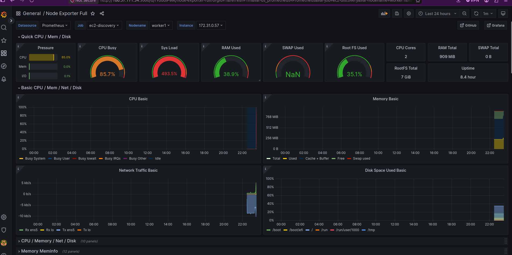

| Panel (worker1) | Under `stress -c 10` |
| --------------- | -------------------- |
| CPU Busy        | **85.7%**            |
| Sys Load        | **493.5%** (2 cores) |
| Alert value     | **100** → FIRING     |

> Dashboard **1860** shows **one server at a time**. For all servers on one graph, add a panel with
> `100 - (avg by (instance) (rate(node_cpu_seconds_total{mode="idle"}[1m])) * 100)`.

### Problems I Faced → Fix

| Problem                                          | Cause                                                        | Fix                                                        |
| ------------------------------------------------ | ------------------------------------------------------------ | ---------------------------------------------------------- |
| New VMs had no Node Exporter                     | "Launch more like this" copies settings, not installed software | Installed Node Exporter on each (or bake an AMI)          |
| `sethostnamectl: command not found`              | Wrong command                                                | `hostnamectl set-hostname worker3`                         |
| `stress` looked stuck                            | It prints nothing while running                              | Watch Prometheus Alerts / Grafana, or `top` in a 2nd tab   |
| Grafana showed no data with old settings         | Job changed `node_exporter_metrics` → `ec2-discovery`; instance lost `:9100` (relabel) | Pick Job `ec2-discovery` + new instance in dropdowns |
| Grafana showed no spike                          | Selected the monitoring server, not worker1                  | Instance → `172.31.0.57`                                   |

## Interview Question — Issues I Faced in Prometheus

**Q: What issues did you face in Prometheus?**

**Problem 1:** after setting up EC2 service discovery, **no VMs were listed** in **Status → Targets**.

**Cause:** in `ec2_sd_configs` I gave a **different region** — not the region where my VMs were
running. Prometheus looked in the wrong region and found nothing.

**Fix:** changed `region` to the **correct region** (`us-east-1`) → restarted Prometheus → all
target VMs were **listed correctly**.

> **Lesson:** service discovery only finds VMs in the region you give — always match `region` to
> where the VMs run.

**Problem 2:** the alert rule **did not show** in **Status → Rules**.

**Cause:** I put the rules file path in the **wrong place** — Prometheus didn't know where the rules
file was.

**Fix:** added the correct path under **`rule_files`** in `prometheus.yml` (`rules/cpu_alert.yml`,
relative to `/etc/prometheus/`) → `promtool check config` → restart → rule loaded.

## Interview One-Liner

Service discovery lets Prometheus automatically find and update its monitoring targets from
platforms like AWS or Kubernetes, so we don't have to add server IPs by hand.

For EC2 service discovery, give the Prometheus server an IAM role with EC2 read-only access and
add `ec2_sd_configs` to `prometheus.yml` — it then finds every EC2 (filtered by tags) on port 9100
automatically.

Alertmanager (port 9093) sends email/Slack alerts when a Prometheus alerting rule fires; Prometheus
finds the rules through `rule_files` and Alertmanager through `alerting` in `prometheus.yml`.
