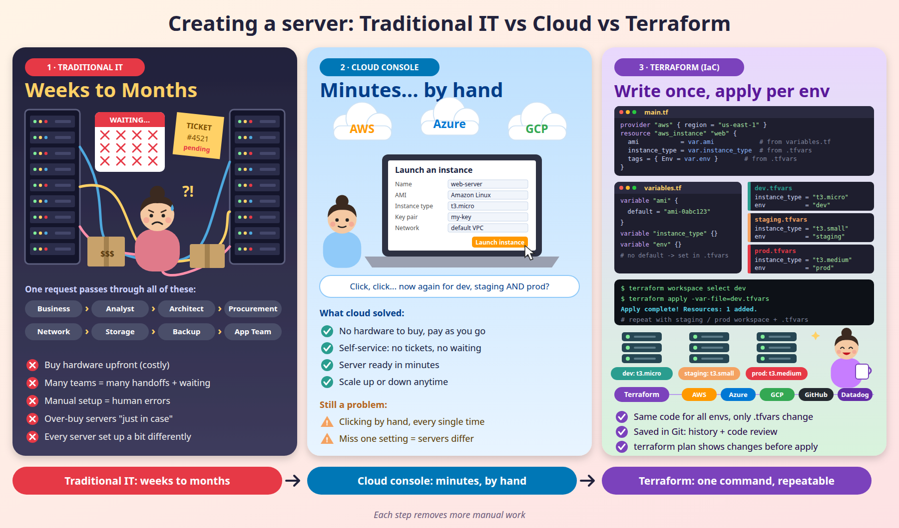

# Day 1 — Intro to Terraform

[← All notes](../README.md)

## Traditional IT vs Cloud vs Terraform



|                    | Traditional IT        | Cloud (console)          | Terraform               |
| ------------------ | --------------------- | ------------------------ | ----------------------- |
| **How**            | Buy & set up hardware | Click in the AWS console | Write code, run it      |
| **Time**           | Weeks to months       | Minutes                  | Minutes, every time     |
| **Repeatable?**    | ❌                    | ❌ (manual clicks)       | ✅ same code everywhere |
| **Change history** | ❌                    | ❌                       | ✅ in Git               |

## What is Terraform?

**Terraform** = an open-source **Infrastructure as Code (IaC)** tool by **HashiCorp**. You write
your infrastructure (servers, VPCs, databases) as **code**, and Terraform **creates it** in the
cloud for you.

- Language: **HCL** (HashiCorp Configuration Language), in `.tf` files
- Works with **many clouds**: AWS, Azure, GCP, Kubernetes, and more (through **providers**)

```
.tf code ──► terraform plan ──► terraform apply ──► AWS resources created
```

## Why Terraform?

| Why                 | In short                                                  |
| ------------------- | --------------------------------------------------------- |
| **Automation**      | No manual clicking in the console                         |
| **Repeatable**      | Same code → identical dev, staging, prod                  |
| **Version control** | Code lives in Git → review, history, rollback             |
| **Fewer mistakes**  | `plan` shows what will change before you `apply`          |
| **Multi-cloud**     | One tool for AWS, Azure, GCP                              |
| **Cost control**    | `terraform destroy` removes everything → no forgotten bills |

## Interview One-Liners

- **IaC** = managing infrastructure with code instead of manual steps.
- **Terraform** = open-source IaC tool by HashiCorp that creates cloud resources from `.tf` code.
- **Why not the console?** Manual clicks are slow, error-prone and not repeatable. Terraform code is
  automated, repeatable and tracked in Git.
