# Day 1 — Intro to Terraform

[← All notes](../README.md)

## Table of Contents

1. [Overview](#overview)
2. [Traditional IT vs Cloud vs Terraform](#traditional-it-vs-cloud-vs-terraform)
3. [What is Terraform?](#what-is-terraform)
4. [Why Terraform?](#why-terraform)
5. [Terraform Block & Version](#terraform-block--version)
6. [Providers (multiple + versions)](#providers-multiple--versions)
7. [Interview One-Liners](#interview-one-liners)

**[Part 2 — count, for_each, Lifecycle & More](#part-2--count-for_each-lifecycle--more)**

8. [Quick Definitions](#quick-definitions)
9. [count vs for_each — Quick Rule](#count-vs-for_each--quick-rule)
10. [count — numbered copies](#count--numbered-copies)
11. [for_each — named resources](#for_each--named-resources)
12. [Why not count with a list of names?](#why-not-count-with-a-list-of-names)
13. [count vs for_each](#count-vs-for_each)
14. [Parallelism](#parallelism)
15. [Current vs Desired Infrastructure](#current-vs-desired-infrastructure)
16. [Terraform Drift](#terraform-drift)
17. [depends_on](#depends_on)
18. [Lifecycle Rules](#lifecycle-rules)
19. [-target (act on one resource only)](#-target-act-on-one-resource-only)
20. [Interview One-Liners (Part 2)](#interview-one-liners-part-2)

## Overview

Before learning Terraform, let's understand **why** we need it — what problems IT teams faced
before Terraform, and how things changed step by step:

```
Traditional IT  ──►  Cloud (console)  ──►  Terraform
weeks to months      minutes, by hand      one command, repeatable
```

**1. Traditional IT (own data center)**
To get one server, the company **bought hardware**, waited for delivery, then many teams
(procurement, network, storage, backup) set it up **by hand**. It took **weeks to months**, cost a
lot up front, and every server ended up set up a bit differently.

**2. Cloud (AWS, Azure, GCP console)**
Cloud removed the hardware. Now we **rent servers** and pay only for what we use — a server is ready
in **minutes**. But we still **click by hand** in the console, again for dev, staging and prod. Miss
one setting and the servers are different.

**3. Terraform (Infrastructure as Code)**
We **write the server once as code**, save it in Git, and run one command to create it. Same code →
same server every time, in every environment. No clicking, no guessing.

> **Traditional IT was slow. Cloud made it fast but manual. Terraform makes it fast AND repeatable.**

## Traditional IT vs Cloud vs Terraform


|                    | Traditional IT        | Cloud (console)          | Terraform               |
| ------------------ | --------------------- | ------------------------ | ----------------------- |
| **How**            | Buy & set up hardware | Click in the AWS console | Write code, run it      |
| **Time**           | Weeks to months       | Minutes                  | Minutes, every time     |
| **Repeatable?**    | ❌                    | ❌ (manual clicks)       | ✅ same code everywhere |
| **Change history** | ❌                    | ❌                       | ✅ in Git               |

## What is Terraform?

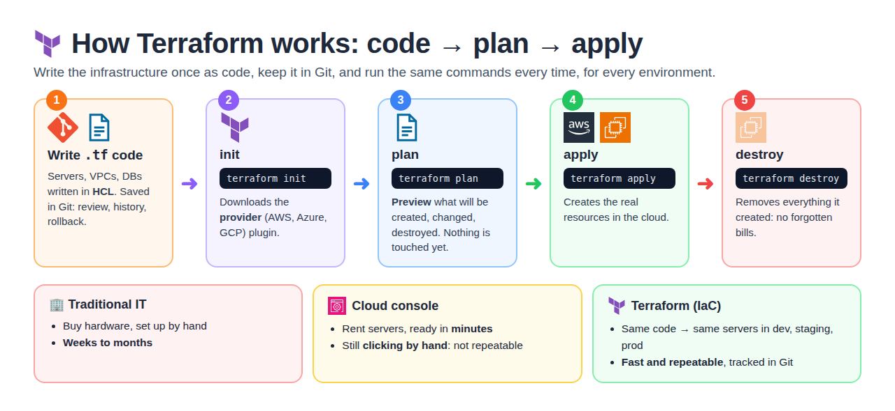

**Terraform** = an open-source **Infrastructure as Code (IaC)** tool by **HashiCorp**. You write
your infrastructure (servers, VPCs, databases) as **code**, and Terraform **creates it** in the
cloud for you.

- Language: **HCL** (HashiCorp Configuration Language), in `.tf` files
- Works with **many clouds**: AWS, Azure, GCP, Kubernetes, and more (through **providers**)

```
.tf code ──► terraform plan ──► terraform apply ──► AWS resources created
```

## Why Terraform?

| Why                 | In short                                                  |
| ------------------- | --------------------------------------------------------- |
| **Automation**      | No manual clicking in the console                         |
| **Repeatable**      | Same code → identical dev, staging, prod                  |
| **Version control** | Code lives in Git → review, history, rollback             |
| **Fewer mistakes**  | `plan` shows what will change before you `apply`          |
| **Multi-cloud**     | One tool for AWS, Azure, GCP                              |
| **Cost control**    | `terraform destroy` removes everything → no forgotten bills |

## Terraform Block & Version

**terraform block** = global **settings for Terraform itself** (not a resource): required Terraform
version, required providers, and backend (where state lives).

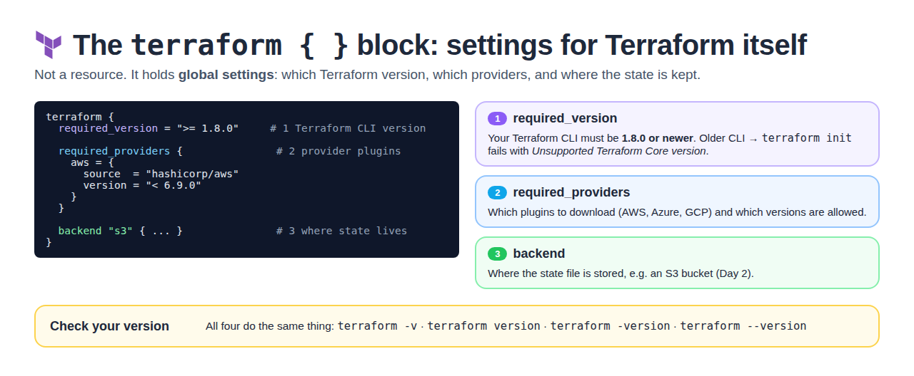

```hcl
terraform {
  required_version = ">= 1.8.0"      # CLI must be 1.8.0 or newer

  required_providers {
    aws = {
      source  = "hashicorp/aws"
      version = "< 6.9.0"
    }
  }
}
```

| Part                 | What it sets                                   |
| -------------------- | ---------------------------------------------- |
| `required_version`   | Allowed Terraform CLI version (older CLI → `init` fails) |
| `required_providers` | Which provider plugins + versions to download  |
| `backend`            | Where the state file is stored (Day 2)         |

**Check the version** (all four do the same): `terraform -v` · `terraform version` ·
`terraform -version` · `terraform --version`

## Providers (multiple + versions)

**Provider** = the **plugin** that talks to a cloud's API (AWS, Azure, GCP). One project can install
**many providers at a time**.

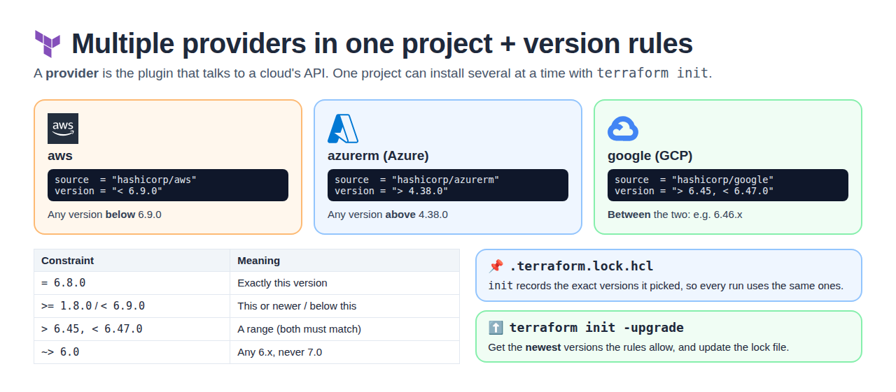

```hcl
terraform {
  required_providers {
    aws = {
      source  = "hashicorp/aws"
      version = "< 6.9.0"            # below 6.9.0
    }
    azurerm = {
      source  = "hashicorp/azurerm"
      version = "> 4.38.0"           # above 4.38.0
    }
    google = {
      source  = "hashicorp/google"
      version = "> 6.45, < 6.47.0"   # between the two
    }
  }
}
```

| Constraint          | Meaning                       |
| ------------------- | ----------------------------- |
| `= 6.8.0`           | Exactly this version          |
| `>= 1.8.0`          | This or newer                 |
| `< 6.9.0`           | Below this                    |
| `> 6.45, < 6.47.0`  | A range (both must match)     |
| `~> 6.0`            | Any 6.x, never 7.0            |

| Command / file             | What it does                                                   |
| -------------------------- | -------------------------------------------------------------- |
| `terraform init`           | Downloads the providers                                        |
| `.terraform.lock.hcl`      | Records the exact versions picked → same versions every run    |
| `terraform init -upgrade`  | Gets the **newest** versions the rules allow, updates the lock file |

## Interview One-Liners

- **IaC** = managing infrastructure with code instead of manual steps.
- **Terraform** = open-source IaC tool by HashiCorp that creates cloud resources from `.tf` code.
- **Why not the console?** Manual clicks are slow, error-prone and not repeatable. Terraform code is
  automated, repeatable and tracked in Git.
- **terraform block** = Terraform's own settings: `required_version`, `required_providers`, `backend`.
- **Provider** = plugin that talks to a cloud API; pin versions in `required_providers`, `init -upgrade` to move to newer allowed versions.

---

# Part 2 — count, for_each, Lifecycle & More

## Quick Definitions

**count** = meta-argument that tells Terraform **how many copies** of a resource to create from one block.
- Each copy gets a number `count.index`, starting at 0.
- **Use when:** identical resources (web-1, web-2, web-3).
- **Disadvantage:** tracked by **index number**, not name → **not safe to delete one server**. `count = 2` always deletes the **last** one (web-3), and removing a name from the middle of a list **shifts** the others, so the wrong servers change or get destroyed. Use `for_each` instead.

**for_each** = meta-argument that creates **one resource for each item** in a map or set.
- Tracked by **name (key)**, not number. Use `each.key` and `each.value`.
- **Use when:** each resource has a different name / settings (frontend, user, cart).

**count vs for_each** = count for identical numbered copies; for_each for named resources.
- count tracks by **position** → remove from middle → others shift and get recreated.
- for_each tracks by **name** → only the removed one is deleted.

**Parallelism** = how many resources Terraform creates **at the same time**.
- Default **10**. Change with `terraform apply -parallelism=5`.
- **Use when:** lower it if the cloud API gives rate-limit errors.

**Current vs desired** = desired is what your **code** says; current is what **actually exists** in the cloud.
- `plan` shows the difference, `apply` makes current match desired.

**Drift** = real infrastructure is **different from the code** because someone changed it by hand.
- Detect with `terraform plan`. Fix with `terraform apply`, or update the code to accept the change.

**depends_on** = **force Terraform to create one resource before another**.
- Terraform usually finds the order itself; use only when there's no direct link.
- **Use when:** the app must wait for the database.

**Lifecycle rules** = change how Terraform **creates, updates or destroys** a resource.
- **create_before_destroy** → new first, then delete old (no downtime).
- **prevent_destroy** → Terraform refuses to delete it (protect prod DB).
- **ignore_changes** → ignore changes to listed fields (tags changed by another tool).

**-target** = run plan / apply / destroy on **one resource only**.
- Example: remove 1 VM out of 5 → `terraform destroy -target='aws_instance.web[2]'`.
- **Use when:** emergencies / testing only — next `apply` recreates it if it's still in the code.

## count vs for_each — Quick Rule

| Want                                                      | Use        |
| --------------------------------------------------------- | ---------- |
| Same kind of VM, numbered names (web-1, web-2, web-3)     | `count`    |
| Different names / settings (frontend, user, cart)         | `for_each` |

## count — numbered copies

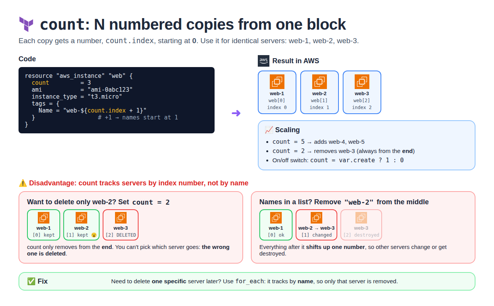

**count** = make **N copies** of the same block. Each copy gets a number: `count.index`
(starts at 0).

```hcl
resource "aws_instance" "web" {
  count         = 3
  ami           = "ami-0abc123"
  instance_type = "t3.micro"
  tags = {
    Name = "web-${count.index + 1}"    # +1 so names start from 1
  }
}
```

| Terraform address     | count.index | Name tag |
| --------------------- | ----------- | -------- |
| `aws_instance.web[0]` | 0           | web-1    |
| `aws_instance.web[1]` | 1           | web-2    |
| `aws_instance.web[2]` | 2           | web-3    |

**Scale:** `count = 5` → adds web-4, web-5. `count = 2` → removes web-3 (always from the **end**).

### Disadvantage of count (deleting one server is not safe)

count tracks servers by **index number** (`[0]`, `[1]`, `[2]`), **not by name**. So you can't safely
delete one specific server.

**Case 1: you want to delete only web-2 → you set `count = 2`**

| Server | Index | Result                     |
| ------ | ----- | -------------------------- |
| web-1  | [0]   | kept                       |
| web-2  | [1]   | kept 😮 (you wanted this gone) |
| web-3  | [2]   | **DELETED** ❌ (wrong server) |

count only removes from the **end**. You can't choose which one.

**Case 2: names come from a list, and you remove `"web-2"` from the middle**

| Index | Before | After                                |
| ----- | ------ | ------------------------------------ |
| [0]   | web-1  | web-1 ✅                             |
| [1]   | web-2  | **web-3** ❌ (this server is changed) |
| [2]   | web-3  | **destroyed** ❌                     |

Everything after the removed item **shifts up one number** → other servers change or get destroyed.

> **Fix:** if you'll ever need to delete **one specific** server, use **`for_each`**. It tracks by
> **name**, so removing one deletes **only that one**.

## for_each — named resources

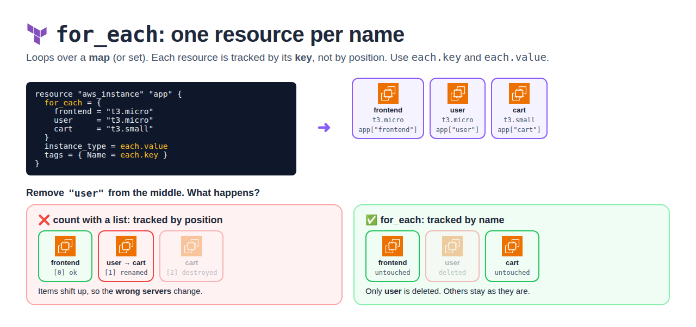

**for_each** = loop over a **map** (or set). Each resource is tracked by its **name (key)**.
Use `each.key` and `each.value`.

```hcl
resource "aws_instance" "app" {
  for_each = {
    frontend = "t3.micro"
    user     = "t3.micro"
    cart     = "t3.small"
  }
  ami           = "ami-0abc123"
  instance_type = each.value            # t3.micro / t3.small
  tags = {
    Name = each.key                     # frontend / user / cart
  }
}
```

| Terraform address              | each.key | each.value |
| ------------------------------ | -------- | ---------- |
| `aws_instance.app["frontend"]` | frontend | t3.micro   |
| `aws_instance.app["user"]`     | user     | t3.micro   |
| `aws_instance.app["cart"]`     | cart     | t3.small   |

### for_each with a list of names: `toset()`

`for_each` accepts only a **map** or a **set**, not a list → wrap the list in `toset()`.

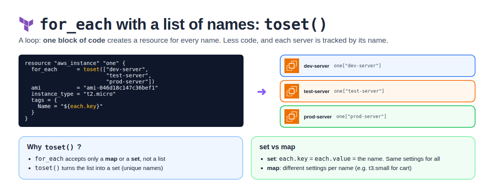

```hcl
resource "aws_instance" "one" {
  for_each      = toset(["dev-server", "test-server", "prod-server"])
  ami           = "ami-046d18c147c36bef1"
  instance_type = "t2.micro"
  tags = {
    Name = each.key                 # dev-server / test-server / prod-server
  }
}
```

| Input         | `each.key` / `each.value`         | Use when                         |
| ------------- | --------------------------------- | -------------------------------- |
| **set** (`toset`) | both = the name               | Same settings, different names   |
| **map**       | key = name, value = its settings  | Different settings per name      |

## Why not count with a list of names?

You *can*, but it's risky:

```hcl
count = 3
tags  = { Name = ["frontend", "user", "cart"][count.index] }
```

Remove `"user"` from the list:

|     | Before   | After                                  |
| --- | -------- | -------------------------------------- |
| [0] | frontend | frontend ✅                            |
| [1] | user     | **cart** ❌ (user renamed to cart)     |
| [2] | cart     | **destroyed** ❌                       |

count tracks by **position** → items shift → wrong VMs change. for_each tracks by **name** →
removing `user` deletes **only** user.

## count vs for_each

|                        | count                           | for_each                     |
| ---------------------- | ------------------------------- | ---------------------------- |
| **Input**              | A number                        | A map or set of strings      |
| **Tracked by**         | Index `[0]`, `[1]`              | Key `["user"]`               |
| **Access**             | `count.index`                   | `each.key`, `each.value`     |
| **Remove from middle** | ❌ Others shift → recreated     | ✅ Only that one is removed  |
| **Best for**           | Identical copies (web-1, web-2) | Different names / settings   |
| **On / off switch**    | ✅ `count = var.create ? 1 : 0` | —                            |

| Question                                       | Use                          |
| ---------------------------------------------- | ---------------------------- |
| Identical VMs, only number in the name?        | `count`                      |
| Each VM has its own name / settings?           | `for_each`                   |
| Will you remove items from the middle later?   | `for_each`                   |
| Create a resource only if a flag is true?      | `count = var.create ? 1 : 0` |

## Parallelism

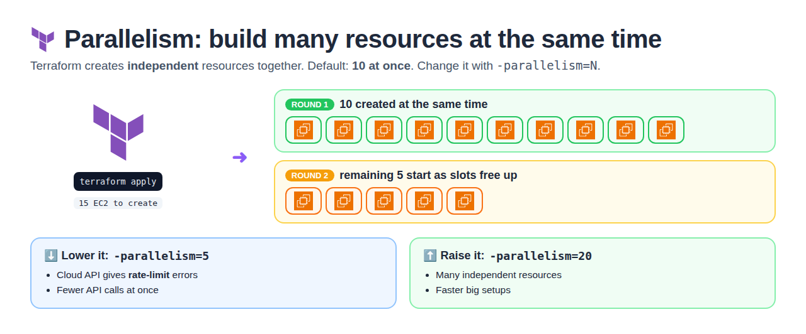

Terraform creates **independent** resources **at the same time** — by default **10 at once**.

```bash
terraform apply -parallelism=5     # max 5 at a time (fewer API calls)
terraform apply -parallelism=20    # faster for big setups
terraform apply -auto-approve -parallelism=15   # -auto-approve = skip the "yes" prompt
```

| Use lower value           | Use higher value            |
| ------------------------- | --------------------------- |
| Cloud API rate-limit errors | Many independent resources |

## Current vs Desired Infrastructure

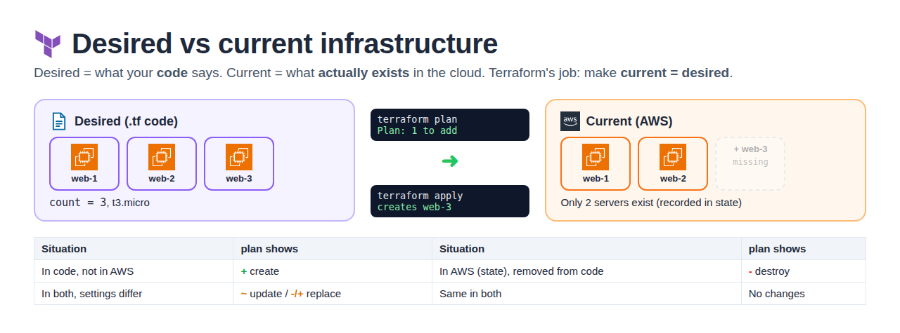

| Term                       | Meaning                                         | Where it lives                |
| -------------------------- | ----------------------------------------------- | ----------------------------- |
| **Desired** infrastructure | What you **want** — written in your code        | `.tf` files                   |
| **Current** infrastructure | What **actually exists** right now in the cloud | AWS (recorded in state file)  |

Terraform's job = make **current = desired**.

```
Desired (.tf code)          Current (AWS)
3 servers, t3.micro   vs    2 servers, t3.micro
            │
     terraform plan   → "1 to add"   (shows the difference)
     terraform apply  → creates 1    (now current = desired)
```

| Situation                          | What `plan` shows      |
| ---------------------------------- | ---------------------- |
| In code, not in AWS                | `+` create             |
| In both, but settings differ       | `~` update / `-/+` replace |
| In AWS (state), removed from code  | `-` destroy            |
| Same in both                       | `No changes`           |

> **Drift** (below) = current changed **outside** Terraform, so it no longer matches desired.

## Terraform Drift

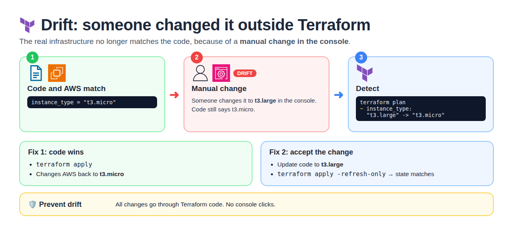

**Drift** = real infrastructure is **different** from what Terraform knows (state/code), because
someone **changed it by hand** in the console.

```
Code says: t3.micro   ──►   Someone changes it in console to t3.large   ──►   DRIFT
```

| Step       | Command                            | What it does                                   |
| ---------- | ---------------------------------- | ---------------------------------------------- |
| **Detect** | `terraform plan`                   | Shows the difference                           |
| **Fix (code wins)** | `terraform apply`         | Changes infra back to match the code           |
| **Accept change** | Update the code, then `terraform apply -refresh-only` | Code + state now match the manual change |

> **Prevent drift:** all changes through Terraform, no console clicks.

## depends_on

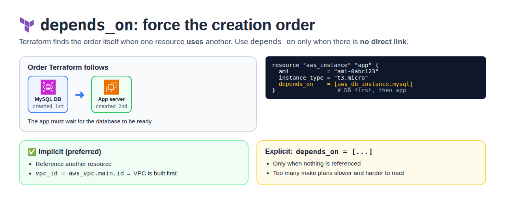

Terraform finds the order **automatically** when one resource **uses** another (e.g. `vpc_id =
aws_vpc.main.id`). **depends_on** = force an order when there is **no direct link**.

```hcl
resource "aws_instance" "app" {
  ami           = "ami-0abc123"
  instance_type = "t3.micro"
  depends_on    = [aws_db_instance.mysql]   # create DB first, then app
}
```

| Type     | How                        |
| -------- | -------------------------- |
| Implicit | Referencing another resource (preferred) |
| Explicit | `depends_on = [...]` (only when needed)  |

## Lifecycle Rules

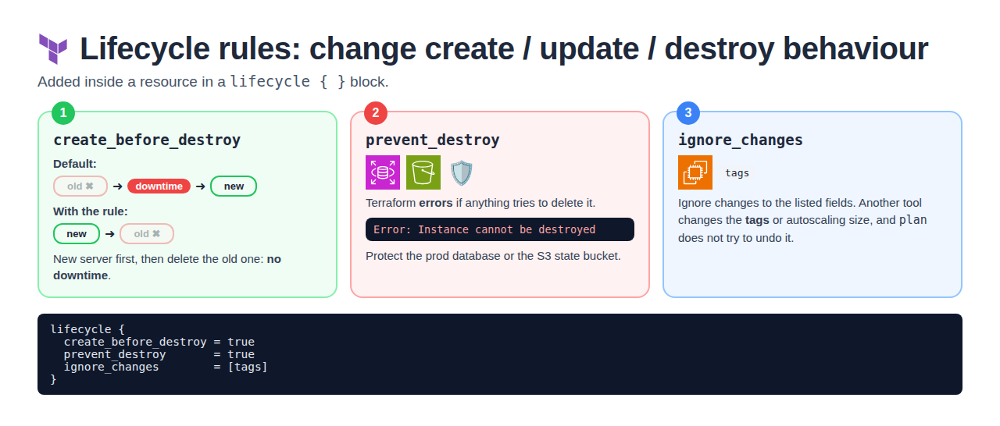

Change Terraform's **default** create / update / destroy behaviour.

| Rule                        | What it does                                               | Use case                                 |
| --------------------------- | ---------------------------------------------------------- | ---------------------------------------- |
| `create_before_destroy`     | Build the **new** one first, then delete the old one       | No downtime when replacing a server      |
| `prevent_destroy`           | Terraform **errors** if anything tries to delete it        | Protect prod database, S3 state bucket   |
| `ignore_changes`            | Ignore changes to listed attributes                        | Tags changed by another tool, autoscaling size |

```hcl
resource "aws_instance" "web" {
  ami           = "ami-0abc123"
  instance_type = "t3.micro"

  lifecycle {
    create_before_destroy = true
    prevent_destroy       = true
    ignore_changes        = [tags]
  }
}
```

```
Default:               destroy old ──► create new     (downtime)
create_before_destroy: create new  ──► destroy old    (no downtime)
```

### create_before_destroy in action (change the AMI)

Change the **AMI** of a running server → Terraform must **replace** it. Run `terraform apply` and
watch the order.

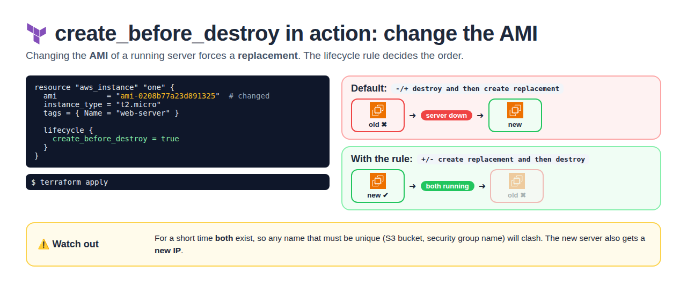

```hcl
resource "aws_instance" "one" {
  ami           = "ami-0208b77a23d891325"   # changed AMI → forces replacement
  instance_type = "t2.micro"
  tags = { Name = "web-server" }

  lifecycle {
    create_before_destroy = true
  }
}
```

| Plan shows                                   | Meaning                          |
| -------------------------------------------- | -------------------------------- |
| `-/+ destroy and then create replacement`    | Default → downtime               |
| `+/- create replacement and then destroy`    | With the rule → no downtime      |

⚠️ For a short time **both** exist → unique names (S3 bucket, SG name) clash. New server = new IP.

## -target (act on one resource only)

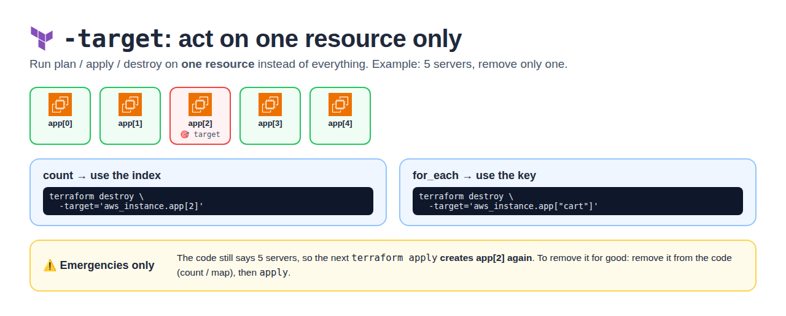

**-target** = run plan / apply / destroy on **one resource** only, not everything.

**Example:** you have 5 VMs and want to remove only one.

```bash
# count  → use the index
terraform destroy -target='aws_instance.app[2]'

# for_each → use the key
terraform destroy -target='aws_instance.app["cart"]'
```

⚠️ Use for emergencies / testing only. If the code still has 5 VMs, the next `apply` creates it
**again**. To remove it permanently → remove it from the code (count / map) and `apply`.

## Interview One-Liners (Part 2)

- **Disadvantage of count?** It tracks by index, so deleting one server isn't safe: `count = 2` removes the last one, and removing from the middle of a list shifts the rest. Use for_each to delete a specific one.
- **count vs for_each?** count for identical copies like web-1 to web-3; for_each for named resources with different settings like frontend, user, cart. for_each is tracked by key, so removing one doesn't shift or recreate the others.
- **Current vs desired?** Desired = what the code says; current = what exists in the cloud. `plan` shows the difference, `apply` makes current match desired.
- **Parallelism** = Terraform builds independent resources at the same time, 10 by default (`-parallelism=N`).
- **Drift** = real infra changed outside Terraform; `terraform plan` detects it.
- **depends_on** = force creation order when there's no direct reference.
- **create_before_destroy** = replace with no downtime. **prevent_destroy** = protect critical resources. **ignore_changes** = don't fight changes made outside Terraform.
- **-target** = act on one resource; for exceptions, not daily use.
