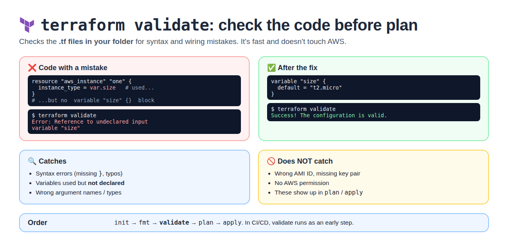
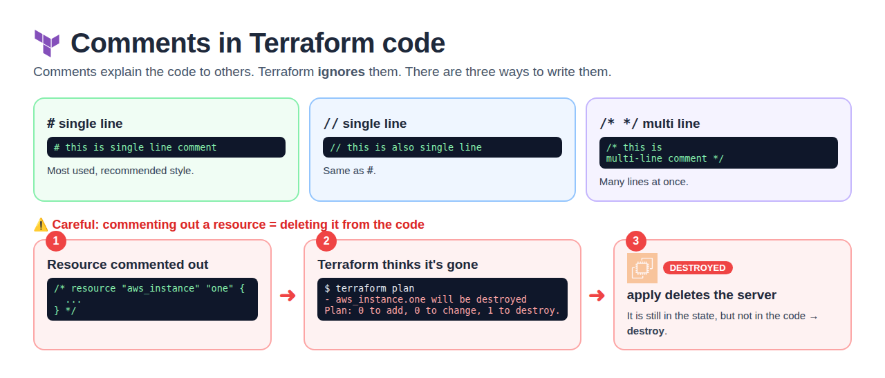
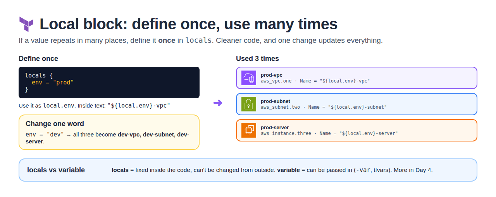
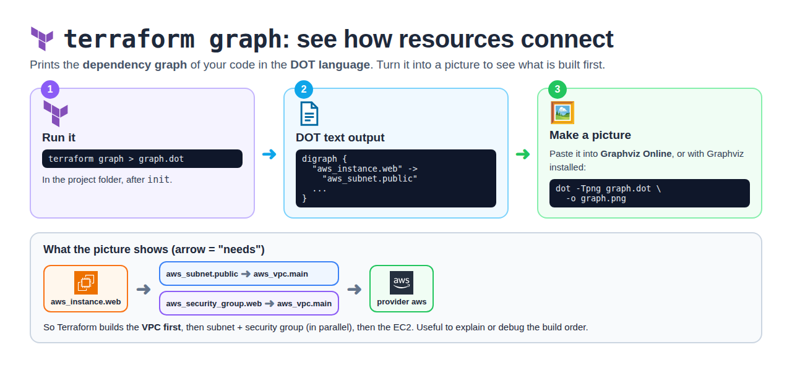

# Day 3 — Taint, Saved Plans, Import & Debugging

[← All notes](../README.md)

## Table of Contents

1. [Quick Definitions](#quick-definitions)
2. [terraform taint (replace a resource)](#terraform-taint-replace-a-resource)
3. [terraform validate](#terraform-validate)
4. [terraform plan -out (saved plan)](#terraform-plan--out-saved-plan)
5. [terraform import](#terraform-import)
6. [Terraform Debugging](#terraform-debugging)
7. [Code Comments](#code-comments)
8. [Local Block](#local-block)
9. [Terraform Block & Providers](#terraform-block--providers)
10. [terraform graph](#terraform-graph)
11. [Interview One-Liners](#interview-one-liners)

## Quick Definitions

**terraform taint** = mark a resource as **broken** so the next `apply` **recreates** it.
- Deprecated → new way: `terraform apply -replace="aws_instance.web"`.
- **Use when:** a server is running but broken inside and needs a fresh rebuild.

**terraform validate** = **checks the .tf files** for syntax mistakes and undeclared variables, without touching AWS.
- **Use when:** before `plan`, and as an early CI/CD step.

**terraform plan -out** = **save the plan to a file**, then apply exactly that plan.
- `terraform plan -out dev` → `terraform apply dev`.
- **Use when:** CI/CD — plan, get approval, apply exactly what was reviewed.

**terraform import** = bring an **existing resource** (made in the console) **under Terraform control**.
- Old: `terraform import aws_instance.web i-0abc123`. New: `import {}` block (can generate the code).

**Comments** = notes in code that Terraform ignores: `#` and `//` (single line), `/* */` (multi line).
- ⚠️ Commenting out a resource = removing it from code → next `apply` **destroys** it.

**Local block** = define a repeating value **once** (`locals { env = "prod" }`), use it many times as `local.env`.

**terraform block** = Terraform's own settings: `required_version`, `required_providers`, `backend` (see Day 1).

**terraform graph** = show **which resource depends on which**, as a DOT graph.
- `terraform graph > graph.dot` → view in Graphviz.

**Terraform debugging** = turn on **detailed logs** with `TF_LOG`.
- Levels: TRACE, DEBUG, INFO, WARN, ERROR. Save to a file with `TF_LOG_PATH`.

## terraform taint (replace a resource)


**Taint** = mark a resource as **broken** so the next `apply` **destroys and recreates** it — even
though the code didn't change.

**Use case:** in real time a resource sometimes **fails to create properly**, or is running but
broken inside (bad config, crashed app) → rebuild it fresh.

```bash
# 1. Find the resource address
terraform state list                         # aws_instance.one[0], aws_instance.one[1]

# Old way (deprecated)
terraform taint aws_instance.one[0]          # mark for recreation
terraform apply -auto-approve                # recreates one[0]
terraform untaint aws_instance.one[0]        # undo the mark (if you change your mind)

# New way (Terraform 0.15.2+) — one step, shows it in the plan first
terraform apply -auto-approve -replace="aws_instance.one[0]"
```

`-auto-approve` = skip the "yes" prompt. Only `one[0]` is rebuilt; `one[1]` is not touched.

| Old (`taint`)                         | New (`-replace`)                         |
| ------------------------------------- | ---------------------------------------- |
| Changes state immediately             | Nothing changes until you approve apply  |
| Teammates may get surprised           | Visible in the plan                      |
| Deprecated                            | ✅ Recommended                            |

## terraform validate



**validate** = checks the **configuration files in your working directory** for mistakes. Fast,
and it does **not** talk to AWS.

```bash
terraform validate
# Error: Reference to undeclared input variable "size"   ← used var.size, no variable block
# Success! The configuration is valid.                    ← after adding variable "size" {}
```

| Catches                                   | Does NOT catch (shows in plan / apply) |
| ----------------------------------------- | -------------------------------------- |
| Syntax errors (missing `}`, typos)        | Wrong AMI ID, missing key pair         |
| Variables used but **not declared**       | No AWS permission                      |
| Wrong argument names / types              | Limits / quotas in AWS                 |

**Order:** `init` → `fmt` → `validate` → `plan` → `apply`.

## terraform plan -out (saved plan)


**plan -out** = save the plan to a **file**, then apply **exactly** that plan — nothing more,
nothing less.

```bash
terraform plan -out dev       # save plan to file "dev" (any name, e.g. ec2)
terraform show dev            # review it
terraform apply dev           # apply exactly what was reviewed (no "yes" prompt)
```

```
plan -out dev  ──►  review / approve  ──►  apply dev
```

| Why use it                                            |
| ----------------------------------------------------- |
| What you reviewed = what gets applied                 |
| Used in **CI/CD**: plan job → approval → apply job    |
| No new surprises if code / infra changed in between   |

⚠️ The plan file can contain secrets → don't commit it to Git.

## terraform import


**Import** = bring an **existing** resource (created by hand in the console) **under Terraform
control**, by adding it to the state.

```
EC2 made in console  ──► terraform import ──► now in state ──► managed by Terraform
```

**Old way (CLI)** — write the resource block first, then import:
```hcl
resource "aws_instance" "web" {
  # fill in to match the real server
}
```
```bash
terraform import aws_instance.web i-0abc123456
terraform plan    # adjust code until plan shows "No changes"
```

**New way (import block, Terraform 1.5+)** — Terraform can **write the code for you**:
```hcl
import {
  to = aws_instance.web
  id = "i-0abc123456"
}
```
```bash
terraform plan -generate-config-out=generated.tf   # code generated
terraform apply                                    # imported
```

| CLI `terraform import`              | `import` block                     |
| ----------------------------------- | ---------------------------------- |
| One resource at a time              | Many, reviewed in plan             |
| You write the code by hand          | Can generate the code              |
| Changes state immediately           | Happens on apply (safer)           |

## Terraform Debugging


Turn on **detailed logs** with the `TF_LOG` environment variable.

| Level   | Shows                                 |
| ------- | ------------------------------------- |
| `TRACE` | Everything (most detail)              |
| `DEBUG` | Detailed internal steps               |
| `INFO`  | General info                          |
| `WARN`  | Warnings                              |
| `ERROR` | Errors only                           |

```bash
export TF_LOG=DEBUG
export TF_LOG_PATH=./terraform.log    # save logs to a file
terraform apply

unset TF_LOG TF_LOG_PATH              # turn logs off
```

**Windows (PowerShell)**
```powershell
$env:TF_LOG="TRACE"
$env:TF_LOG_PATH="logs.txt"
terraform init
terraform plan
```

| Set                         | Logs go to             |
| --------------------------- | ---------------------- |
| Only `TF_LOG`               | Screen                 |
| `TF_LOG` + `TF_LOG_PATH`    | File (`logs.txt`)      |

**Other helpful commands**

| Command              | Use                                        |
| -------------------- | ------------------------------------------ |
| `terraform validate` | Check syntax / config errors               |
| `terraform fmt`      | Fix formatting                             |
| `terraform console`  | Test expressions, e.g. `local.name`        |

## Code Comments



**Comments** = notes to help others understand the code. Terraform **ignores** them.

```hcl
# this is single line comment

// this is also single line comment

/* this is
multi-line comment */
```

| Syntax   | Type         |
| -------- | ------------ |
| `#`      | Single line (most used) |
| `//`     | Single line  |
| `/* */`  | Multi line   |

⚠️ **Comment out a resource block = remove it from the code.** It's still in the state but not in
the code → `plan` shows **1 to destroy** → `apply` **deletes** the real server.

## Local Block



**locals** = define a value **once** and use it **many times**. Cleaner code; one change updates
everything.

```hcl
locals {
  env = "prod"
}

resource "aws_vpc" "one" {
  cidr_block = "10.0.0.0/16"
  tags = { Name = "${local.env}-vpc" }          # prod-vpc
}

resource "aws_subnet" "two" {
  vpc_id     = aws_vpc.one.id
  cidr_block = "10.0.0.0/24"
  tags = { Name = "${local.env}-subnet" }       # prod-subnet
}

resource "aws_instance" "three" {
  subnet_id     = aws_subnet.two.id
  ami           = "ami-0abc123"
  instance_type = "t2.micro"
  tags = { Name = "${local.env}-server" }       # prod-server
}
```

Change `env = "dev"` → dev-vpc, dev-subnet, dev-server. Full details (variables vs locals) in
[Day 4](../day-4-variables/README.md#locals).

## Terraform Block & Providers

**terraform block** = Terraform's own settings (version, providers, backend). Full notes in
[Day 1](../day-1-intro/README.md#terraform-block--version).


```hcl
terraform {
  required_version = ">= 1.8.0"
}
```

Check version: `terraform -v` · `terraform version` · `terraform -version` · `terraform --version`

**Multiple providers** can be installed at once; `terraform init -upgrade` moves to the newest
versions the rules allow.


## terraform graph

**terraform graph** = prints the **dependency graph** of your code (which resource needs which) in
the **DOT language**.



```bash
terraform graph > graph.dot                 # run in the project folder (after init)
dot -Tpng graph.dot -o graph.png            # make a picture (needs Graphviz installed)
```

No Graphviz? Paste the output into **Graphviz Online** in the browser.

```
aws_instance.web ──► aws_subnet.public ──► aws_vpc.main
                 └─► aws_security_group.web ──► aws_vpc.main
```
→ VPC is built first, then subnet + SG (in parallel), then the EC2.

## Interview One-Liners

- **taint** = force recreate a resource; deprecated → use `terraform apply -replace=<address>`.
- **plan -out** = save the plan and apply exactly that; standard in CI/CD with approval.
- **import** = bring hand-made resources under Terraform; import block (1.5+) can generate the code.
- **validate** = checks syntax and undeclared variables before plan; doesn't touch AWS.
- **Comments** = `#`, `//`, `/* */`; commenting out a resource makes Terraform destroy it.
- **locals** = define once, reuse; can't be set from outside (unlike variables).
- **terraform graph** = dependency graph in DOT format; view it with Graphviz.
- **Debugging** = `TF_LOG=DEBUG` (or TRACE) + `TF_LOG_PATH` to save logs to a file.
