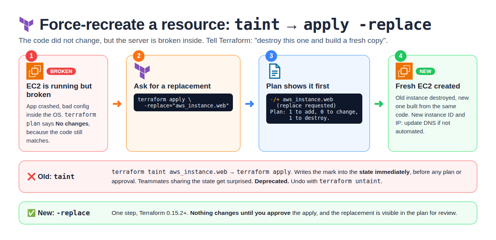
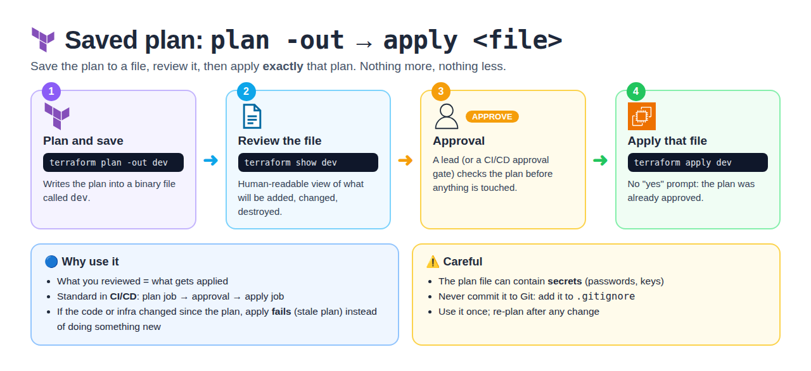
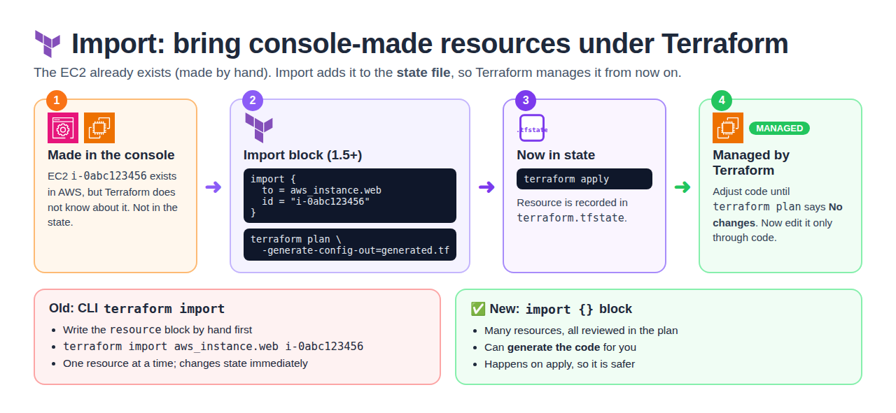
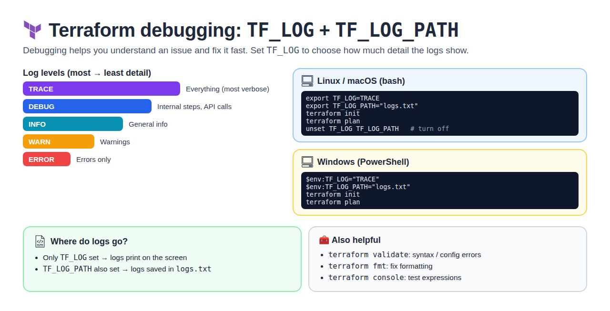

# Day 3 — Taint, Saved Plans, Import & Debugging

[← All notes](../README.md)

## Table of Contents

1. [Quick Definitions](#quick-definitions)
2. [terraform taint (replace a resource)](#terraform-taint-replace-a-resource)
3. [terraform plan -out (saved plan)](#terraform-plan--out-saved-plan)
4. [terraform import](#terraform-import)
5. [Terraform Debugging](#terraform-debugging)
6. [Interview One-Liners](#interview-one-liners)

## Quick Definitions

**terraform taint** = mark a resource as **broken** so the next `apply` **recreates** it.
- Deprecated → new way: `terraform apply -replace="aws_instance.web"`.
- **Use when:** a server is running but broken inside and needs a fresh rebuild.

**terraform plan -out** = **save the plan to a file**, then apply exactly that plan.
- `terraform plan -out dev` → `terraform apply dev`.
- **Use when:** CI/CD — plan, get approval, apply exactly what was reviewed.

**terraform import** = bring an **existing resource** (made in the console) **under Terraform control**.
- Old: `terraform import aws_instance.web i-0abc123`. New: `import {}` block (can generate the code).

**Terraform debugging** = turn on **detailed logs** with `TF_LOG`.
- Levels: TRACE, DEBUG, INFO, WARN, ERROR. Save to a file with `TF_LOG_PATH`.

## terraform taint (replace a resource)



**Taint** = mark a resource as **broken** so the next `apply` **destroys and recreates** it — even
though the code didn't change.

**Use case:** a server is running but broken inside (bad config, crashed app) → rebuild it fresh.

```bash
# Old way (deprecated)
terraform taint aws_instance.web
terraform apply

# Undo the mark
terraform untaint aws_instance.web

# New way (Terraform 0.15.2+) — one step, shows it in the plan first
terraform apply -replace="aws_instance.web"
```

| Old (`taint`)                         | New (`-replace`)                         |
| ------------------------------------- | ---------------------------------------- |
| Changes state immediately             | Nothing changes until you approve apply  |
| Teammates may get surprised           | Visible in the plan                      |
| Deprecated                            | ✅ Recommended                            |

## terraform plan -out (saved plan)



**plan -out** = save the plan to a **file**, then apply **exactly** that plan — nothing more,
nothing less.

```bash
terraform plan -out dev       # save plan to file "dev"
terraform show dev            # review it
terraform apply dev           # apply exactly what was reviewed (no "yes" prompt)
```

```
plan -out dev  ──►  review / approve  ──►  apply dev
```

| Why use it                                            |
| ----------------------------------------------------- |
| What you reviewed = what gets applied                 |
| Used in **CI/CD**: plan job → approval → apply job    |
| No new surprises if code / infra changed in between   |

⚠️ The plan file can contain secrets → don't commit it to Git.

## terraform import



**Import** = bring an **existing** resource (created by hand in the console) **under Terraform
control**, by adding it to the state.

```
EC2 made in console  ──► terraform import ──► now in state ──► managed by Terraform
```

**Old way (CLI)** — write the resource block first, then import:
```hcl
resource "aws_instance" "web" {
  # fill in to match the real server
}
```
```bash
terraform import aws_instance.web i-0abc123456
terraform plan    # adjust code until plan shows "No changes"
```

**New way (import block, Terraform 1.5+)** — Terraform can **write the code for you**:
```hcl
import {
  to = aws_instance.web
  id = "i-0abc123456"
}
```
```bash
terraform plan -generate-config-out=generated.tf   # code generated
terraform apply                                    # imported
```

| CLI `terraform import`              | `import` block                     |
| ----------------------------------- | ---------------------------------- |
| One resource at a time              | Many, reviewed in plan             |
| You write the code by hand          | Can generate the code              |
| Changes state immediately           | Happens on apply (safer)           |

## Terraform Debugging



Turn on **detailed logs** with the `TF_LOG` environment variable.

| Level   | Shows                                 |
| ------- | ------------------------------------- |
| `TRACE` | Everything (most detail)              |
| `DEBUG` | Detailed internal steps               |
| `INFO`  | General info                          |
| `WARN`  | Warnings                              |
| `ERROR` | Errors only                           |

```bash
export TF_LOG=DEBUG
export TF_LOG_PATH=./terraform.log    # save logs to a file
terraform apply

unset TF_LOG TF_LOG_PATH              # turn logs off
```

**Windows (PowerShell)**
```powershell
$env:TF_LOG="TRACE"
$env:TF_LOG_PATH="logs.txt"
terraform init
terraform plan
```

| Set                         | Logs go to             |
| --------------------------- | ---------------------- |
| Only `TF_LOG`               | Screen                 |
| `TF_LOG` + `TF_LOG_PATH`    | File (`logs.txt`)      |

**Other helpful commands**

| Command              | Use                                        |
| -------------------- | ------------------------------------------ |
| `terraform validate` | Check syntax / config errors               |
| `terraform fmt`      | Fix formatting                             |
| `terraform console`  | Test expressions, e.g. `local.name`        |

## Interview One-Liners

- **taint** = force recreate a resource; deprecated → use `terraform apply -replace=<address>`.
- **plan -out** = save the plan and apply exactly that; standard in CI/CD with approval.
- **import** = bring hand-made resources under Terraform; import block (1.5+) can generate the code.
- **Debugging** = `TF_LOG=DEBUG` (or TRACE) + `TF_LOG_PATH` to save logs to a file.
