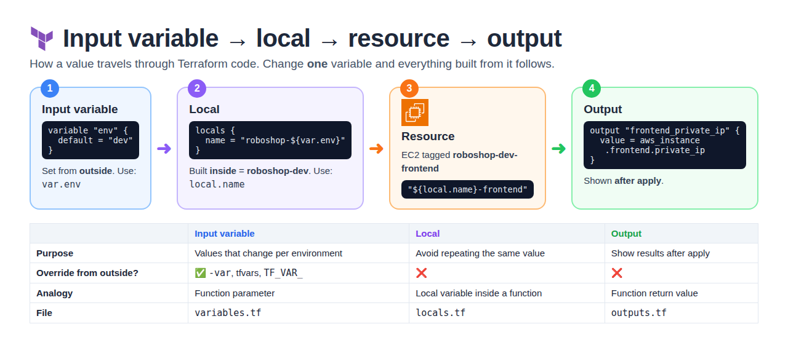
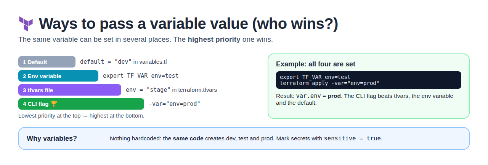
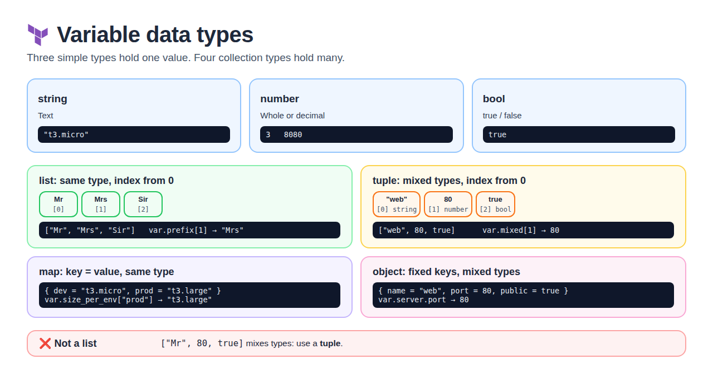
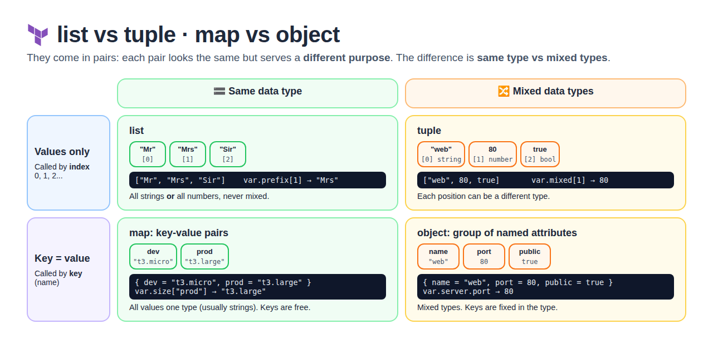
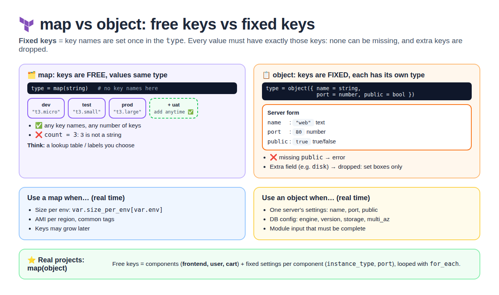
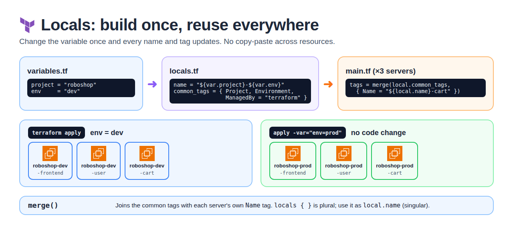
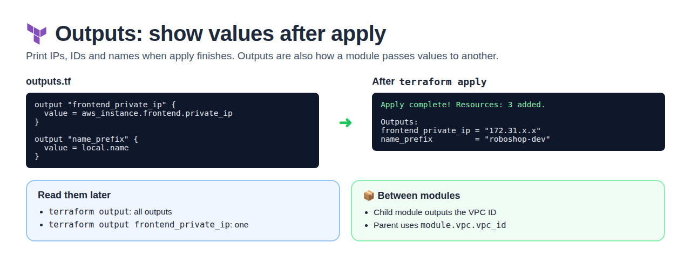

# Day 4 — Terraform Variables, Outputs & Locals

[← All notes](../README.md)

## Table of Contents

1. [Quick Definitions](#quick-definitions)
2. [Overview](#overview)
3. [Input Variable vs Local vs Output](#input-variable-vs-local-vs-output)
4. [Input Variables](#input-variables)
5. [Data Types](#data-types)
6. [Locals](#locals)
7. [Outputs](#outputs)
8. [Syntax Cheat Sheet](#syntax-cheat-sheet)
9. [Interview One-Liners](#interview-one-liners)

## Quick Definitions

**Input variable** = a value **passed in from outside**, so nothing is hardcoded.
- Same code → different environments (dev / prod).

**Local** = a value **built inside the code**, usually from variables, reused many times.
- Can't be changed from outside.

**Output** = a value Terraform **shows after apply** (IP, ID).
- Also how modules pass values to each other.

## Overview

| Term               | Simple meaning                                               | Reference          |
| ------------------ | ------------------------------------------------------------ | ------------------ |
| **Input variable** | A value that **changes** (dev / prod), set from **outside**  | `var.env`          |
| **Local**          | A value you **build once and reuse**, usually from variables | `local.name`       |
| **Output**         | A value Terraform **shows after apply** (IP, ID)             | `terraform output` |

```
env = dev  ──►  local.name = roboshop-dev  ──►  roboshop-dev-frontend  ──►  output: private IP
(variable)        (local)                         (resource)                   (output)
```

## Input Variable vs Local vs Output



|                    | Input variable                          | Local                              | Output                          |
| ------------------ | --------------------------------------- | ---------------------------------- | ------------------------------- |
| **Purpose**        | Values that change per environment      | Avoid repeating the same value     | Show results after apply        |
| **Who sets it**    | Caller / user (from outside)            | The code itself (inside)           | The code itself                 |
| **Can override?**  | ✅ `-var`, tfvars, `TF_VAR_`            | ❌                                 | ❌                              |
| **Keyword**        | `variable "env" {}`                     | `locals { }` (plural)              | `output "ip" {}`                |
| **Reference**      | `var.env`                               | `local.name` (singular)            | `terraform output ip`           |
| **File**           | `variables.tf`                          | `locals.tf`                        | `outputs.tf`                    |
| **Analogy**        | Function parameter                      | Local variable inside function     | Function return value           |

**When to use what**

| Ask yourself                                  | Use      |
| --------------------------------------------- | -------- |
| Will this value change per environment?       | Variable |
| Am I typing the same thing again and again?   | Local    |
| Do I need to see / share a result after apply? | Output   |

## Input Variables



A value passed **into** Terraform so nothing is hardcoded. Same code → dev, test, prod.

```hcl
variable "env" {
  description = "Environment name"
  type        = string
  default     = "dev"
}
```

**Ways to pass the value** (lowest → highest priority)

| Way          | Example                            |
| ------------ | ---------------------------------- |
| Default      | `default = "dev"`                  |
| Env variable | `export TF_VAR_env=prod`           |
| tfvars file  | `env = "prod"` in `terraform.tfvars` |
| CLI flag     | `terraform apply -var="env=prod"`  |

## Data Types



| Type       | Short description                           | Example                                   |
| ---------- | ------------------------------------------- | ----------------------------------------- |
| **string** | Text                                        | `"t3.micro"`                              |
| **number** | Whole or decimal number                     | `3`, `8080`                               |
| **bool**   | true / false                                | `true`                                    |
| **list**   | Collection of values, **same type only** (all strings or all numbers), index from 0 | `["frontend", "user", "cart"]` or `[80, 443, 8080]` |
| **map**    | Key = value pairs, **same type** values     | `{ dev = "t3.micro", prod = "t3.large" }` |
| **object** | Key = value pairs, **different types**, fixed keys | `{ name = "web", port = 80, public = true }` |
| **tuple**  | Collection of values, **different types allowed** (string, number, bool together), index from 0 | `["web", 80, true]` |

### List

A **list** is an ordered collection of values where each element can be accessed by its **index
(starting at 0)**. All values in a list must be of the **same type** — either all strings, all
numbers, or all booleans, but **not mixed**.

For example, consider a variable that uses a list of prefixes:

```hcl
variable "prefix" {
  type    = list(string)
  default = ["Mr", "Mrs", "Sir"]
}
```

| Index | Value | Access            |
| ----- | ----- | ----------------- |
| 0     | Mr    | `var.prefix[0]`   |
| 1     | Mrs   | `var.prefix[1]`   |
| 2     | Sir   | `var.prefix[2]`   |

```hcl
["Mr", "Mrs", "Sir"]   # ✅ all strings
[80, 443, 8080]        # ✅ all numbers
["Mr", 80, true]       # ❌ mixed types → not a list (use a tuple)
```

### List vs Tuple

List and tuple **look the same** (values in `[ ]`, called by index), but they serve a **different
purpose**.

|                    | list                                              | tuple                                              |
| ------------------ | ------------------------------------------------- | -------------------------------------------------- |
| **What we pass**   | **Values only** (no keys)                         | **Values only** (no keys)                          |
| **Data types**     | **Same type** only: all strings, or all numbers    | **Different types** mixed: string, number, bool    |
| **How we call it** | By **index number** 0, 1, 2 → `var.prefix[1]`     | By **index number** 0, 1, 2 → `var.mixed[1]`       |
| **Example**        | `["Mr", "Mrs", "Sir"]`                            | `["web", 80, true]`                                |
| **Type syntax**    | `list(string)`                                    | `tuple([string, number, bool])`                    |

### Collection Types at a Glance



|                       | Same data type | Mixed data types |
| --------------------- | -------------- | ---------------- |
| **Values only** (index 0, 1, 2) | **list**  | **tuple**        |
| **Key = value** (call by key)   | **map**   | **object**       |

**Map vs Object**: also look the same (key = value in `{ }`), but serve a different purpose.

|                    | map                                               | object                                             |
| ------------------ | ------------------------------------------------- | -------------------------------------------------- |
| **What we pass**   | **Keys and values** both                          | **Keys and values** both                           |
| **What it is**     | **Key-value pairs**                               | **Group of named attributes**                      |
| **Data types**     | All values **same type** (usually strings)        | **Mixed**: string, number, bool together           |
| **Keys**           | Free: any names                                   | Fixed: set in the type                             |
| **How we call it** | By key → `var.size["prod"]`                       | By attribute → `var.server.port`                   |
| **Example**        | `{ dev = "t3.micro", prod = "t3.large" }`         | `{ name = "web", port = 80, public = true }`       |

> **Remember:** list / tuple = **values only**, called by **index**. map / object = **key and
> value**, called by **key**. In each pair: first one = **same type**, second one = **mixed types**.

### Map vs Object (what are "fixed keys"?)



**Fixed keys** = the key names are decided **once, in the variable's `type`**, and every value
must use **exactly** those names.

Think of an object like a **form with set fields**: you fill in the boxes, but you **can't remove
a box or add a new one**.

```
Server form
  name   : ______   (text)
  port   : ______   (number)
  public : ______   (true/false)
```

**Object: keys are fixed**
```hcl
variable "server" {
  type = object({
    name   = string     # key 1 is fixed
    port   = number     # key 2 is fixed
    public = bool       # key 3 is fixed
  })
}

server = { name = "web", port = 80, public = true }   # ✅ correct
server = { name = "web", port = 80 }                  # ❌ error: "public" is missing
server = { name = "web", port = 80, public = true, disk = 20 }  # ⚠️ "disk" is dropped (not in the type)
```

**Map: keys are free** (any names, any number), but all values are the **same type**
```hcl
variable "size_per_env" {
  type = map(string)          # no key names written here
}

size_per_env = { dev = "t3.micro" }                                       # ✅
size_per_env = { dev = "t3.micro", test = "t3.small", prod = "t3.large" } # ✅ added new keys
size_per_env = { dev = "t3.micro", count = 3 }                            # ❌ 3 is not a string
```

|                 | map                                  | object                               |
| --------------- | ------------------------------------ | ------------------------------------ |
| **Keys**        | Free: any names, any number          | **Fixed**: only names in the `type`  |
| **Value types** | All the same                         | Each key can have its own type       |
| **Think of it** | A lookup table / list of labels      | A form with set fields (one record)  |

**When to use which (real time)**

| Use a **map** when…                                          | Real-time example                                           |
| ------------------------------------------------------------ | ----------------------------------------------------------- |
| You **look up** a value by a name                            | Instance size per env: `var.size_per_env[var.env]`          |
| Keys can **grow** (new env, new region)                      | AMI per region: `{ us-east-1 = "ami-..", us-west-2 = "ami-.." }` |
| Every value is the same kind                                 | Common tags: `{ Project = "roboshop", Env = "dev" }`        |

| Use an **object** when…                                      | Real-time example                                           |
| ------------------------------------------------------------ | ----------------------------------------------------------- |
| One thing has **several different settings**                 | One server: name (string), port (number), public (bool)     |
| You want Terraform to **check** all settings are given       | DB config: engine, version, storage, multi_az               |
| A module needs a **structured input**                        | VPC module input: cidr, azs, enable_nat                     |

**Most common in real projects: map of objects** = free keys (component names) + fixed settings
for each one. Used with `for_each`:

```hcl
variable "components" {
  type = map(object({
    instance_type = string
    port          = number
  }))
  default = {
    frontend = { instance_type = "t3.micro", port = 80 }
    user     = { instance_type = "t3.micro", port = 8080 }
    cart     = { instance_type = "t3.small", port = 8080 }
  }
}

resource "aws_instance" "app" {
  for_each      = var.components          # keys: frontend, user, cart (free → add more anytime)
  instance_type = each.value.instance_type  # object fields (fixed → must be given)
  tags          = { Name = each.key }
}
```

> **One-liner:** "A map is a lookup table: any keys, one value type. An object is a fixed
> structure: set keys, each with its own type. In real projects I use a map of objects with
> for_each: one entry per component, each with the same set of settings."

```hcl
variable "instance_type" {
  type    = string
  default = "t3.micro"
}

variable "instance_count" {
  type    = number
  default = 3
}

variable "enable_monitor" {
  type    = bool
  default = true
}

variable "components" {
  type    = list(string)
  default = ["frontend", "user", "cart"]
}

variable "size_per_env" {
  type    = map(string)
  default = { dev = "t3.micro", prod = "t3.large" }
}

variable "server" {
  type    = object({ name = string, port = number, public = bool })
  default = { name = "web", port = 80, public = true }
}

variable "mixed" {
  type    = tuple([string, number, bool])
  default = ["web", 80, true]
}
```

**Access values**

| Type   | Syntax                       | Result     |
| ------ | ---------------------------- | ---------- |
| list   | `var.components[0]`          | `frontend` |
| map    | `var.size_per_env["prod"]`   | `t3.large` |
| object | `var.server.port`            | `80`       |
| tuple  | `var.mixed[1]`               | `80`       |

## Locals



A value built **inside** the code, used many times. Change the variable once → every local and
resource updates automatically.

**variables.tf** — values that change
```hcl
variable "project" { default = "roboshop" }
variable "env"     { default = "dev" }
```

**locals.tf** — build once
```hcl
locals {
  name = "${var.project}-${var.env}"     # roboshop-dev

  common_tags = {
    Project     = var.project
    Environment = var.env
    ManagedBy   = "terraform"
  }
}
```

**main.tf** — reuse many times
```hcl
resource "aws_instance" "frontend" {
  ami           = "ami-0abc123"
  instance_type = "t3.micro"
  tags          = merge(local.common_tags, { Name = "${local.name}-frontend" })
}

resource "aws_instance" "user" {
  ami           = "ami-0abc123"
  instance_type = "t3.micro"
  tags          = merge(local.common_tags, { Name = "${local.name}-user" })
}

resource "aws_instance" "cart" {
  ami           = "ami-0abc123"
  instance_type = "t3.micro"
  tags          = merge(local.common_tags, { Name = "${local.name}-cart" })
}
```

`merge()` = joins the common tags with each server's own `Name` tag.

```bash
terraform apply                    # dev
terraform apply -var="env=prod"    # prod — no code change
```

| env  | local.name    | Servers created                                              |
| ---- | ------------- | ------------------------------------------------------------ |
| dev  | roboshop-dev  | roboshop-dev-frontend, roboshop-dev-user, roboshop-dev-cart    |
| prod | roboshop-prod | roboshop-prod-frontend, roboshop-prod-user, roboshop-prod-cart |

## Outputs



Shows values **after apply** — IPs, IDs, names. Also how modules pass values to each other.

**outputs.tf**
```hcl
output "frontend_private_ip" {
  value = aws_instance.frontend.private_ip
}

output "name_prefix" {
  value = local.name
}
```

```bash
terraform output                       # all outputs
terraform output frontend_private_ip   # one output
```

## Syntax Cheat Sheet

| Where            | Write                    |
| ---------------- | ------------------------ |
| Directly         | `var.env`                |
| Inside a string  | `"roboshop-${var.env}"`  |
| Locals block     | `locals { }` → `local.name` |
| Secret value     | `sensitive = true`       |

## Interview One-Liners

- **Input variable** = a value that changes, passed from outside, so the same code works for dev and prod.
- **Local** = a value built inside the code, usually from variables, so I don't repeat myself. It can't be set from outside.
- **Output** = a value shown after apply (IP, ID); also how a child module passes values to its parent.
- **Variable vs local?** "Variables are for values that change. Locals are for values I build inside the code to avoid repetition."
- **map vs object?** Map = all values same type. Object = fixed keys, values can be different types.
- **list vs tuple?** List = all items same type. Tuple = items can be different types.
