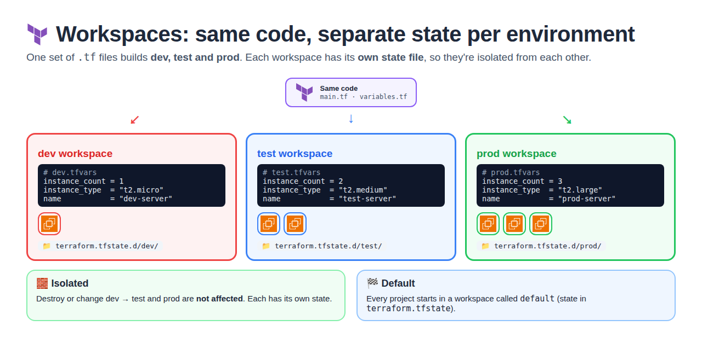

# Day 5 — Terraform Workspaces

[← All notes](../README.md)

## Table of Contents

1. [Quick Definitions](#quick-definitions)
2. [What are Workspaces?](#what-are-workspaces)
3. [Example: dev, test, prod](#example-dev-test-prod)
4. [Workspace Commands](#workspace-commands)
5. [Where the State Lives](#where-the-state-lives)
6. [terraform.workspace](#terraformworkspace)
7. [Real-Time Tips](#real-time-tips)
8. [Interview One-Liners](#interview-one-liners)

## Quick Definitions

**Workspace** = a separate **state file** for the **same Terraform code**.
- One code → many environments (dev, test, prod), each with its own state.
- **Use when:** you need similar copies of the same infra for different environments.

**default workspace** = the workspace every project starts in, called `default`.

**Isolated** = resources in one workspace **don't affect** other workspaces (separate state).

**terraform.tfstate.d/** = folder where each workspace's state is kept (local backend).

**terraform.workspace** = built-in value with the **current workspace name** (`dev`, `prod`).

## What are Workspaces?



**Workspaces** = maintain **multiple environments** (development, testing, production) using the
**same Terraform configuration** but with **different state files**.

```
                 same code (main.tf)
          ┌──────────────┼──────────────┐
     dev workspace   test workspace   prod workspace
     dev state       test state       prod state
     DEV INFRA       TEST INFRA       PROD INFRA
```

| Point                     | Meaning                                                    |
| ------------------------- | ---------------------------------------------------------- |
| Same code                 | No copy-paste of `.tf` files per environment               |
| Own state file            | Each workspace has its own state (`terraform.tfstate.d/`)  |
| Isolated                  | Destroy dev → test and prod are **not affected**           |
| Default                   | Every project starts in the `default` workspace            |

## Example: dev, test, prod

Same code; only the **values** change per environment, through a tfvars file.

| Workspace | tfvars file   | count | type        | name         | State folder                  |
| --------- | ------------- | ----- | ----------- | ------------ | ----------------------------- |
| **dev**   | `dev.tfvars`  | 1     | `t2.micro`  | dev-server   | `terraform.tfstate.d/dev/`    |
| **test**  | `test.tfvars` | 2     | `t2.medium` | test-server  | `terraform.tfstate.d/test/`   |
| **prod**  | `prod.tfvars` | 3     | `t2.large`  | prod-server  | `terraform.tfstate.d/prod/`   |

**variables.tf**
```hcl
variable "instance_count" {}
variable "instance_type"  {}
variable "name"           {}
```

**main.tf**
```hcl
resource "aws_instance" "one" {
  count         = var.instance_count
  ami           = "ami-0abc123"
  instance_type = var.instance_type
  tags = {
    Name = "${var.name}-${count.index + 1}"     # dev-server-1, prod-server-3 ...
  }
}
```

**dev.tfvars**
```hcl
instance_count = 1
instance_type  = "t2.micro"
name           = "dev-server"
```

**test.tfvars**
```hcl
instance_count = 2
instance_type  = "t2.medium"
name           = "test-server"
```

**prod.tfvars**
```hcl
instance_count = 3
instance_type  = "t2.large"
name           = "prod-server"
```

## Workspace Commands


| Command                            | What it does                               |
| ---------------------------------- | ------------------------------------------ |
| `terraform workspace list`         | Lists all workspaces (`*` = current)       |
| `terraform workspace show`         | Shows the **current** workspace            |
| `terraform workspace new dev`      | **Creates** dev and switches to it         |
| `terraform workspace select test`  | **Switches** to test                       |
| `terraform workspace delete dev`   | **Deletes** dev (destroy its resources first) |

**Full flow**
```bash
terraform init

terraform workspace new dev
terraform apply -var-file=dev.tfvars      # 1 x t2.micro

terraform workspace new test
terraform apply -var-file=test.tfvars     # 2 x t2.medium

terraform workspace new prod
terraform apply -var-file=prod.tfvars     # 3 x t2.large

terraform workspace list
#   default
#   dev
#   test
# * prod
```

**Clean up** (one workspace at a time):
```bash
terraform workspace select dev
terraform destroy -var-file=dev.tfvars
terraform workspace select default        # can't delete the workspace you're in
terraform workspace delete dev
```

| Rule                                         | Why                                         |
| -------------------------------------------- | ------------------------------------------- |
| Can't delete the `default` workspace         | It always exists                            |
| Can't delete the **current** workspace       | Switch to another one first                 |
| Destroy resources before deleting            | Otherwise they're left running, untracked   |

## Where the State Lives

| Backend   | default workspace         | Other workspaces                                |
| --------- | ------------------------- | ----------------------------------------------- |
| **Local** | `terraform.tfstate`       | `terraform.tfstate.d/<name>/terraform.tfstate`  |
| **S3**    | `<key>`                   | `env:/<name>/<key>` in the same bucket          |

```
my-project/
├── main.tf
├── variables.tf
├── dev.tfvars  test.tfvars  prod.tfvars
├── terraform.tfstate          ← default
└── terraform.tfstate.d/
    ├── dev/terraform.tfstate
    ├── test/terraform.tfstate
    └── prod/terraform.tfstate
```

## terraform.workspace


**terraform.workspace** = the **current workspace name**. Use it in code so names change
automatically.

```hcl
resource "aws_instance" "one" {
  count         = var.instance_count
  ami           = "ami-0abc123"
  instance_type = var.instance_type
  tags = {
    Name = "${terraform.workspace}-server-${count.index + 1}"
  }
}
```

| Current workspace | Servers created                              |
| ----------------- | -------------------------------------------- |
| dev               | dev-server-1                                 |
| test              | test-server-1, test-server-2                 |
| prod              | prod-server-1, prod-server-2, prod-server-3  |

## Real-Time Tips

| Tip                                            | Why                                                   |
| ---------------------------------------------- | ----------------------------------------------------- |
| Run `terraform workspace show` before apply    | Wrong workspace = changes hit the **wrong environment** |
| Match the tfvars file to the workspace         | dev workspace + `prod.tfvars` = prod-sized servers in dev |
| Workspaces fit **similar** envs (dev / test)   | Quick copies of the same infra                        |
| Prod often in a **separate folder / account / backend** | All workspaces share one backend and the same credentials → weaker isolation |

## Interview One-Liners

- **Workspace** = same Terraform code, separate state file per environment (dev, test, prod).
- **Default workspace** = `default`; its state is `terraform.tfstate`. Others live in `terraform.tfstate.d/<name>/`.
- **Isolation** = changes or destroy in one workspace don't affect the others.
- **Commands** = `workspace new / select / list / show / delete`.
- **terraform.workspace** = current workspace name, used in resource names and tags.
- **Risk** = applying in the wrong workspace; always check `terraform workspace show`. Many teams keep prod in a separate backend or account.
